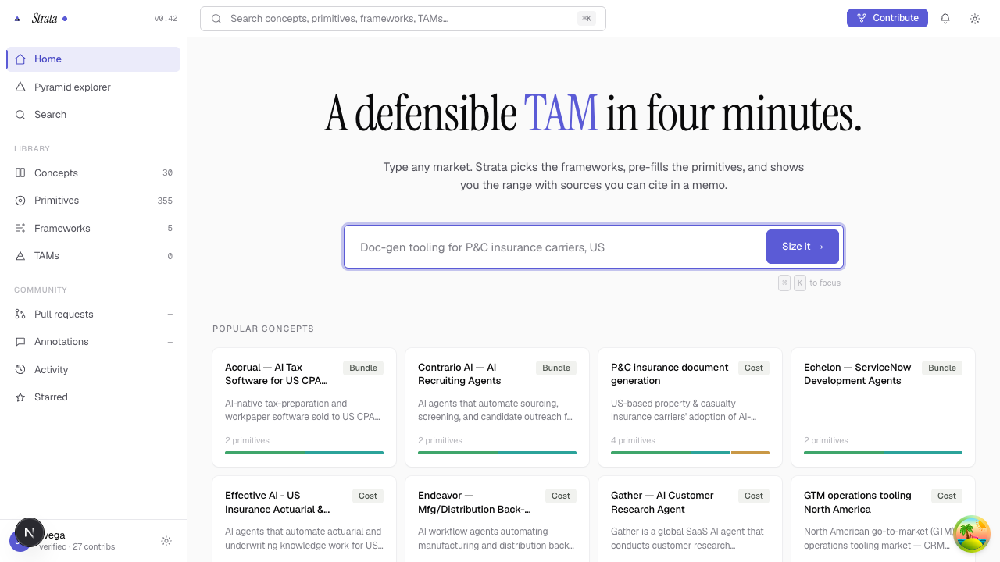
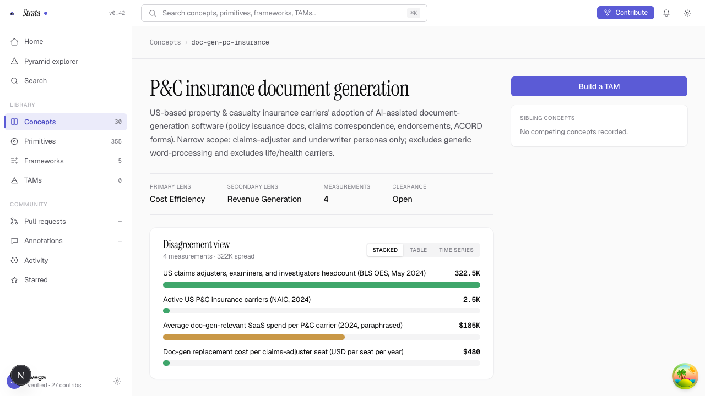
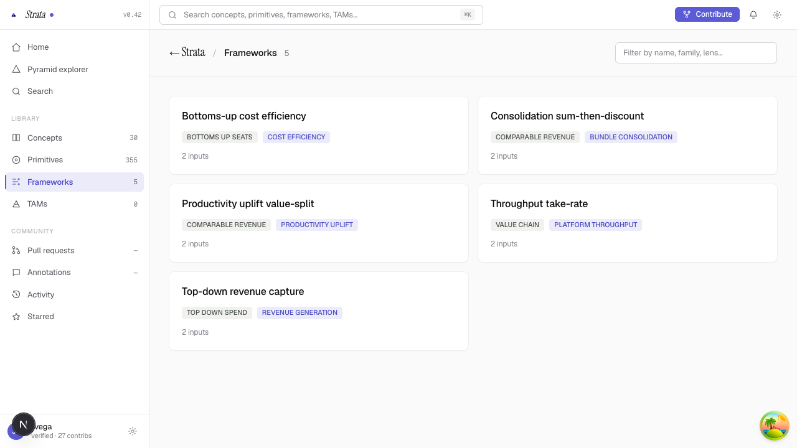
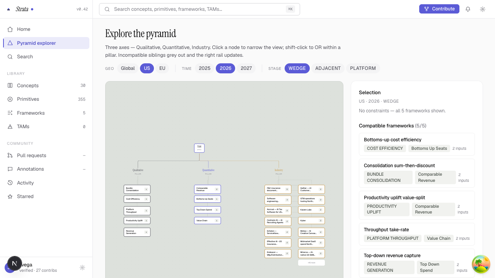
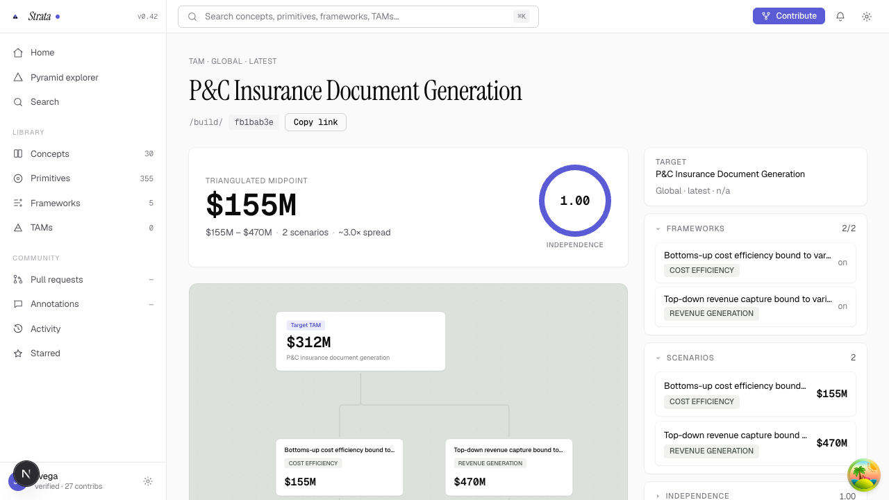
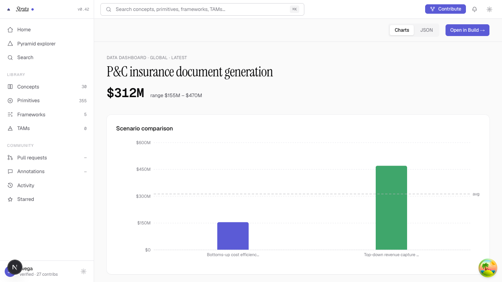
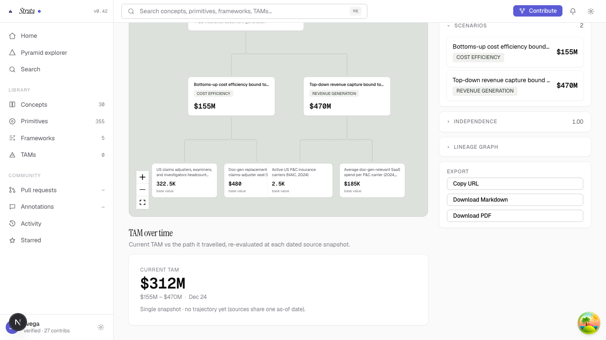
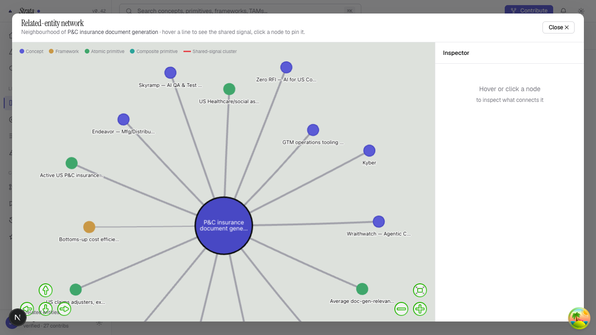

# Strata Platform Walkthrough

A screenshot-driven tour of the Strata web app, captured live with the Playwright
CLI against the running dev build (frontend `:3040` → backend `:8060`). Built up
in **batches** as the v0.42 frontend rebuild lands (see
`~/.claude/plans/run-the-frontend-and-floofy-pearl.md`). Each batch covers the
routes a wave of work made real, with the verifying screenshots inline.

> Status legend: ✅ wired to the real backend · 🧪 graceful empty/placeholder
> (backend endpoint not built yet) · ⚠️ known issue tracked for the polish pass.

---

## Batch 1 — App shell + library (PR2 shell · PR3 home · PR4 detail pages)

Integration branch `feat/frontend-v042-parity` after merging PR0–PR4 + PR7.
Every screen below is wired to live data: **30 concepts, 355 primitives, 5
frameworks** served by the FastAPI backend.

### Home — the app shell ✅

The v0.42 shell is now real and wraps every route:
- **Left sidebar (240px):** Home · Pyramid explorer · Search, then a `LIBRARY`
  group with **live counts** (Concepts 30 · Primitives 355 · Frameworks 5 · TAMs 0)
  fetched from the backend, then a `COMMUNITY` group, then the contributor profile.
- **Top bar:** a ⌘K-style global search trigger, `Contribute`, notifications, and
  a light/dark toggle.
- **Hero + search:** "A defensible TAM in four minutes" with the market-query box.
- **Popular Concepts grid:** real concepts (Accrual, Contrario AI, P&C doc-gen,
  Echelon, …) with lens chips and source-tier sparkline bars.

### Concepts library — `/c` ✅

A filterable grid of all 30 concepts, each card showing its primary lens and
measurement count. Breadcrumb + "Filter concepts…" header; sidebar marks
`Concepts` active.

### Concept detail — `/c/<slug>` (disagreement view) ✅

The "disagreement view" for *P&C insurance document generation*:
- Serif title + definition lede; metadata strip (Primary lens, Secondary lens,
  Measurements, Clearance); a `Build a TAM` CTA and sibling-concepts rail.
- **Disagreement bars:** one source-tier-colored bar per measurement primitive
  (claims-adjuster headcount, active carriers, SaaS spend/carrier, cost/seat),
  with a `STACKED · TABLE · TIME SERIES` toggle. Hydrated from the concept's
  `measurements[]` against the live `/p/{slug}` endpoint.

### Frameworks library — `/f` ✅

All 5 frameworks with method-family + lens chips and input counts:
bottoms-up cost efficiency, consolidation sum-then-discount, productivity uplift
value-split, throughput take-rate, top-down revenue capture.

Also live in this batch (not screenshotted): `/p` + `/p/<slug>` (primitive detail
with source snapshot + sha256 + uncertainty) and `/f/<slug>` (formula, inputs
table, applicability) — they close the pyramid-rail `/f/<slug>` 404.

### Findings carried into the polish pass
- ⚠️ **Double ⌘K handler.** The shell registers ⌘K to open the command palette,
  but the home page also registers ⌘K to focus its own search box — the home
  handler wins, so ⌘K on `/` focuses the hero input instead of opening the palette.
  Reconcile in PR11 (home should defer to the shell palette).
- 🧪 **`/tam/<hash>` shows NotFoundState.** The backend computes a `state_hash`
  on `/build/<slug>` but does **not** persist computed TAMs, and `data/tam_outputs/`
  is empty — so `GET /tam/<hash>` 404s in dev. The page (PR7) handles this
  gracefully, but demoing the frozen-artifact view needs backend TAM persistence
  (or a seeded `tam_output`). Tracked as a backend follow-up.
- Note: the disagreement bars currently plot measurements of different units
  (headcount vs $/carrier vs $/seat) on one normalized scale — semantically the
  view compares competing measurements of the *same* quantity; revisit once a
  concept carries genuinely competing measurements.

---

---

## Batch 2 — Pyramid fix · Build + state-hash · Real /data (PR5 · PR6 · PR9)

### Pyramid explorer — `/graph` (fixed) ✅

The squished, unreadable band is gone. The pyramid now lays out as **three
labelled columns** — Qualitative (grey), Quantitative (indigo), Industry (ochre)
— converging up to an apex `TAM` node. Concept leaves stack readably (industry
caps with a "+N more" node). New **STAGE** filter chips (WEDGE / ADJACENT /
PLATFORM) sit beside Geo/Time; the right rail shows the selection + live
compatible frameworks. Click narrows, shift-click ORs within a pillar.

### Build workhorse — `/build/<hash>` (real URL state) ✅

Opening `/build?q=doc-gen-pc-insurance` now **mints a real URL**:
`/build/fb1bab3e…?s=<base64url state>` — the hash is the backend's own
`state_hash`, and the encoded state makes the page reconstructable/shareable.
The view shows a genuine **two-method range** ($155M–$470M, ~3× spread,
independence 1.00), a scenario tree (Target → Bottoms-up + Top-down), and the
U2-ordered accordion rail (Target · Frameworks · Scenarios · Independence).

### Data dashboard — `/data` (real, mock deleted) ✅

`/data` now reads the live `/build` evaluation (the `PC_DOC_GEN` mock and
`web/src/lib/api.ts` are deleted). Headline $312M with the $155M–$470M range and
a scenario-comparison bar chart from real scenarios; Charts/JSON toggle + "Open
in Build".

### Findings carried into the polish pass (PR11)
- ⚠️ **Midpoint inconsistency.** `/build` header reads "TRIANGULATED MIDPOINT
  $155M" while its scenario-tree Target node and `/data` both read **$312M**
  (the true average of 155/470). `midScenario()` picks a scenario (the lower of
  two) where the header should use the averaged midpoint — make them consistent.
- ⚠️ **Bare `/build` hangs.** With no `?q=`/concept, `/build` sits on "Sizing…"
  forever — needs an empty state or a concept picker.
- Perf: a React Flow `nodeTypes`/`edgeTypes` object is created in render
  (warning in console) — memoize it.

---

## Batch 3 — TAM trajectory · Network modal · Motion (PR12 · PR13 · PR14 · PR11)

### TAM over time — current-vs-previous trajectory (PR12 + PR13) ✅ (data-gated)

A "TAM over time" section on `/build` and `/tam` charts the TAM re-evaluated at
each date its sourced numbers were published (the `GET /build/{concept}/trajectory`
endpoint — PR12). Here the build is fully consistent after the midpoint fix:
scenario tree $155M + $470M, **Current TAM $312M** (the mean), range $155M–$470M.

**Honest data note:** every concept's seed primitives currently share a single
`as_of` date, and a framework needs *all* its inputs at a date — so the endpoint
returns one point for every concept today, and the chart shows the **single-snapshot
state** ("no trajectory yet — sources share one as-of date") rather than a curve.
The feature is built and correct; the current-vs-previous **curve renders once a
concept carries primitives from more than one date** (a data-seeding task — no
figures were invented to fake it, per the project's sourcing rule).

### Related-entity network modal (PR14) ✅

Opened from any concept or TAM page ("Related entities"), a force-directed bubble
graph of the neighbourhood: the root concept at center, with related concepts
(shared lens / source / measurement), the frameworks that size them, and the
measurement primitives — colour-coded by type, with an inspector panel, hover-
highlight, click-to-pin, multi-hop expand/collapse, and shared-signal clustering.

### Motion (PR11)
The home concept grid now staggers in on load; reusable `FadeIn` / `Stagger` /
`HoverLift` primitives (brand-kit timings, `prefers-reduced-motion`-aware) are in
place for the broader animation pass.

### Verified this pass
- **Production build** (`bun run build`, main tree): all 15 routes compile (12
  static + the `[hash]`/`[slug]` dynamic routes). The earlier Turbopack symlink
  failure was worktree-only.
- **Gates:** `bun run check` (typecheck + biome + eslint + knip) green ×2; 117
  vitest; 433 backend pytest + pyright + ruff.
