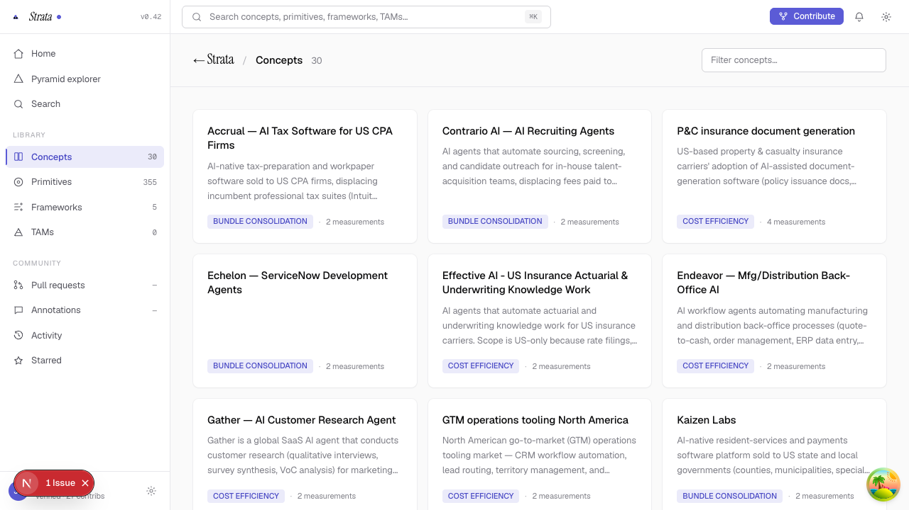

# Strata Platform Walkthrough

A screenshot-driven tour of the Strata web app, captured live with the Playwright
CLI against the running dev build (frontend `:3040` → backend `:8060`). Built up
in **batches** as the v0.42 frontend rebuild lands (see
`~/.claude/plans/run-the-frontend-and-floofy-pearl.md`). Each batch covers the
routes a wave of work made real, with the verifying screenshots inline.

> Status legend: ✅ wired to the real backend · 🧪 graceful empty/placeholder
> (backend endpoint not built yet) · ⚠️ known issue tracked for the polish pass.

---

## Batch 1 — App shell + library (PR2 shell · PR3 home · PR4 detail pages)

Integration branch `feat/frontend-v042-parity` after merging PR0–PR4 + PR7.
Every screen below is wired to live data: **30 concepts, 355 primitives, 5
frameworks** served by the FastAPI backend.

### Home — the app shell ✅

The v0.42 shell is now real and wraps every route:
- **Left sidebar (240px):** Home · Pyramid explorer · Search, then a `LIBRARY`
  group with **live counts** (Concepts 30 · Primitives 355 · Frameworks 5 · TAMs 0)
  fetched from the backend, then a `COMMUNITY` group, then the contributor profile.
- **Top bar:** a ⌘K-style global search trigger, `Contribute`, notifications, and
  a light/dark toggle.
- **Hero + search:** "A defensible TAM in four minutes" with the market-query box.
- **Popular Concepts grid:** real concepts (Accrual, Contrario AI, P&C doc-gen,
  Echelon, …) with lens chips and source-tier sparkline bars.

### Concepts library — `/c` ✅

A filterable grid of all 30 concepts, each card showing its primary lens and
measurement count. Breadcrumb + "Filter concepts…" header; sidebar marks
`Concepts` active.

### Concept detail — `/c/<slug>` (disagreement view) ✅

The "disagreement view" for *P&C insurance document generation*:
- Serif title + definition lede; metadata strip (Primary lens, Secondary lens,
  Measurements, Clearance); a `Build a TAM` CTA and sibling-concepts rail.
- **Disagreement bars:** one source-tier-colored bar per measurement primitive
  (claims-adjuster headcount, active carriers, SaaS spend/carrier, cost/seat),
  with a `STACKED · TABLE · TIME SERIES` toggle. Hydrated from the concept's
  `measurements[]` against the live `/p/{slug}` endpoint.

### Frameworks library — `/f` ✅

All 5 frameworks with method-family + lens chips and input counts:
bottoms-up cost efficiency, consolidation sum-then-discount, productivity uplift
value-split, throughput take-rate, top-down revenue capture.

Also live in this batch (not screenshotted): `/p` + `/p/<slug>` (primitive detail
with source snapshot + sha256 + uncertainty) and `/f/<slug>` (formula, inputs
table, applicability) — they close the pyramid-rail `/f/<slug>` 404.

### Findings carried into the polish pass
- ⚠️ **Double ⌘K handler.** The shell registers ⌘K to open the command palette,
  but the home page also registers ⌘K to focus its own search box — the home
  handler wins, so ⌘K on `/` focuses the hero input instead of opening the palette.
  Reconcile in PR11 (home should defer to the shell palette).
- 🧪 **`/tam/<hash>` shows NotFoundState.** The backend computes a `state_hash`
  on `/build/<slug>` but does **not** persist computed TAMs, and `data/tam_outputs/`
  is empty — so `GET /tam/<hash>` 404s in dev. The page (PR7) handles this
  gracefully, but demoing the frozen-artifact view needs backend TAM persistence
  (or a seeded `tam_output`). Tracked as a backend follow-up.
- Note: the disagreement bars currently plot measurements of different units
  (headcount vs $/carrier vs $/seat) on one normalized scale — semantically the
  view compares competing measurements of the *same* quantity; revisit once a
  concept carries genuinely competing measurements.

---

_Batch 2 (pyramid fix · build+state-hash · resolve · browse · contribute) to
follow once PR5/PR6/PR8/PR9/PR10 land._
