# Strata Platform Guide

A screenshot-driven walkthrough of the Strata market-sizing engine for VCs and operators.

**Version:** v0.2.0-alpha | **Last captured:** 2026-05-26 | **Environment:** Docker local (localhost:3001)

---

## Table of Contents

1. [What is Strata?](#1-what-is-strata)
2. [Quick orientation — pages at a glance](#2-quick-orientation)
3. [The search experience](#3-the-search-experience)
4. [Building a TAM](#4-building-a-tam)
5. [The scenario graph](#5-the-scenario-graph)
6. [Right rail — frameworks and independence](#6-right-rail)
7. [Data dashboard](#7-data-dashboard)
8. [Waterfall chart and primitives table](#8-waterfall-chart)
9. [Browse — public TAM gallery](#9-browse)
10. [Contribute — community data](#10-contribute)
11. [API access](#11-api-access)
12. [Data coverage — what's in the bank](#12-data-coverage)
13. [Live vs. coming soon](#13-live-vs-coming-soon)
14. [Page reference](#14-page-reference)
15. [Appendix — how this guide was built](#15-appendix)

---

## 1. What is Strata?

Strata is an open-source market-sizing engine that replaces expensive analyst reports (IBISWorld, Statista, Gartner) with **reproducible, citable TAM estimates** built from real government and market data.

Instead of trusting a paywalled PDF that says "the market is $4.2B," Strata shows you *exactly* how the number was built: which data sources, which assumptions, which frameworks — and lets you tweak any input to see how the range changes.

**Who it's for:** VCs doing investment memos, operators sizing new markets, strategy teams building defensible bottoms-up models.

**What makes it different:**
- Every number traces to a real API response (BLS, FRED, Census, EDGAR, World Bank)
- Multiple frameworks triangulate the same market from different angles
- An independence score tells you how correlated your estimates are
- Shareable URLs freeze a TAM calculation so you can cite it in a deck

---

## 2. Quick orientation

| Page | What it does | Who uses it |
|------|-------------|-------------|
| **Search** (`/`) | Type any market question, get a TAM | Everyone — this is the front door |
| **Build** (`/build?q=`) | Interactive scenario graph with frameworks and primitives | Analysts building or reviewing a model |
| **Data** (`/data`) | Scenario comparison charts, waterfall breakdowns, primitives table | Analysts who want to see the math |
| **Browse** (`/browse`) | Gallery of promoted public TAMs | Investors browsing the library (coming v0.3) |
| **Contribute** (`/contribute`) | Submit new data or corrections | Community contributors (coming v0.5) |
| **API docs** (`/docs`) | Swagger UI for programmatic access | Developers integrating Strata into workflows |

---

## 3. The search experience

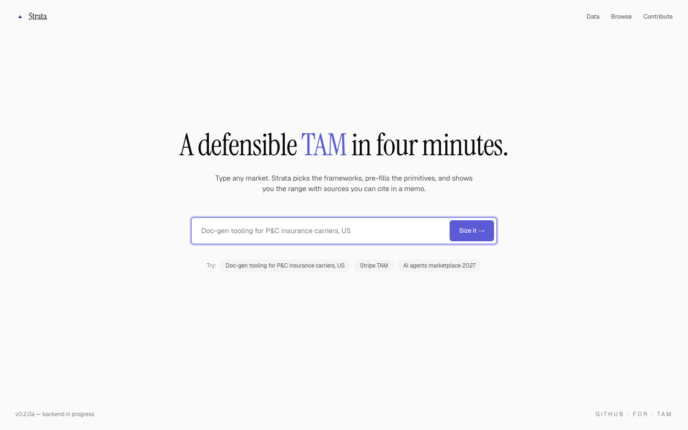

The landing page is a single search box. Type any market — "HR software for mid-market," "EV charging infrastructure 2026," "AI agents marketplace" — and press **Size it**.

**Three suggestion chips** below the search box offer one-click examples:
- "Doc-gen tooling for P&C insurance carriers, US"
- "Stripe TAM"
- "AI agents marketplace 2027"

Clicking a chip or pressing Enter takes you to the **Build** page.

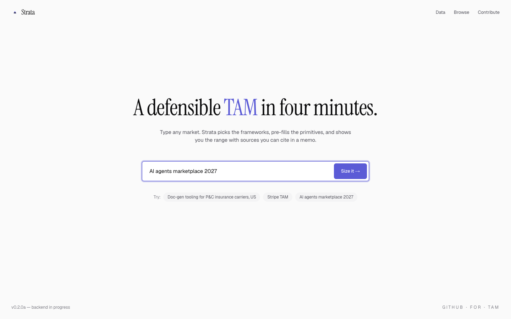

**How it works behind the scenes:** If your query matches a concept already in the registry (like "doc-gen-pc-insurance"), you get an instant static build with pre-validated data. If it's a new query, Strata's dynamic resolution engine parses your question, searches the web for relevant data, and builds a TAM on the fly.

---

## 4. Building a TAM

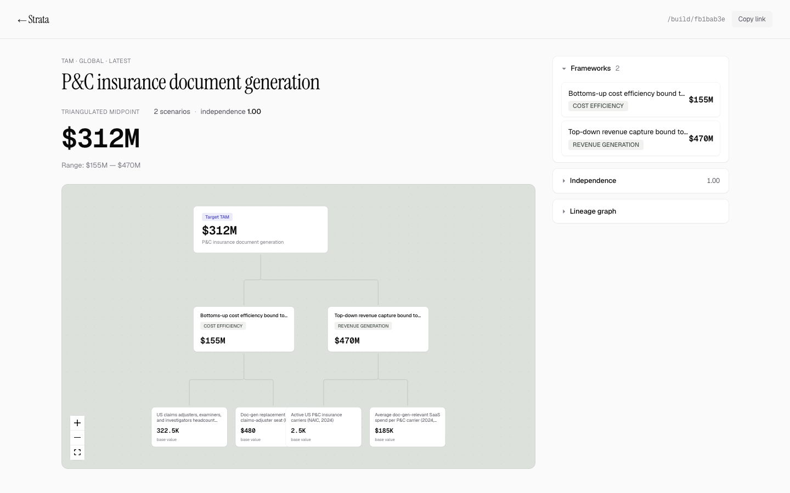

The Build page is the workhorse. Here's what you see:

**Header:**
- **Back to search** button (top left)
- **Permalink** — a content-hash URL (e.g., `/build/fb1bab3e`) that freezes this exact calculation. Click **Copy link** to share it.

**Summary bar:**
- **TAM label** — "TAM . Global . latest"
- **Concept name** — "P&C insurance document generation"
- **Triangulated midpoint** — **$312M** (the weighted average across frameworks)
- **Range** — $155M to $470M
- **Scenario count and independence** — "2 scenarios . independence 1.00"

The midpoint isn't a single estimate — it's the average of multiple independent frameworks that approach the market from different angles. An independence score of 1.00 means the two frameworks use completely different input data, giving you high confidence the range is real.

---

## 5. The scenario graph

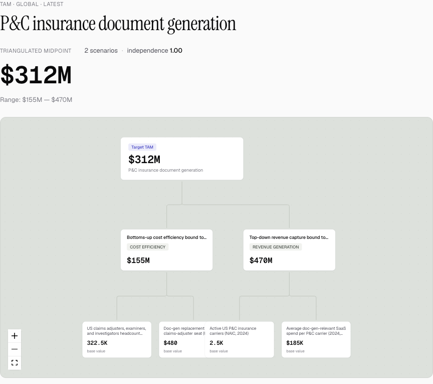

The center of the Build page is a **ReactFlow canvas** — an interactive node graph that shows how inputs flow into the final TAM.

**Three levels of nodes:**
1. **Target node** (top) — shows the triangulated midpoint ($312M) and concept name
2. **Framework nodes** (middle) — each framework is a different approach to sizing the market:
   - *Bottoms-up cost efficiency*: $155M (cost_efficiency lens)
   - *Top-down revenue capture*: $470M (revenue_generation lens)
3. **Primitive nodes** (bottom) — the atomic data points feeding each framework:
   - "US claims adjusters headcount: 322.5K" (from BLS)
   - "Doc-gen cost per seat: $480" (from BLS wages)
   - "Active US P&C carriers: 2.5K" (from NAIC)
   - "SaaS spend per carrier: $185K" (from Gartner)

**Interacting with the graph:**
- **Pan and zoom** — drag to move, scroll to zoom, or use the +/- controls (bottom-left)
- **Click a node** — highlights its connections and shows details
- **Fit view** button snaps the graph to fit all nodes in view

---

## 6. Right rail — frameworks and independence

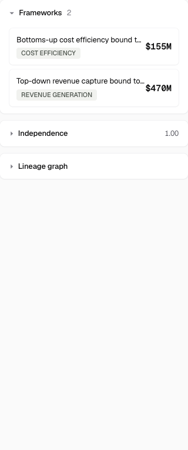

The right sidebar has three collapsible sections:

**Frameworks** (expanded by default) — lists every framework applied to this concept, with its lens type and calculated value:
- *Bottoms-up cost efficiency*: cost_efficiency — **$155M**
- *Top-down revenue capture*: revenue_generation — **$470M**

**Independence** — shows how correlated the frameworks are. A score of 1.00 means fully independent inputs; 0.0 means they share data and you shouldn't trust the triangulation.

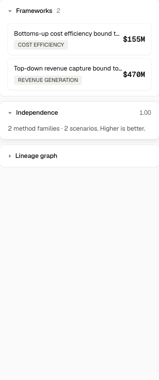

**Lineage graph** — opens a force-directed network view showing the full dependency chain from concept through frameworks down to individual data sources.

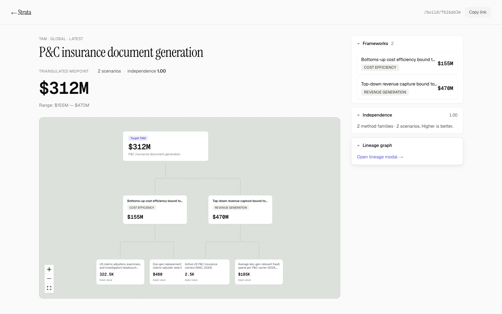

---

## 7. Data dashboard

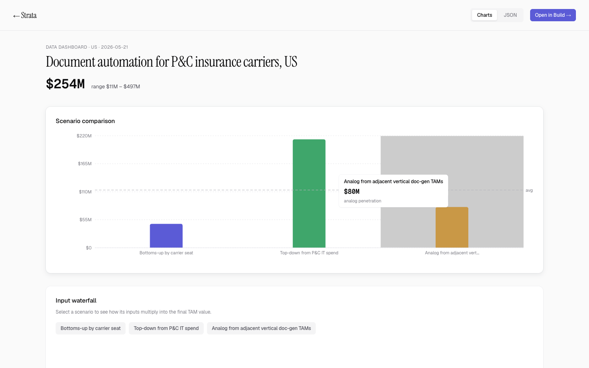

The Data page (`/data`) gives you a deeper analytical view of the same TAM. At the top:

- **Summary header** — "Document automation for P&C insurance carriers, US"
- **Midpoint and range** — $254M, range $11M to $497M
- **Scenario comparison chart** — a horizontal bar chart comparing all frameworks side by side:
  - Bottoms-up by carrier seat
  - Top-down from P&C IT spend
  - Analog from adjacent vertical doc-gen TAMs

The average line ($113M) shows where the frameworks converge.

**Toggle between views** using the **Charts** and **JSON** buttons at the top. The JSON view shows the raw API response for developers.

---

## 8. Waterfall chart and primitives table

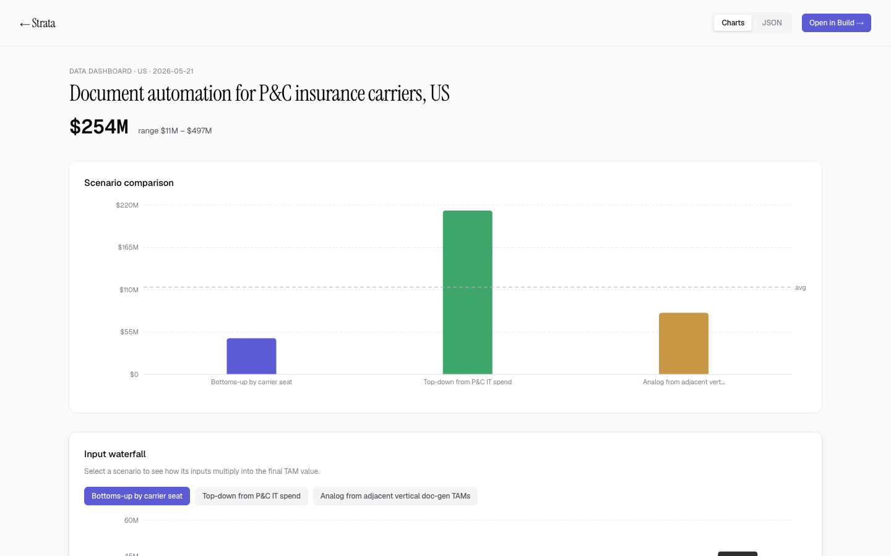

Click any scenario button to see its **Input waterfall** — a step-by-step breakdown showing how each primitive multiplies into the final TAM value.

Below the waterfall is the **Primitives table** — every atomic input used across all scenarios:

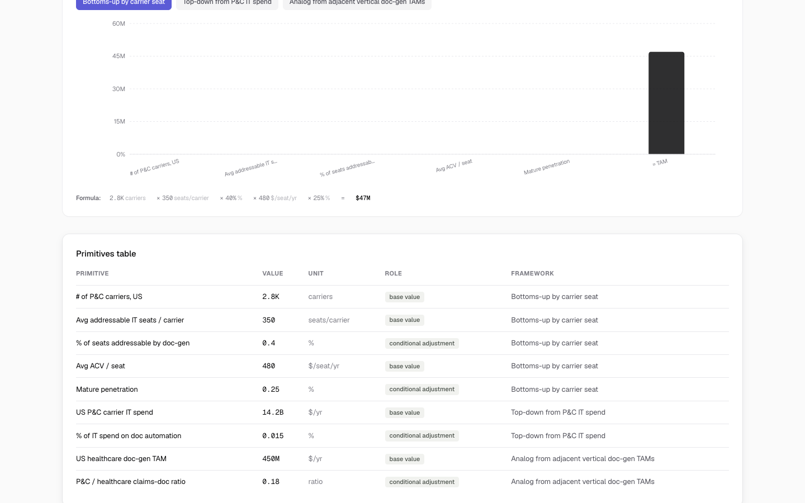

| Column | What it shows |
|--------|--------------|
| **Primitive** | The data point name (e.g., "# of P&C carriers, US") |
| **Value** | The number (e.g., 2.8K) |
| **Unit** | What it measures (carriers, seats/carrier, $/yr) |
| **Role** | How it's used — "base value" or "conditional adjustment" |
| **Framework** | Which framework consumes this input |

At the bottom, an **Architecture** section shows an ASCII diagram of the full data flow — from YAML sources through the loader, registry, validator, and evaluator to the final scenario tree.

---

## 9. Browse — public TAM gallery

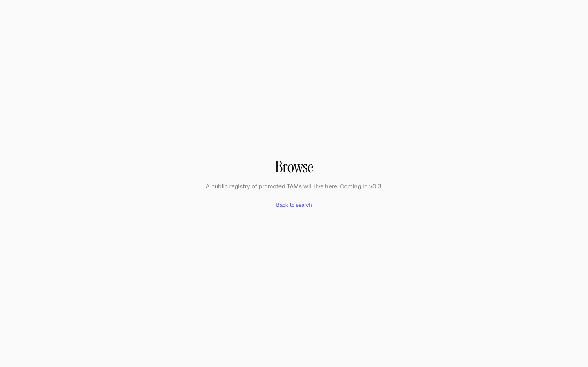

The Browse page will be a searchable gallery of promoted public TAMs — think of it as a library of ready-made market sizes you can fork and customize.

**Status:** Coming in v0.3. The page currently shows a placeholder.

---

## 10. Contribute — community data

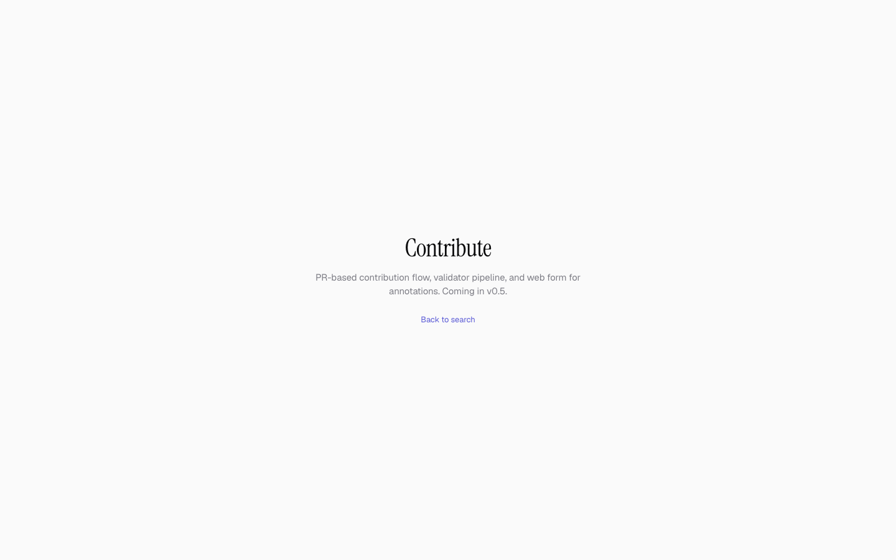

The Contribute page will let community members submit new primitives, flag outdated numbers, and add expert annotations to existing TAMs.

**Status:** Coming in v0.5. The current page links to the GitHub repository.

---

## 11. API access

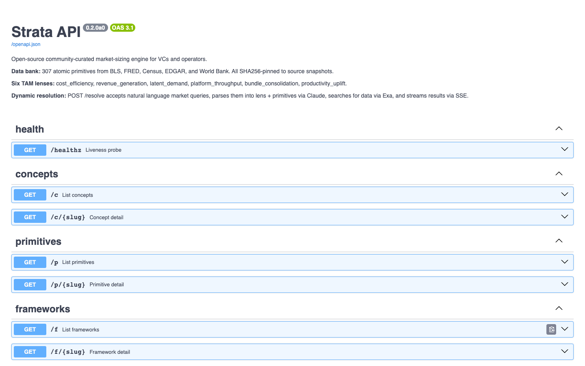

Every feature in the UI is backed by a public API. Visit `/docs` for interactive Swagger documentation.

**Key endpoints:**

| Endpoint | What it returns |
|----------|----------------|
| `GET /c` | All 6 concepts (market categories) |
| `GET /p` | All 307 primitives (atomic data points) |
| `GET /f` | All 5 frameworks (calculation recipes) |
| `GET /build/{slug}` | Full TAM calculation for a concept |
| `GET /tam/{hash}` | Frozen TAM output by content hash |
| `POST /resolve` | Dynamic TAM from natural language (SSE stream) |

**Production API:** `https://strata-api-production-9740.up.railway.app`

---

## 12. Data coverage — what's in the bank

Strata's data bank currently holds:

| Record type | Count | Sources |
|-------------|-------|---------|
| **Atomic primitives** | 307 | BLS, FRED, Census, EDGAR, World Bank, Kalshi |
| **Source records** | 87 | All SHA256-pinned to API responses |
| **Concepts** | 6 | One per TAM lens |
| **Frameworks** | 5 | Bottoms-up, top-down, throughput, consolidation, productivity |

**Six TAM lenses covered:**

| Lens | Math shape | Example use case |
|------|-----------|-----------------|
| Cost efficiency | persona x cost | Harvey, Glean — what does the workflow cost today? |
| Revenue generation | segment x spend | Brex, Rippling — what do companies spend? |
| Latent demand | population x adoption x WTP | Uber — how big is the unserved market? |
| Platform throughput | volume x take_rate | Stripe, Visa — what flows through the pipe? |
| Bundle consolidation | total_spend x consolidation | Notion, Linear — what gets replaced? |
| Productivity uplift | personas x value_split | Copilot, Cursor — what's the time savings worth? |

**Six data connectors** pull from government and market APIs:
- **BLS** — employment, wages, CPI, JOLTS
- **FRED** — GDP, interest rates, money supply, consumption
- **Census** — business counts by NAICS industry code
- **EDGAR** — SEC company financials, XBRL frames
- **World Bank** — global GDP, population, adoption rates
- **Kalshi** — prediction market probabilities

---

## 13. Live vs. coming soon

### What works today

- **Natural-language TAM queries** — type any market and get a calculated scenario tree
- **Static TAM builds** — pre-built concepts with validated data and multiple frameworks
- **Full data lineage** — trace every number back to its government API source
- **Scenario comparison** — bar charts comparing frameworks side by side
- **Waterfall breakdowns** — see how inputs multiply into the final number
- **Shareable permalinks** — content-hash URLs that freeze a calculation
- **API access** — all features available programmatically with Swagger docs
- **307 primitives from 6 connectors** — real data from BLS, FRED, Census, EDGAR, World Bank, Kalshi

### Coming soon

| Feature | Expected | What it adds |
|---------|----------|-------------|
| **Interactive wiring UI** | v0.3 | Drag-and-drop framework builder with slider ranges |
| **Multi-framework triangulation** | v0.3 | Search across lenses for truly independent estimates |
| **Browse gallery** | v0.3 | Searchable library of promoted public TAMs |
| **Real source snapshots** | v0.3 | Downloaded source documents with SHA256 verification |
| **PDF/Markdown export** | v0.4 | Download TAM reports with full citations |
| **Contribution flow** | v0.5 | Submit data, flag errors, add expert annotations |
| **Auth and API keys** | v0.5 | Metered API access for paid plans |

---

## 14. Page reference

| URL | Page | Description |
|-----|------|-------------|
| `/` | Search | Landing page with query box and suggestion chips |
| `/build?q={query}` | Build | TAM scenario graph with frameworks and primitives |
| `/data` | Data | Charts, waterfall breakdowns, primitives table |
| `/browse` | Browse | Public TAM gallery (coming v0.3) |
| `/contribute` | Contribute | Community contribution splash (coming v0.5) |
| `/docs` | API docs | Swagger UI for all endpoints |
| `/redoc` | API docs (alt) | ReDoc-formatted API reference |

**Production URLs:**
- Frontend: `https://strata-pied-three.vercel.app`
- API: `https://strata-api-production-9740.up.railway.app`

---

## 15. Appendix — how this guide was built

**Screenshots captured:** 2026-05-26, from Docker local environment (`localhost:3001` + `localhost:8000`)

**Branch:** `main` at commit `b1acc53`

**Data:** 307 primitives, 87 sources, 6 concepts, 5 frameworks seeded via `strata db seed`

**Tools:** playwright-cli with Chromium at 1440x900 viewport

**Screenshot directory:** `docs/screenshots/client-guide/`

**To update a screenshot:**
```bash
playwright-cli open http://localhost:3001
playwright-cli resize 1440 900
playwright-cli goto "http://localhost:3001/{page}"
playwright-cli screenshot --filename=/path/to/docs/screenshots/client-guide/NN-name.png
playwright-cli close
```

**Engineer-facing docs:** See `CLAUDE.md` for technical architecture and development conventions, and `docs/10-v0.2-backend-spec.md` for the backend implementation blueprint.
