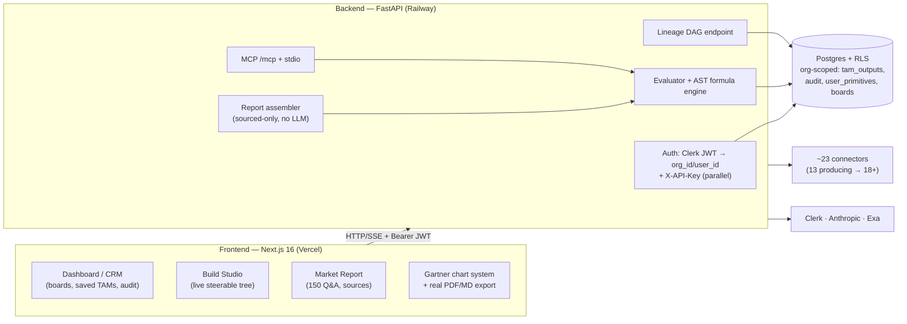
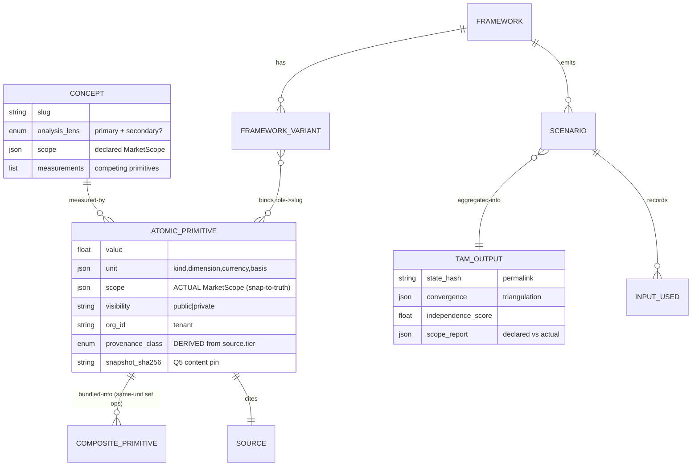
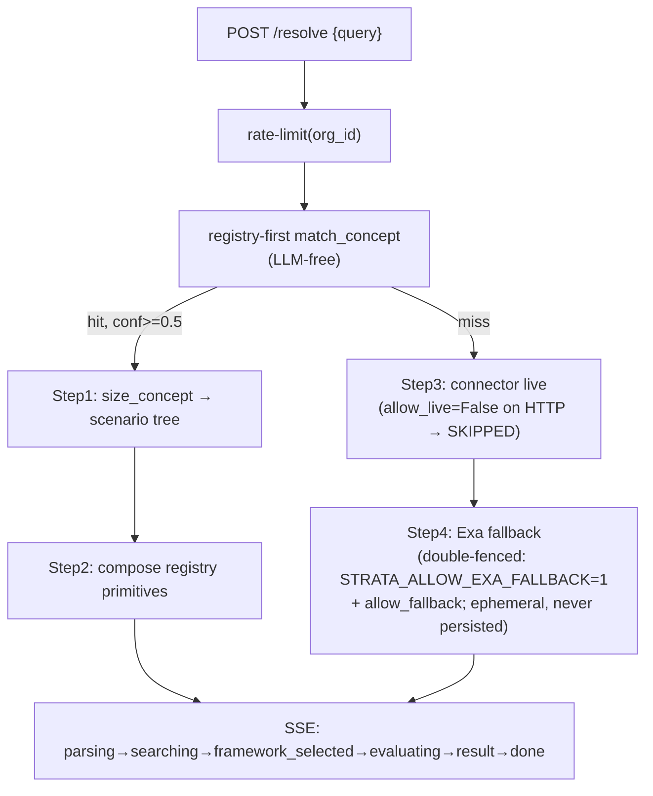
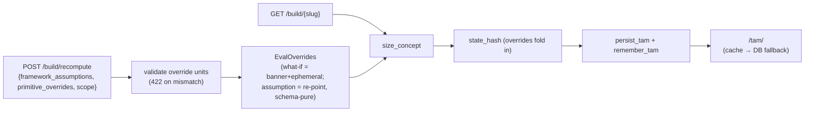
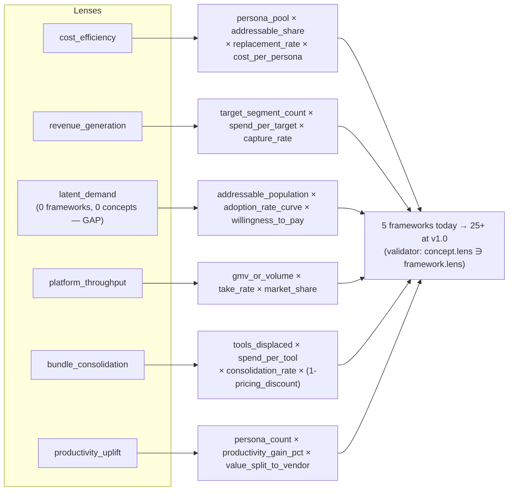
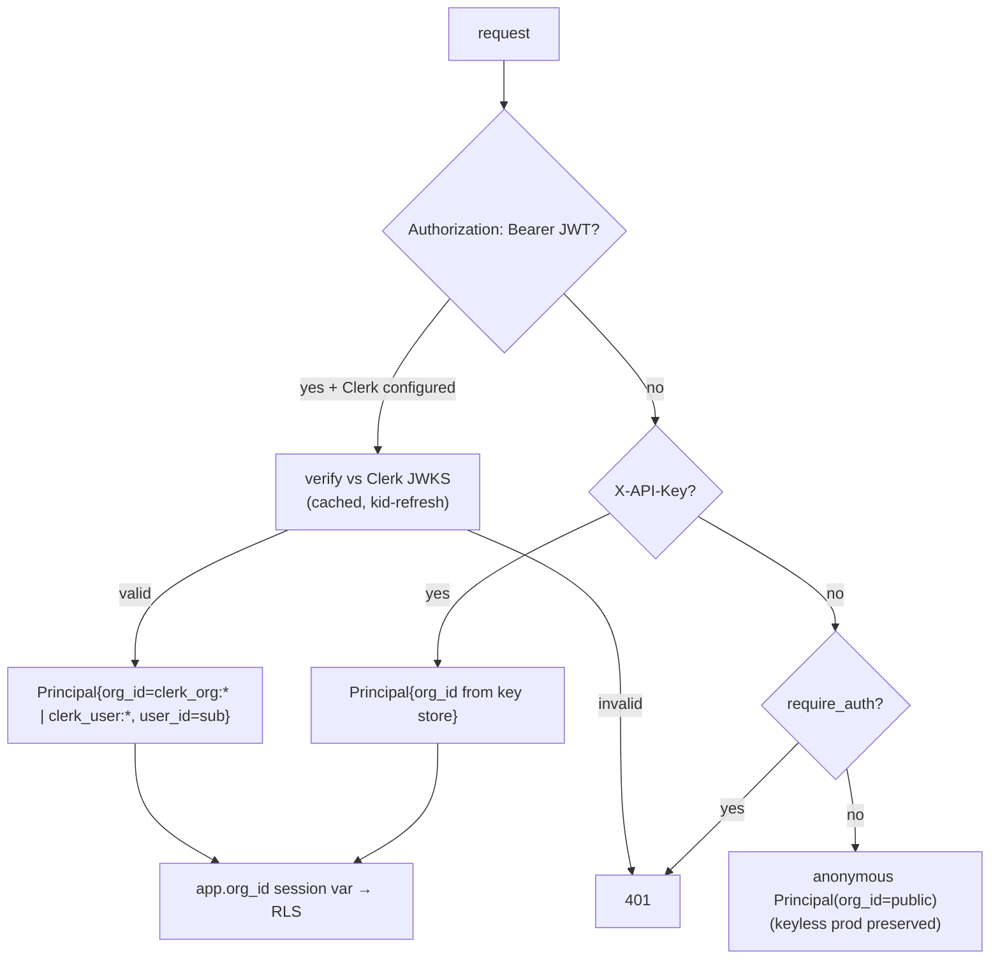
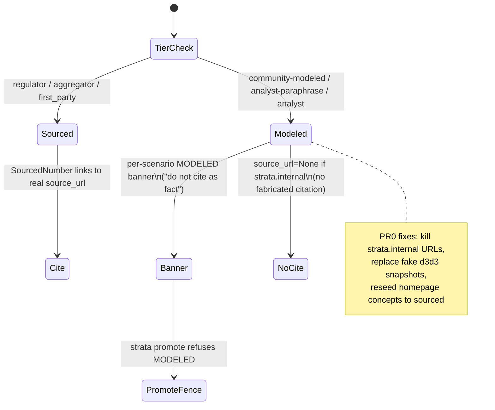
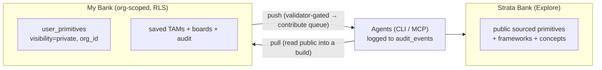
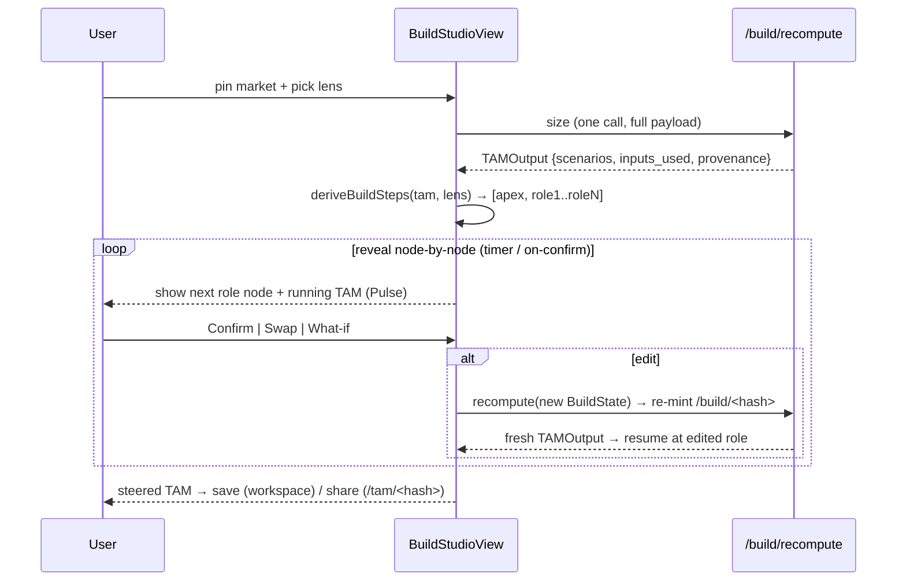
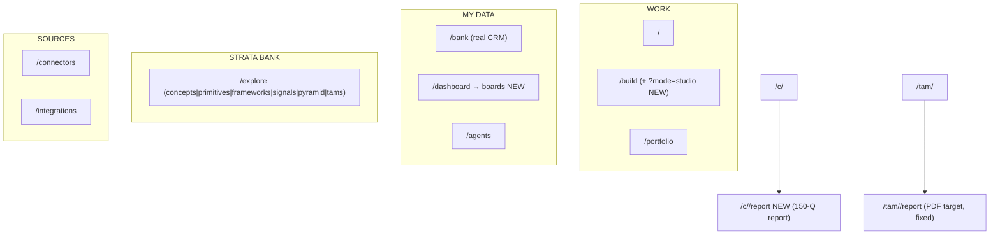

# Strata → v1.0: Real Value, Sequenced

## Context

Strata looks built but doesn't yet *feel* usable — the owner's words: "I would not use
it right now." Six parallel investigations (3 code-maps + a live headed walkthrough + an
export/sources audit + a full architecture synthesis) pinned down *why*, and it is not
vibes — it's concrete:

- **Trust collapses on first contact.** The 3 homepage-featured concepts and the AI-market
  `/build` queries are backed by `community-modeled` primitives whose `source.url` is the
  non-resolvable `strata.internal`, and by 25 `demo-*` primitives that all share a **fake
  snapshot hash** `d3d3…d3` — under a UI that claims "SHA-256 pinned · reproducible." 64 of
  279 primitives (23%) are modeled/paraphrase, and the demo path surfaces precisely those.
- **Export is genuinely broken.** Every "Download PDF" calls `window.print()` on the dense
  interactive app shell (not the clean `/tam/<hash>/report` one-pager); the ReactFlow graph
  is a transform-panned canvas that won't reflow and blanks. Markdown export omits sources
  entirely and has a `revokeObjectURL` race that can yield an empty file.
- **The "CRM" is faked.** `/bank` → "My Primitives · 25" is portfolio companies cosplaying
  as primitives; there is no per-user primitive store. `tam_outputs` and `audit_events`
  have **no `org_id`** — saved research and history are globally shared. Clerk is
  frontend-only; the backend never sees the user.
- **No live tree, no dashboards, charts aren't analyst-grade.** Charts pop in fully formed
  at the end (no progressive build); 2 chart components are dead code; the one live chart
  uses hardcoded hex that ignores the theme. There is no dashboard surface.
- **10 connectors show empty** (mostly missing manifest entries + a 1-line host-map fix for
  2 of them), and a real bug lets community-tier connector data silently feed TAMs on the DB
  path.
- **Doc rot:** the docs CLAUDE.md calls "load-bearing" (`00-vision`, `05-roadmap`,
  `07-data-layer`, `08-product-surface`, `09`, `10`, `superpowers/specs/`) were deleted in
  commit `0e2787b` and survive only in git history.

**Decisions taken (owner):** first slice = **live steerable TAM tree + real per-user
workspace**; persistence = **full server-backed multi-tenant** (Clerk→backend); question
bank = **fully curated YAML**, TAM/market-focused (growth, competitors, market size,
segmentation — not generic pitch questions).

**Intended outcome:** a tool the owner would actually use — open a dashboard with a CRM of
your research, type a market, **watch the tree assemble live with real sources you can
click**, download a clean Gartner-grade PDF, and have ~150 sourced analytical questions
auto-answered into a defensible report. Delivered as **6 sequenced PRs**, never merged to
`main` without review.

### Live re-audit (headed Playwright, full chain) — confirmations + new nuances

Drove the running app through home → connectors → bank → concept → **TAM workspace** →
**report** → contribute → portfolio → explore → agents. Confirmed the audit *on screen* and
found refinements:

- **CONFIRMED the fake-snapshot smoking gun.** On `/tam/<hash>/report`, the "SOURCES &
  PROVENANCE" table shows snapshot `d3d3d3d3d3` on **every** row while the footer claims
  *"Every figure traces to a cited source snapshot (SHA-256 pinned). Reproducible."* That
  footer claim is false for demo TAMs → **PR 0 must also fix the claim text**, not just the
  hashes (`TamReport.tsx:119-123`).
- **The differentiating numbers ARE the modeled ones.** In `/explore/primitives`, the
  AI-specific inputs ("AI coding-assistant annual spend per engineer (blended, modeled)",
  "Realistic … capture rate" 0.1–0.4) are `community-modeled`/`analyst-paraphrase`; the only
  *sourced* inputs are generic BLS/Census headcounts. So "reseed homepage concepts to
  sourced" (PR 0) is **partially blocked** — many AI-specific inputs have no sourced
  equivalent. Revised PR 0 stance: **don't fake-source them** — fix fake snapshots on the
  genuinely-sourced rows, and make modeled rows render *honestly* (no snapshot, MODELED label
  at the number, no fabricated URL). Honesty over a fake green check.
- **Sensitivity chart overflows/clips** on the report ("What moves the answer" bars run off
  the frame, labels truncated) → folds into PR 3's chart system.
- **`/report` is good but prints with the app shell visible** — the sidebar isn't hidden in
  the print path → PR 3 print-CSS work.
- **`/contribute` asks the user to hand-type a 64-char `snapshot_sha256`** — unusable for a
  real user → **PR 1 personal-primitive create must auto-compute the snapshot** from a
  fetched source, not demand hex.
- **Portfolio is undifferentiated:** every company in a market shows the *identical* TAM (all
  3 cyber cos = $45.22B, all dev-tooling = $18.96B) because a company just points to its
  market concept. By design, but it reads as low-value → **new nuance:** PR 3 should show
  each company's *addressable share / scope-narrowed* number, not the raw market TAM.
- **The interactive `/build` workspace is genuinely solid** (scenario tree, rail with
  frameworks/scenarios/independence/lineage) — PR 2's live tree builds on a strong base, low
  risk.

---

## Target architecture (after the 6 PRs)



---

## Architecture today (Mermaid reference set)

These document the system as-built (recovered facts, every claim traced to `file:line` in
the synthesis). They ship as `docs/architecture/` in PR 0. Showing the load-bearing subset
here; the full set is 28 diagrams (system context, resolve/build sequences, validator,
scope guard, MCP, migrations, etc.).

### Five-layer data model



### Resolve pipeline (4-step, first non-null wins)



### Build / recompute + state-hash



### Six lenses → frameworks → required roles



### Auth: the Clerk→backend bridge being added (PR 1)



### Soft-data fence (the trust contract)



### Two-tier data bank (private ↔ shared via agents)



### Build Studio reveal (PR 2 — the new "watch it build")



### Frontend IA (today → additions)



---

## Design governance (impeccable + redesign-audit) — binds PR 2 / PR 3

The frontend has a committed system ("The Sourced Ledger"); **identity-preservation wins —
upgrade within it, never rewrite.** All UI work (esp. PR 2 Build Studio, PR 3 charts/
dashboards/PDF) obeys:

- **Tokens are fixed:** paper `--bg-0 #fafafa`, ink `--fg-1 #0a0a0b`, one accent indigo
  `--accent #5b5bd6`, AA-verified muted `--fg-3 #6b6b73`. Instrument Serif (display) + Geist
  (body) + **tabular Geist Mono for every number**. Flat-by-default elevation. Full
  dark-mode token parity exists — honor it.
- **Color means one thing (PR #84 contract):** the **source-tier ramp** (`--tier-regulator`
  green, `--tier-aggregator` teal, `--tier-analyst` amber, `--tier-community` gray,
  `--tier-onchain` purple, `--tier-prediction` orange, `--tier-first-party` indigo) is
  reserved for **provenance**; **lenses** use the separate cool family (indigo/cyan/violet/
  rose). PR 3 charts must encode tier with the tier ramp and lens with the cool family,
  never cross them. This is why `ResolveResultChart`'s hardcoded hex must be tokenized.
- **Gartner-grade = Strata's voice, not generic analyst gloss:** axis titles + units, on-
  chart annotations, a title/subtitle/**source-footnote** frame ("source: BLS OEWS, 2024"),
  tabular-mono numerals, tier-colored series. The point is *provenance-forward* charts.
- **Register = product** (design serves the job): editorial restraint, fast to a defensible
  answer; "Provenance is the product" and "Disagreement gets a page" are the two principles
  the UI must physically express (the report's disagreement spread, the studio's source-at-
  the-node).
- **Absolute bans** (impeccable): no gradient text, no glassmorphism-by-default, no
  hero-metric template, no identical card grids, no side-stripe borders, no
  border+wide-shadow "ghost cards," no 32px+ card radii. Anti-references: generic SaaS slop,
  legacy research-report walls, academic/dry.
- **Motion + a11y are load-bearing:** every Build-Studio reveal / count-up / tornado needs a
  `prefers-reduced-motion` crossfade-or-instant alternative; ease-out-expo, staggered per
  item (not one uniform reflex); visible focus rings on every interactive element **including
  ReactFlow nodes**; WCAG 2.2 AA contrast verified.
- **Redesign fix-priority order** within each UI PR: palette/token cleanup → hover/active/
  focus states → layout rhythm → replace cliché components → loading/empty/error states →
  typography polish. Small reviewable changes, test after each.

## The program — 6 PRs (sequenced, stacked)

### PR 0 — Trust quick-wins + doc/architecture recovery  *(small, ship first)*

The cheapest way to stop "fake sources / garbage export" on first contact, plus restore the
deleted ground-truth docs and land the architecture diagrams.

- **Kill placeholder provenance:** replace all `strata.internal` URLs (~12 community-modeled
  primitives) with real deep links or quarantine them; replace the 25 `demo-*` fake
  `d3d3…d3` snapshots with real SHA-256s (or stop rendering the "SHA-256 pinned ·
  reproducible" claim for demo-backed TAMs — `web/.../tam/TamReport.tsx:119-123`).
- **Reseed the 3 homepage-featured concepts** (`web/src/app/page.tsx:178` `slice(0,3)`) so
  first-contact numbers are regulator/aggregator-sourced, not modeled/demo.
- **Connector 1-line host-map fixes:** add `"github"` and `"usda_nass"` host entries to
  `backend/src/strata/api/routes/connectors.py:_CONNECTOR_HOSTS` (lights up 3 + 8 existing
  primitives; comment that github entries are *citations*, not ingests).
- **Delete dead charts** `web/src/components/charts/WaterfallChart.tsx` +
  `ScenarioBarChart.tsx` (zero imports, confirmed).
- **Doc recovery:** restore `docs/07-data-layer-brainstorm.md` (Q1–Q40),
  `08-product-surface-brainstorm.md` (U1–U12), `00-vision.md`, `05-roadmap.md`, `10-…` from
  git history (`git show 0e2787b^:docs/07-…`). Add `docs/architecture/` with the 28 Mermaid
  diagrams. Fix the stale "load-bearing" references in CLAUDE.md/README.
- **Verify:** `strata validate ../data` green; `/connectors` shows github=3, usda_nass=8;
  `strata verify-integrity` passes on reseeded primitives.

### PR 1 — Real multi-tenant per-user workspace  *(foundation; biggest backend lift)*

The CRM, audit log, personal primitives + lineage — all server-backed, cross-device.

- **Clerk→backend bridge (linchpin):** new `backend/src/strata/api/clerk_auth.py` —
  verify the Clerk session JWT against JWKS (cached, kid-refresh, fail-open in dev /
  fail-closed in prod). Add `user_id` to `Principal`; insert a Bearer-token branch in
  `api/auth.py:principal_for_headers` *before* the API-key branch. `org_id =
  clerk_org:<id>` (org token) else `clerk_user:<sub>`. Keyless degradation preserved.
  `pyjwt[crypto]` added; `STRATA_CLERK_JWKS_URL/ISSUER/AUDIENCE` settings (None → inert).
- **Migrations 008/009** (copy the proven RLS template from migration 006):
  - `tam_outputs` + `audit_events` gain `org_id` (+ `created_by`, `title`, `is_saved` on
    TAMs). **Dual-purpose RLS** on `tam_outputs`: `USING (org_id IS NULL OR org_id =
    current_setting('app.org_id', true))` so anonymous content-addressed permalinks still
    resolve while tenant saves isolate; split partial-unique indexes on `state_hash`.
  - New tables `user_primitives` (org-scoped private store, replaces in-process
    `connectors/saas/store.py` as durable backing), `boards` + `board_items` (dashboards).
- **Thread the principal into write paths** (currently `actor=None`): `db/audit.py`
  (`routes/build.py:148`, `routes/resolve.py:~230`) run under `org_session_scope`.
- **Personal primitive CRUD** (`routes/primitives.py`, `require_authenticated`):
  `GET/POST/PATCH/DELETE /me/primitives` (forces `visibility=private`, `org_id` server-side;
  **enforces the MODELED fence** like `resolver/writer.py`); `POST
  /me/primitives/{slug}/promote` routes to the existing `/contribute` review queue (never a
  direct public write — respects the tier gate).
- **Saved TAMs / audit:** `POST /me/tams/save`, `GET /me/tams`, `GET /me/audit` (per-user
  history with hash + market + rebuild link). Migrate `favorites-store.ts`/`build-history.ts`
  localStorage → server on first login.
- **Lineage graph:** new `routes/lineage.py` `GET /lineage/{id}` — recursive DAG over
  `concept.measurements → framework.inputs → derives_from / composite.inputs` (cycle-guard,
  depth cap), shaped to match `web/.../LineageGraph.tsx`'s existing client builder so the
  frontend swaps a local walk for a fetch.
- **Frontend:** inject `Authorization: Bearer` in `web/src/lib/api-client.ts` via a Clerk
  token getter; replace the faked `myPrimitivesQuery` (`lib/queries-personal.ts:33-48`) with
  real `/me/primitives`; wire `MyPrimitivesSection`/`ActivitySection`/`SavedBuildsSection` to
  the new endpoints.
- **Verify:** RLS isolation tests (org A can't read org B's saves/primitives/boards/audit;
  anon sees only `org_id IS NULL` global TAMs); sign-in → save → cross-device persistence;
  second org sees nothing of the first; keyless regression (permalinks still resolve, no 401
  storm). pyright strict + ruff clean; new migrations up/down round-trip.

### PR 2 — Build Studio: live, steerable TAM tree

Watch the pyramid assemble node-by-node and steer each branch. **Client-side staged reveal
over a single `/build/recompute` payload — NOT a fake SSE endpoint** (`size_concept` is
synchronous; faking streaming would be theater in a provenance-first product).

- **New:** `web/src/lib/build-studio.ts` (`deriveBuildSteps(tam, lens, state) →
  BuildStep[]`, pure, unit-tested); `components/build/BuildStudioView.tsx` (reducer + reveal
  timer, ResolveView's event-fold shape); `BuildStudioGraph.tsx` (progressive ReactFlow,
  module-scope `NODE_TYPES`, reuses **ScenarioGraph's** node cards — *not* PyramidGraph, which
  is the wrong abstraction); `StudioStepRail.tsx`; `LensPicker.tsx`.
- **Reuse:** `OverridePanel` (swap/what-if → `/build/recompute` → re-mint `/build/<hash>`),
  `MarketSpecStep` (the market gate), `Pulse` for the running TAM. No new URL fields —
  reveal cursor is ephemeral UI; the steered tree replays deterministically from
  `BuildState`, so "watch it build" and "finished TAM" are the same artifact at different
  cursor positions. Saving ties into PR 1's workspace.
- **Fix the React Flow `nodeTypes` inline-object warning:** ensure `BuildStudioGraph` reuses
  `ScenarioGraph`'s module-scope `NODE_TYPES` (already hoisted as the exported
  `SCENARIO_NODE_TYPES` + edge/fitView/pro option objects — never inline an object into
  `<ReactFlow nodeTypes={{…}}>`). The original premise — `PyramidOverlays.tsx` +
  `tam/TamDetailView.tsx` — was stale: `PyramidOverlays.tsx` renders no ReactFlow and
  `TamDetailView.tsx` delegates to `ScenarioGraph`, whose `NODE_TYPES` was already hoisted.
- **Open product call (flagged):** lens chosen up-front vs auto-suggested-then-confirmed;
  gate `LensPicker` to lenses with ≥1 applicable framework variant for the pinned concept.
- **Verify:** Playwright — apex appears, role leaves appear one-by-one, `aria-live` headline
  updates between reveals, what-if re-mints + resumes (doesn't restart), reload reproduces
  the steered tree; console-error assertion that the nodeTypes warning is gone.

### PR 3 — Dashboards-as-a-service + Gartner charts + real export + visible sources

The "open a dashboard, see graphs, download a real PDF, see the sources" cluster.

- **Dashboards:** revive `/dashboard` (currently redirects to `/bank`) as a board surface
  backed by PR 1's `boards`/`board_items`; pin `TornadoChart`/`CompositionChart`/
  `ScenarioComparisonChart`/`TamTrajectoryChart` + TAMs as draggable tiles; reuse
  `lib/chart-export.ts`.
- **Gartner chart system:** a shared contract on top of `ui/chart.tsx` — axis titles +
  units, on-chart annotations/callouts, legends, a title/subtitle/**source-footnote** frame
  ("source: BLS, 2024"), consistent color ramp + margins. Tokenize `ResolveResultChart`'s
  hardcoded hex `LENS_COLORS` so the one live chart is theme-aware.
- **Fix export (the "garbage PDF"):** every "Download PDF" must render the clean
  `/tam/<hash>/report` markup (open it and `print()` there, or a hidden print container) —
  never `window.print()` on the interactive workspace. Add `print-color-adjust: exact`,
  resolve CSS vars to print-safe literals, reuse `chart-export.ts` style-inlining so charts
  don't blank. Best: server-side Playwright print-to-PDF of `/report` for deterministic
  output. Fix the `downloadMarkdown` `revokeObjectURL` race (defer it); de-dupe the two
  copies; **add a Sources/provenance section to `tamToMarkdown`** (URL, tier, snapshot).
- **Inline source visibility:** label modeled numbers *at the number* (not only in the
  banner); deep-link `source_url` to the cited figure, not a publisher homepage.
- **Progressive chart during resolve:** emit partial input bars as primitives resolve so the
  graph visibly builds (complements PR 2's studio).
- **Verify:** PDF from `/tam` and `/build` produces the clean one-pager with charts intact
  and a sources table; markdown contains provenance; board persists across reload; charts
  theme-toggle correctly.

### PR 4 — Curated question → report engine

~150 TAM/market questions, each answered **only** from sourced bank primitives, assembled
into a forwardable report.

- **`data/questions/` (new record kind `analysis_question`):** model
  `backend/src/strata/models/question.py` (`AnalysisQuestion` + `AnswerSpec` discriminated
  union: `primitive_role` | `concept_measurement` | `tam_field` | `qualitative`). Wire into
  `loader.py:KNOWN_KINDS` + `Registry`. **The Q20 fence is structural:** `AnswerSpec` can
  only bind registry objects (never literal numbers); a new `cross_record.py`
  `_question_answers_resolvable` check **rejects** any question whose answer resolves to a
  quarantined `reg.signals` entry, and warns on questions that never resolve.
- **Report assembler** (`backend/src/strata/report/assembler.py`, pure, no LLM, no network):
  `assemble_report(reg, concept_slug) → MarketReport`. Resolves each applicable question to a
  sourced primitive (+ provenance/snapshot), a disagreement spread (≥2 competing
  measurements → "page, not a footnote"), a `tam_field` synthesis (labeled "triangulated
  from N sourced scenarios, reproducible at /tam/<hash>"), or an honest **gap** with a
  `resource_target` hint. `ResolvedAnswer` model validator forbids a numeric value without
  provenance/synthesis.
- **Surfaces:** `GET /report/{concept_slug}`; `strata report <concept>` CLI;
  `web/.../report/MarketReport.tsx` cloned from `TamReport.tsx` (reuse `SourcedNumber`,
  `ConvergenceBanner`, `ProvenanceTable`); route `/c/[slug]/report`.
- **Question taxonomy (below).** Author ~15–20 by hand, prove end-to-end on 3 concepts,
  bulk-author the rest against the validated schema.
- **Verify:** `strata validate` green (question-resolvability runs here); a test asserting
  **every numeric answer across every concept's report has provenance or SYNTHESIS status**;
  `strata report` on 3–5 concepts spanning ≥4 lenses — gaps say "no data," disagreements show
  a spread, every number links to a snapshot.

### PR 5 — Breadth to v1.0

- **Frameworks — REFRAMED 2026-06-07** (see
  [`docs/plans/2026-06-07-frameworks-taxonomy-reframe.md`](plans/2026-06-07-frameworks-taxonomy-reframe.md)).
  The "5 → 25, each a structurally distinct math shape" goal was wrong: there are
  only **6 distinct shapes** (one per lens). The 25 frameworks are now classified
  as **6 canonical + 19 subframeworks** (realism-modifier specializations), and a
  validator gate enforces exactly one canonical shape per lens. Done. The note
  below is retained for historical context on the L3 build that closed the gap. **Build
  L3 `latent_demand` first** — it has 0 frameworks *and* 0 concepts: add
  `latent-demand-adoption-curve.yaml` (`addressable_population * logistic(adoption_rate_curve)
  * willingness_to_pay`; the formula engine already supports `logistic`/`curve`) + 1–2 L3
  concepts + ~6 sourced primitives (population/WTP/adoption; if no sourced adoption curve
  exists, use `community-modeled` with the honest MODELED banner — never fabricate). Then the
  other ~19 across the 6 lenses, clearing the standing role-coverage warnings.
- **Fill connectors:** manifest `arg_sets` for ingestable ones; **fix the quarantine bug** —
  community-tier connectors (reddit/twitter/stack_exchange/github) quarantine by directory on
  the YAML path but only `PREDICTION_MARKET` quarantines on the DB path, so community data can
  silently feed TAMs. Extend `Registry.from_db`'s quarantine set + the promote target so
  social data lands in `signals`, never `reg.atomic`. Flag keyed connectors
  (alpha_vantage/reddit/twitter/nasdaq) as BLOCKED on API keys. Rewrite `strata
  test-connectors` (hardcoded to 5 → all 23, honest skip reasons).
- **Semantic-embeddings search** (pgvector over concept/primitive text; `strata embed`;
  `match_concept` NN fallback) + **concept-promotion / intersection-auto-promotion** (extend
  the contribute flow, validator-gated). These close the remaining v1.0 gates (250+
  primitives already met at 279; 5+ verticals to confirm).
- **Verify:** `strata size` each new framework's concept (warnings drop); `/connectors`
  non-zero for newly-filled; community data provably absent from `reg.atomic`.

---

## The TAM/market question bank (PR 4 content)

Fully curated YAML, keyed to the six lenses + 10 cross-cutting categories. ~60 lens-specific
(keyed to `REQUIRED_PRIMITIVE_ROLES`) + ~90 cross-cutting ≈ **150**. Junk questions (e.g.
"should we move to SF") are excluded by design — every question must bind to a sourced
primitive, a concept measurement, a TAM field, or a registry modifier, else it's a gap.

| Category | ~Count | Sourced from | Example question |
|---|---|---|---|
| market_size | 8 | `primitive_role` + `tam_field(midpoint,range)` | "How large is the addressable persona base this displaces cost from?" |
| growth_rate | 6 | `primitive_role` (adoption) + `/trajectory` | "What adoption trajectory does the bank imply over 3 years?" |
| segmentation | 10 | `primitive_role` (share/capture/consolidation) | "What share of the segment is realistically capturable?" |
| geography | 8 | concept.scope.geo + geo-scoped primitives | "How does TAM split across the in-scope geographies?" |
| competition_share | 12 | `primitive_role` (market_share, value_split) | "Who are the incumbents and what share assumption is sourced?" |
| regulation | 8 | `qualitative` → RegulatoryUnlockModifier | "What regulatory change could unlock this market, and when?" |
| adoption | 10 | `primitive_role` (adoption/replacement) | "What replacement rate vs incumbents does the data support?" |
| unit_economics | 14 | `primitive_role` (cost/spend/take/WTP) | "What is the sourced spend-per-target / take-rate?" |
| risks | 8 | primitive uncertainty + TAM banners | "Which inputs are modeled (not sourced), and how wide is the range?" |
| methodology | 6 | `tam_field` (families, independence) | "How many independent method families agree, and how far apart?" |

Worked record (`data/questions/q-ms-001-cost-base-size.yaml`):

```yaml
kind: analysis_question
question_id: Q-MS-001
prompt: "How large is the addressable persona base this product can displace cost from?"
category: market_size
lenses: [cost_efficiency]
applies_when: { lens_in: [cost_efficiency], requires_role: [persona_pool] }
answer: { strategy: primitive_role, roles: [persona_pool], aggregation: value }
narrative_template: "The addressable persona base is {value} ({source_name}, {source_tier},
  as of {as_of}). Snapshot {snapshot}."
gap_text: "No sourced persona-pool primitive bound — needs a BLS/Census headcount ingest."
```

---

## Cross-cutting verification

- Master gate after every PR: `cd backend && uv run pytest && uv run pyright && uv run ruff
  check . && uv run ruff format --check .`; web `bunx tsc --noEmit && bunx biome check`.
- `strata validate ../data` stays green (0 errors); new question-resolvability + framework
  checks run inside it.
- Headed Playwright walkthrough (the live audit harness already set up at keyless `:3005`)
  re-run per PR over every route.
- **Never merge to `main`** — stacked PRs, each reviewed (`/code-review` per PR).

## Riskiest decisions / open calls

1. **`tam_outputs` dual public/private RLS** (PR 1) — same table serves anonymous permalinks
   AND tenant saves; the `org_id IS NULL OR …` policy + split partial-unique indexes must be
   exactly right or you leak tenants / break permalinks. Highest correctness risk.
2. **Clerk JWKS on the hot path** — cache + fail-open(dev)/closed(prod), never 500; use a
   dedicated JWT template for stable claims.
3. **Lens up-front vs auto-suggested** (PR 2) — inverts today's "frameworks derived from
   eval" flow; needs a product call. Gate to lenses with an applicable variant.
4. **Community-connector quarantine bug** (PR 5) — must bar community/social tiers from
   `reg.atomic` on *both* the YAML and DB paths, or social data silently feeds TAMs.
5. **Report answers staying sourced** (PR 4) — keep the fence in the type system + validator;
   never call an LLM in the report path.
6. **L3 needs concepts + primitives, not just a framework** — budget the sourced ingests;
   prefer an honest MODELED adoption primitive over a fabricated one.
