# Strata — Architecture (Mermaid reference)

Living architecture map, recovered from a full-codebase synthesis (every claim traced to
`file:line` in the backend/frontend). Diagrams are grouped: **system → data → flows →
subsystems → frontend**. Render in any Mermaid-aware viewer (GitHub, VS Code, Obsidian).

> Sibling docs: [`charts-and-dashboards.md`](charts-and-dashboards.md) (PR 3 chart system),
> the v1.0 program in [`../plans/2026-06-06-v1-program.md`](../plans/2026-06-06-v1-program.md),
> and the question bank in [`../questions/README.md`](../questions/README.md).

---

## 1. System context

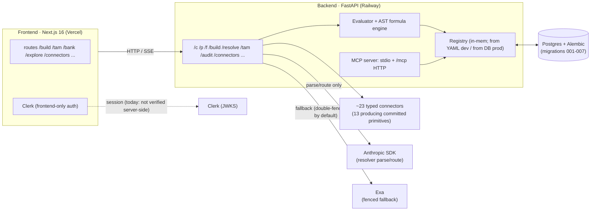

Note the **Clerk gap**: today Clerk authenticates only the frontend; the backend trusts
`X-API-Key` → `Principal(org_id)`. The v1.0 program adds server-side Clerk-JWT verification.

---

## 2. Five-layer data model

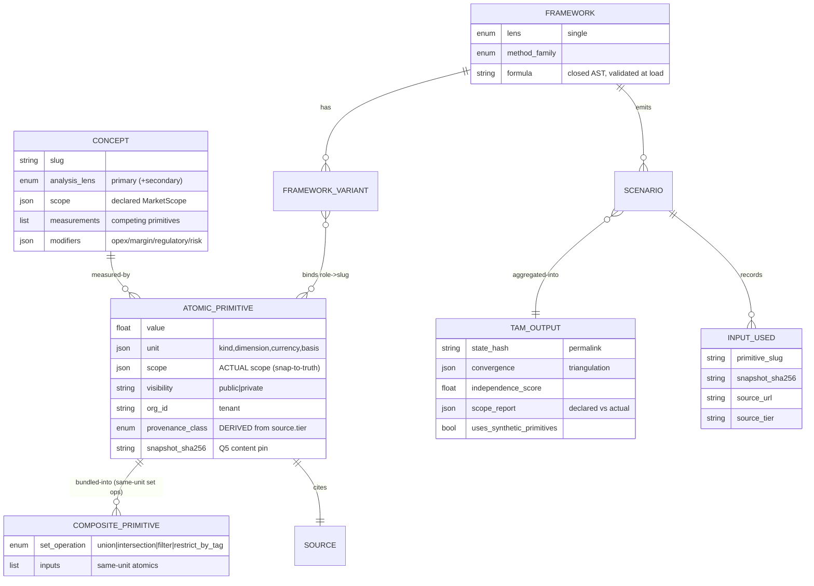

---

## 3. Ingest pipeline

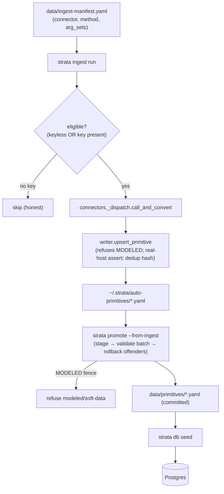

---

## 4. Resolve flow (`POST /resolve`, SSE)

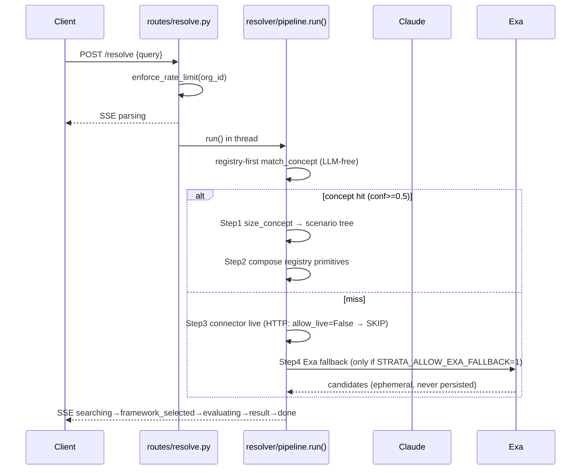

---

## 5. Build / recompute + state-hash

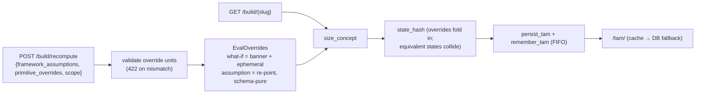

---

## 6. Evaluator + AST formula engine

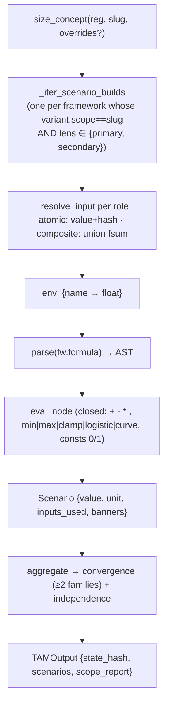

---

## 7. Six lenses → frameworks → required roles

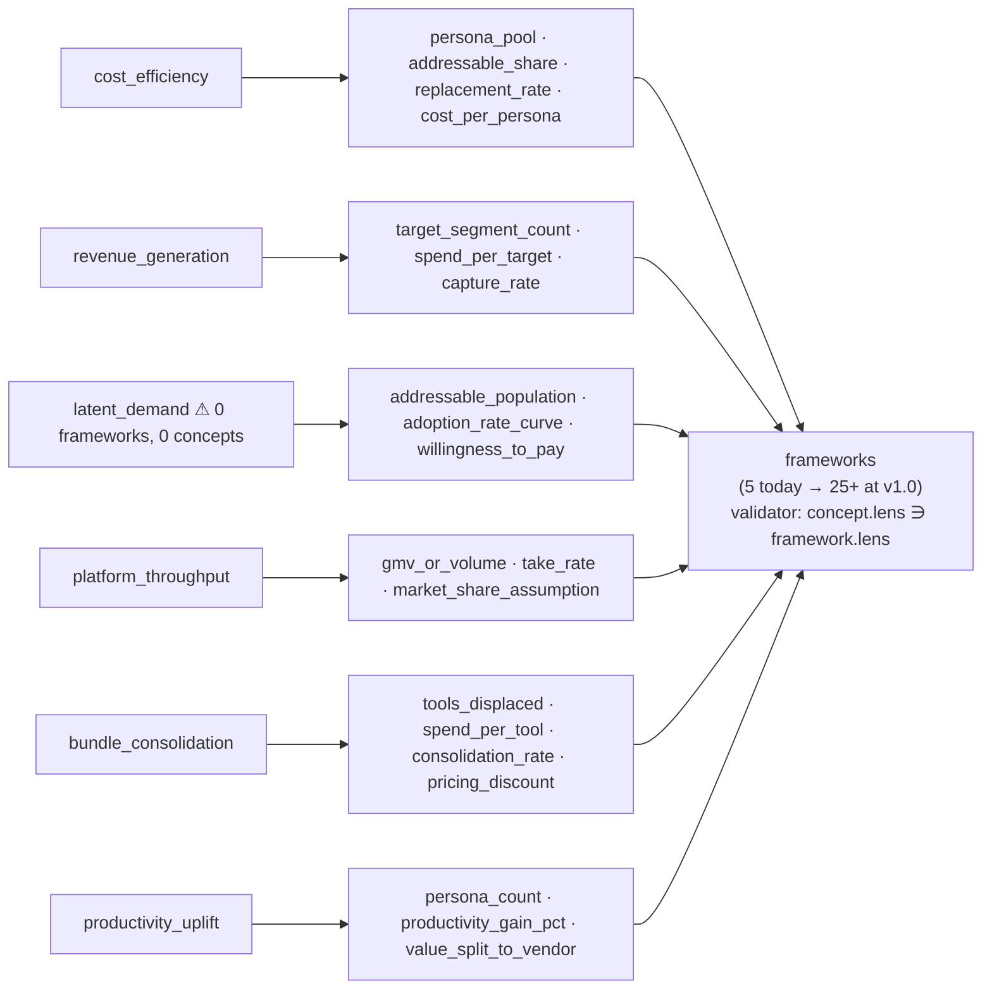

---

## 8. Auth + multi-tenancy (current + the Clerk bridge)

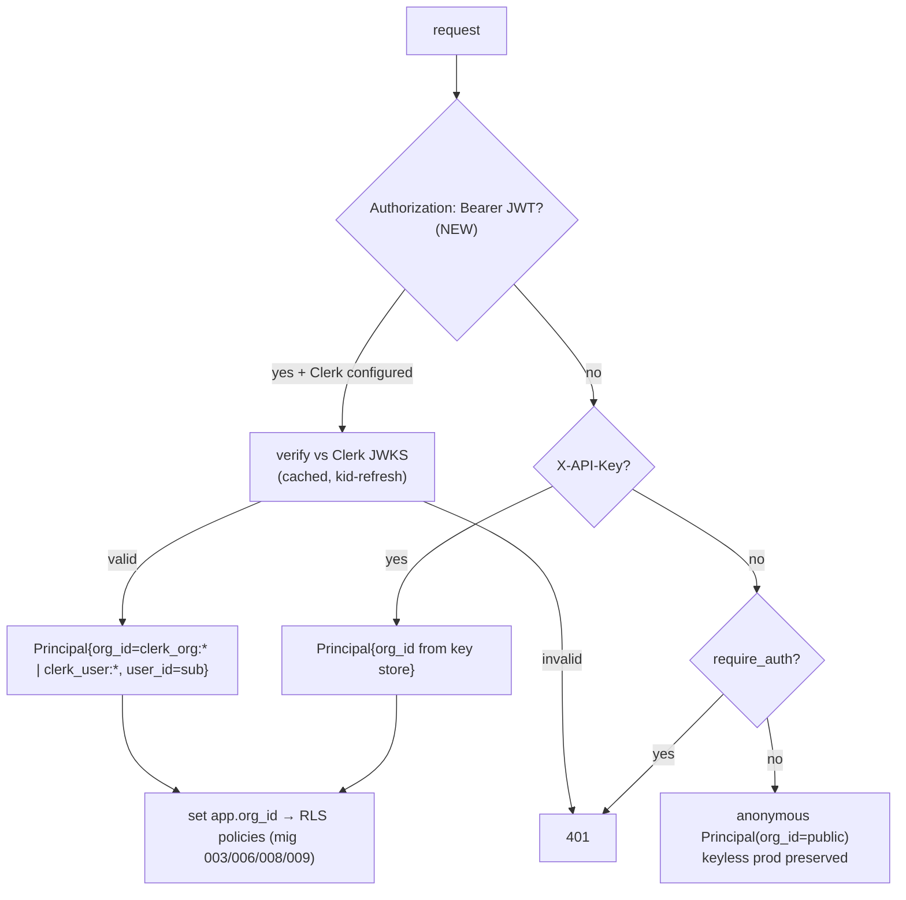

---

## 9. Soft-data fence (the trust contract)

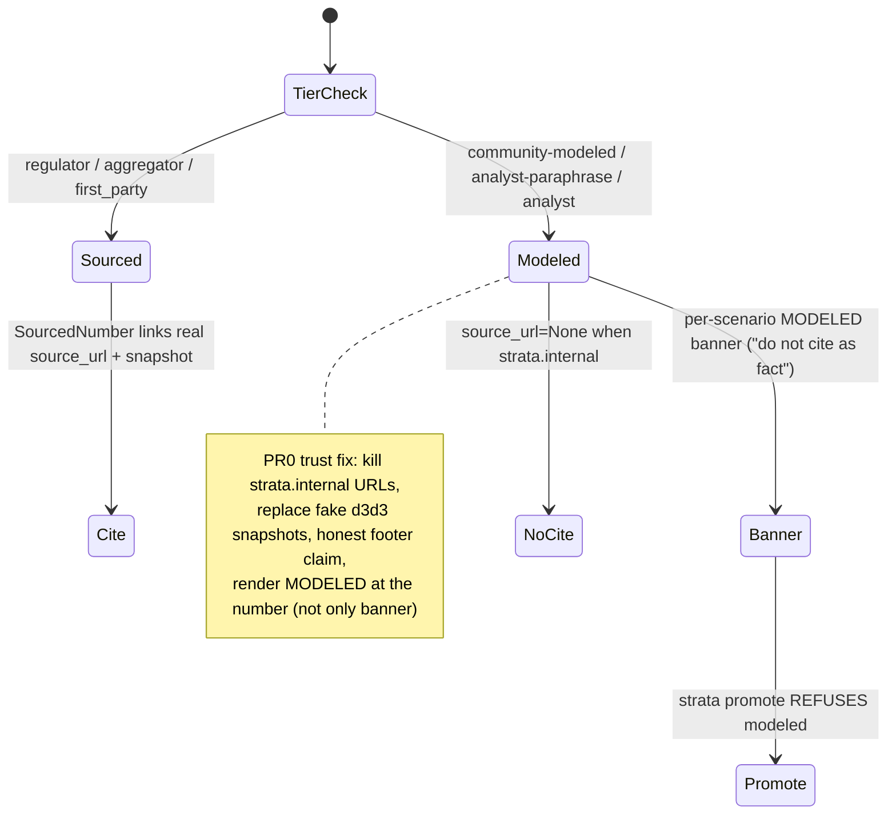

---

## 10. Two-tier data bank (private ↔ shared via agents)

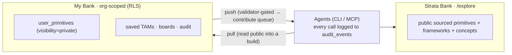

---

## 11. Validator (3-layer) + guards

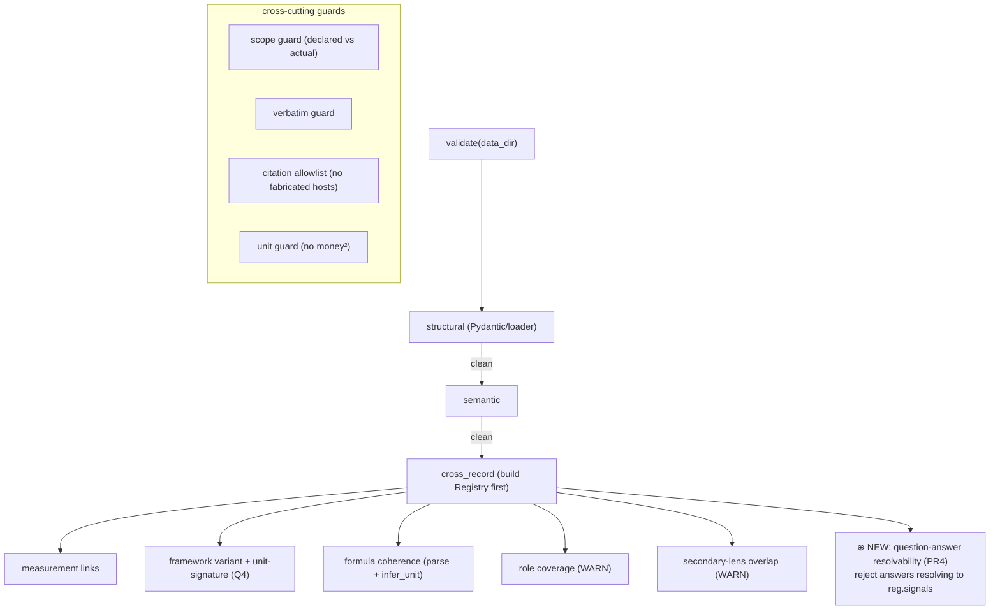

---

## 12. Frontend route / IA map

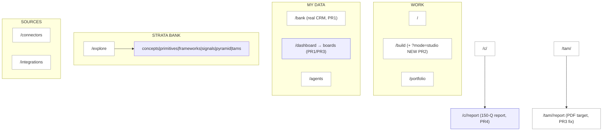

---

## 13. MCP tool surface (12 tools)

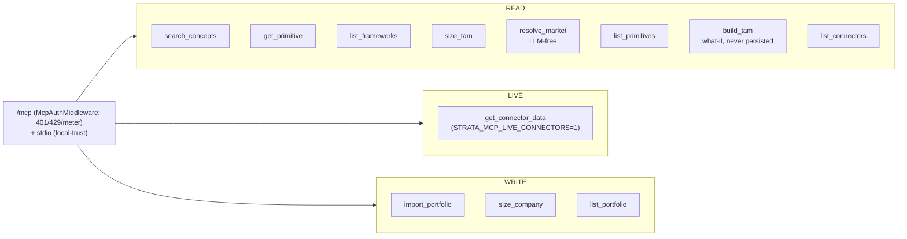

---

## 14. Migrations timeline

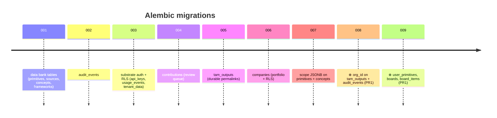

---

## Design-system anchor

Tokens are committed and load-bearing ("The Sourced Ledger"): paper `--bg-0 #fafafa`, ink
`--fg-1 #0a0a0b`, accent indigo `--accent #5b5bd6`, AA-verified muted `--fg-3 #6b6b73`.
Type: Instrument Serif (display) + Geist (body) + tabular Geist Mono (numbers). Chart vars:
`--chart-1..6` alias accent + tier hues; `--chart-lens-*` carry the cool lens family.
**A colour means one thing** — tier ramp = provenance, cool family = lens. See
[`charts-and-dashboards.md`](charts-and-dashboards.md).
