# Strata — architecture diagram set (mermaid)

The as-built system plus the v1.0 program (the 6 stacked PRs in
[`../TODO_june6.md`](../TODO_june6.md)). Every diagram is a recovered fact or a
declared target; PR-tagged diagrams (PR1–PR5) describe work in flight. Render in
any mermaid-aware viewer (GitHub, VS Code, Obsidian).

Index:

| # | Diagram | Layer |
|---|---|---|
| 1 | System context | whole |
| 2 | Five-layer data model (ERD) | data |
| 3 | Resolve pipeline (SSE) | backend |
| 4 | Build / recompute + state hash | backend |
| 5 | Six lenses → frameworks → roles | data |
| 6 | Evaluator: inputs → scenario tree | backend |
| 7 | Soft-data fence (trust contract) | integrity |
| 8 | Citation allowlist + tier derivation | integrity |
| 9 | Q20 no-LLM-number fence | integrity |
| 10 | Snapshot integrity verification | integrity |
| 11 | Scope guard (declared vs actual) | data |
| 12 | Validator pipeline | data |
| 13 | Connector ingest pipeline | connectors |
| 14 | Connector dispatch (call_and_convert) | connectors |
| 15 | /connectors host attribution | connectors |
| 16 | Quarantine: signals never feed TAM | integrity |
| 17 | Convergence cross-check | backend |
| 18 | Sensitivity tornado | backend |
| 19 | Override: what-if vs assumption | backend |
| 20 | State-hash canonicalization | backend |
| 21 | TAM persistence + permalink | backend |
| 22 | MCP server (stdio + /mcp) | agents |
| 23 | Two-tier data bank (private ↔ shared) | agents |
| 24 | Portfolio sizing wedge | product |
| 25 | Frontend IA (routes) | frontend |
| 26 | Deploy topology | ops |
| 27 | Auth: Clerk → backend bridge (PR1) | PR1 |
| 28 | Dual-purpose RLS policy (PR1) | PR1 |
| 29 | Migration lineage (PR1) | PR1 |
| 30 | Lineage DAG endpoint (PR1) | PR1 |
| 31 | Build Studio reveal (PR2) | PR2 |
| 32 | Build Studio component graph (PR2) | PR2 |
| 33 | Dashboards-as-a-service (PR3) | PR3 |
| 34 | Gartner chart contract (PR3) | PR3 |
| 35 | Real PDF export pipeline (PR3) | PR3 |
| 36 | Question → report assembler (PR4) | PR4 |
| 37 | Answer-strategy resolution (PR4) | PR4 |
| 38 | latent_demand framework (PR5) | PR5 |
| 39 | Semantic search + concept promotion (PR5) | PR5 |
| 40 | The 6-PR program dependency graph | program |
| 41 | End-to-end demo flow | demo |
| 42 | Registry-first slug resolution (match ladder) | backend |
| 43 | Token-coverage concept matching | backend |
| 44 | Unit type system (the algebra) | data |
| 45 | Source-tier taxonomy (9 tiers) | integrity |
| 46 | Request lifecycle + middleware stack | backend |
| 47 | API route surface (16 routers) | backend |
| 48 | CLI command surface | backend |
| 49 | Connector 6-layer pattern | connectors |
| 50 | Three data stores (YAML · PG · registry) | data |
| 51 | OAuth inbound SaaS connector | connectors |
| 52 | API-key auth + rate-limit + metering | substrate |
| 53 | Resolver status + estimate_kind | backend |
| 54 | Full /resolve sequence (end to end) | backend |

---

### 1. System context

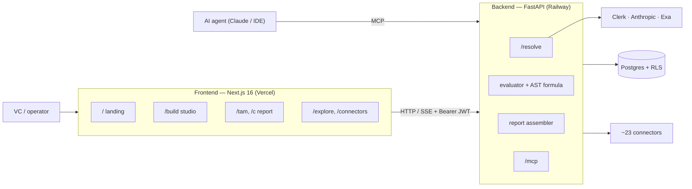

### 2. Five-layer data model (ERD)

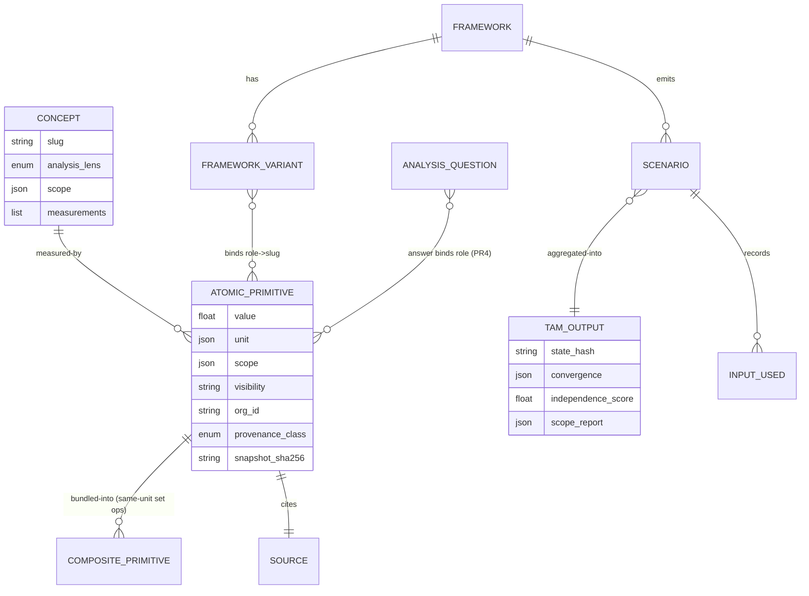

### 3. Resolve pipeline (SSE, 4-step fallback chain, first hit wins)

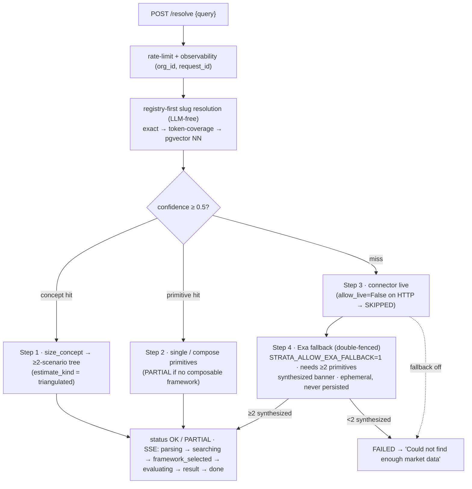

> A wrong concept dressed as a sourced TAM is the worst outcome the resolver can
> produce, so the match ladder (#42–#43) is deliberately strict: a near-miss
> falls through to the *honest* fallback (#54) — a synthesized estimate behind a
> "verify before citing" banner — rather than a confident wrong answer.

### 4. Build / recompute + state hash

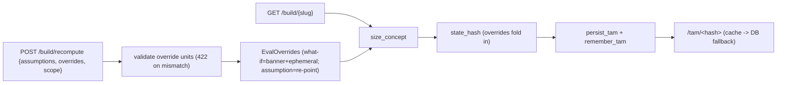

### 5. Six lenses → frameworks → required roles

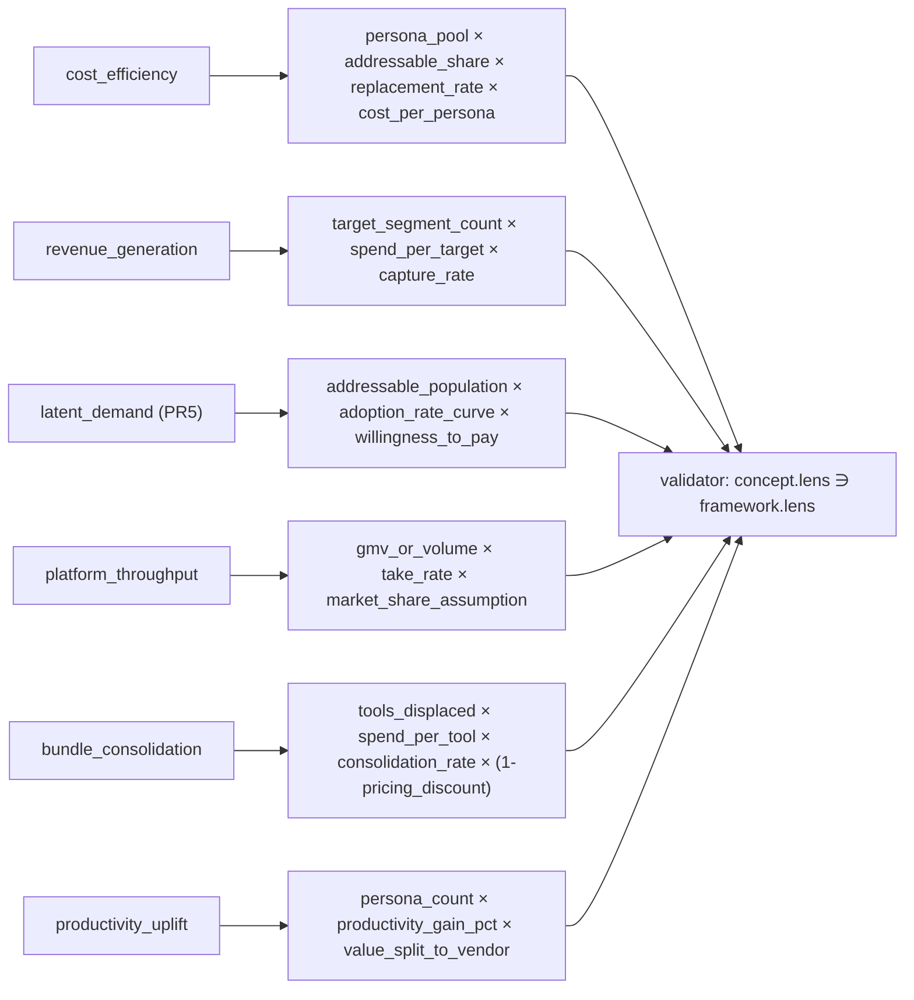

### 6. Evaluator: inputs → scenario tree

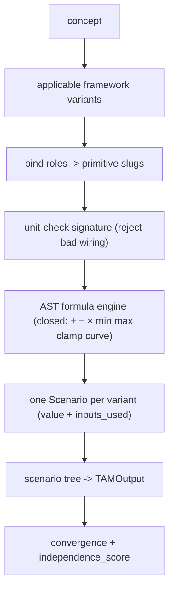

### 7. Soft-data fence (the trust contract)

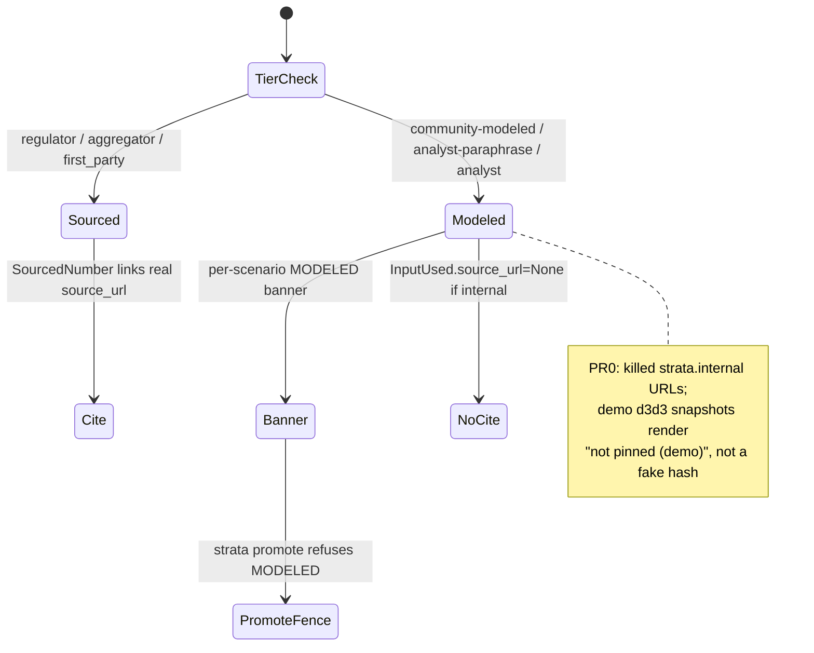

### 8. Citation allowlist + tier derivation

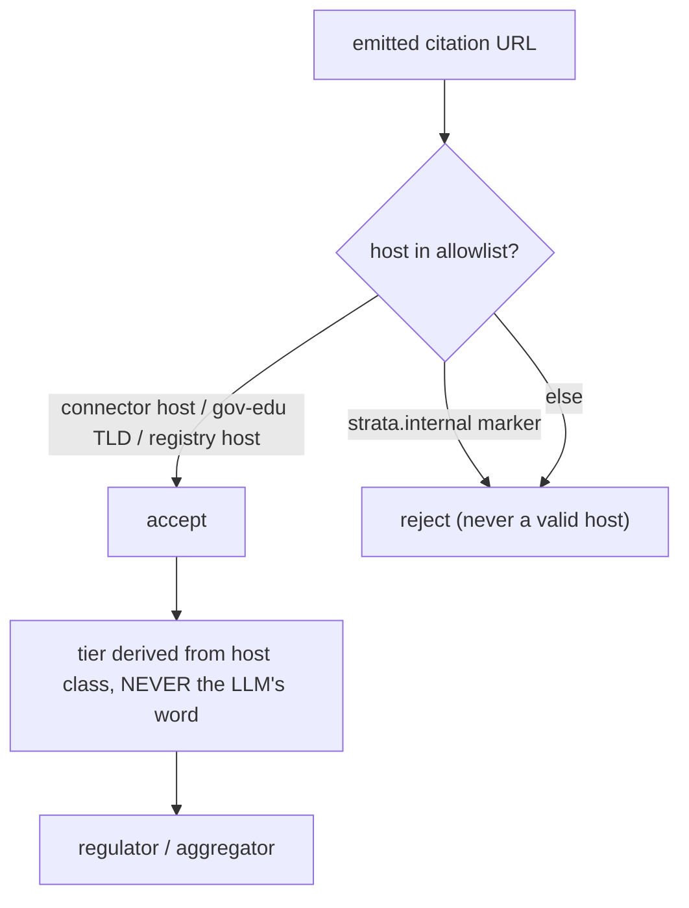

### 9. Q20 no-LLM-number fence

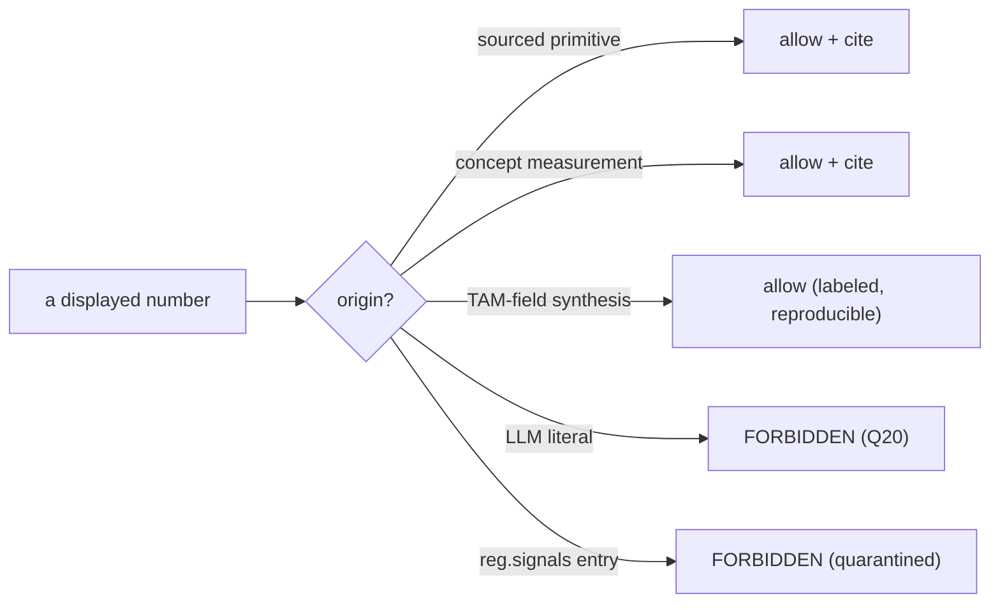

### 10. Snapshot integrity verification

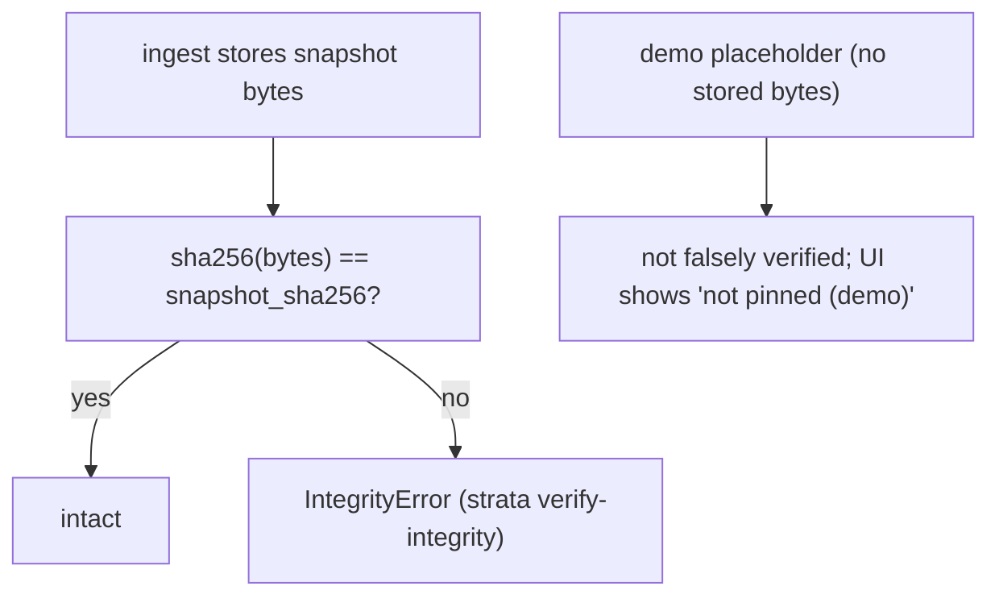

### 11. Scope guard (declared vs actual, snap-to-truth)

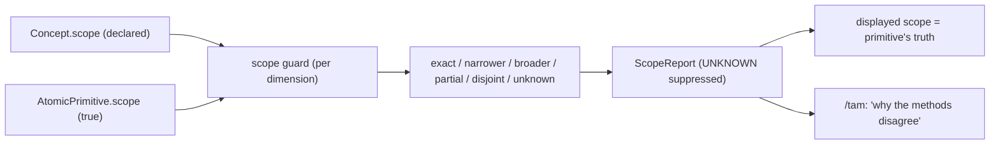

### 12. Validator pipeline

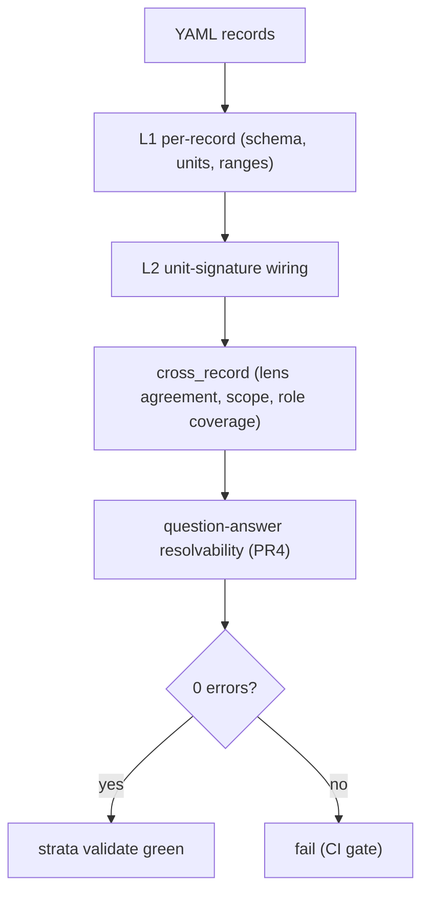

### 13. Connector ingest pipeline

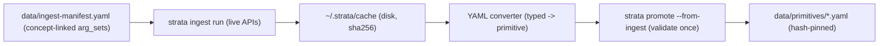

### 14. Connector dispatch (call_and_convert)

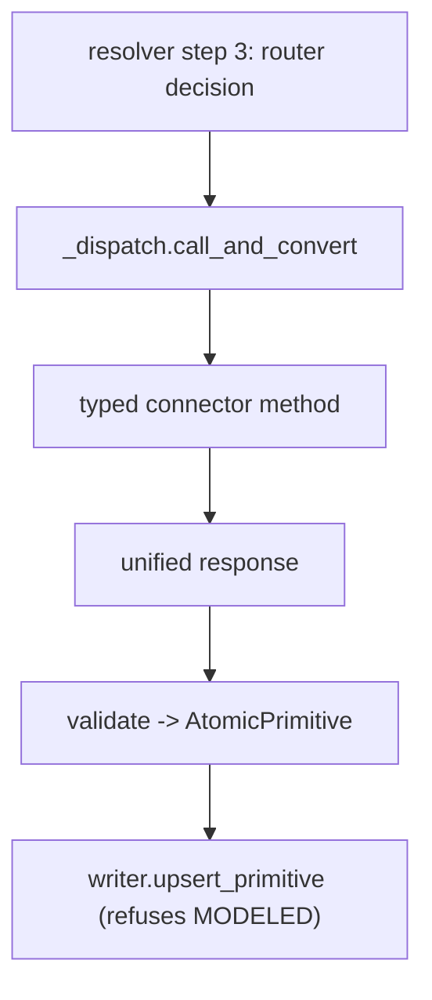

### 15. /connectors host attribution

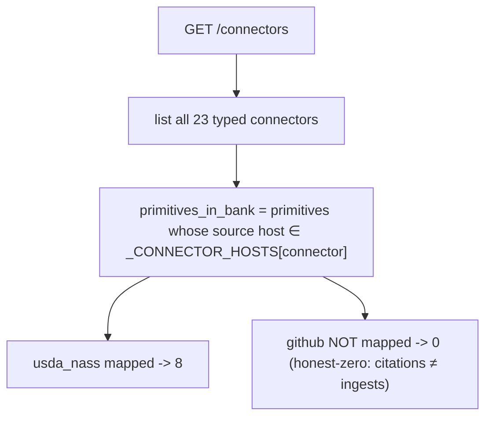

### 16. Quarantine: signals never feed a TAM

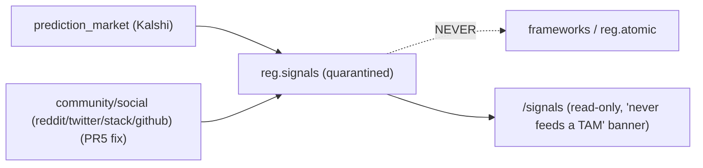

### 17. Convergence cross-check

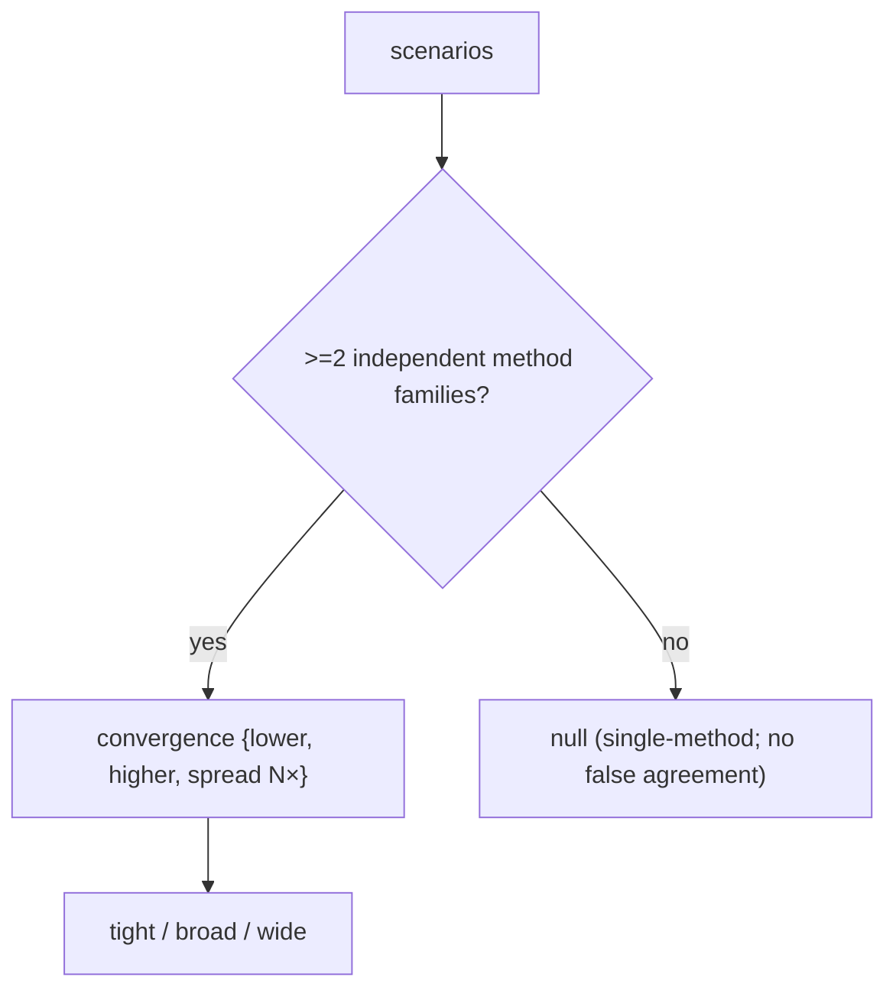

### 18. Sensitivity tornado

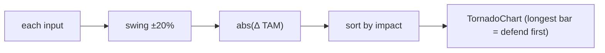

### 19. Override: what-if vs assumption

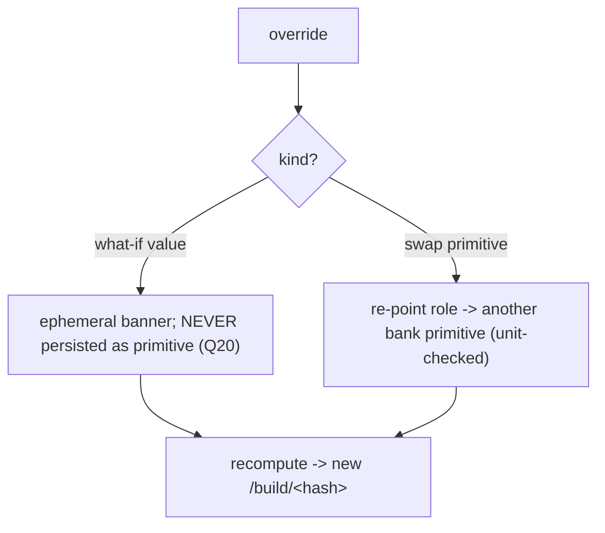

### 20. State-hash canonicalization

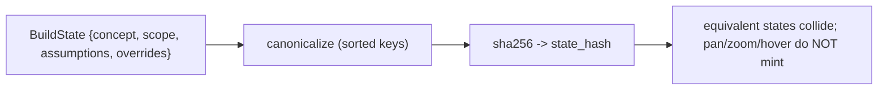

### 21. TAM persistence + permalink

```mermaid
flowchart TD
  BUILD["build/recompute"] --> REM["reg.remember_tam (FIFO cache)"]
  BUILD --> DBW["tam_outputs (Postgres, migration 005)"]
  REQ["GET /tam/&lt;hash&gt;"] --> CACHE{"in cache?"}
  CACHE -->|yes| SERVE
  CACHE -->|no| DBR["DB fallback"] --> SERVE["SSR + OpenGraph"]
```

### 22. MCP server (stdio + /mcp)

```mermaid
flowchart LR
  AG["agent"] -->|stdio| STDIO["strata-mcp"]
  AG -->|streamable-HTTP| MOUNT["/mcp mount (auth, Wave 3)"]
  STDIO --> TOOLS["12 tools: search_concepts, list/get primitive, list_frameworks, size_tam, build_tam, list/get connector, resolve_market, portfolio ..."]
  MOUNT --> TOOLS
  TOOLS --> PAY["every payload: source_url + tier + snapshot_sha256"]
```

### 23. Two-tier data bank (private ↔ shared via agents)

```mermaid
flowchart LR
  subgraph Private["My Bank (org-scoped, RLS)"]
    UP["user_primitives (visibility=private, org_id)"]
    SB["saved TAMs + boards + audit"]
  end
  subgraph Shared["Strata Bank (Explore)"]
    PUB["public sourced primitives + frameworks + concepts"]
  end
  Agents["Agents (CLI / MCP), logged to audit_events"]
  Private -->|"push (validator-gated -> contribute queue)"| Agents
  Agents -->|"pull (read public into a build)"| Private
  Agents --> Shared
```

### 24. Portfolio sizing wedge

```mermaid
flowchart LR
  PF["portfolio companies (org-scoped pointer)"] --> MK["MARKET concept (shared, sourced)"]
  MK --> TAM["base TAM -> /tam/&lt;hash&gt;"]
  PF --> UNS["unsizable rows shown as honesty"]
```

### 25. Frontend IA (routes)

```mermaid
flowchart TD
  subgraph WORK
    Home["/"]; Build["/build (+ ?mode=studio, PR2)"]; Portfolio["/portfolio"]
  end
  subgraph MYDATA["MY DATA"]
    Bank["/bank (real CRM, PR1)"]; Boards["/dashboard boards (PR3)"]; Agents["/agents"]
  end
  subgraph BANK["STRATA BANK"]
    Explore["/explore (concepts · primitives · frameworks · signals · pyramid · tams)"]
  end
  subgraph SOURCES
    Connectors["/connectors"]; Integrations["/integrations"]
  end
  Concept["/c/&lt;slug&gt;"] --> CReport["/c/&lt;slug&gt;/report (150-Q, PR4)"]
  TAM["/tam/&lt;hash&gt;"] --> TReport["/tam/&lt;hash&gt;/report (PDF, PR3)"]
```

### 26. Deploy topology

```mermaid
flowchart LR
  V["Vercel (Next.js)"] -->|HTTPS| RW["Railway (FastAPI)"]
  RW --> PG[("Railway Postgres + RLS")]
  RW --> ANTH["Anthropic SDK (prod resolver)"]
  RW --> EXA["Exa (fenced fallback)"]
  V --> CLERK["Clerk (auth)"]
  CI["GitHub Actions (backend gate)"] -.->|"⚠ billing-blocked"| RW
```

### 27. Auth: Clerk → backend bridge (PR1)

```mermaid
flowchart TD
  Req["request"] --> H{"Authorization: Bearer JWT?"}
  H -->|"yes + Clerk configured"| Vv["verify vs Clerk JWKS (cached, kid-refresh)"]
  Vv -->|valid| P1["Principal{org_id=clerk_org:* or clerk_user:*, user_id=sub}"]
  Vv -->|invalid| E401["401"]
  H -->|no| K{"X-API-Key?"}
  K -->|yes| P2["Principal{org_id from key store}"]
  K -->|no| AN{"require_auth?"}
  AN -->|yes| E401
  AN -->|no| P3["anonymous Principal(org_id=public) — keyless prod preserved"]
  P1 --> RLS["app.org_id session var -> RLS"]
  P2 --> RLS
```

### 28. Dual-purpose RLS policy (PR1 — highest correctness risk)

```mermaid
flowchart TD
  Q["query tam_outputs"] --> POL["USING (org_id IS NULL OR org_id = current_setting('app.org_id', true))"]
  POL --> PUB["org_id IS NULL -> anonymous content-addressed permalink resolves"]
  POL --> TEN["org_id = caller -> tenant save isolated"]
  POL --> NO["org_id = other tenant -> 0 rows"]
  IDX["split partial-unique indexes on state_hash (public vs per-org)"] --> POL
```

### 29. Migration lineage (PR1)

```mermaid
flowchart LR
  M3["003 tenant_data + FORCE RLS"] --> M5["005 tam_outputs"]
  M5 --> M6["006 companies (RLS)"]
  M6 --> M7["007 scope JSONB"]
  M7 --> M8["008 tam_outputs/audit_events + org_id, created_by, title, is_saved"]
  M8 --> M9["009 user_primitives + boards + board_items"]
```

### 30. Lineage DAG endpoint (PR1)

```mermaid
flowchart TD
  REQ["GET /lineage/{id}"] --> WALK["recursive walk (cycle-guard, depth cap)"]
  WALK --> A["concept.measurements"]
  WALK --> B["framework.inputs"]
  WALK --> C["derives_from / composite.inputs"]
  A --> SHAPE["shaped to LineageGraph.tsx builder"]
  B --> SHAPE
  C --> SHAPE
  SHAPE --> FE["frontend swaps local walk -> fetch"]
```

### 31. Build Studio reveal (PR2 — "watch it build")

```mermaid
sequenceDiagram
  participant U as User
  participant V as BuildStudioView
  participant API as /build/recompute
  U->>V: pin market + pick lens
  V->>API: size (one call, full payload)
  API-->>V: TAMOutput {scenarios, inputs_used, provenance}
  V->>V: deriveBuildSteps(tam, lens) -> [apex, role1..N]
  loop reveal node-by-node
    V-->>U: show next role node + running TAM (Pulse)
    U->>V: Confirm | Swap | What-if
    alt edit
      V->>API: recompute(new BuildState) -> re-mint /build/&lt;hash&gt;
      API-->>V: fresh TAMOutput -> resume at edited role
    end
  end
  V-->>U: steered TAM -> save / share /tam/&lt;hash&gt;
```

### 32. Build Studio component graph (PR2)

```mermaid
flowchart TD
  BSV["BuildStudioView (reducer + reveal timer)"] --> BSG["BuildStudioGraph (progressive ReactFlow)"]
  BSV --> RAIL["StudioStepRail"]
  BSV --> LP["LensPicker (gated to lenses with >=1 applicable variant)"]
  BSG --> NODES["reuses ScenarioGraph node cards (module-scope NODE_TYPES)"]
  BSV --> OP["OverridePanel (swap / what-if)"]
  BSV --> DS["build-studio.ts deriveBuildSteps (pure, unit-tested)"]
```

### 33. Dashboards-as-a-service (PR3)

```mermaid
flowchart LR
  DASH["/dashboard (boards surface)"] --> BRD["boards / board_items (PR1)"]
  BRD --> TILES["draggable tiles"]
  TILES --> T1["TornadoChart"]
  TILES --> T2["CompositionChart"]
  TILES --> T3["ScenarioComparisonChart"]
  TILES --> T4["TamTrajectoryChart"]
  TILES --> T5["pinned TAMs"]
```

### 34. Gartner chart contract (PR3)

```mermaid
flowchart TD
  CH["ui/chart.tsx base"] --> FRAME["title / subtitle / source-footnote frame"]
  CH --> AXIS["axis titles + units"]
  CH --> ANN["on-chart annotations / callouts"]
  CH --> RAMP["tier ramp = provenance; cool family = lens (never crossed)"]
  RAMP --> TOK["tokenize ResolveResultChart hex -> CSS vars"]
```

### 35. Real PDF export pipeline (PR3)

```mermaid
flowchart TD
  BTN["Download PDF"] --> CLEAN["render clean /tam/&lt;hash&gt;/report markup"]
  CLEAN --> SRV["server-side Playwright print-to-PDF (deterministic)"]
  CLEAN --> CSS["print-color-adjust: exact; CSS vars -> literals; inline chart styles"]
  MD["Download Markdown"] --> RACE["defer revokeObjectURL (fix empty-file race)"]
  MD --> PROV["tamToMarkdown + Sources/provenance (url, tier, snapshot)"]
```

### 36. Question → report assembler (PR4)

```mermaid
flowchart TD
  REQ["GET /report/{concept_slug} · strata report"] --> ASM["assemble_report(reg, slug) — pure, NO LLM, NO network"]
  ASM --> Q["for each applicable AnalysisQuestion"]
  Q --> RES{"answer.strategy"}
  RES -->|primitive_role| P["sourced primitive (+ provenance/snapshot)"]
  RES -->|concept_measurement| SP["spread when >=2 disagree"]
  RES -->|tam_field| SY["synthesis (triangulated, reproducible at /tam/&lt;hash&gt;)"]
  RES -->|qualitative| QL["modifier / annotation narrative"]
  RES -->|unresolvable| GAP["honest gap + resource_target"]
  P --> RA["ResolvedAnswer (validator: no numeric without provenance/synthesis)"]
  SP --> RA
  SY --> RA
  RA --> MR["MarketReport -> /c/&lt;slug&gt;/report (zero external citations)"]
```

### 37. Answer-strategy resolution (PR4)

```mermaid
stateDiagram-v2
  [*] --> Applicable
  Applicable --> Bind: lens_in + requires_role match
  Bind --> RegistryObject: role / concept / tam_field ONLY
  RegistryObject --> Quarantine: resolves to reg.signals?
  Quarantine --> Reject: YES -> validator rejects question
  RegistryObject --> Resolve: NO
  Resolve --> Answer: provenance or SYNTHESIS
  Applicable --> Gap: no binding -> "no data in bank"
```

### 38. latent_demand framework (PR5)

```mermaid
flowchart LR
  POP["addressable_population (sourced)"] --> MUL["× logistic(adoption_rate_curve)"]
  ADO["adoption_rate_curve (sourced or MODELED-banner)"] --> MUL
  WTP["willingness_to_pay (sourced)"] --> MUL
  MUL --> TAM["latent-demand-adoption-curve TAM"]
  NOTE["L3 had 0 frameworks AND 0 concepts -> add framework + 1-2 concepts + ~6 primitives"] -.-> POP
```

### 39. Semantic search + concept promotion (PR5)

```mermaid
flowchart TD
  EMB["strata embed (pgvector over concept/primitive text)"] --> NN["match_concept NN fallback"]
  NN --> RES["/resolve match (semantic)"]
  CONTRIB["/contribute (validator-gated)"] --> PROMO["concept promotion"]
  PROMO --> INT["intersection auto-promotion"]
  INT --> BANK["public bank"]
```

### 40. The 6-PR program dependency graph

```mermaid
flowchart LR
  PR0["PR0 trust + docs ✅ merged"] --> PR1["PR1 multi-tenant workspace"]
  PR1 --> PR2["PR2 Build Studio live tree"]
  PR1 --> PR3["PR3 dashboards + charts + PDF"]
  PR1 --> PR4["PR4 question report engine"]
  PR2 --> PR5["PR5 breadth to v1.0"]
  PR3 --> PR5
  PR4 --> PR5
  classDef done fill:#d6f5d6,stroke:#2e7d32;
  class PR0 done;
```

### 41. End-to-end demo flow

```mermaid
flowchart TD
  ASK["ask a niche TAM question"] --> RESV["/resolve (registry-first, LLM-free)"]
  RESV --> BUILD["/build studio — graph assembles node-by-node (PR2)"]
  BUILD --> MOD["modify a node (swap / what-if) -> live recompute"]
  MOD --> REP["/c/&lt;slug&gt;/report — 150 Qs answered from sourced primitives (PR4)"]
  REP --> FENCE["zero external citations; gaps say 'no data'; spreads show disagreement"]
  REP --> PDF["forwardable PDF (PR3)"]
```

### 42. Registry-first slug resolution (the match ladder)

The resolver spends nothing on an LLM until it has exhausted the free,
deterministic registry ladder. Each rung is stricter-to-looser; the first hit
wins, a total miss becomes `NOVEL` intent and falls to synthesis.

```mermaid
flowchart TD
  Q["free-form query"] --> NORM["normalize (lowercase, strip punctuation)"]
  NORM --> EXACT{"exact slug OR name match?"}
  EXACT -->|yes| HIT["concept slug (confidence 1.0)"]
  EXACT -->|no| TOK["token-coverage match_concept (LLM-free, deterministic)"]
  TOK --> THR{"best score ≥ 0.6?"}
  THR -->|yes| HIT
  THR -->|no| SEM["pgvector NN match_concept_semantic (cosine)"]
  SEM --> STHR{"similarity ≥ 0.5?"}
  STHR -->|yes| HIT
  STHR -->|no| MISS["miss → NOVEL intent → fallback synthesis (#54)"]
  HIT --> CONF{"confidence ≥ 0.5?"}
  CONF -->|yes| SIZE["size_concept (registry, no LLM)"]
  CONF -->|no| MISS
```

### 43. Token-coverage concept matching

Matching turns on shared *meaningful tokens*, not character coincidence. The
prior `SequenceMatcher` char-ratio mis-bound "Market research tools" → AI legal
*research* (0.61) and "pet insurance" → P&C *insurance* doc-gen (0.67) on one
incidental word each. Coverage + a head-token guard kills those without
breaking real or verbose queries.

```mermaid
flowchart TD
  IN["query + candidate (slug & name)"] --> T["tokenize: lowercase · drop 1-char + grammatical filler"]
  T --> SH["shared = greedy 1:1 token overlap<br/>(exact OR ratio ≥ 0.85 typo-tolerant)"]
  SH --> Z{"shared == 0?"}
  Z -->|yes| ZERO["score 0"]
  Z -->|no| COV["cov_q = shared/len(q) · cov_c = shared/len(c)<br/>score = max(cov_q, cov_c)"]
  COV --> G{"shared == 1 AND candidate has > 1 token?"}
  G -->|no| KEEP["keep score"]
  G -->|yes| HEAD{"is the shared token the candidate's HEAD?"}
  HEAD -->|"yes — brand head ('Kyber')"| KEEP
  HEAD -->|"no — mid-word ('research' / 'insurance' / 'test')"| CAP["cap below 0.6 → reject"]
  KEEP --> OUT["best candidate ≥ 0.6 wins, else None"]
  CAP --> OUT
```

### 44. Unit type system (the algebra)

```mermaid
flowchart LR
  subgraph U["Unit (structured — frameworks declare signatures)"]
    K["kind: stock · flow · intensive · dimensionless"]
    D["dimension: people · currency · transactions · events · percent · tokens · impressions · organizations · seats"]
    DEN["denominator: str or None (e.g. per-seat-per-year)"]
    CUR["currency: str or None"]
    BAS["basis: nominal"]
  end
  U --> VAL["L2 validator: reject dimensionally-invalid wiring (no money²)"]
  U --> NORM["currency stored nominal → normalized at query time"]
  VAL --> EVAL["evaluator only multiplies unit-checked roles"]
```

### 45. Source-tier taxonomy (9 tiers)

```mermaid
flowchart TD
  ST["SourceTier (9; models/source.py)"] --> SIZ["sizing tiers — may feed a TAM"]
  ST --> QUAR["non-sizing — quarantined from the evaluator"]
  SIZ --> A["first_party"]
  SIZ --> B["regulator"]
  SIZ --> C["aggregator"]
  SIZ --> D["analyst"]
  SIZ --> E["analyst-paraphrase"]
  SIZ --> F["onchain"]
  SIZ --> G["community-modeled (MODELED banner; strata promote refuses)"]
  QUAR --> H["prediction_market → reg.signals (#16)"]
  QUAR --> I["community (social) → reg.signals (#16)"]
```

### 46. Request lifecycle + middleware stack

```mermaid
flowchart TD
  REQ["HTTP request"] --> CORS["CORSMiddleware (fails closed in prod; any localhost:* in dev)"]
  CORS --> OBS["observability middleware"]
  OBS --> RID["assign request_id (uuid4) → request.state + X-Request-Id"]
  RID --> PRIN["extract Principal (org_id) for metering"]
  PRIN --> T0["perf_counter start"]
  T0 --> ROUTE["route handler"]
  ROUTE --> METER["meter.record(org_id)"]
  METER --> LOG["structured log: request_id · method · path · status · org · elapsed_ms"]
  LOG --> RESP["response (+ X-Request-Id)"]
```

### 47. API route surface (16 routers + /mcp)

```mermaid
flowchart LR
  subgraph Data
    C["/c concepts"]; P["/p primitives"]; F["/f frameworks"]; SG["/signals"]
  end
  subgraph Sizing
    B["/build + /build/recompute"]; R["/resolve (SSE)"]; RP["/report"]; LN["/lineage"]
  end
  subgraph Tenant
    AU["/audit"]; US["/usage"]; ME["/me"]; CB["/contribute"]; PO["/portfolio"]
  end
  subgraph Sources
    CN["/connectors"]; IN["/integrations (OAuth)"]
  end
  subgraph Ops
    HZ["/healthz (+ /llm)"]; MCP["/mcp mount (McpAuthMiddleware)"]
  end
```

### 48. CLI command surface (`strata`)

```mermaid
flowchart LR
  CLI["strata"] --> CORE["version · validate · size · report · stats · embed"]
  CLI --> INTEG["verify-integrity · resource-status · test-connectors"]
  CLI --> GOAL["goal (4-step resolver) · promote"]
  CLI --> DB["db: seed · stats"]
  CLI --> ING["ingest: run · status · refresh"]
  CLI --> PF["portfolio: import · size · list · gaps"]
```

### 49. Connector 6-layer pattern

```mermaid
flowchart TD
  L1["1 · Enums (API constants)"] --> L2["2 · TypedDicts (raw API response shapes)"]
  L2 --> L3["3 · frozen dataclasses (validated models, slots=True)"]
  L3 --> L4["4 · unified response (e.g. BLSResponse: status + data + cache meta)"]
  L4 --> L5["5 · disk cache (~/.strata/cache/{connector}, sha256, ~24h TTL)"]
  L5 --> L6["6 · client (context-manager) + YAML converters → AtomicPrimitive"]
  L6 --> OUT["23 typed connectors; 13 produce committed primitives"]
```

### 50. Three data stores (YAML · Postgres · in-memory registry)

```mermaid
flowchart LR
  YAML["YAML on disk (data/*.yaml — source of truth in dev/CI)"] -->|"strata db seed"| PG[("Postgres — prod primary; GIN+B-tree; RLS")]
  YAML -->|"load_data_dir at boot"| REG["in-memory Registry (evaluator reads THIS)"]
  PG -.->|"Registry.from_db round-trips scope"| REG
  CONN["connectors"] -->|"disk cache → converter"| YAML
  UP["user_primitives (PG-only, migration 009)"] -.->|"⚠ substrate rot #98: invisible to in-memory evaluator"| REG
  REGISTRY_NOTE["⚠ #97: in-memory registry frozen at boot"] -.-> REG
```

### 51. OAuth inbound SaaS connector (private, org-scoped primitives)

```mermaid
sequenceDiagram
  participant U as User
  participant API as /integrations
  participant P as Provider (HubSpot)
  participant V as TokenVault (Fernet)
  participant E as Evaluator
  U->>API: connect (authorize_url)
  API->>P: redirect to OAuth consent
  P-->>API: code (single-use CSRF state)
  API->>P: exchange_code → access_token
  API->>V: encrypt + store (org_id, provider)
  U->>API: sync
  API->>V: decrypt token
  API->>P: fetch(access_token)
  P-->>API: raw tenant data
  API->>API: to_private_primitives(org_id, raw)
  Note over API,E: visibility=private · org_id-scoped · private banner · disconnect purges
  API-->>E: feed same evaluator (isolated cross-tenant)
```

### 52. API-key auth + rate-limit + metering

```mermaid
flowchart TD
  REQ["request"] --> KEY{"X-API-Key OR Bearer JWT?"}
  KEY -->|present| PR["Principal{org_id} (api/auth.py)"]
  KEY -->|"none + require_auth"| E401["401"]
  KEY -->|"none + keyless prod"| ANON["anonymous Principal(org_id=public)"]
  PR --> RL["token-bucket rate-limit per org (api/ratelimit.py)"]
  ANON --> RL
  RL -->|"bucket empty"| E429["429 + Retry-After"]
  RL -->|ok| H["handler"]
  H --> MET["usage meter → GET /usage · /metrics"]
```

### 53. Resolver status + estimate_kind

```mermaid
stateDiagram-v2
  [*] --> Resolve
  Resolve --> Triangulated: concept hit · ≥2 method families
  Resolve --> SingleMethod: 1 family OR fallback synthesis
  Resolve --> Partial: primitives found · no composable framework
  Resolve --> Failed: registry miss + fallback off / empty
  Triangulated --> OK: status OK (no banner)
  SingleMethod --> Banner: honesty banner (synthesized / MODELED)
  Banner --> OK
  Partial --> OKp: status PARTIAL
  Failed --> Msg: "Could not find enough market data"
```

### 54. Full /resolve sequence (end to end)

```mermaid
sequenceDiagram
  participant FE as Frontend (ResolveView)
  participant API as /resolve (SSE)
  participant MT as match (registry-first)
  participant EV as evaluator
  participant EX as Exa + LLM (fenced)
  FE->>API: POST {query}
  API-->>FE: event: parsing
  API->>MT: match_concept (exact → token → pgvector NN)
  alt confidence ≥ 0.5 (concept hit)
    API-->>FE: searching · primitive_found ×N
    API->>EV: size_concept → scenario tree
    API-->>FE: framework_selected · evaluating
    API-->>FE: event: result (triangulated, sourced)
  else miss + STRATA_ALLOW_EXA_FALLBACK=1
    API->>EX: parse → Exa search → extract (needs ≥2 primitives)
    EX-->>API: synthesized primitives (ephemeral, never persisted)
    API-->>FE: event: result (single_method + 'verify before citing' banner)
  else miss + fallback off / empty
    API-->>FE: event: error ('Could not find enough market data')
  end
  API-->>FE: event: done
```
