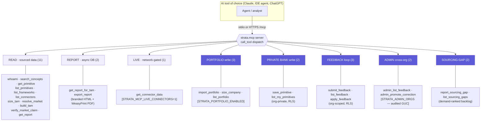
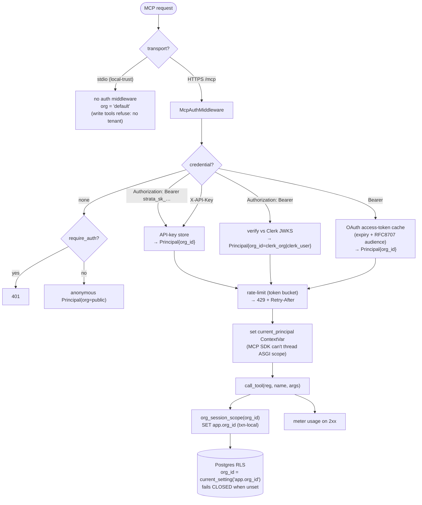
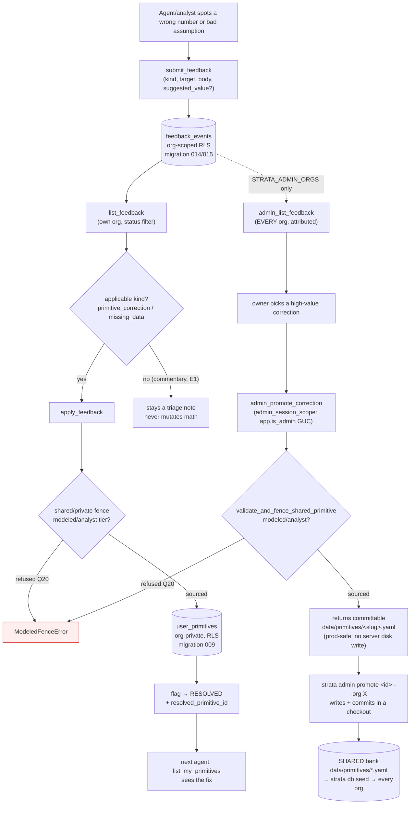
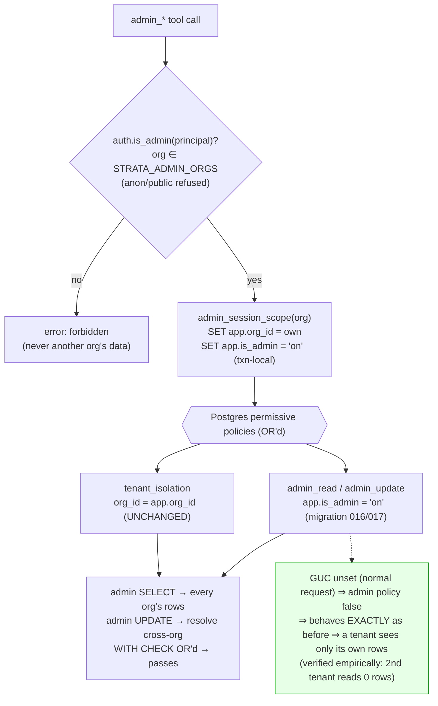
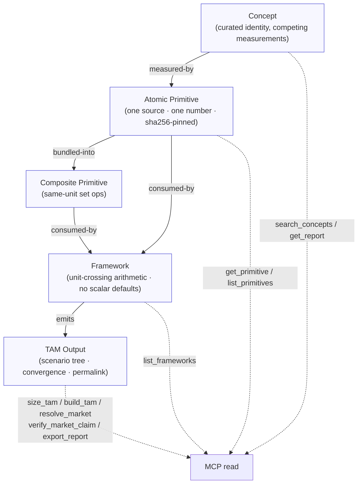

# Strata MCP — architecture diagrams

Detailed Mermaid diagrams of the Strata MCP server: the surface agents drive to
generate and verify sourced market research. Companion to
[`DIAGRAMS.md`](DIAGRAMS.md) (whole-system) — this file zooms into the **MCP**.

As of 2026-06-08 the live surface is **26 tools** over two transports. Verified
live: `https://strata-api-production-9740.up.railway.app/mcp/`.

---

## 1. The 26-tool surface, by tier



**Invariant:** every numeric payload carries its citation (`source_url`,
`source_tier`, `snapshot_sha256`, `integrity`). No tool ever returns a fabricated
number — a miss is flagged `unsourced=true`, never synthesized (Q20).

---

## 2. Transport + auth + tenant isolation



The `current_principal` **ContextVar** is the key trick: the MCP SDK doesn't pass
the ASGI scope into tool callbacks, so the middleware stashes the authenticated
`Principal` in a ContextVar that write/portfolio/feedback tools read.

---

## 3. Request lifecycle of one sourced TAM (`size_tam`)

```mermaid
sequenceDiagram
    participant A as Agent
    participant M as MCP server
    participant R as Registry (YAML dev / PG prod, 30s TTL)
    participant E as Evaluator (AST formula engine)
    participant C as Cache + tam_outputs (PG)

    A->>M: tools/call size_tam {concept_slug}
    M->>R: load concept + its frameworks + primitives
    R-->>M: Concept, Framework[], AtomicPrimitive[]
    M->>E: size_concept(reg, slug)
    Note over E: multiply unit-checked inputs per framework variant<br/>→ scenario tree; convergence if ≥2 independent families
    E-->>M: TAMOutput {scenarios[], method_families, convergence,<br/>independence_score, scope, state_hash}
    M->>C: remember_tam (FIFO cache) + persist
    M-->>A: {matched:true, scenarios[], charts, permalink,<br/>every input cited (url+tier+sha256+integrity)}
    Note over A,M: resource_links → strata://primitive/<slug>,<br/>strata://tam/<hash>; next_actions → get_report_for_tam, build_tam
```

A **miss** (`resolve_market` with no curated concept) takes the honest branch
instead — see diagram 5.

---

## 4. The feedback flywheel (org loop → admin promote to shared bank)



**E1 holds throughout:** a flag is commentary; applying one *creates* a new
(private, then optionally promoted) number — it never silently rewrites a sourced
one. **Q20 holds at both doors:** modeled/analyst tier is refused into the private
*and* the shared bank.

---

## 5. The sourcing-gap loop (novel query → ranked demand → connector → sourced)

```mermaid
flowchart LR
    q["First-time query"] --> rm["resolve_market"]
    rm --> hit{curated concept match?}
    hit -->|yes| sized["sourced scenario tree<br/>(diagram 3)"]
    hit -->|no| miss["matched:false<br/>unsourced:true<br/>independence_score:0<br/>next_action → report_sourcing_gap"]

    miss --> rep["report_sourcing_gap<br/>(agent-native: the agent reports the miss)"]
    rep --> dedup{"dedup_key<br/>(org_id, normalized query / resource_target)"}
    dedup -->|new| ins[("sourcing_gaps INSERT<br/>migration 017, closed RLS")]
    dedup -->|seen| bump["ON CONFLICT → hit_count++<br/>incoming resource_target wins"]
    ins --> rank
    bump --> rank["list_sourcing_gaps<br/>most-demanded first"]

    rank -->|"scope=all (admin)"| backlog["platform-wide demand-ranked backlog<br/>= which connector to build next"]
    backlog --> build["build the connector for the top gap<br/>(ingest run → promote --from-ingest)"]
    build --> prim[("committed data/primitives/*.yaml")]
    prim --> close["strata gaps resolve &lt;id&gt;<br/>→ status=sourced + link primitive"]
    close --> requery["next query for that vertical<br/>resolves SOURCED, not unsourced"]

    classDef honest fill:#fff3cd,stroke:#b80;
    class miss honest;
```



**A gap is a demand signal, never a number (E1)** — it never feeds the evaluator.
It is the supply-side twin of feedback: *feedback says a number is wrong; a gap
says there is no number here yet.*

---

## 6. Admin cross-org bypass — additive, never fail-open



This fixes the fail-*open* worry (#99): the cross-tenant read is an **explicit,
opt-in, audited GUC** OR'd alongside the closed policy — not a column-nullability
accident.

---

## 7. Five-layer data model as it surfaces through the MCP



Source tiers (trust order): `first_party · regulator · aggregator · analyst ·
analyst-paraphrase · community · onchain · prediction_market · community-modeled`.
The last three never feed a TAM (quarantined); the MCP exposes their tier so a
caller always knows how trustworthy a number is.

---

## Tool index (quick reference)

| Tier | Tools | Gate |
|---|---|---|
| Read (sourced) | whoami, search_concepts, get_primitive, list_primitives, list_frameworks, list_connectors, size_tam, resolve_market, build_tam, verify_market_claim, get_report | — |
| Report (async) | get_report_for_tam, export_report | — |
| Live | get_connector_data | `STRATA_MCP_LIVE_CONNECTORS` |
| Portfolio (write) | import_portfolio, size_company, list_portfolio | `STRATA_PORTFOLIO_ENABLED` |
| Private bank (write) | save_primitive, list_my_primitives | auth (org) |
| Feedback (write) | submit_feedback, list_feedback, apply_feedback | auth (org) |
| Admin (cross-org) | admin_list_feedback, admin_promote_correction | `STRATA_ADMIN_ORGS` |
| Sourcing-gap | report_sourcing_gap, list_sourcing_gaps | auth (org); `scope=all` admin |
