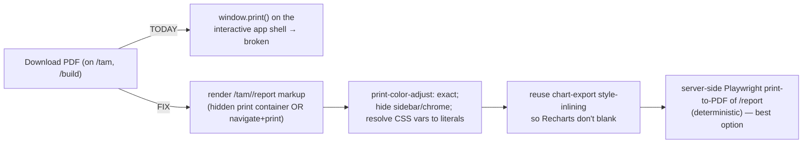
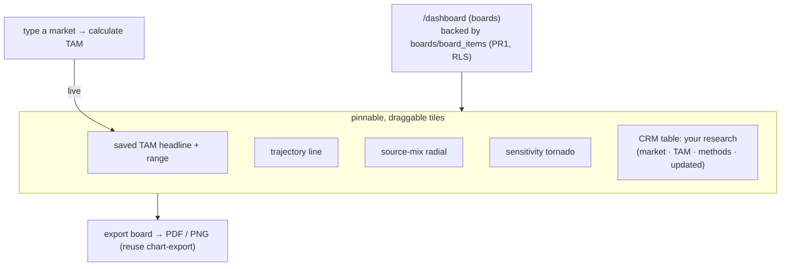

# Charts & Dashboards (PR 3 plan)

Goal: **Gartner-grade, provenance-forward** charts and a real dashboard — "open a board,
type a market, watch graphs generate, download a clean PDF" — built **within** the existing
system, not a rewrite.

## What already exists (reuse, don't reinvent)

- `web/src/components/ui/chart.tsx` — the **shadcn Recharts wrapper** (`ChartContainer`,
  `ChartConfig`, `ChartTooltip`, `ChartTooltipContent`). This is the same primitive as the
  pasted shadcn blocks (interactive line, radar-dots, radial-label). We build on it.
- Tokens in `globals.css`: `--chart-1..6` (alias accent + tier hues), `--chart-lens-*` (cool
  lens family). Light/dark parity. **Numbers use tabular Geist Mono.**
- Live charts: `TornadoChart` (sensitivity), `CompositionChart`, `ScenarioComparisonChart`,
  `TamTrajectoryChart`, `ConvergenceBanner`, `IndependenceDonut`, `DisagreementBar`,
  `TierSparkline`. Export: `lib/chart-export.ts` (PNG/SVG, style-inlining).

## The chart-system contract (impeccable-governed)

Every chart, new or upgraded, carries:

1. **A frame**: title + subtitle + **source-footnote** ("source: BLS OEWS 41-4012, 2024").
   Analyst charts always name the source on the chart.
2. **Axes with titles + units** (today Tornado/ResolveResult hide the X axis — fix).
3. **Tabular-mono numerals** for every value/tick/label.
4. **Colour means one thing**: tier ramp (`--chart-2..6`) for *provenance/source* series;
   `--chart-lens-*` cool family for *lens/method* series. Never cross. (Fixes
   `ResolveResultChart`'s hardcoded hex, which currently colours lenses with tier green.)
5. **`prefers-reduced-motion`** alternative for any entrance/transition; visible focus.
6. **No bans**: no gradient fills, no glassmorphism, flat elevation, card radius ≤16px.

## New / upgraded chart blocks (shadcn patterns, tokenized)

| Block | shadcn pattern | Strata use | Series colour |
|---|---|---|---|
| **Trajectory line** (interactive) | `ChartLineInteractive` | TAM-over-time per as_of cutoff; toggle scenarios | lens family |
| **Method radar** | `ChartRadarDots` | per-lens method coverage / role completeness across a concept | lens family |
| **Source-mix radial** | `ChartRadialLabel` | share of a TAM's inputs by **source tier** (regulator/aggregator/analyst…) | **tier ramp** |
| **Sensitivity tornado** (upgrade) | horizontal bars | which assumption moves the answer; add axis + on-bar deltas; fix overflow | neutral + accent |
| **Composition / waterfall** (upgrade) | stacked/step bars | how the multiplicative inputs build to TAM | tier ramp (by input provenance) |
| **Disagreement spread** (upgrade) | range bar | "lower $X · higher $Y · N× apart" — Principle #2 made visual | lens family (per method) |

Interactive-line header pattern (from the pasted block) — the per-series toggle with a
big tabular-mono total — is the right header for the trajectory and composition charts.

## Export / PDF (the "garbage PDF" fix)

Also: fix `downloadMarkdown` `revokeObjectURL` race (defer it); de-dupe the two copies
(`TamDetailView` + `BuildWorkspace`); **add a Sources/provenance section to `tamToMarkdown`**
(input · value · tier · real source_url · snapshot) — today markdown omits sources entirely.

## Dashboards-as-a-service

The CRM table tile is the "open dashboard, see all my research" surface; "type → calculate
→ watch graphs" reuses PR2's Build Studio progressive reveal, then pins the result to a board.

## Build order (redesign fix-priority)

1. Tokenize `ResolveResultChart` hex → `--chart-lens-*` (kill the tier/lens colour collision).
2. Chart-frame primitive (title/subtitle/source-footnote/axis) on top of `ui/chart.tsx`.
3. Upgrade Tornado + Composition (axes, deltas, overflow fix).
4. New blocks: trajectory line, source-mix radial, method radar.
5. Export/PDF rewrite (report-target + server-side print; markdown sources).
6. `/dashboard` boards surface + CRM tile + pin/export.
7. Loading/empty/error states; reduced-motion + focus pass; a11y contrast verify.
