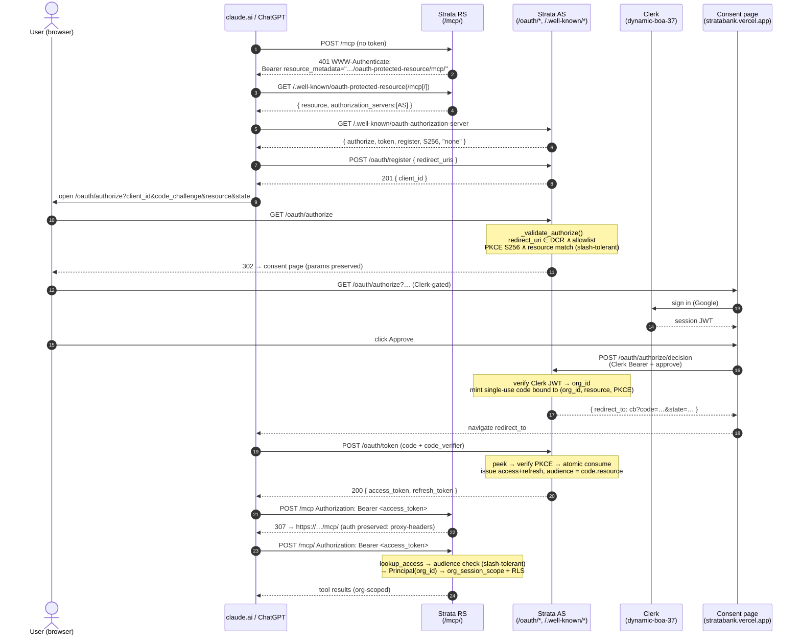
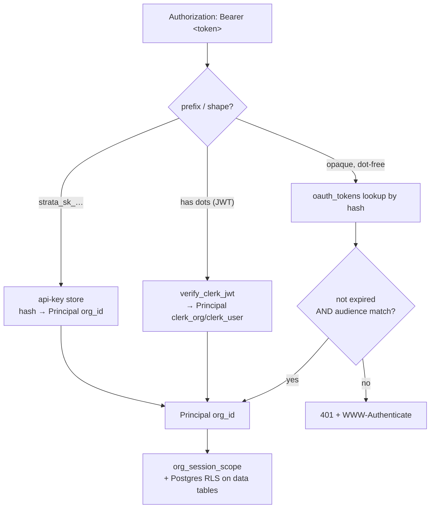
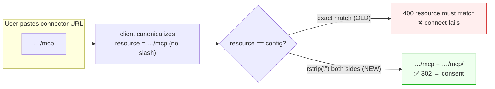

# Strata MCP OAuth 2.1 Connector — flow diagrams

How a browser connector (claude.ai web · ChatGPT) connects to the hosted Strata
MCP server at `/mcp/` with **one click**, using the co-hosted OAuth 2.1
Authorization Server (PR #125). Identity reuses Clerk; the issued opaque token
maps to the same `org_id` the API-key + RLS path uses.

- **Backend (Resource Server + Authorization Server):** `https://strata-api-production-9740.up.railway.app`
- **Frontend (Clerk-gated consent page):** `https://stratabank.vercel.app/oauth/authorize`
- **Spec basis:** MCP Authorization rev 2025-06-18 (OAuth 2.1 + RFC 8414 + 7591 + 9728 + 8707 + PKCE S256)

---

## 1. One-click connect sequence

---

## 2. Three additive bearer branches at the Resource Server

`/mcp/` always requires auth. The OAuth branch is **additive** — the existing
`strata_sk_` key and Clerk-JWT paths are untouched.

The audience check (`row.resource.rstrip("/") == settings.mcp_resource_url.rstrip("/")`)
is the RFC 8707 binding — a token minted for a different resource never
authenticates here.

---

## 3. The trailing-slash interop fix (why the live connect 400'd)

claude.ai/ChatGPT canonicalize the pasted connector URL and send the RFC 8707
`resource` indicator **without** the trailing slash, even though the transport
is mounted at `/mcp/`. An exact-match audience check rejected it.

`rstrip("/")` collapses only `…/mcp` ≡ `…/mcp/` ≡ `…/mcp//` (all the same mounted
transport — one 307s to the other on https, so auth is preserved). It never
touches the host, scheme, or interior path, so genuinely-distinct resources
still compare unequal. Normalization is applied symmetrically at **mint**
(`oauth.py` `_validate_authorize`) and **acceptance** (`mcp_auth.py`), so no
token minted for a different resource becomes acceptable.

---

## Prod configuration (env)

| Var (Railway) | Value | Role |
|---|---|---|
| `STRATA_OAUTH_ISSUER` | `https://strata-api-production-9740.up.railway.app` | AS issuer (no path) |
| `STRATA_MCP_RESOURCE_URL` | `https://strata-api-production-9740.up.railway.app/mcp` | RFC 8707 audience (slash-tolerant) |
| `STRATA_OAUTH_CONSENT_URL` | `https://stratabank.vercel.app/oauth/authorize` | Clerk-gated consent page |
| `STRATA_CLERK_JWKS_URL` | `https://dynamic-boa-37.clerk.accounts.dev/.well-known/jwks.json` | consent-decision JWT verify |

> The web app's Clerk publishable key (`pk_test_…dynamic-boa-37…`) and the
> backend JWKS point at the **same** Clerk (dev) instance, so the consent
> decision verifies and the flow completes. Swap both to a `pk_live_` prod
> Clerk instance before exposing to real customers.

## Connect (claude.ai / ChatGPT)

1. Settings → Connectors → **Add custom connector**
2. URL: `https://strata-api-production-9740.up.railway.app/mcp/`
3. OAuth runs automatically → Strata consent screen → sign in (Google) → **Approve**
4. Verify with the `whoami` tool (returns your org).
