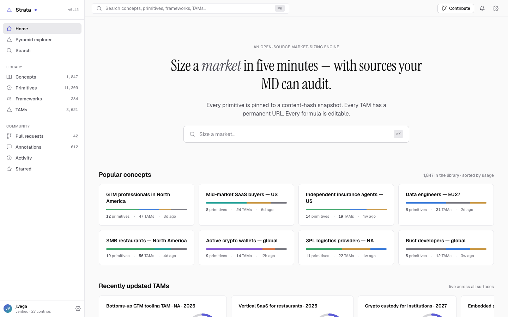

# Strata — Component Catalog (v0.42 mockup)

Annotated tour of every component in `Strata Design - Standalone.html`. Screenshots in
[`./captures/`](./captures/). Token names refer to [`brand-kit.md`](brand-kit.md).

The mockup is one Vue SPA bundling Vue + d3 + Inter Variable + Geist + Instrument Serif.
All assets are inlined into a single 7.9MB self-extracting HTML for portability —
open it in any browser, no server needed.

---

## App shell

Two-column layout: a 240px left **sidebar** (`--sidebar-w`) and a single fluid **main column**.
The main column has a 48px **top bar** (`--topbar-h`) docked above a scrollable content area.
There is no global header — branding lives in the sidebar.

### Sidebar — `captures/02-sidebar.png`

Three semantic groups, each separated by a `--type-eyebrow` label:

1. **Top nav** (no label) — `Home`, `Pyramid explorer`, `Search`.
2. **LIBRARY** — `Concepts (1,847)`, `Primitives (11,309)`, `Frameworks (284)`, `TAMs (3,621)`.
   Counts are right-aligned `--type-mono-sm` in `--fg-3`.
3. **COMMUNITY** — `Pull requests (42)`, `Annotations (612)`, `Activity`, `Starred`.

Selected item: filled with `--accent-tint`, left-edge accent bar, icon and label switch to `--fg-1`.

Top: wordmark `Strata` (Instrument Serif italic) + small accent dot + `v0.42` chip in `--font-mono` `--fs-11` `--fg-3`.
Bottom: avatar `JV` initials chip → `j.vega` + `verified · 27 contribs` line + a settings cog.

### Top bar — `captures/03-topbar.png`

- Left: a **search trigger** (not an input — clicking opens the ⌘K palette). `Search concepts, primitives, frameworks, TAMs…` placeholder + a kbd `⌘K` chip on the right.
- Right: primary `Contribute` button (`--accent` filled), bell-icon notifications, settings cog.

The `Contribute` button uses the git-fork glyph — language is intentionally GitHub-coded ("Pull requests", "Fork concept", "Contribute") because the product positions as "GitHub for TAM".

---

## Home — `captures/01-home-fullpage.png`, `captures/07-home-bottom.png`

### Hero — `captures/04-hero.png`

- Eyebrow: `AN OPEN-SOURCE MARKET-SIZING ENGINE` (`--type-eyebrow`, `--fg-3`).
- H1 in `--type-display` (Instrument Serif 48px). The word **market** is italicised inline for editorial flavour.
- Sub: `Every primitive is pinned to a content-hash snapshot. Every TAM has a permanent URL. Every formula is editable.` This is the product's three-promise pitch — keep verbatim.
- A second, larger search input ("Size a market…" with ⌘K chip) — visually identical to the top-bar trigger but the entry point most users will reach for first.

### Popular concepts — `captures/05-popular-concepts.png`

Section header `Popular concepts` (h2) with right-aligned count: `1,847 in the library · sorted by usage`.

A 4-column grid of **concept cards**:
- Title in `--type-h4` / `--fg-1`.
- A stacked horizontal bar ("usage spectrum") with segments coloured by source-tier mix.
- Footer row: `12 primitives · 47 TAMs · 3d ago`, dot separators in `--fg-4`.

Card surface: `--bg-1`, `--border-1` hairline, `--r-3` radius, `--shadow-pop` on hover.

### Recently updated TAMs — `captures/06-recent-tams.png`

Same 4-column grid, different card body — see **TAM card** below.

### Pyramid CTA

A wide ghost card with the pitch line in `--type-display` italic and a primary `Explore the pyramid →` button.

### Stats footer

Four stat blocks at the bottom: `CONTRIBUTORS 3,412 · PRIMITIVES 11,309 · TAMS BUILT 3,621 · CITED IN MEMOS 847`. Eyebrow + `--type-mono-num` (`600 32px Geist Mono`). This is the "trust" footer.

---

## Pyramid explorer — `captures/08-pyramid-explorer.png`

The product's heart. Three-pane layout under the standard top bar.

### Axis filter chip-bar (top of pane)

Pills grouped by axis dimension, separated by gaps:
- **GEO**: `NORTH AMERICA` (selected, `--accent-tint` fill) · `EU` · `GLOBAL`
- **YEARS**: `2026` (selected) · `2025` · `2030`
- **STAGE**: `WEDGE` (selected) · `ADJACENT` · `PLATFORM`

Right-aligned: `Filters` and `Layers` outline buttons. Chips use `--r-round`, `--type-mono-sm`, uppercase.

### Canvas — `captures/09-pyramid-canvas.png`

A dotted-grid d3 canvas. Five nodes plus the TAM apex, drawn as three converging legs:

- Apex: **TAM** node, `--accent` filled circle, label `RESULTING TAM $8.24B` above in `--type-display` italic.
- Mid row (one per axis): `Decision-maker`, `Seats × ACV`, `Sales SaaS` — outline circles, axis-coloured stroke.
- Base row: `Buyer persona` (Qualitative, grey), `Seats` (Quantitative, indigo — selected, filled ring), `GTM tooling` (Industry, ochre).
- Axis labels at the very bottom: `QUALITATIVE` `QUANTITATIVE` `INDUSTRY` in the respective axis colours.

Below the canvas, a four-cell **primitive ribbon** shows the actual numbers feeding the selected base node:
| Source | Tier | Value | As-of |
|---|---|---|---|
| BLS OEWS | REGU. (green) | 6,400,000 | May 2024 |
| LinkedIn Talent Insights | FIRS. (indigo) | 7,210,000 | 2025-08 |
| Gartner CSO Survey | ANAL. (ochre) | 5,800,000 | 2025-Q1 |
| Census ACS | (community) | 6,180,000 | 2024 |

### Right rail — `captures/10-pyramid-rightpanel.png`

- **RESULTING TAM** card: `MID` label, `$8.24B` in `--type-mono-num`, range `$2.1B - $14.6B · 5 leaves` in `--type-body-sm`. To the right, a **donut gauge** showing `0.71` `INDEPENDENCE` in indigo on a grey track. Below: primary CTA `Open this TAM →`.
- **COMPATIBLE FRAMEWORKS** list — ranked by match score (e.g. `0.94`):
  - `seats × ACV × penetration` · subtitle `seats × $/seat × pen` · `BOTTOMS-UP` chip · `used 47×` meta.
  - `adj. comparable × share-of-wallet` · `Σ comp_i × share_i` · `COMPARABLE` chip · `used 23×`.
  - `spend per FTE × FTEs` · `spend/FTE × FTE` · `TOP-DOWN-SPEND` chip · `used 16×`.
  - `analog-penetration · CRM` · `analog × decay(t)` · `ANALOG-PENETRATION` chip · `used 12×`.
- **SELECTED SEGMENT** info: `Seats · quantitative axis` heading + `318 primitives across 4 source tiers · last refresh 2025-09-14`.

---

## Concept detail — `captures/11-concepts.png`

The detail page for one primitive concept (e.g. `GTM professionals in North America`).

- Breadcrumb (`--type-mono-sm`, `--fg-3`): `Concepts › Labor markets › GTM professionals`.
- H1 in `--type-display`, with the region (`in North America`) italicised inline.
- Lede paragraph (`--type-body`, `--fg-2`).
- Metadata strip: `AS-OF`, `GEO`, `MEASUREMENTS`, `TAMS BUILT`, `LAST REVISED` — each is an eyebrow over a mono number.
- Action bar: `Build a TAM` (primary), `Fork concept`, `Star`, `Version history`, `Cite` (all ghost buttons).

### "Disagreement view"

A horizontal stacked-bar chart with one row per source, each bar tinted by tier (`--tier-*`). Header strip: `STACKED · TABLE · TIME SERIES` (segmented toggle).
Subtitle: `6 measurements · 1.41M spread · σ/μ = 0.08`. Below the chart, the same data as a table with `SOURCE · TIER · VALUE · RANGE · AS-OF` columns.

### Right rail
- **TAMS BUILT USING THIS CONCEPT** — list of TAMs with their Independence score on the right (`0.71`, `0.62`, `0.55`).
- **SIBLING CONCEPTS** — `SDR / BDR — NA`, `RevOps practitioners — NA`, `Customer Success — NA`.
- **PARENT CONCEPT** — `Knowledge workers — NA`.
- **TOP CONTRIBUTORS** — avatar list with edit counts.

(The mockup reuses this detail page for the `Primitives`, `Frameworks`, `TAMs`, and `Community` sidebar entries — see captures 11–17. The route placeholders signal that those library pages exist but ship the same detail surface until each gets a dedicated mock.)

---

## TAM detail — `captures/19-tam-detail.png`

The most opinionated page in the product. Reached by clicking any TAM card.

- Breadcrumb: `TAMs › GTM tooling › 3f7a9c8e` (last segment is the content-hash short SHA).
- H1: `Bottoms-up GTM tooling TAM for North America, 2026`.
- Chips strip: `GEO NORTH AMERICA · 2026 · STAGE WEDGE · USD NOMINAL`.
- Byline: `by j.vega · 2025-09-14 · forked from 7a3ff001b`.
- Permalink row (top-right): `strata.io/tam` · `3f7a9c8e` mono chip · `Copy` button. This is the "permanent URL" promise rendered.
- Action bar: `Export`, `Fork`, `Cite`, `History · 8 revisions`, `4 annotations`.

### Provenance banner

Yellow `--warning`-tinted banner with text-warning ink:

> 2 of 12 inputs are community-tier. The "wide · embedded" leaf uses a synthetic agent-led-GTM multiplier — review before citing externally.

This is non-dismissable — provenance hygiene is a product principle.

### Mid scenario card

- Eyebrow `MID SCENARIO` → headline `$8.24B` in `--type-mono-num`.
- Subtitle: `$2.10B - $14.60B · 5 leaves · ~7× spread`.
- Method-family chips inline: `BOTTOMS-UP-SEATS · COMPARABLE-REVENUE · VALUE-CHAIN`.
- Right: large Independence donut (`0.71`, same gauge component as pyramid right-rail).

### Scenario tree

A horizontal "definitional choice" tree. Each leaf node is a card containing:
- Title (e.g. `Narrow · pure-play CRM only`)
- Method-family tag and weight (`BOTTOMS-UP · WEIGHT 0.10`)
- Computed value (`$2.10B`)

The midline (highlighted) is `Mid · GTM tooling, all categories — $8.24B`. Leaf cards trace back to a single `DEFINITIONAL CHOICE` parent (`GTM tooling scope`).

### Right rail
- **METHOD FAMILIES USED** — chip cluster.
- **SOURCE TIER MIX** — stacked horizontal bar + legend with %: `Regulator 35 · First Party 25 · Analyst 15 · Aggregator 10 · Community 15`. Tier swatches use the §1.6 palette.
- **ANNOTATIONS · 4** — list of expert annotations with author chip + relative time.
- **EXPORT** — `PDF · Markdown` (plus implied API).

---

## ⌘K command palette — `captures/18-search-modal.png`

Triggered by `⌘K`, the search trigger, or clicking the hero search input.

- Centered modal, `--bg-1`, `--shadow-overlay`, `--r-3`, max-width ~520px.
- Search input with magnifying-glass icon, placeholder `Jump to concepts, primitives, frameworks, TAMs…`, `esc` chip on the right.
- Grouped result list with eyebrow section headers:
  - **RECENT** — recently visited entities, with type-tag on the right (`CONCEPT`, `TAM`).
  - **CONCEPTS** — name + measurement count.
  - **FRAMEWORKS** — name + framework family chip.
- Arrow-key navigation; selected row uses `--accent-tint`.

This is the universal navigator — search by name, by tag, by hash. There is no top-of-page "browse" — the palette IS the directory.

---

## Component primitives reference

| Component | Tokens | Where to see it |
|---|---|---|
| **Card** | `--bg-1`, `--border-1`, `--r-3`, `--shadow-pop` on hover | Home concept/TAM grids, scenario tree leaves |
| **Primary button** | `--accent` fill, `--accent-hover`, `--r-3`, `--type-body` semibold | `Contribute`, `Open this TAM`, `Build a TAM`, `Explore the pyramid` |
| **Ghost button** | `--border-2` outline, transparent fill, `--fg-1` text | `Fork concept`, `Cite`, `Version history` |
| **Chip / pill** | `--r-round`, `--type-mono-sm`, padded 6–10px | Axis filters, geo/year/stage |
| **Tier badge** | `--r-1`, `--type-eyebrow`, tier-tint background + tier solid dot | Source rows, scenario leaves |
| **Independence donut** | SVG ring, accent stroke on `--border-1` track, mono-num center | Pyramid right rail, TAM detail |
| **Disagreement bar** | Tier-coloured stacked segments, `--type-mono-sm` value labels | Concept detail |
| **Stat block** | `--type-eyebrow` label + `--type-mono-num` value | Home stats footer, concept metadata strip |
| **Eyebrow** | `--type-eyebrow`, uppercase, `--fg-3` | Section labels throughout |

## What this catalog deliberately does not cover

- **Light/dark fork** — the CSS has a `[data-theme="light"]` hook with no rules; treat as todo.
- **Empty states** — no zero-data screens captured. Add when the data layer lands.
- **Mobile breakpoints** — the mockup is designed at 1440×900. Responsive rules need a separate pass.
- **Auth & onboarding** — out of scope for this mock.

Update this doc alongside any new mockup so screenshots, tokens and components stay in lock-step.
