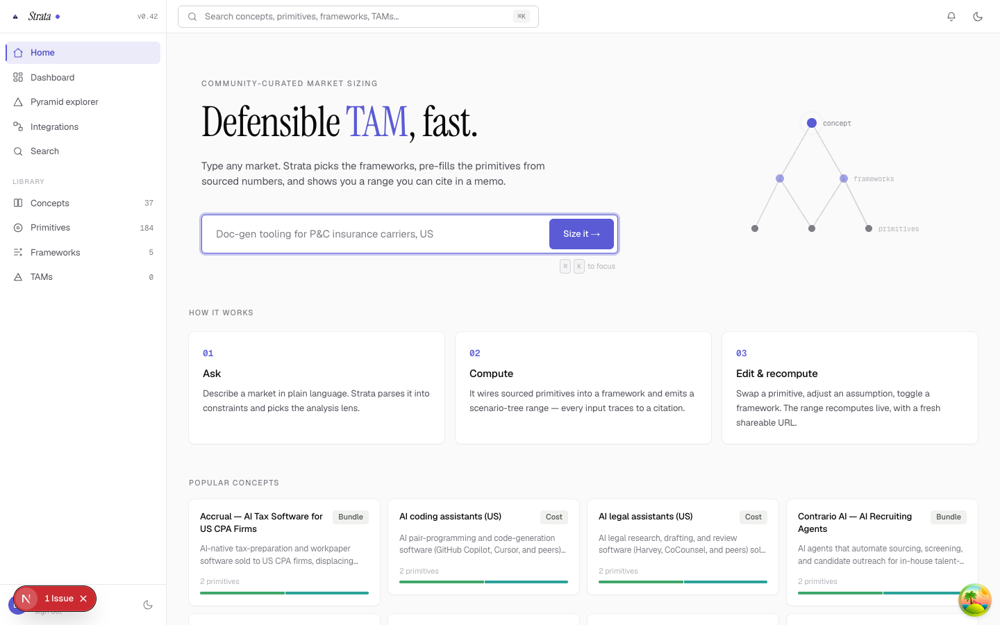
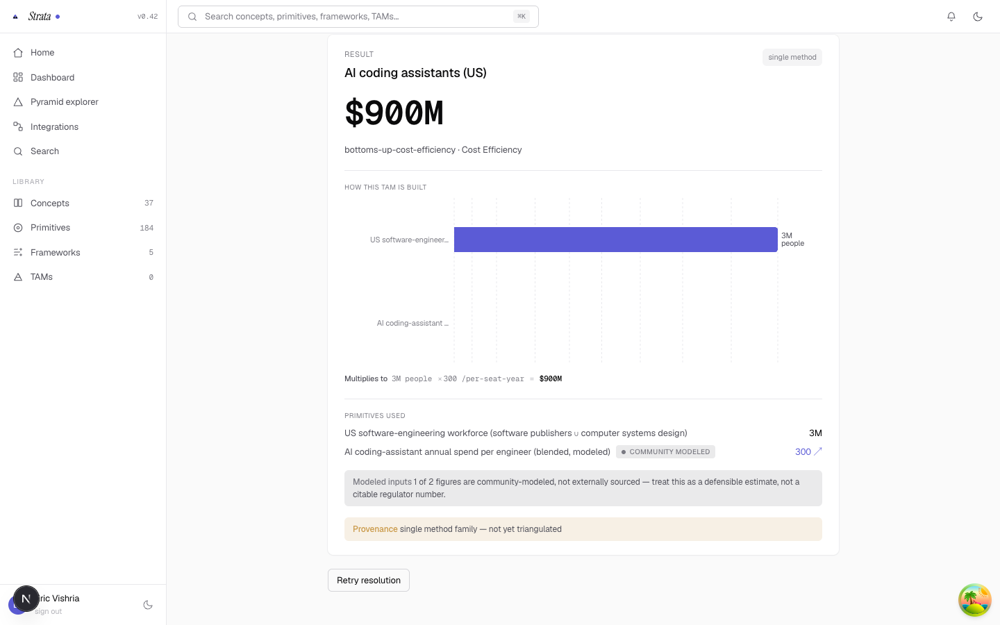
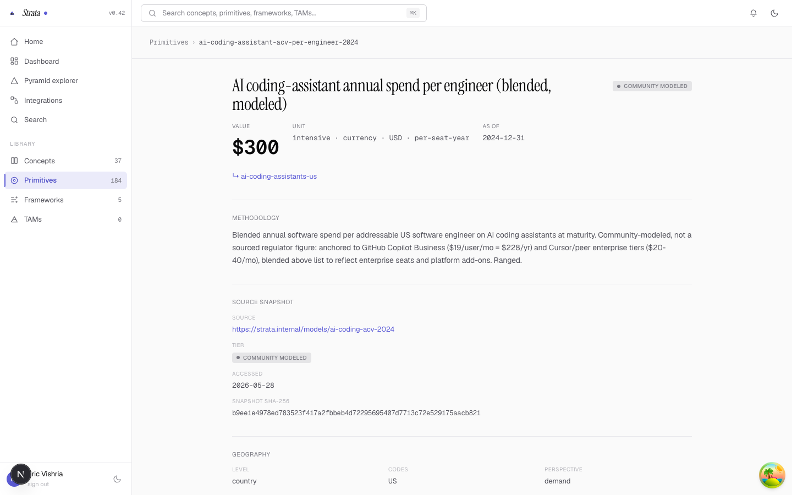
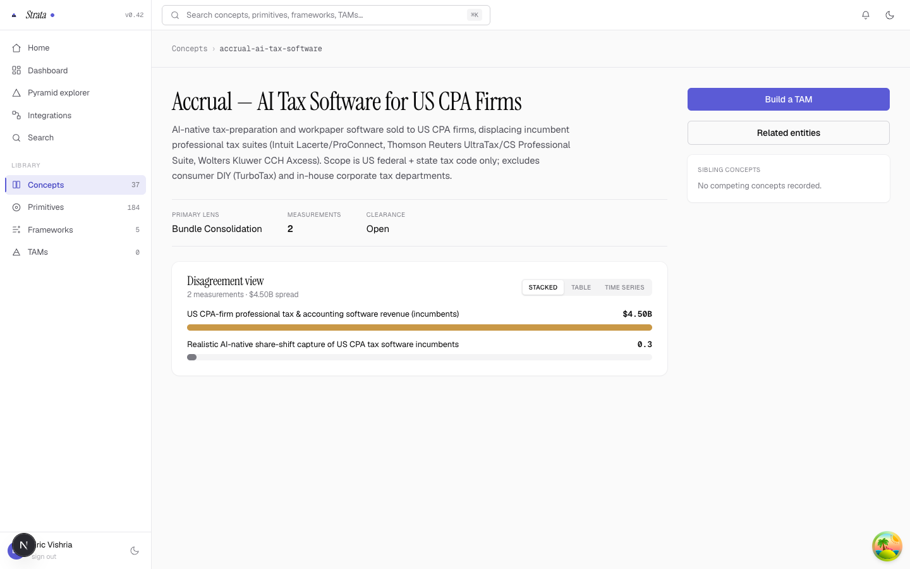
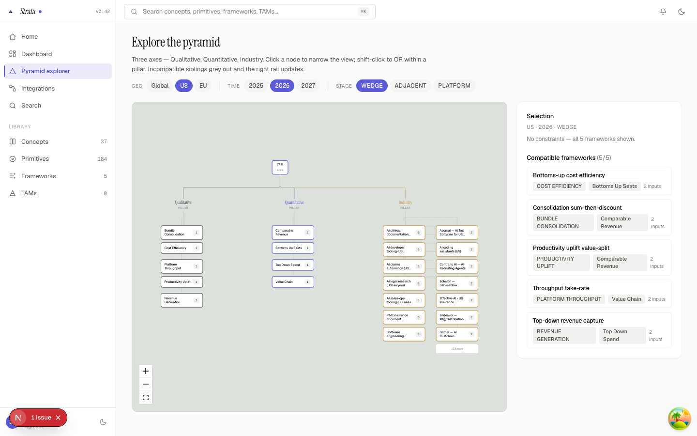
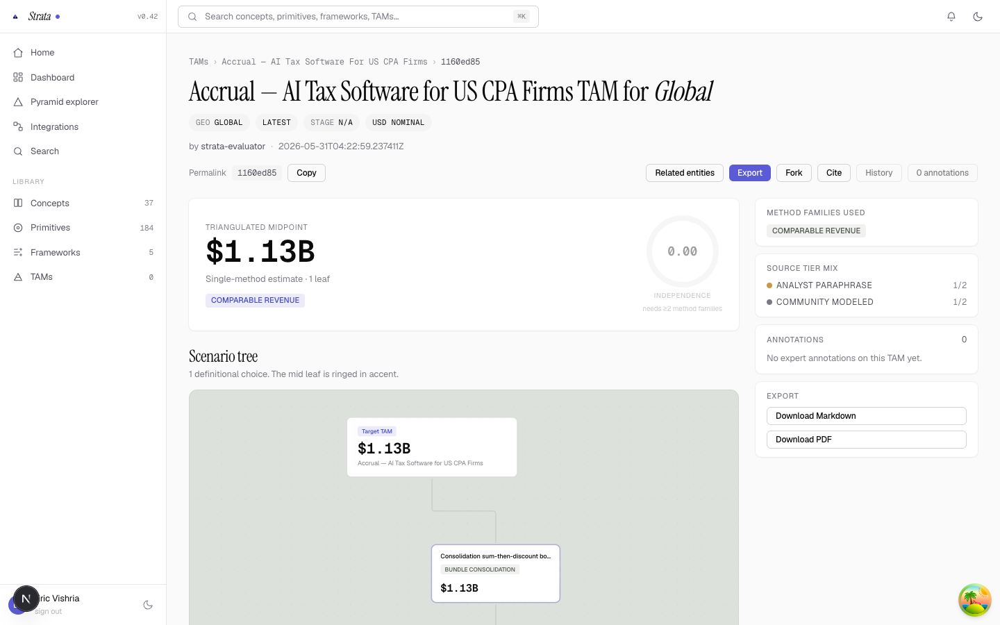
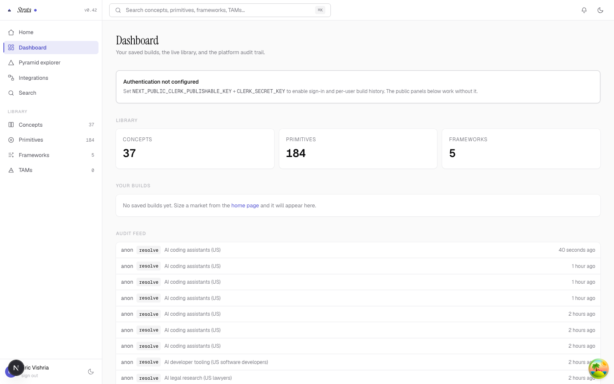
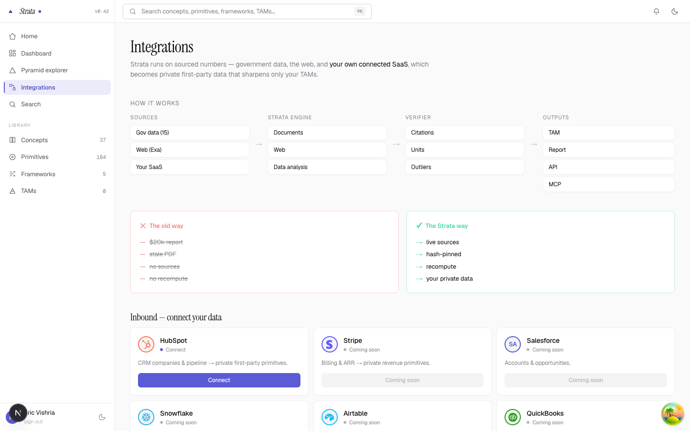
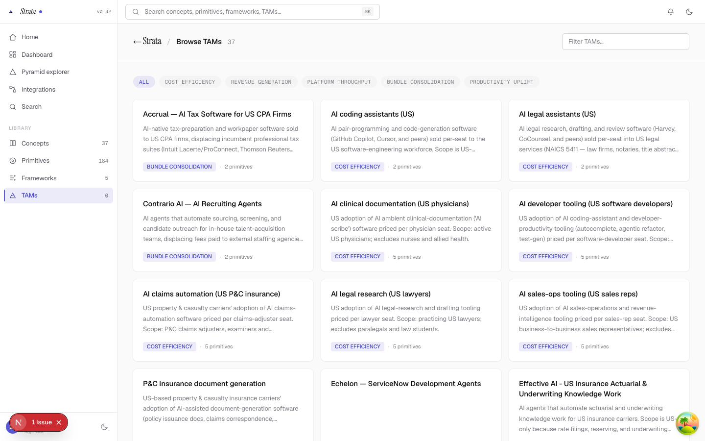

# Strata — Client Platform Guide

> The customer-facing walkthrough. The same content renders in-app at **`/guides`**
> (sidebar → Guides). Screenshots live in `web/public/guides/` and are captured
> from the live app. Engineer-facing companion: [`14-platform-walkthrough.md`](../14-platform-walkthrough.md).

## What is Strata?

Strata turns a one-line market description into a **defensible TAM** — a market
size you can put in an investment memo and defend in a partner meeting. It
replaces a $30k analyst report, and it beats five minutes of an LLM chat, because
every number is sourced, the math is shown, and the result is reproducible.

### Why this beats an LLM answer

| | 5 minutes of an LLM chat | **Strata** |
|---|---|---|
| Numbers | Plausible prose, often unsourced | Every input is a sourced primitive: URL + tier + sha256 snapshot |
| Reproducible | Re-run → a different answer | Hash-pinned `/tam/<id>` — frozen, citable, shareable forever |
| The math | Black-box "≈ $X B" | Explicit equation: workforce × spend = TAM, every factor clickable |
| Defensible | Can't defend to an IC/LP | Triangulation across ≥2 method families + independence score |
| Your data | Can't ingest | OAuth CRM connectors → org-scoped private primitives feed your TAM |
| Honesty | Hides modeled assumptions | Loud banner when any input is modeled vs externally sourced |

## Walkthrough

### 01 · First impression — describe a market in plain language
Type a market (“AI coding assistants for software developers, US”). Strata picks
the framework, pre-fills sourced primitives, and returns a citable range. The
left rail is your live library (Concepts / Primitives / Frameworks).

### 02 · Build your own TAM — see the math
The result shows the input bars **and** the explicit equation —
“Multiplies to 3M people × $300/seat-year = $900M”. Each input shows its source
tier; modeled inputs get an honesty banner so the headline is never mistaken for
a regulator citation.

### 03 · Every number is sourced
Each primitive has a page: value, structured unit, methodology, and a hash-pinned
**Source Snapshot** (URL + tier + content hash). Re-runs reproduce the number.

### 04 · Competing measurements
A concept is first-class: multiple sourced estimates attach to it, and the
disagreement is shown — see the spread instead of trusting one opaque figure.

### 05 · Explore the pyramid
The map of the data bank — filter by geo / time / stage, click a node to see
which frameworks can size it.

### 06 · The shareable artifact
Every TAM gets a permanent `/tam/<hash>` URL that resolves forever (survives
restarts). Shows the range, scenario tree, **source-tier mix**, **sensitivity
tornado**, and Markdown / PDF export.

### 07 · Your workspace
A simple sign-in attributes your saved TAMs and activity; the dashboard is your
home base with an audit trail of every resolve/recompute.

### 08 · Connect your data
Connect a CRM (e.g. HubSpot) → private, org-scoped first-party primitives,
isolated to your tenant and fed into the same evaluator with a private banner.

### 09 · Browse promoted TAMs
A public registry of promoted, defensible TAMs you can fork and adapt.

## Live today vs. coming soon

**Live:** free-form query → sourced TAM with the equation; hash-pinned shareable
`/tam/<id>` (survives restarts); source-tier mix + sensitivity tornado +
Markdown/PDF export; simple sign-in; pyramid explorer; concept disagreement view.

**Coming soon:** live CRM (HubSpot) sync (gallery wired, OAuth pilot in
progress); triangulated hero concepts with competing measurements; deeper
verticals (e.g. semiconductor value chain); metered micropayments & team
workspaces.

## Page reference

| Page | URL |
|---|---|
| Home / query | `/` |
| Build a TAM | `/build?q=<market>` |
| Frozen artifact | `/tam/<hash>` |
| Concept / Primitive / Framework | `/c/<slug>` · `/p/<slug>` · `/f/<slug>` |
| Pyramid explorer | `/graph` |
| Browse promoted TAMs | `/browse` |
| Integrations | `/integrations` |
| Dashboard | `/dashboard` |
| This guide | `/guides` |

## Appendix — how this guide was built

- **Captured:** 2026-05-30, from the live app on `http://localhost:3008` (branch
  `feat/guides-logins-sections-2026-05-30`), signed in as a demo analyst.
- **Method:** the `playwright-doc-generator` skill driving `playwright-cli` at a
  1440×900 viewport; screenshots written to `web/public/guides/NN-*.png`.
- **To replace a stale screenshot:** `playwright-cli resize 1440 900`, then
  `playwright-cli goto http://localhost:3008/<route>` and
  `playwright-cli screenshot --filename=web/public/guides/NN-name.png` (overwrite
  the same numbered file). The in-app `/guides` page and this handbook both read
  from that directory.
