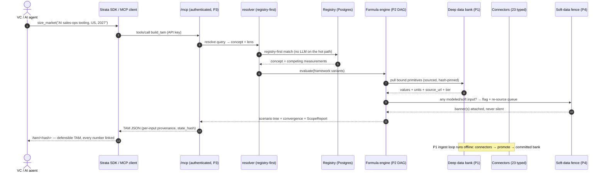
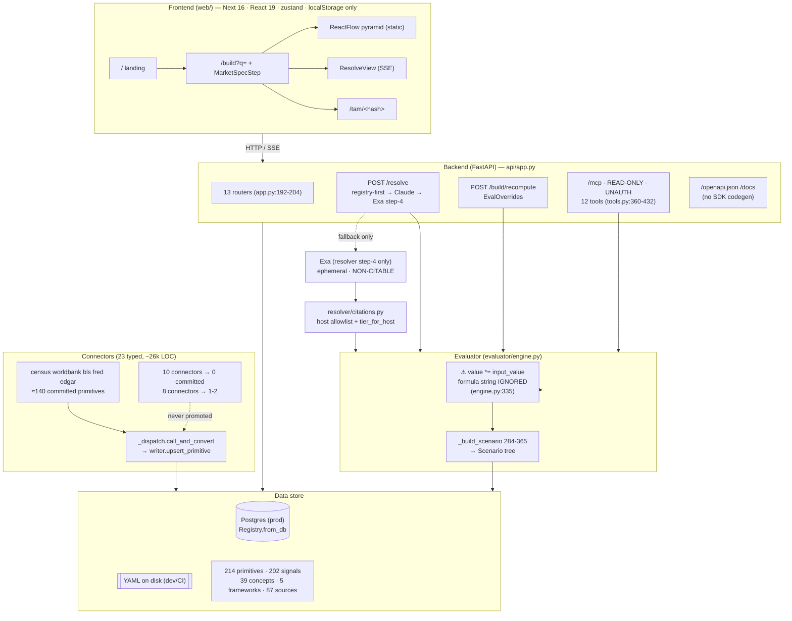
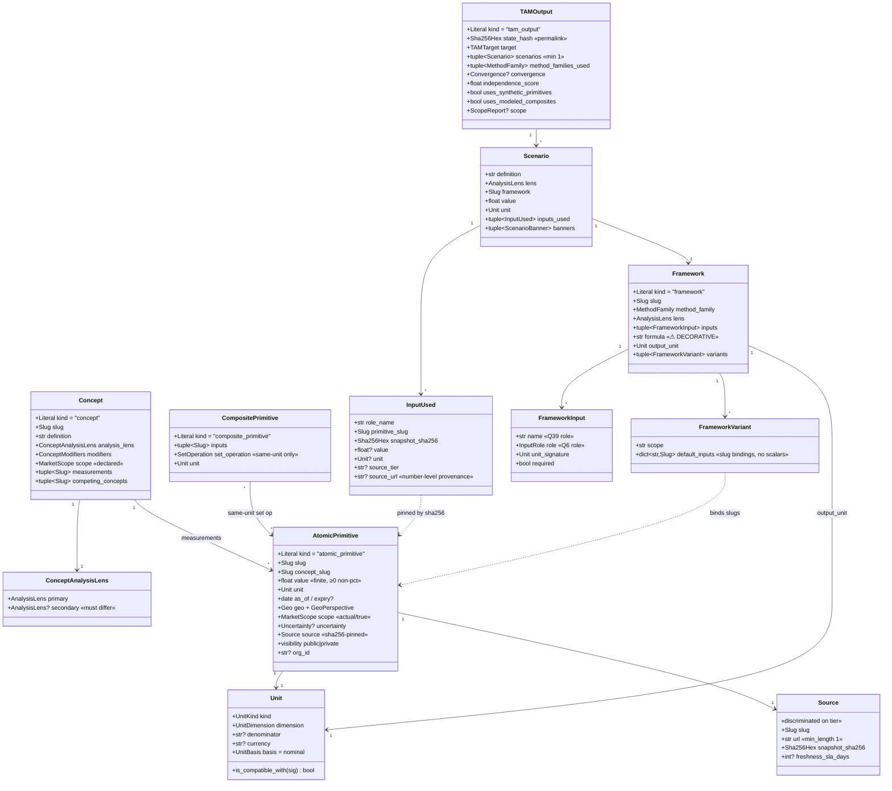
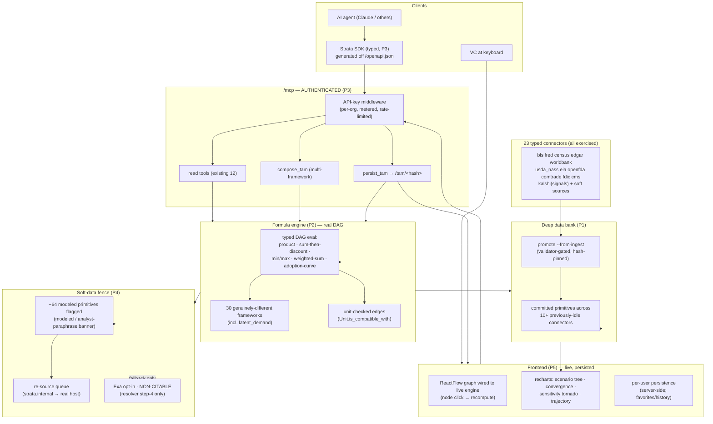
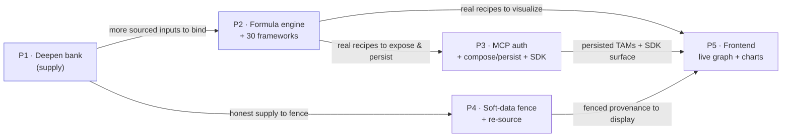
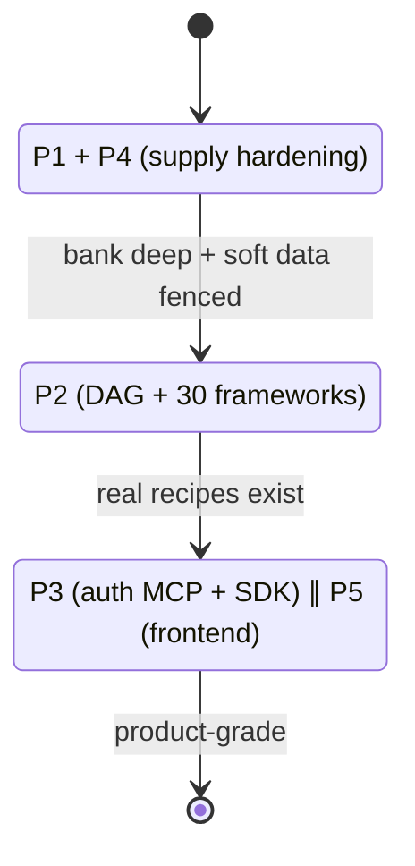
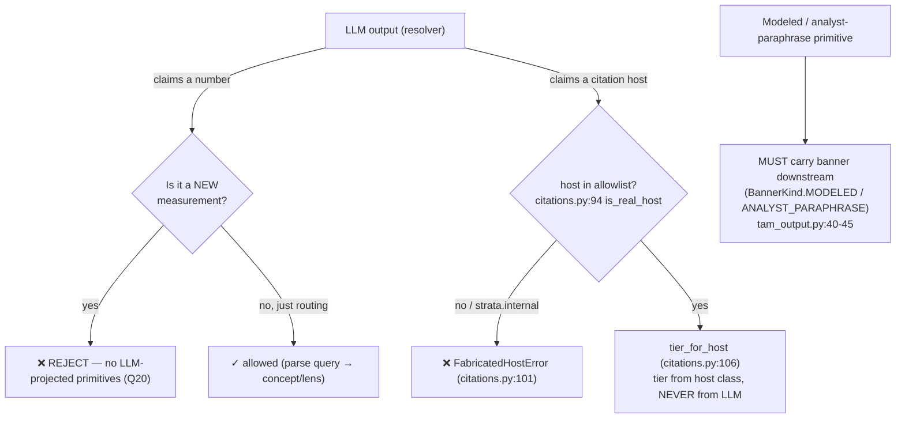
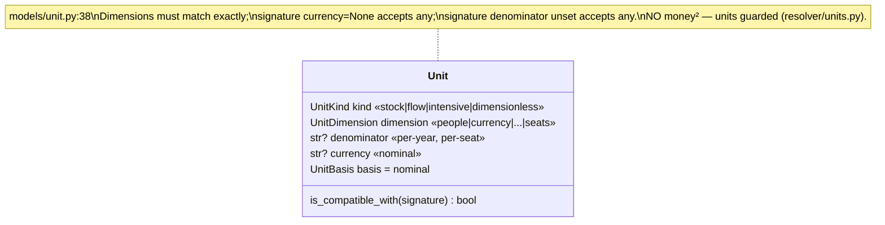
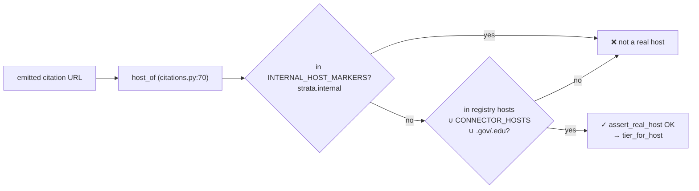

# 00 · Master Architecture Spec — "The Plaid for AI Agents"

> Strata five-phase initiative · OVERVIEW (ties together specs `01`–`05`)
> Status: **planning** · Owner: Arkash Jain (`arkash@benmore.tech`) · Codename **Strata**
> Audience: engineers building the phases + future-me. This is a **spec, not code.**

This document is the load-bearing index for the whole initiative. The five phase
specs (`docs/plans/01..05`) carry the executable detail; this one carries the
*shape*: the vision, the current system, the target system, the dependency
ordering, the cross-cutting invariants that every phase must not break, and the
risk/rollback register. Read this first, then the phase you own.

Every figure here is either **traceable to code** (cited `file:line`, verify
before relying on it) or explicitly labelled **illustrative**. Per the project
contract: **don't invent numbers.**

---

## Table of contents

1. [Executive summary + product vision](#1--executive-summary--product-vision)
2. [Current full-system architecture](#2--current-full-system-architecture)
3. [The five-layer data model](#3--the-five-layer-data-model)
4. [Target architecture (after all 5 phases)](#4--target-architecture-after-all-5-phases)
5. [Phase dependency graph + sequencing](#5--phase-dependency-graph--sequencing)
6. [Cross-cutting concerns + invariants](#6--cross-cutting-concerns--invariants)
7. [Glossary](#7--glossary)
8. [Risk register + rollback strategy](#8--risk-register--rollback-strategy)
9. [Phase spec links](#9--phase-spec-links)
10. [Appendix — ground-truth audit table](#10--appendix--ground-truth-audit-table)

---

## 1 · Executive summary + product vision

### 1.1 The thesis

Strata is an open-source, community-curated **market-sizing engine** for VCs and
operators. It replaces IBISWorld / Statista / Gartner-lite reports by exposing the
two primitives those reports hide:

- **PRIMITIVES** — atomic, single-source, reproducible numbers, each pinned to a
  regulator/aggregator API snapshot by `snapshot_sha256`
  (`models/primitive.py:59` `AtomicPrimitive`).
- **FRAMEWORKS** — parameterized recipes (the six analysis *lenses*) that combine
  primitives, unit-crossing, into a **TAM scenario tree** — never a scalar with
  error bars (`models/tam_output.py:137` `TAMOutput`, Q1).

The product wedge for this initiative: **"the Plaid for AI agents."** An AI agent
(or a VC at a keyboard) speaks one protocol — **MCP** — to a sourced, typed,
auditable market-sizing backend, and gets back numbers it can *defend* in a
partner meeting, each one traceable to a `.gov` snapshot.

The five-phase initiative turns the *demo-grade* Strata of today (deep connector
code, shallow committed bank; decorative framework formulas; an unauthenticated
read-only MCP) into the *product-grade* Strata: a **deep sourced bank**, a **real
DAG formula engine**, an **authenticated compose/persist MCP + SDK**, an
**honesty fence** around soft data, and a **live frontend graph**.

### 1.2 The end-to-end story (target state)



The honest contract that runs through every arrow: **a number is never shown
without its source, and a soft/modeled number is never shown without its
fence.** Phases 1 and 4 widen and harden the supply; phase 2 makes the math
real; phase 3 makes the protocol usable by agents; phase 5 makes it legible to
humans.

### 1.3 What each phase delivers (one line each)

| Phase | Name | Wedge | Spec |
|---|---|---|---|
| **P1** | Deepen the data bank | The #1 wedge: turn 23 idle connectors into committed sourced primitives | [`01`](01-deepen-data-bank.md) |
| **P2** | Formula engine + frameworks 6→30 | Replace decorative `formula` with a real DAG evaluator; 30 genuinely-different recipes incl. `latent_demand` | [`02`](02-formula-engine-and-frameworks.md) |
| **P3** | MCP auth + compose/persist + SDK | API-key gate `/mcp`; add compose/persist tools; ship a typed SDK off the published OpenAPI | [`03`](03-mcp-auth-compose-sdk.md) |
| **P4** | Soft-data fence + re-source | Flag the ~64 modeled primitives, queue re-sourcing, keep Exa opt-in/non-citable | [`04`](04-soft-data-fence-and-resource.md) |
| **P5** | Frontend live graph + charts | Wire the ReactFlow graph + recharts to the live engine; persistence story | [`05`](05-frontend-live-graph.md) |

---

## 2 · Current full-system architecture

### 2.1 Canonical ASCII flow (reconciled with `CLAUDE.md`)

The repo `CLAUDE.md` carries an architecture ASCII block. It is **substantially
correct but two figures are stale** and are corrected here (verify before
citing either doc):

- `CLAUDE.md` says *"6 concepts · 307 primitives · 5 frameworks"* in the data-store
  box, and the API description string still hard-codes *"307 atomic primitives"*
  (`api/app.py:115`). **Audit ground truth: 214 sizing primitives · 202 quarantined
  signals · 39 concepts · 5 frameworks · 87 sources.** The `307` string in
  `api/app.py:115` is a **documentation literal**, not a runtime count — P1 should
  refresh it.
- `CLAUDE.md` lists *"15 connectors"* in places and *"23 typed connectors"* in the
  PR-#83 note. **Ground truth: 23 typed connector clients** in
  `backend/src/strata/connectors/` (see [§10](#10--appendix--ground-truth-audit-table)).

Reconciled canonical flow:

```
User / AI agent types a market query
        │
        ▼
┌─ FRONTEND (Next 16 · React 19 · Tailwind 4 · bun · biome) ──────────────┐
│  / (landing)  →  /build?q=  →  PIN MARKET (MarketSpecStep)  →  Size      │
│  In-registry concept → static ReactFlow pyramid graph                    │
│  Not in registry     → ResolveView streams SSE from POST /resolve        │
│  State: localStorage only (zustand) — favorites/identity/build-history   │
│  Clerk keyless/off → NO per-user server persistence (gap, P5)            │
└──────────────────────────────┬───────────────────────────────────────────┘
                               │ HTTP / SSE
┌─ BACKEND (FastAPI · Pydantic v2 · pyright strict) ─────────────────────────┐
│  Routers (api/app.py:192-204): health concepts primitives signals          │
│    frameworks build resolve audit usage integrations connectors            │
│    contribute portfolio                                                     │
│  POST /resolve   → registry-first match → Claude parse → Exa Step-4 only   │
│  POST /build/recompute → EvalOverrides → re-eval → new state_hash          │
│  Evaluator (evaluator/engine.py): multiply all inputs → scenario tree      │
│    ⚠ formula string is DECORATIVE — engine hard-codes value *= input       │
│      (engine.py:335, _build_scenario 284-365). Framework.formula           │
│      (models/framework.py:83) is never parsed.                             │
│  /mcp  → read-only · UNAUTHENTICATED · 12 tools (mcp/tools.py:360-432)      │
│    mounted at api/app.py:206-219; observability middleware SKIPS it        │
│    (api/app.py:177-179 path-prefix exclusion)                              │
│  /openapi.json /docs /redoc fully published (api/app.py:124-127) — no SDK  │
└──────────────────────────────┬───────────────────────────────────────────┘
                               │
┌─ DATA STORE ───────────────────────────────────────────────────────────────┐
│  Prod: Postgres (Registry.from_db, api/app.py:93)                           │
│  Dev/CI: YAML on disk → in-memory Registry (load_registry)                  │
│  214 sizing primitives · 202 quarantined signals · 39 concepts · 5 fw · 87 src │
│  Each primitive: value + structured Unit + Source(sha256-pin) + scope       │
└──────────────────────────────┬───────────────────────────────────────────┘
                               │ populated (OFFLINE) by
┌─ CONNECTORS (ingest) ────────────────────────────────────────────────────────┐
│  23 typed HTTP clients (~26k lines). Only ~5 are committed-bank-deep:         │
│    census · worldbank · bls · fred · edgar ≈ 140 of ~150 connector primitives │
│  10 connectors produced 0 committed primitives (usda_nass kalshi              │
│    alpha_vantage dune nasdaq_data_link github stack_exchange twitter reddit   │
│    yfinance); 8 produced 1-2.                                                 │
│  _dispatch.call_and_convert → writer.upsert_primitive → validator → YAML/DB   │
│  ALL connector API keys present in .env (uv run loads it).                    │
└───────────────────────────────────────────────────────────────────────────────┘
        ▲
        │ ephemeral, guarded, NON-CITABLE
┌─ EXA (resolver Step-4 fallback only) ─────────────────────────────────────────┐
│  resolver/pipeline.py — used only when registry-first + connectors miss.      │
│  Emitted citations pass through resolver/citations.py allowlist guard.        │
└───────────────────────────────────────────────────────────────────────────────┘
```

### 2.2 Current system (mermaid flowchart)



### 2.3 The four structural problems this initiative fixes

1. **Shallow bank.** 23 connectors, ~5 committed-deep. The supply side is mostly
   idle code. → **P1.**
2. **Decorative formulas.** Every framework is 2-input multiplicative; the
   evaluator multiplies regardless of `Framework.formula`
   (`models/framework.py:83` declares it; `evaluator/engine.py:335` ignores it).
   The 6th lens `latent_demand` (`models/_common.py:55`) has *no* framework YAML
   in `data/frameworks/`. → **P2.**
3. **Unauthenticated, read-only MCP.** `/mcp` is mounted without auth
   (`api/app.py:206-219`), skipped by metering (`api/app.py:177-179`); no compose/
   persist; no SDK off the published OpenAPI. → **P3.**
4. **Soft-data leakage.** ~30% of the bank (~64 primitives) is hand-seeded
   community-modeled / analyst-paraphrase YAML, some citing fabricated
   `strata.internal` URLs that bypass the host-allowlist guard (the guard only
   gates the *resolver's emitted* citations — `resolver/citations.py:101` — not
   committed seed YAML). → **P4.**

(And the legibility gap — static graph, no live persistence — is **P5.**)

---

## 3 · The five-layer data model

Locked across `docs/07-data-layer-brainstorm.md` (Q1–Q40). The chain:

```
Concept  ──measured-by──▶  Atomic Primitive  ──bundled-into──▶  Composite Primitive
   │                                                                    │
   │                          consumed-by                               │
   └──────────────────────────────┬─────────────────────────────────────┘
                                  ▼
                              Framework  ──emits──▶  TAM Output (scenario tree)
```

### 3.1 Class diagram (grounded in `models/*.py`)



### 3.2 Entity-relationship view (storage shape)

```mermaid
erDiagram
    CONCEPT ||--o{ ATOMIC_PRIMITIVE : "measured-by (measurements)"
    CONCEPT ||--o| CONCEPT : "competes-with"
    ATOMIC_PRIMITIVE }o--|| SOURCE : "sha256-pinned-to"
    ATOMIC_PRIMITIVE }o--|| UNIT : "carries"
    COMPOSITE_PRIMITIVE }o--o{ ATOMIC_PRIMITIVE : "set-op-over (same unit)"
    FRAMEWORK ||--o{ FRAMEWORK_VARIANT : "has"
    FRAMEWORK_VARIANT }o--o{ ATOMIC_PRIMITIVE : "binds slugs"
    FRAMEWORK ||--o{ TAM_OUTPUT : "emits"
    TAM_OUTPUT ||--|{ SCENARIO : "is-tree-of"
    SCENARIO ||--o{ INPUT_USED : "consumed"
    INPUT_USED }o--|| ATOMIC_PRIMITIVE : "pins"

    CONCEPT {
        slug PK
        analysis_lens_primary enum
        analysis_lens_secondary enum
        market_scope jsonb
    }
    ATOMIC_PRIMITIVE {
        slug PK
        concept_slug FK
        float value
        unit jsonb
        source_tier enum
        snapshot_sha256 string
        visibility enum
        org_id string
    }
    FRAMEWORK {
        slug PK
        method_family enum
        lens enum
        formula string "DECORATIVE today; DAG in P2"
        output_unit jsonb
    }
    TAM_OUTPUT {
        state_hash PK
        independence_score float
        uses_synthetic_primitives bool
        is_promoted bool
    }
```

### 3.3 The six lenses (Q39) and their required roles

The lenses live as `AnalysisLens` (`models/_common.py:23-36`) with
`REQUIRED_PRIMITIVE_ROLES` (`models/_common.py:43-76`). **Five have framework
YAML today; `latent_demand` does not** — P2's headline deliverable.

| Lens | Required roles (`_common.py:43`) | Math shape (target, P2) | Framework today |
|---|---|---|---|
| `cost_efficiency` | persona_pool · addressable_share · replacement_rate · cost_per_persona | product (4-way) | `bottoms_up_cost_efficiency.yaml` (2-input) |
| `revenue_generation` | target_segment_count · spend_per_target · capture_rate | product | `top_down_revenue_capture.yaml` |
| `latent_demand` | addressable_population · adoption_rate_curve · willingness_to_pay | **adoption curve × WTP** | **MISSING — P2 builds it** |
| `platform_throughput` | gmv_or_volume · take_rate · market_share_assumption | product | `throughput_take_rate.yaml` |
| `bundle_consolidation` | tools_displaced · spend_per_tool · consolidation_rate · pricing_discount | **sum-then-discount** | `consolidation_sum_then_discount.yaml` (still multiplies) |
| `productivity_uplift` | persona_count · productivity_gain_pct · value_split_to_vendor | product | `productivity_uplift_value_split.yaml` |

> **The decorative-formula fact, proven:** `consolidation_sum_then_discount.yaml:32`
> declares `formula: "tools_displaced * consolidation_rate"` over 2 inputs, and the
> name promises sum-then-discount — but the evaluator never reads the string; it
> multiplies the bound inputs in order (`evaluator/engine.py:335`). P2 makes the
> formula authoritative via a typed DAG.

---

## 4 · Target architecture (after all 5 phases)



### 4.1 Target ASCII (what changed vs §2.1)

```
            ┌─────────────────────────── DELTAS BY PHASE ───────────────────────────┐
P1  BANK:   ~5 deep connectors ─────────────▶ 10+ exercised, idle connectors promoted
P2  ENGINE: value *= input (decorative) ─────▶ typed DAG: product | sum-then-discount |
                                                min/max | weighted-sum | adoption-curve
            5 frameworks (2-input) ──────────▶ 30 genuinely-different; latent_demand built
P3  MCP:    read-only · UNAUTH · 12 tools ───▶ API-key gated · compose_tam + persist_tam
            OpenAPI published, no SDK ────────▶ typed SDK generated off /openapi.json
P4  FENCE:  64 modeled prims leak silently ──▶ flagged + banner'd + re-source queue;
            strata.internal bypass ──────────▶ resolved or fenced; Exa opt-in/non-citable
P5  FE:     static graph · localStorage ─────▶ live graph wired to engine · charts ·
                                                per-user server persistence
            └────────────────────────────────────────────────────────────────────────┘
```

---

## 5 · Phase dependency graph + sequencing



### 5.1 State machine of the rollout



### 5.2 Sequencing rationale

```
PHASE-LANE TIMELINE (illustrative ordering, not calendar dates)

  lane A (supply) :  ████ P1 ████──────────────────────────────
  lane B (honesty):  ──── P4 ────  (parallel with P1, shares connector/source work)
  lane C (math)   :  ........──── P2 ────────────────  (starts once P1 lands new prims)
  lane D (protocol): ............................──── P3 ────────  (needs P2 recipes)
  lane E (surface):  ............................──── P5 ────────  (needs P2+P3+P4)
```

- **P1 and P4 parallelize.** Both touch the supply side (connectors, sources,
  the host-allowlist guard) but from opposite ends: P1 *adds* genuine sourced
  primitives; P4 *flags/re-sources* the soft ones. They should be coordinated
  (same `writer.py` / `citations.py` surface) but can run on separate branches.
  P1 deepening also *gives P4 honest substitutes* for the worst modeled primitives.
- **P2 depends on P1.** A DAG engine with 30 recipes is only meaningful if there
  are enough sourced primitives to bind the new roles (`latent_demand` needs
  `addressable_population`, `adoption_rate_curve`, `willingness_to_pay`). Start P2
  design in parallel, but lock recipes after P1's first promote wave.
- **P3 depends on P2.** `compose_tam` / `persist_tam` MCP tools and the SDK are
  only worth shipping over a *real* engine; exposing decorative multiplication
  through an authenticated protocol would lock in the wrong contract.
- **P5 depends on P2, P3, P4.** The live graph must visualize real recipes (P2),
  read persisted TAMs and call authenticated tools (P3), and render fenced
  provenance honestly (P4).

**Critical path: P1 → P2 → P3 → P5.** P4 rides alongside P1 and feeds P5.

---

## 6 · Cross-cutting concerns + invariants

These must hold across **every** phase. A PR that breaks one is wrong even if
green.

### 6.1 The honesty / anti-hallucination invariants (Q20)



Invariants (LOCKED):

1. **No LLM-projected primitives, ever** (Q20). The resolver may *route* a query
   (parse → concept + lens) but may never mint a citable number.
2. **Tier comes from the host class, never the model's say-so**
   (`citations.py:106` `tier_for_host`; `citations.py:101` `assert_real_host`).
3. **`strata.internal` is never a valid emitted host**
   (`citations.py:18` `INTERNAL_HOST_MARKERS`). **Known gap (P4 target):** committed
   *seed YAML* with `strata.internal` URLs bypasses this guard because the guard
   only runs on the resolver's *emitted* citations, not on already-committed
   primitives loaded by the registry.
4. **Soft data is never silent.** Modeled/synthetic/analyst-paraphrase inputs
   carry a `ScenarioBanner` down to the TAM (`tam_output.py:88`, `engine.py:368`
   `_banners_for`), and `TAMOutput.uses_synthetic_primitives` /
   `uses_modeled_composites` (`tam_output.py:155-156`) flag the whole artifact.
5. **Hallucination policy = FENCE + RE-SOURCE** (locked). Keep Exa opt-in and
   non-citable; flag the ~64 modeled primitives; queue re-sourcing. Never delete a
   number silently; fence it.

### 6.2 Unit type system (Q4)



- Frameworks declare a `unit_signature` per input (`framework.py:55`) and an
  `output_unit` (`framework.py:84`). The validator rejects bad wiring statically.
- **P2 must keep unit checking on every DAG edge** — a sum-then-discount or
  weighted-sum node must validate operand units (`Unit.is_compatible_with`,
  `unit.py:53`), not just multiply blindly.

### 6.3 Source tiers (Q26, Q37, Q40)

```
SourceTier (source.py:24-35) — ordered first-party → modeled:

  first_party ─ regulator ─ aggregator ─ analyst ─ analyst-paraphrase ─
  community ─ onchain ─ prediction_market ─ community-modeled
       │            │           │                                    │
   sharpest    .gov APIs   worldbank/oecd                      softest (P4 fences)
```

- `analyst-paraphrase` (`source.py:69` `AnalystParaphraseSource`) is a *distinct
  discriminated branch* — ≤280-char paraphrase, mandatory `original_publisher` +
  `paraphrase_reviewer`. P4 treats this tier and `community-modeled` as the
  fence's primary targets.
- `prediction_market` (kalshi) is **quarantined to signals** (202 signals) and
  **never feeds a TAM** — `tier_for_host` classifies kalshi as
  `PREDICTION_MARKET`, not regulator (`citations.py:111`).

### 6.4 State hashing (Q38)

```
canonical state (sorted keys)  ──sha256──▶  state_hash  ──▶  /tam/<hash> (permalink)

  mint_state_hash(payload)            evaluator/engine.py:20, :166
  Display-only fields (source_url, scope, ScopeReport, value/name/unit on
  InputUsed) are NOT in the hash payload (tam_output.py:82-85 note) — so they
  can NEVER re-mint a different permalink. Equivalent states collide.
```

Invariant: **only load-bearing inputs (framework + bound primitive slugs +
their snapshot hashes + overrides) enter the hash.** Enrichment is display-only.
P2 (new DAG node types) and P3 (compose/persist) must extend the canonical
payload deliberately — a new recipe shape that changes the result *must* change
the hash; cosmetic metadata must not.

### 6.5 Host-allowlist guard (the fence's spine)



- `CONNECTOR_HOSTS` allowlist seed at `citations.py:24`; combined with
  `source_hosts_from_registry` (`citations.py:82`) and the gov/edu TLD rule
  (`citations.py:78`).
- **The gap P4 closes:** this guard is enforced on the resolver path only. Seed
  YAML committed with `strata.internal` was never run through it. P4 adds an
  ingest-time / validator-time sweep so the same allowlist gates *committed*
  primitives, not just *emitted* citations.

---

## 7 · Glossary

Canonical definitions live in [`docs/06-glossary.md`](../06-glossary.md). Key
terms used in this spec:

| Term | Meaning (see glossary for full) | Code anchor |
|---|---|---|
| **Concept** | Curated market identity object; competing measurements attach to it | `models/concept.py:86` |
| **Atomic Primitive** | One source, one number, reproducible, sha256-pinned | `models/primitive.py:59` |
| **Composite Primitive** | Same-unit set op (union/intersection/filter) over atomics | `models/primitive.py:116` |
| **Framework** | Parameterized unit-crossing recipe; one lens; no scalar defaults | `models/framework.py:70` |
| **Lens** | One of six TAM math shapes (Q39) | `models/_common.py:23` |
| **TAM Output** | Scenario tree (never scalar+error-bars), permalink by state_hash | `models/tam_output.py:137` |
| **Scenario** | One framework-variant evaluation inside a TAM | `models/tam_output.py:95` |
| **Convergence** | Bottoms-up vs top-down agreement ratio across ≥2 method families | `models/tam_output.py:116` |
| **Source tier** | first_party → community-modeled (9 tiers) | `models/source.py:24` |
| **state_hash** | sha256 of canonical state; mints `/tam/<hash>` | `evaluator/engine.py:166` |
| **Signal** | Quarantined prediction-market number; never feeds a TAM | (registry `signals`) |
| **Fence** | P4: banner + re-source queue around soft/modeled primitives | this spec §6.1 |

> If P2–P5 introduce new domain terms (e.g. "DAG node", "recipe", "compose
> tool"), add them to `docs/06-glossary.md` in the same change (project convention).

---

## 8 · Risk register + rollback strategy

| # | Phase | Risk | Likelihood | Impact | Mitigation | Rollback |
|---|---|---|---|---|---|---|
| R1 | P1 | A previously-idle connector returns malformed/garbage data → bad primitive promoted | Med | High (corrupts bank) | `promote --from-ingest --validate-only`; per-offender rollback (only attributed offenders reverted, tree never left broken — see `CLAUDE.md` PR #83) | Revert the promote commit; bank is additive YAML, deletable per-slug |
| R2 | P1 | Connector live-verify needs paid/keyed API (e.g. Comtrade world-aggregate) | Med | Med | Record honest limits, never fabricate; mark connector capability-only | Skip that connector; no committed change to revert |
| R3 | P2 | New DAG eval changes existing TAM values → all old `/tam/<hash>` permalinks drift | High | High | New recipe shape = new hash by design; keep old multiplicative path for legacy frameworks until migrated; snapshot golden TAM values in tests | Feature-flag the DAG engine; fall back to `value *= input` path (engine.py:335) |
| R4 | P2 | `latent_demand` adoption-curve introduces non-multiplicative math → unit/finite bugs | Med | Med | Keep `is_compatible_with` on every edge (unit.py:53); reuse finite-guard (primitive.py:102, engine.py:336) | Ship the 5 existing lenses as DAG; defer latent_demand if unstable |
| R5 | P3 | API-key middleware on `/mcp` breaks the existing unauth read flow / observability skip | Med | Med | Add auth as opt-in gate first (env-flagged); MCP mount is best-effort (app.py:220) so a failure can't down the REST API | Unmount or unflag `/mcp` auth; revert to read-only mount (app.py:206-219) |
| R6 | P3 | SDK codegen drifts from OpenAPI / leaks the `307`-style stale strings | Low | Low | Generate from `/openapi.json` (app.py:126); fix stale doc literals (app.py:115) in P1 first | Regenerate; SDK is additive artifact |
| R7 | P4 | Flagging 64 modeled primitives breaks demo TAMs that depend on them | Med | High | Banner, don't delete (FENCE + RE-SOURCE locked policy); only re-source after a real substitute exists | Banners are additive metadata — strip the banner flag, no data loss |
| R8 | P4 | Re-sourcing finds no real number for a modeled primitive | Med | Med | Keep the modeled value behind a permanent banner + expiry; never invent a replacement | No-op; primitive stays fenced |
| R9 | P5 | Live graph recompute floods the engine / no per-user persistence backend chosen | Med | Med | Debounce node-click recompute; decide persistence (Clerk vs custom) explicitly in `05` | Revert to static graph + localStorage (current behavior) |
| R10 | all | Stale figures in `CLAUDE.md` / `api/app.py:115` mislead implementers | High | Low | This OVERVIEW is the reconciled source; refresh both in P1 | Docs-only revert |

**General rollback principle:** the bank is **additive YAML + DB upserts**, every
new behavior (DAG engine, MCP auth) lands **behind a flag or as an additive
mount**, and **banners/provenance are display metadata** — so each phase rolls
back to the prior phase's behavior without data loss. No phase deletes a sourced
number; the worst case is fencing it (Q20 + locked FENCE policy).

---

## 9 · Phase spec links

Each phase has its own detailed spec (sibling docs in `docs/plans/`):

- **P1 — Deepen the data bank:** [`01-deepen-data-bank.md`](01-deepen-data-bank.md)
- **P2 — Formula engine + frameworks 6→30:** [`02-formula-engine-and-frameworks.md`](02-formula-engine-and-frameworks.md)
- **P3 — MCP auth + compose/persist + SDK:** [`03-mcp-auth-compose-sdk.md`](03-mcp-auth-compose-sdk.md)
- **P4 — Soft-data fence + re-source:** [`04-soft-data-fence-and-resource.md`](04-soft-data-fence-and-resource.md)
- **P5 — Frontend live graph + charts:** [`05-frontend-live-graph.md`](05-frontend-live-graph.md)

Supporting decision records (load-bearing, do not redesign without revisiting):
[`docs/07-data-layer-brainstorm.md`](../07-data-layer-brainstorm.md) (Q1–Q40) ·
[`docs/08-product-surface-brainstorm.md`](../08-product-surface-brainstorm.md) (U1–U12) ·
[`docs/01-primer.md`](../01-primer.md) (conceptual on-ramp).

---

## 10 · Appendix — ground-truth audit table

Verified against the repo at planning time. **Verify `file:line` anchors before
relying on them** — line numbers drift.

### 10.1 Counts (corrects stale `CLAUDE.md` / `app.py` literals)

| Metric | Value | Notes |
|---|---|---|
| Typed connector clients | **23** | `backend/src/strata/connectors/*.py` (+ `saas/`) |
| Connector code size | **~26k lines** | sum of connector modules |
| Committed-deep connectors | **~5** | census · worldbank · bls · fred · edgar ≈ 140 of ~150 connector-sourced primitives |
| Connectors with 0 committed primitives | **10** | usda_nass kalshi alpha_vantage dune nasdaq_data_link github stack_exchange twitter reddit yfinance |
| Connectors with 1–2 committed | **8** | (audit) |
| Sizing primitives | **214** | (audit) — NOT the `307` literal in `app.py:115` |
| Quarantined signals | **202** | prediction_market, never feed a TAM |
| Concepts | **39** | (audit) |
| Frameworks | **5** | `data/frameworks/*.yaml`; `latent_demand` missing |
| Sources | **87** | (audit) |
| Hand-seeded soft primitives | **~64 (~30%)** | community-modeled / analyst-paraphrase; some cite `strata.internal` |
| MCP tools | **12** | `mcp/tools.py:360-432` |

### 10.2 Key code anchors

| Concern | File:line |
|---|---|
| Evaluator multiplies (formula ignored) | `evaluator/engine.py:335`, `_build_scenario` 284-365 |
| `Framework.formula` (decorative) | `models/framework.py:83` |
| Six lenses + required roles | `models/_common.py:23`, `:43` |
| State hash mint | `evaluator/engine.py:20`, `:166` |
| MCP mount (read-only, unauth) | `api/app.py:206-219` |
| MCP skipped by observability/metering | `api/app.py:177-179` |
| OpenAPI published (no SDK) | `api/app.py:124-127` |
| Host allowlist | `resolver/citations.py:24` (`CONNECTOR_HOSTS`) |
| `assert_real_host` | `resolver/citations.py:101` |
| `tier_for_host` (tier from host, not LLM) | `resolver/citations.py:106` |
| `strata.internal` marker | `resolver/citations.py:18` |
| Soft-data banners | `models/tam_output.py:29-49`, `engine.py:368` |
| Source tiers (9) | `models/source.py:24-35` |
| Analyst-paraphrase branch | `models/source.py:69` |
| Stale `307` doc literal | `api/app.py:115` (fix in P1) |

> All connector API keys are present in `backend/.env` and root `.env`
> (`uv run` loads it): FRED · BLS · Census · EIA · NASS · openFDA · Comtrade ·
> Dune · AlphaVantage · Nasdaq · GitHub · StackExchange · Twitter · SEC · Exa,
> plus unused keys (Polymarket · Metaculus · Manifold · Crunchbase ·
> OpenCorporates · Tavily · Serper · Brave · Perplexity · CoinGecko · Etherscan).
> **The bottleneck is committed primitives, not credentials** — which is exactly
> why P1 is the #1 wedge.
