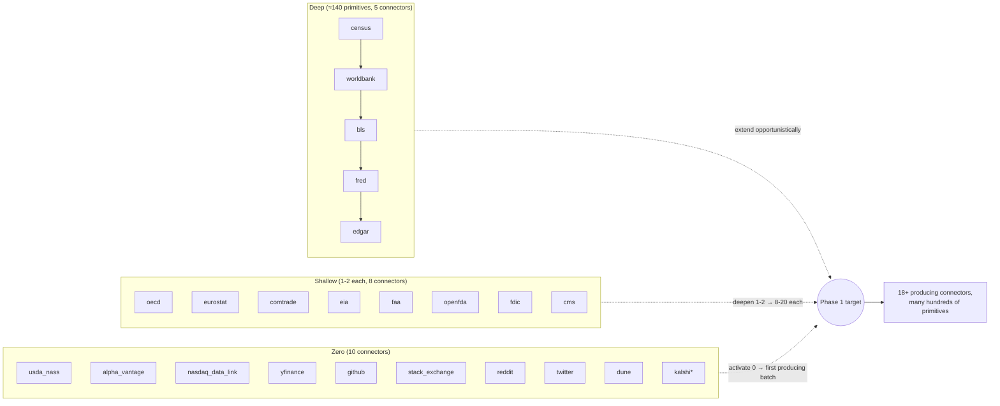
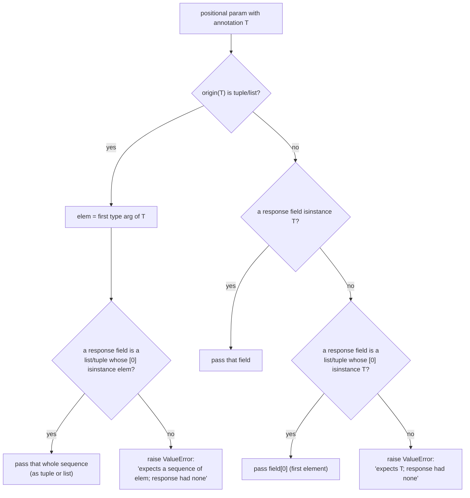
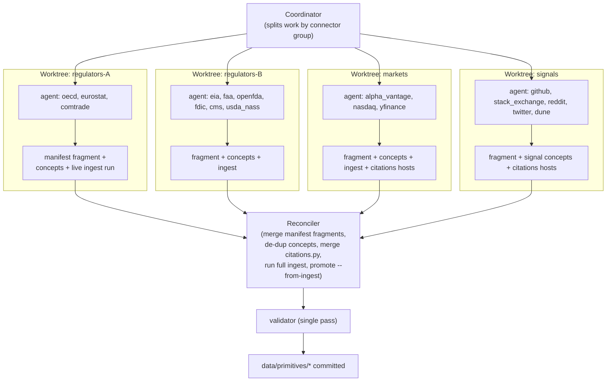

# Phase 1 — Deepen the Data Bank

**Status:** spec (build contract)
**Owner:** data-ingest pod
**Codename:** Strata · "Plaid for AI agents"
**Goal:** take the committed data bank from **215 primitive files** (~5 connectors
deep) to **many hundreds** of real regulator/aggregator-sourced primitives across
**18+ producing connectors** — by *activating the 10 zero-primitive connectors*
and *deepening the 8 shallow ones* — using the **existing manifest → ingest →
promote** machinery, with **zero new application code** (manifest + concepts +
one allowlist edit only).

> **Non-negotiable (CLAUDE.md "What NOT to do"):** never invent figures. Every
> real number in this plan that is not a verbatim code citation is either
> (a) read live from a connector at ingest time, or (b) explicitly labelled
> **illustrative / target**. Concrete `series_id`/`indicator`/`naics`/`code`
> values below are *candidates to dispatch*; where I could not verify a code
> from the connector source it is marked **"to be confirmed live."**

---

## 0. TL;DR for the impatient

```
data/ingest-manifest.yaml   ──►  strata ingest run   ──►  ~/.strata/auto-primitives/*.yaml
   (add arg_sets)                  (live HTTP per arg_set)        (staging, never committed)
                                                                          │
data/concepts/*.yaml  ◄── add concept_slug targets                       ▼
citations.py CONNECTOR_HOSTS  ◄── add any new host        strata promote --from-ingest
                                                            (stage → validate once → roll
                                                             back only offenders) ──► data/primitives/*.yaml
```

The whole phase is **data + manifest authoring**. The pipeline already exists and
is tested. The work is: (1) write hundreds of correct `arg_sets`, (2) ensure a
`concept` exists for each `concept_slug`, (3) add new source hosts to the
allowlist, (4) parallelize the authoring across worktree-isolated subagents,
(5) reconcile, validate, promote.

---

## 1. Problem statement — the real depth distribution

The data bank is lopsided. Five connectors carry essentially the entire bank; the
other eighteen contribute 0–2 primitives or nothing. The bank is **215 files** in
`data/primitives/` today (`ls data/primitives | wc -l` → 215, includes a
`.gitkeep`), plus the Kalshi `prediction_market` signals quarantined to
`data/signals/` (never feed a TAM, Q20).

### Committed depth by connector (from the live manifest + tree)

| Connector | Tier | Committed primitives (approx) | Manifest arg_sets today | State |
|---|---|---:|---:|---|
| census | regulator | ~40 | 7 | **deep** |
| worldbank | aggregator | ~31 | 12 | **deep** |
| bls | regulator | ~29 | 10 | **deep** |
| fred | regulator | ~24 | 2 | **deep** (history) |
| edgar | regulator | ~16 | 1 | **deep** (history) |
| oecd | aggregator | 2 | 2 | shallow |
| eurostat | regulator | 2 | 2 | shallow |
| comtrade | aggregator | 2 | 2 | shallow |
| eia | regulator | 2 | 2 | shallow |
| faa | regulator | 2 | 2 | shallow |
| openfda | regulator | 2 | 2 | shallow |
| fdic | regulator | 1 | 1 | shallow |
| cms | regulator | 1 | 1 | shallow |
| usda_nass | regulator | **0** | 0 | **zero — activate** |
| alpha_vantage | aggregator | **0** | 0 | **zero — activate** |
| nasdaq_data_link | aggregator | **0** | 0 | **zero — activate** |
| yfinance | analyst | **0** | 0 | **zero — activate** |
| github | community | **0** | 0 | **zero — activate (signal)** |
| stack_exchange | community | **0** | 0 | **zero — activate (signal)** |
| reddit | community | **0** | 0 | **zero — activate (signal)** |
| twitter | analyst | **0** | 0 | **zero — activate (signal)** |
| dune | onchain | **0** | 0 | **zero — activate (signal)** |
| kalshi | prediction_market | **0 primitives** (signals only) | 0 | **signals-only, stays quarantined** |

> The per-connector "committed primitives" counts above are **approximate** — they
> reflect the historical seed (census 40 / worldbank 31 / bls 29 / fred 24 /
> edgar 16) plus the manifest's shallow tail. They are descriptive, not targets.
> The authoritative live count is always `uv run strata stats -d ../data`.

### ASCII histogram of committed depth (▇ ≈ 4 primitives)

```
census       ▇▇▇▇▇▇▇▇▇▇  ~40
worldbank    ▇▇▇▇▇▇▇▇    ~31
bls          ▇▇▇▇▇▇▇     ~29
fred         ▇▇▇▇▇▇      ~24
edgar        ▇▇▇▇        ~16
oecd         ▌           2
eurostat     ▌           2
comtrade     ▌           2
eia          ▌           2
faa          ▌           2
openfda      ▌           2
fdic         ▏           1
cms          ▏           1
usda_nass    ·           0   ◄─ activate
alpha_vantage·           0   ◄─ activate
nasdaq       ·           0   ◄─ activate
yfinance     ·           0   ◄─ activate
github       ·           0   ◄─ activate (community signal)
stack_exch   ·           0   ◄─ activate (community signal)
reddit       ·           0   ◄─ activate (community signal)
twitter      ·           0   ◄─ activate (analyst signal)
dune         ·           0   ◄─ activate (onchain signal)
kalshi       ·           0   ◄─ signals-only (quarantined, never a TAM input)
```



**The core problem:** the connector layer is **23 typed clients** with **~350
query methods**, but the *manifest* — the declarative list of what to actually
ingest — only exercises ~40 arg_sets. The clients are built and tested; they're
just not pointed at enough data. Phase 1 closes that gap.

---

## 2. The ingest pipeline (end to end)

### Mermaid sequence diagram

```mermaid
sequenceDiagram
  autonumber
  participant Eng as Ingest engineer
  participant M as data/ingest-manifest.yaml
  participant CLI as strata ingest run
  participant ORCH as ingest/orchestrator.run_ingest
  participant DISP as connectors/_dispatch.call_and_convert
  participant CLI2 as <Connector>Client
  participant API as Live regulator/aggregator API
  participant CONV as *_to_primitive_yaml converter
  participant W as resolver/writer.upsert_primitive
  participant CIT as resolver/citations.assert_real_host
  participant FS as ~/.strata/auto-primitives/
  participant PROM as strata promote --from-ingest
  participant V as validator.validate
  participant TREE as data/primitives/

  Eng->>M: add arg_sets (method args + converter metadata)
  Eng->>CLI: uv run strata ingest run [--tier .. --connector ..]
  CLI->>ORCH: load_manifest(path) → [IngestTarget(connector, method, args)]
  loop per IngestTarget (filtered by tier/connector + key presence)
    ORCH->>DISP: call_and_convert(connector, method, args)
    DISP->>DISP: split args → method_args vs converter_kwargs (signature)
    DISP->>CLI2: client_factory() (injects creds the ctor declares)
    DISP->>CLI2: getattr(client, method)(**method_args)
    CLI2->>API: HTTP GET/POST (disk-cached ~/.strata/cache/)
    API-->>CLI2: typed dataclass response
    DISP->>DISP: _match_positional(response) → fill converter positionals
    DISP->>CONV: converter(*positionals, **converter_kwargs)
    CONV-->>DISP: AtomicPrimitive YAML dict
    DISP->>DISP: AtomicPrimitive.model_validate(dict)
    DISP-->>ORCH: validated dict
    ORCH->>W: upsert_primitive(primitive_yaml, connector, method, args)
    W->>CIT: assert_real_host(source.url, CONNECTOR_HOSTS)
    alt host allowlisted
      W->>FS: write {slug}.yaml (+ is_auto/auto_args_hash metadata)
    else host NOT allowlisted
      CIT-->>W: FabricatedHostError → orchestrator records failed, continues
    end
  end
  ORCH-->>CLI: IngestReport(written, failed, skipped_connectors, paths)
  Eng->>PROM: uv run strata promote --from-ingest [--validate-only]
  PROM->>FS: stage every uncommitted {slug}.yaml → TREE (strip metadata)
  loop until report.ok
    PROM->>V: validate(data_dir)  (loader + structural + semantic + cross-record)
    alt report.ok
      V-->>PROM: clean
    else errors
      PROM->>PROM: _attribute_errors → unlink only offenders → re-validate
    end
  end
  PROM->>TREE: committed primitives remain; staging sources unlinked
```

### ASCII version (the load-bearing path)

```
 ┌──────────────────────────┐
 │ data/ingest-manifest.yaml│   connectors: <name>: [{ method, arg_sets: [ {..} ] }]
 └────────────┬─────────────┘   one arg_set = method args + converter metadata
              │ load_manifest()  ── ingest/manifest.py:44
              ▼
 [ IngestTarget(connector, method, args), ... ]   ── manifest.py:35
              │ run_ingest()  ── orchestrator.py:157
              │   • _eligible_targets: filter by --tier / --connector
              │   • skip connector if STRATA_<X>_API_KEY unset AND not KEYLESS
              ▼
 call_and_convert(connector, method, args)   ── _dispatch.py:269
   ├─ sig = signature(converter)             ── _dispatch.py:285
   ├─ converter_kwargs = {k: v in KEYWORD_ONLY}   ── _dispatch.py:290
   ├─ method_args      = {k: v not in converter params}  ── _dispatch.py:291
   ├─ client = entry.client_factory()        ── _dispatch.py:293 (creds via _build_factory:190)
   ├─ response = client.<method>(**method_args)  ── _dispatch.py:296
   ├─ positionals = _match_positional(response) per positional param  ── _dispatch.py:236
   ├─ yaml = converter(*positionals, **converter_kwargs)  ── _dispatch.py:305
   └─ AtomicPrimitive.model_validate(yaml)   ── _dispatch.py:306
              ▼
 upsert_primitive(primitive_yaml, connector, method, args)  ── writer.py:36
   ├─ TypeAdapter(AtomicPrimitive).validate_python(yaml)    ── writer.py:56
   ├─ assert_real_host(source.url, CONNECTOR_HOSTS)         ── writer.py:62  ◄── HOST GATE
   ├─ metadata.auto_args_hash = sha256(connector+method+args)[:16]  ── writer.py:69 (dedupe)
   └─ write ~/.strata/auto-primitives/{slug}.yaml            ── writer.py:76
              ▼
 strata promote --from-ingest  ── cli.py:596 _promote_from_ingest
   ├─ stage uncommitted {slug}.yaml → data/primitives/ (strip metadata)  ── cli.py:622
   ├─ loop: validate once → roll back only attributed offenders          ── cli.py:631
   └─ on success: unlink staging source; tree NEVER left broken
              ▼
 data/primitives/{slug}.yaml   (committed, hash-pinned, validated)
```

**Idempotency lives in two places:** `upsert_primitive` keys on
`metadata.auto_args_hash = sha256({connector,method,args})[:16]` (`writer.py:31`,
`writer.py:69`) so the same target rewrites one file; `_promote_from_ingest`
skips any slug whose `data/primitives/{slug}.yaml` already exists
(`cli.py:619`). Re-running the whole campaign is safe.

---

## 3. The dispatch contract + DISPATCH TRAP CHECKLIST

`call_and_convert` (`_dispatch.py:269`) is the crux. An `arg_set` is a **flat
dict** that mixes two unrelated things, and the function splits them purely by
**signature introspection**:

```python
sig = inspect.signature(converter)                       # _dispatch.py:285
converter_param_names = set(sig.parameters)              # _dispatch.py:286
keyword_only = {KEYWORD_ONLY params}                     # _dispatch.py:287
converter_kwargs = {k: v for k,v in args if k in keyword_only}     # :290
method_args      = {k: v for k,v in args if k not in converter_param_names}  # :291
```

So:
- A key that is a **keyword-only converter param** (`primitive_slug`,
  `concept_slug`, `name`, `description`, `source_url`, `unit_kind`,
  `unit_dimension`, `unit_currency`, `unit_denominator`, `geo_codes`,
  `geo_level`, `value_scale`, `value_field`, ...) → routed to the **converter**.
- A key that is **not any converter param** → routed to the **method** as a call
  arg (`series_id`, `indicator`, `country`, `naics`, `year`, `route`,
  `report_date`, `cmd_code`, ...).

Then converter **positionals** (the domain dataclass(es): BLS `Series`, FRED
`(SeriesInfo, tuple[Observation,...])`, EDGAR `tuple[FrameEntry,...]`) are filled
by **type-matching the method response's fields** (`_match_positional`,
`_dispatch.py:236`).

### `_match_positional` decision logic (mermaid flowchart)



`_response_field_values` (`_dispatch.py:230`) is just "every dataclass field
value, in declared order" (or `vars()` for non-dataclasses).

### The DISPATCH TRAP CHECKLIST (manifest header lines 17–21, made precise)

A `(connector, method, converter)` triple is **ingest-ready** only when **both**
hold:

**TRAP 1 — name collision.** No `arg_set` key may be both a converter param and
an intended method arg. Because the split is "converter params win"
(`_dispatch.py:291` excludes *all* converter param names from method args), a
colliding key is **silently stolen from the method**.
- *Canonical example from the live manifest:* the BLS OEWS block deliberately
  omits `year:` because `year` is a converter keyword — passing `year:` would
  feed the converter (select a data point) instead of reaching the method
  (manifest lines 60–63).

**TRAP 2 — response shape.** The method's response must actually **carry the
dataclass** the converter's positional needs, or `_match_positional` raises
(`_dispatch.py:252`/`:263`) and the target is recorded `failed`
(`orchestrator.py:197`). This is why each manifest block is **single-record by
design** (header line 20): the method must return exactly one matching row so
`_match_positional`'s "first element" rule hands the converter the right datum.
- *Canonical example:* `census.get_susb` uses the `firm_to_primitive_yaml`
  override (`_dispatch.py:169`) and a **single** NAICS per arg_set so exactly one
  firm record comes back (manifest lines 146–149, 203).

### Worked collision bug → fix (illustrative)

Suppose we add a USDA NASS arg_set and (wrongly) try to pin the survey year by
adding `year: 2023`, intending it as a method filter:

```yaml
# BROKEN — TRAP 1
usda_nass:
  - method: get_production
    arg_sets:
      - commodity: CORN
        year: 2023                 # ← intended as a method filter
        primitive_slug: nass-corn-production-us-2023
        concept_slug: us-corn-production
        ...
```

`nass_record_to_primitive_yaml` declares a keyword-only `year` (it stamps `as_of`).
So `year` lands in `converter_kwargs` (`_dispatch.py:290`) and **never reaches
`get_production`** — the method runs *unfiltered* and `_match_positional` may grab
the wrong/most-recent record. The primitive's `as_of` says 2023 but its value is
whatever the unfiltered call returned: a **silent provenance lie**.

**Fix** — name the method filter something the converter does *not* declare, and
let the connector method's own parameter accept it (verify the real signature at
`usda_nass.py:624`). If the method's filter parameter happens to *be* `year`,
there is a true collision and the triple is **not ingest-ready** until the
converter or method is renamed — record it as a known limit, do not ship a lie.

> **Rule for authors:** before adding any non-metadata key to an arg_set, open the
> connector method signature *and* the converter signature. If the key appears in
> the converter signature, it goes to the converter, full stop.

---

## 4. Per-connector activation playbook

Conventions for every subsection:
- **Method (file:line)** is cited from the live connector source.
- **Converter** is from `_DEFAULT_CONVERTERS`/`_CONVERTER_OVERRIDES`
  (`_dispatch.py:140`/`:168`).
- **Host** notes whether the `source_url` host is already in `CONNECTOR_HOSTS`
  (`citations.py:24`) or **must be added** (§5).
- Concrete codes are **candidates**; "**TBC live**" = confirm by running the call.
- **All numeric values come from the live API at ingest — never authored here.**

---

### 4.1 usda_nass — ACTIVATE (regulator)

- **Methods (usda_nass.py):** `get_production` (:624), `get_acreage` (:650),
  `get_yield` (:679), `get_prices` (:705), `get_livestock_inventory` (:731),
  `get_sales_value` (:942), `get_operations_count` (:969),
  `get_national_totals` (:919). Converter `nass_record_to_primitive_yaml`
  (default, `_dispatch.py:161`).
- **Candidate arg_sets** (codes **TBC live** via `get_param_values`,
  usda_nass.py:607 — NASS uses `commodity_desc`, `statisticcat_desc`,
  `agg_level_desc`; do not guess raw enum spellings):
  - corn production (US national total) → `concept_slug: us-corn-production` **(new)**
  - soybean production (US) → `us-soybean-production` **(new)**
  - cattle inventory (US) → `us-cattle-inventory` **(new)**
  - farm operations count (US) → `us-farm-operations` **(new)**
- **Unit signatures:** production → `flow / mass` (bushels/tons — confirm the
  unit the converter emits); inventory/operations → `stock / organizations` or
  `stock / count`; prices → `flow / currency USD / denominator unit`.
- **Host:** `quickstats.nass.usda.gov`, `nass.usda.gov` — **already in
  CONNECTOR_HOSTS** (`citations.py:47-48`). Use one of those as the `source_url`
  host.
- **Tier:** `regulator` (`usda_nass.py` capabilities `source_tier="regulator"`).
- **Known limits:** NASS requires an API key (`STRATA_USDA_NASS_API_KEY` per
  `_build_factory` default, `_dispatch.py:197`) — **present per the brief**.
  `usda_nass` is *not* in `KEYLESS_CONNECTORS` (`orchestrator.py:53`), so a
  missing key silently skips it. TRAP 1: do not add a `year:` key if the converter
  declares `year` (see §3 worked example) — use the method's own time parameter.

---

### 4.2 oecd — DEEPEN (aggregator, keyless)

- **Methods (oecd.py):** `get_gdp` (:739) and `get_health_spending` (:877) are
  the manifest-blessed clean `{country}.{freq}`-key methods (manifest lines
  375–378 warn the SDMX sector methods are flagged un-verified in source — avoid
  `get_value_added_by_sector` :997, `get_employment_by_sector` :1049 until
  verified live). Also safe candidates: `get_rd_spending` (:894),
  `get_population` (:980), `get_household_consumption` (:1026),
  `get_unemployment` (:795). Converter `oecd_observation_to_primitive_yaml`.
- **Candidate arg_sets:** extend `get_gdp` to FRA / JPN / ITA / CAN / KOR / AUS /
  ESP / NLD (2022) → `oecd-gdp-fra`, `oecd-gdp-jpn`, ... **(new concepts each)**;
  add `get_health_spending` for DEU/GBR/FRA/USA → `oecd-health-spending-*`
  **(new)**; `get_rd_spending` for DEU/USA/KOR → `oecd-rd-spending-*` **(new)**.
- **Unit signatures:** GDP → `flow / currency / <national currency>` with
  `value_scale: 1000000` (OECD reports DSD_NAMAIN10 B1GQ **in millions** — manifest
  line 387 documents this; the existing primitive `oecd-gdp-deu-2022.yaml` carries
  `value: 3989390000000.0` after the lift). Health/R&D spending → confirm the
  measure (% of GDP vs absolute) live before assigning a unit.
- **Host:** `data.oecd.org`, `oecd.org` — **already allowlisted** (`citations.py:39`),
  and classified `aggregator` (`citations.py:59`).
- **Tier:** `aggregator`.
- **Known limits:** GDP is in **national currency**, not USD (manifest line 378) —
  per-country `unit_currency` is mandatory (EUR/GBP/JPY/...). Reported in
  **millions** → `value_scale: 1000000` always.

---

### 4.3 eurostat — DEEPEN (regulator, keyless)

- **Methods (eurostat.py):** `get_gdp` (:504), `get_population` (:540),
  `get_employment` (:558), `get_unemployment` (:579), `get_inflation` (:603),
  `get_rd_spending` (:664), `get_ict_usage` (:682), `get_cloud_adoption` (:891),
  `get_ecommerce` (:867). Converter `observation_to_primitive_yaml`.
- **Candidate arg_sets:** extend `get_gdp` to IT / ES / NL / PL / SE / BE / AT
  (2023) → `eurostat-gdp-it`, ... **(new)**; `get_population` for the EU-large
  members → `eurostat-population-*` **(new)**; `get_cloud_adoption` /
  `get_ecommerce` for DE/FR/IT → these are **AI-adjacent demand signals**
  (cloud/e-commerce penetration) → `eurostat-cloud-adoption-*` **(new)**.
- **Unit signatures:** GDP → `flow / currency / EUR`, `value_scale: 1000000`
  (CP_MEUR / millions, manifest lines 409–410, existing
  `eurostat-gdp-de-2023.yaml`). Adoption % → `flow / ratio` (dimensionless
  fraction — confirm the converter's unit handling for percentages live).
- **Host:** `ec.europa.eu` — **already allowlisted** (`citations.py:38`).
- **Tier:** `regulator`.
- **Known limits:** GDP in **millions EUR** (`value_scale: 1000000`). Adoption
  series are **percent of enterprises/individuals**, not absolute counts — do not
  mislabel as a population count.

---

### 4.4 comtrade — DEEPEN (aggregator)

- **Methods (comtrade.py):** `get_world_imports` (:946), `get_world_exports`
  (:971), `get_bilateral_trade` (:610), `get_commodity_imports` (:662),
  `get_commodity_exports` (:647), `get_tech_exports` (:851),
  `get_pharma_trade` (:902), `get_energy_trade` (:886). Converter
  `trade_to_primitive_yaml`.
- **Candidate arg_sets:** mirror the existing pattern — concrete **reporter** M49
  (842 = USA, 156 = China, 276 = Germany, 392 = Japan), **cmd_code** = HS chapter
  (84 machinery, 85 electrical machinery, 90 optical/medical, 30 pharma, 87
  vehicles). e.g. `get_world_imports` reporter 276 / HS 84 →
  `ct-deu-imports-machinery-2023` **(new concept)**; `get_bilateral_trade`
  842↔392 → `ct-us-japan-bilateral-2023` **(new)**.
- **Unit signature:** `flow / currency / USD` (Comtrade reports trade value in USD).
- **Host:** `comtrade.un.org`, `comtradeapi.un.org` — **already allowlisted**
  (`citations.py:40-41`), classified `aggregator` (`citations.py:59`).
- **Tier:** `aggregator`.
- **Known limits (manifest lines 551–557):** the **keyless public preview does
  NOT support the World reporter** (`reporterCode=0` → zero rows → TRAP 2 failure).
  Always use a **concrete reporter** unless `STRATA_COMTRADE_API_KEY` is set, in
  which case the World aggregate is available (switch reporter to `"0"`). Key is
  passed as `subscription_key` (`_dispatch.py:180`).

---

### 4.5 eia — DEEPEN (regulator)

- **Methods (eia.py):** `get_electricity_sales` (:594), `get_electricity_prices`
  (:567), `get_electricity_generation` (:621), `get_petroleum_supply` (:708),
  `get_natural_gas_supply` (:760), `get_total_energy` (:814),
  `get_renewable_generation` (:883), `get_ev_sales_stock` (:1136). Converter
  `datapoint_to_primitive_yaml`.
- **Candidate arg_sets:** the existing block uses `route: electricity/retail-sales`
  with `state/sector/frequency` (manifest lines 441–466). Extend sectors
  (RES / IND / TRA), add `get_electricity_generation` (US, all fuels) →
  `us-electricity-generation` **(new)**; `get_renewable_generation` →
  `us-renewable-generation` **(new)**; `get_ev_sales_stock` →
  `us-ev-stock` **(new)** — a strong AI/energy-demand denominator.
- **Unit signatures:** sales/generation → `flow / transactions` (the existing EIA
  block uses `unit_dimension: transactions` for million-kWh volumes, manifest line
  455 — keep consistent; values are **million kWh**, note it in the description).
- **Host:** `api.eia.gov`, `eia.gov` — **already allowlisted** (`citations.py:45-46`).
  The existing block uses `https://www.eia.gov/electricity/data.php` — `eia.gov`
  is the registered host suffix; `www.eia.gov` resolves via `_gov_or_edu`
  (`citations.py:78`).
- **Tier:** `regulator`. **Key:** `STRATA_EIA_API_KEY` (present; not keyless).
- **Known limits:** every EIA route call needs `route`, `frequency`, and facet
  params — confirm facet codes (`sectorid`, `fueltypeid`) **live** via
  `get_metadata` (eia.py:557). Values are in route-specific units (kWh, BTU,
  barrels) — describe the unit in `description`.

---

### 4.6 faa — DEEPEN (regulator, keyless)

- **Methods (faa.py):** `get_airport_count` (:695, override converter
  `airport_count_to_primitive_yaml`, `_dispatch.py:174`),
  `get_airports_by_state` (:591), `get_commercial_airports` (:649),
  `get_general_aviation_airports` (:660), `get_heliports` (:678).
- **Candidate arg_sets:** the existing block sizes **US national** and **CA**
  airport counts (manifest lines 513–529). Extend to more states (TX, FL, NY, AK)
  → `faa-tx-airport-count`, ... all under `concept_slug: us-air-travel` (reuse) or
  a per-state concept; add `get_commercial_airports` (US) →
  `faa-us-commercial-airport-count` **(new)**.
- **Unit signature:** `stock / count` (facility count — the existing arg_sets omit
  `unit_kind`/`unit_dimension`, letting `airport_count_to_primitive_yaml` set them;
  confirm the converter's emitted unit live).
- **Host:** `source_url` **MUST be `faa.gov`** — the converter's ArcGIS default is
  **not allowlisted** (manifest lines 507–512). The existing block uses
  `https://www.faa.gov/air_traffic/flight_info/aeronav`. `faa.gov` is in
  `CONNECTOR_HOSTS` (`citations.py:49`).
- **Tier:** `regulator` (keyless).
- **Known limits (manifest lines 507–512):** the FAA AIS feature layer is an
  **identity/location layer with no enplanement or operations columns** — we size
  **airport COUNTS only** (a supply denominator), **never passenger figures**.
  FAA publishes enplanements **as Excel files, not a queryable API**, so
  `get_total_passengers` (:765) / `get_enplanements_ranked` (:879) are **out of
  scope** for ingest (TRAP 2: the live layer returns no passenger field).

---

### 4.7 openfda — DEEPEN (regulator, keyless)

- **Methods (openfda.py):** `get_clearance_count_by_year` (:1101, override
  `event_count_to_primitive_yaml`), `get_drug_recall_count_by_class` (:1146),
  `get_approval_count_by_year` (:1106), `get_ndc_count` (:1111),
  `get_recall_count_by_year` (:1200), `get_udi_count` (:1088),
  `get_label_count_by_route` (:1158). Default converter
  `event_count_to_primitive_yaml` (`_dispatch.py:157`).
- **Candidate arg_sets:** the existing block has 510(k) clearance totals and drug
  recalls-by-class (manifest lines 531–549). Add `get_approval_count_by_year`
  (device PMA approvals) → `us-medical-device-approvals` **(new)**;
  `get_ndc_count` (count of marketed drug products) → `us-drug-products` **(new)**;
  `get_recall_count_by_year` → `us-fda-recalls-trend` **(new)**.
- **Unit signature:** counts → `stock / count` (these are total event counts;
  confirm the converter's emitted unit — the existing arg_sets omit `unit_*` and
  let `event_count_to_primitive_yaml` set defaults).
- **Host:** `api.fda.gov`, `fda.gov` — **already allowlisted** (`citations.py:50-51`).
  The existing block uses the literal endpoint URL `https://api.fda.gov/device/510k.json`.
- **Tier:** `regulator` (keyless).
- **Known limits:** `drug_name` in these arg_sets is a **converter label** (feeds
  the source slug/sha), **not a query arg** (manifest lines 531–532) — do not
  rename it expecting it to filter. Count endpoints return **totals across the
  facet**, not a single year unless the method narrows it.

---

### 4.8 fdic — DEEPEN (regulator, keyless)

- **Methods (fdic.py):** `get_financials` (:614, default
  `financial_to_primitive_yaml`). Plus the **scalar aggregate** helpers that
  return a `float`/`int` (NOT a dataclass — see limits): `get_total_assets`
  (:845), `get_total_deposits` (:862), `get_institution_count` (:1101),
  `get_total_loans` (:1051).
- **Candidate arg_sets:** the existing block returns the **single largest bank by
  assets** (manifest lines 468–487, honest "NOT an industry total"). Add more
  `get_financials` slices: top bank by `DEP` (deposits), by `LNLSNET` (loans) →
  `fdic-largest-bank-deposits-2024`, `fdic-largest-bank-loans-2024` **(new)**.
- **Unit signature:** `stock / currency / USD`, `value_scale: 1000` (FDIC reports
  dollar fields in **thousands** — manifest line 487, existing
  `fdic-largest-bank-assets-2024.yaml`).
- **Host:** `banks.data.fdic.gov`, `fdic.gov` — **already allowlisted**
  (`citations.py:42-43`).
- **Tier:** `regulator` (keyless).
- **Known limits (manifest lines 468–470):** only `get_financials` is cleanly
  dispatchable through the type-matching converter; it returns the **single largest
  bank**, not an industry total. The `get_total_*`/`get_institution_count` helpers
  return **bare scalars** (`float`/`int`), which `_match_positional` cannot map to
  a converter dataclass positional (TRAP 2) — they are **not ingest-ready** without
  a new scalar converter (out of Phase-1 scope; record as a limit). Keep
  `limit: 1` + a deterministic `sort_by`/`sort_order` so the call is reproducible.

---

### 4.9 cms — DEEPEN (regulator, keyless)

- **Methods (cms.py):** `get_enrollment` (:824, default
  `enrollment_to_primitive_yaml`), `get_medicaid_enrollment` (:1115),
  `get_ma_enrollment` (:1135). The `get_spending`/`get_national_health_expenditure`
  methods map to `spending_to_primitive_yaml` (`_dispatch.py:170-171`) but the
  manifest excludes NHE for a **converter/method type mismatch** (manifest lines
  489–490) — leave excluded unless verified live.
- **Candidate arg_sets:** the existing block sizes CA Medicare enrollment
  (manifest lines 491–505). Add more states (TX, FL, NY) and
  `get_medicaid_enrollment` (US) → `us-medicaid-enrollment` **(new)**;
  `get_ma_enrollment` (Medicare Advantage, US) → `us-ma-enrollment` **(new)**.
- **Unit signature:** `stock / people` (beneficiary counts, as in the existing
  arg_set). Subnational arg_sets carry `geo_codes: ["US-XX"]`,
  `geo_level: subnational`.
- **Host:** `data.cms.gov`, `cms.gov` — **already allowlisted** (`citations.py:44`).
- **Tier:** `regulator` (keyless — added to `KEYLESS_CONNECTORS` at
  `orchestrator.py:65`).
- **Known limits:** pass a concrete `state` + `limit` for **determinism** (manifest
  line 490) — the API otherwise paginates. NHE excluded (converter mismatch).

---

### 4.10 alpha_vantage — ACTIVATE (aggregator, fragile)

- **Methods (alpha_vantage.py):** `get_company_overview` (:354, returns
  `CompanyOverview` → default converter `market_cap_to_primitive_yaml`,
  `_dispatch.py:141`), `get_global_quote` (:421), `get_real_gdp` (:518),
  `get_cpi` (:522), `get_inflation` (:526).
- **Candidate arg_sets:** `get_company_overview` for a few large public AI/cloud
  vendors by ticker (MSFT, NVDA, CRM) → market-cap primitives like
  `av-msft-market-cap` **(new concepts, or map to existing company concepts)**.
- **Unit signature:** market cap → `stock / currency / USD`.
- **Host:** **NOT in CONNECTOR_HOSTS.** Alpha Vantage's host is
  `www.alphavantage.co` — must be **added to the allowlist** (§5) or every write
  fails `assert_real_host` (`writer.py:62`). Tier is `aggregator`, so it is **not**
  caught by the `_gov_or_edu` rule — the host edit is **mandatory**.
- **Tier:** `aggregator`.
- **Known limits:** **free tier ≈ 25 requests/day** (`is_fragile=True` per the
  capability) — keep alpha_vantage arg_sets **few** (≤10) and run them in an
  isolated, rate-limited batch. Key: `STRATA_ALPHA_VANTAGE_API_KEY` (present).
  Market caps are **point-in-time and drift** — `as_of` honesty matters; refresh
  via `strata ingest refresh` rather than re-ingesting blindly.

---

### 4.11 nasdaq_data_link — ACTIVATE (aggregator, premium-gated)

- **Methods (nasdaq_data_link.py):** `get_dataset` (:294), `get_datatable`
  (:347), `get_treasury_yield_curve` (:374), `get_lbma_gold` (:395). Converter
  `nasdaq_observation_to_primitive_yaml` (`_dispatch.py:155`).
- **Candidate arg_sets:** the two **free** named series are the safest first
  targets: `get_treasury_yield_curve` → `us-treasury-yield-curve` **(new)**;
  `get_lbma_gold` → `lbma-gold-price` **(new)**. Generic `get_dataset` against a
  premium `database_code/dataset_code` is **premium-gated** (`requires_paid_tier`)
  — only add with a confirmed paid key.
- **Unit signature:** yield → `flow / ratio` (percent — confirm); gold →
  `flow / currency / USD per troy ounce` (`denominator`).
- **Host:** **NOT in CONNECTOR_HOSTS.** Host is `data.nasdaq.com` — must be
  **added** (§5).
- **Tier:** `aggregator`.
- **Known limits:** premium datasets refuse on a free key — stick to the named
  free series. Key: `STRATA_NASDAQ_DATA_LINK_API_KEY` (present).

---

### 4.12 yfinance — ACTIVATE (analyst, fragile scraper)

- **Methods (yfinance.py):** `get_quote` (:101, returns `YahooQuote` → converter
  `quote_to_primitive_yaml`, `_dispatch.py:163`).
- **Candidate arg_sets:** `get_quote` for a handful of public comparables (tickers)
  → market-cap / price primitives, **mirroring** alpha_vantage as a cross-check
  source → `yf-<ticker>-market-cap` **(new)**.
- **Unit signature:** `stock / currency / USD`.
- **Host:** **NOT in CONNECTOR_HOSTS.** yfinance scrapes Yahoo; host is
  `finance.yahoo.com` — must be **added** (§5).
- **Tier:** `analyst` (`source_tier="analyst"`, `is_fragile=True`) — an **unofficial
  scraper**. These are the **lowest-trust** primitives in Phase 1; tag honestly.
  yfinance is in `KEYLESS_CONNECTORS` (`orchestrator.py:60`) — it always runs.
- **Known limits:** scraper, can break or rate-limit without notice; treat as a
  corroborating cross-check, never a sole source for a TAM input.

---

### 4.13 github — ACTIVATE as COMMUNITY SIGNAL

- **Methods (github.py):** `get_repo` (:197, → `repo_to_primitive_yaml`,
  `_dispatch.py:153`), `get_repo_contributors_count` (:222),
  `search_repos_count` (:249), `get_org_repos` (:254).
- **Candidate arg_sets:** `get_repo` for marquee AI/agent repos
  (`owner: openai, repo: openai-python`; `owner: langchain-ai, repo: langchain`;
  `owner: vllm-project, repo: vllm`) → stars/forks as **ecosystem momentum
  signals** → `gh-<owner>-<repo>-stars` **(new concept(s) under a signals concept)**.
- **Unit signature:** `stock / count` (stars/forks/contributors).
- **Host:** **NOT in CONNECTOR_HOSTS.** Host is `github.com` (or `api.github.com`)
  — must be **added** (§5).
- **Tier:** **`community`** (`source_tier="community"`) — **NOT regulator**. A
  GitHub star count is a **signal**, not a sourced market measurement.
- **Known limits:** **must be tagged `community` tier and treated as a signal** —
  per the brief, community signals must not masquerade as regulator data. Token:
  `STRATA_GITHUB_TOKEN` (`_dispatch.py:181`, present). github is NOT in
  `KEYLESS_CONNECTORS` so a missing token skips it.

---

### 4.14 stack_exchange — ACTIVATE as COMMUNITY SIGNAL

- **Methods (stack_exchange.py):** `get_tag_info` (:133, →
  `tag_to_primitive_yaml`, `_dispatch.py:159`), `get_related_tags` (:204),
  `get_tag_questions_in_window` (:176).
- **Candidate arg_sets:** `get_tag_info` for tags like `langchain`,
  `openai-api`, `llm`, `huggingface` → question counts as **developer-interest
  signals** → `se-<tag>-questions` **(new)**.
- **Unit signature:** `stock / count` (question count).
- **Host:** **NOT in CONNECTOR_HOSTS.** Host is `stackoverflow.com` (or
  `api.stackexchange.com`) — must be **added** (§5).
- **Tier:** **`community`** signal. stack_exchange is in `KEYLESS_CONNECTORS`
  (`orchestrator.py:62`) — always runs, no key needed.
- **Known limits:** signal only; backoff/quota on the SE API — keep arg_sets few.

---

### 4.15 reddit — ACTIVATE as COMMUNITY SIGNAL

- **Methods (reddit.py):** `get_subreddit_about` (:158, →
  `subreddit_to_primitive_yaml`, `_dispatch.py:158`), `search_subreddits` (:180).
- **Candidate arg_sets:** `get_subreddit_about` for `r/LocalLLaMA`,
  `r/MachineLearning`, `r/OpenAI` → subscriber counts as **community-size signals**
  → `reddit-<subreddit>-subscribers` **(new)**.
- **Unit signature:** `stock / people` (subscribers).
- **Host:** **NOT in CONNECTOR_HOSTS.** Host is `reddit.com` (or `www.reddit.com`)
  — must be **added** (§5).
- **Tier:** **`community`** signal. Reddit uses OAuth: `STRATA_REDDIT_CLIENT_ID` +
  `STRATA_REDDIT_CLIENT_SECRET` (`_dispatch.py:183-186`, present). reddit is NOT in
  `KEYLESS_CONNECTORS` so missing creds skip it.
- **Known limits:** signal only; OAuth token churn — verify creds before the batch.

---

### 4.16 twitter — ACTIVATE as ANALYST/COMMUNITY SIGNAL

- **Methods (twitter.py):** only the **2 free-tier endpoints** exist —
  `user_lookup_by_username` (:137) and `user_timeline` (the connector CLAUDE.md
  documents this; converter `user_to_primitive_yaml`, `_dispatch.py:160`).
- **Candidate arg_sets:** `user_lookup_by_username` for a few official AI-vendor
  handles → follower counts as **reach signals** → `tw-<handle>-followers` **(new)**.
- **Unit signature:** `stock / people` (followers).
- **Host:** **NOT in CONNECTOR_HOSTS.** Host is `twitter.com` / `x.com` — must be
  **added** (§5).
- **Tier:** **`analyst`** (`source_tier="analyst"`, fragile) — per the brief,
  treat X as a **community/analyst-tier signal, never regulator**. Credential:
  `STRATA_TWITTER_BEARER_TOKEN` (`_dispatch.py:182`, present). twitter is NOT
  keyless.
- **Known limits:** harsh free-tier rate limits (the connector exposes only the 2
  free endpoints by design). Keep to ≤5 arg_sets; signal only.

---

### 4.17 dune — ACTIVATE as ONCHAIN SIGNAL (constrained)

- **Methods (dune.py):** `get_latest_result` (:458, →
  `dune_run_query_result_to_primitive_yaml`, `_dispatch.py:146`), `run_query`
  (:485), `get_results` (:439).
- **Candidate arg_sets:** `get_latest_result` against a **known public Dune
  query_id** that returns a single onchain metric (e.g. a stablecoin daily-volume
  query) → `dune-<metric>` **(new)** — query_id **TBC live** (do not fabricate a
  query id).
- **Unit signature:** depends on the query result column — `flow / transactions`
  or `flow / currency / USD`; confirm live.
- **Host:** **NOT in CONNECTOR_HOSTS.** Host is `dune.com` — must be **added** (§5).
- **Tier:** **`onchain`** signal. Key: `STRATA_DUNE_API_KEY` (present); dune is NOT
  keyless.
- **Known limits:** CLAUDE.md marks Dune "Reference only (plan limits)" —
  treat as **signal**, query execution is **credit-metered**; pre-pick a free/cheap
  query and run it **once**, then refresh sparingly.

---

### 4.18 kalshi — SIGNALS ONLY (prediction_market, quarantined)

- **Methods (kalshi.py):** `get_markets` (:734), `get_market` (:774),
  `get_events` (:827), etc. Converter `market_to_primitive_yaml` (`_dispatch.py:154`).
- **Status:** Kalshi is **NOT a Phase-1 primitive target.** Its 200+ outputs are
  `prediction_market`-tier and are **quarantined to `data/signals/`** (the
  `kalshi-*.yaml` files there) — they **never feed a TAM** (Q20). The ingest
  manifest pipeline writes to `data/primitives/`; Kalshi signals are maintained on
  the existing signals path, not promoted into the primitive tree.
- **Host:** `kalshi.com` — allowlisted (`citations.py:36`) and **classified
  `prediction_market`** (`citations.py:63`), so even if a value were emitted, the
  tier guard keeps it honest.
- **Action in Phase 1:** **none** beyond not regressing the quarantine. Listed here
  only to state explicitly that it is excluded.

---

### 4.19 census / worldbank / bls / fred / edgar — EXTEND OPPORTUNISTICALLY

These are deep already (§1). Extend only where a *new concept* in Phases 2–5 needs
a denominator that's missing — e.g. additional NAICS for census CBP/SUSB (manifest
lines 150–224), more BLS OEWS occupations for new AI-persona TAMs (manifest lines
64–141), more FRED series (`fred.py` has 10 methods), more EDGAR XBRL frames
(`edgar.get_frames`, manifest lines 226–241). **No structural work** — just append
arg_sets following the existing single-record pattern. All hosts already
allowlisted.

---

## 5. citations.py allowlist changes (exact)

New connectors whose hosts are **not** `*.gov`/`*.edu` and **not** already in
`CONNECTOR_HOSTS` (`citations.py:24`) will have **every write rejected** by
`assert_real_host` (`writer.py:62`). Add the following to the `CONNECTOR_HOSTS`
frozenset. Confirm each host's exact spelling against the connector's real
`source_url` **live** before committing (the literal strings below are the
candidate set):

```python
# citations.py — additions to CONNECTOR_HOSTS frozenset (citations.py:24)
    "www.alphavantage.co",      # alpha_vantage (aggregator)
    "alphavantage.co",
    "data.nasdaq.com",          # nasdaq_data_link (aggregator)
    "finance.yahoo.com",        # yfinance (analyst, fragile scraper)
    "github.com",               # github (community signal)
    "api.github.com",
    "stackoverflow.com",        # stack_exchange (community signal)
    "api.stackexchange.com",
    "reddit.com",               # reddit (community signal)
    "www.reddit.com",
    "twitter.com",              # twitter (analyst/community signal)
    "x.com",
    "dune.com",                 # dune (onchain signal)
```

**Tier classification follow-up (optional, recommended):** `tier_for_host`
(`citations.py:106`) currently returns `REGULATOR` for any host in
`CONNECTOR_HOSTS` that isn't an aggregator/prediction-market
(`citations.py:115`). The **community/analyst signal hosts above would be
mis-tiered as `regulator`** by that fallback if a resolver ever re-derived their
tier from the host. Two safe options:
1. The **authored primitive's `source.tier`** is set explicitly per arg_set
   (`community`/`analyst`/`onchain`) — the manifest/converter path stamps the tier
   from the connector capability, **not** from `tier_for_host`, so the committed
   YAML is correct regardless. **(Primary safeguard — verify the converter sets
   tier from the connector, not the host.)**
2. Defensively extend `citations.py` so these hosts classify honestly: add a
   `_COMMUNITY_HOSTS` / `_ANALYST_HOSTS` / `_ONCHAIN_HOSTS` set checked in
   `tier_for_host` **before** the `CONNECTOR_HOSTS → REGULATOR` fallback. **Do this
   if §8 testing shows any signal primitive lands with `tier: regulator`.**

> usda_nass, oecd, eurostat, comtrade, eia, faa, openfda, fdic, cms hosts are
> **already allowlisted** (`citations.py:39-51`) — no edit needed for the
> regulator/aggregator deepening, only for the new community/analyst/onchain
> activations.

---

## 6. New concepts required

Every `arg_set`'s `concept_slug` **must resolve to a concept** in `data/concepts/`
or the cross-record validator rejects the primitive at promote time
(`validator/cross_record.py`, surfaced via `cli.py:114`). Concept shape (from
`data/concepts/demo-ai-sales-ops-us.yaml`):

```yaml
kind: concept
slug: <kebab-case>
schema_version: 1
name: <human name>
definition: '<one-paragraph scope statement>'
analysis_lens:
  primary: <one of L1..L6>      # see CLAUDE.md "Six analysis lenses (Q39)"
  secondary: <optional>
modifiers: {}
scope:            # optional (sub-project 1); omit/empty is fine for macro concepts
  geo_supply: [..]
  geo_demand: [..]
measurements: []  # may start empty; primitives point UP at the concept via concept_slug
competing_concepts: []
requires_clearance: []
```

**Concept authoring rules for this phase:**
- A **macro/denominator concept** (e.g. `oecd-gdp-fra`, `world-gdp-jpn`-style) is
  thin: name + definition + a lens. Many already exist (the manifest's worldbank
  block references `world-gdp-deu`, `world-population-usa`, etc. — confirm those
  concept files exist or create them).
- **Lens tagging (Q39, CLAUDE.md):** GDP / spend / consumption denominators →
  `revenue_generation` (L2) or `latent_demand` (L3); labor headcount / wage →
  `cost_efficiency` (L1) or `productivity_uplift` (L6); facility/firm counts →
  `cost_efficiency` (L1, denominator). Signals (github/reddit/SE/twitter/dune)
  → group under a small number of **signal concepts** (e.g. `ai-ecosystem-momentum`)
  with a lens that reflects they are demand/interest proxies, **flagged as
  signal-tier**, not TAM inputs.
- **Reuse before creating.** Map new arg_sets onto existing concepts where the
  scope genuinely matches (e.g. extra FAA states → existing `us-air-travel`,
  manifest line 517). One concept can carry many measurements (it's the
  "disagreement page").

**Inventory step (do first):** enumerate every distinct `concept_slug` across the
expanded manifest, diff against `ls data/concepts/`, and create exactly the
missing ones. A primitive citing a non-existent concept fails promote — this diff
is the gate.

---

## 7. Parallel-execution model (worktree-isolated subagents)

Authoring hundreds of arg_sets is embarrassingly parallel **except** that every
subagent touches the **same two shared surfaces**: `data/ingest-manifest.yaml`
and `data/primitives/`. We isolate with **git worktrees**, one connector-group per
agent, then a single **reconciler** merges.

### Fan-out / fan-in



### ASCII

```
coordinator
   ├─ git worktree add ../wt-regulators-a   (oecd, eurostat, comtrade)
   ├─ git worktree add ../wt-regulators-b   (eia, faa, openfda, fdic, cms, usda_nass)
   ├─ git worktree add ../wt-markets        (alpha_vantage, nasdaq_data_link, yfinance)
   └─ git worktree add ../wt-signals        (github, stack_exchange, reddit, twitter, dune)
        each agent:  edit manifest (its connectors only) ─ add concepts ─
                     edit citations hosts (markets/signals only) ─
                     uv run strata ingest run --connector <name> ─ eyeball IngestReport
        ▼ fan-in
   reconciler:  merge the 4 manifest fragments into data/ingest-manifest.yaml
                merge citations.py host additions (one frozenset)
                de-dup data/concepts/ (no two agents create the same slug)
                uv run strata ingest run        (full, live)
                uv run strata promote --from-ingest --validate-only   (dry run)
                uv run strata promote --from-ingest                   (commit)
```

### Conflict strategy

- **`data/ingest-manifest.yaml`** — the file is a single `connectors:` mapping, so
  two agents editing different connector keys produces a textual conflict only at
  the seams. Mitigation: each agent owns **disjoint connector keys**; the
  reconciler concatenates fragments under the one `connectors:` root. Prefer
  **agent-authored fragments** (one file per group, e.g.
  `manifest-fragments/<group>.yaml`) that the reconciler splices in, avoiding
  mid-file merge conflicts entirely.
- **`data/primitives/`** — agents run `ingest` in their worktree, which writes to
  the **shared `~/.strata/auto-primitives/`** (not the worktree). To avoid agents
  clobbering each other's staging dir, each agent runs ingest with a
  **`dir_override`** staging dir (`run_ingest(..., dir_override=Path(...))`,
  `orchestrator.py:165`) namespaced per group, OR the reconciler runs the single
  authoritative `ingest run` after merging the manifest. **Recommended: agents
  validate their fragment locally; the reconciler does the one real ingest +
  promote** so the committed tree is written exactly once, eliminating
  primitive-file conflicts.
- **`data/concepts/`** — slug collisions are possible if two agents invent the
  same macro concept. Mitigation: a shared **concept-slug registry note** in the
  coordinator; reconciler de-dups by slug (identical content → keep one; divergent
  → coordinator arbitrates).
- **`citations.py`** — only the **markets** and **signals** agents touch it; the
  reconciler merges their additions into the single `CONNECTOR_HOSTS` frozenset.

> Subagent tooling note: `EnterWorktree` / `ExitWorktree` are available for
> worktree isolation; spawn one ingest-engineer task per group with `TaskCreate`.

---

## 8. Validation & guards

The promote path runs the **full validator pipeline** (`validator.validate`,
`cli.py:632`), which composes (per `validator/` package):
- **loader** — YAML parses, schema_version, slug shape (`validator/__init__` →
  loader findings, `cli.py:60`).
- **structural** (`validator/structural.py`) — `AtomicPrimitive` field shape,
  unit object well-formedness, kebab-case slug, no forbidden `metadata` block
  (promote strips it, `cli.py:567`).
- **semantic** (`validator/semantic.py`) — unit signature sanity (no money², etc.).
- **cross_record** (`validator/cross_record.py`) — **every `concept_slug` resolves
  to a real concept**; no duplicate slugs; source references resolve.

Layered guards already enforced by the pipeline (no new code):
- **Schema validation twice** — at dispatch (`_dispatch.py:306`) and again at the
  writer (`writer.py:56`). A malformed converter output never reaches disk.
- **Host allowlist gate** — `assert_real_host` (`writer.py:62`,
  `citations.py:101`). Any un-allowlisted host (the new market/signal connectors
  before §5) is rejected here. **This is why §5 must land before §7's market/signal
  ingest.**
- **Hash pinning** — `source.snapshot_sha256` is computed from the response payload
  (connector convention, `connectors/CLAUDE.md`); `refresh` rewrites a primitive
  **only when the sha changes** (`orchestrator.py:309-312`), so re-runs are quiet
  unless the source actually moved.
- **Dedupe** — `metadata.auto_args_hash` (`writer.py:69`) makes
  `(connector, method, args)` idempotent in staging; `_promote_from_ingest` skips
  already-committed slugs (`cli.py:619`).
- **Tier honesty** — `prediction_market` (kalshi) stays in `data/signals/`;
  `community`/`analyst`/`onchain` tiers are stamped from the connector capability,
  not the host (§5 follow-up verifies this).

**Rollback safety of promote (`cli.py:631-658`):** stage whole batch → validate
once → `_attribute_errors` blames specific staged slugs → unlink only those →
re-validate → repeat. If errors can't be attributed to any staged primitive, the
**entire remaining batch is rolled back** (`cli.py:646-650`) so the committed tree
is **never left unloadable**. Guarantees termination.

---

## 9. Test plan

### Per-connector live verification (the gate for "is this triple ingest-ready")

For each connector, before adding bulk arg_sets, run **one** arg_set live and
confirm a valid primitive lands:

```bash
# from backend/ (uv run loads .env with the API keys)
uv run strata ingest run --connector <name>          # live HTTP, writes staging
uv run strata ingest status                           # read back the staged rows
ls ~/.strata/auto-primitives/                         # confirm {slug}.yaml exists
```

A `failed` count in the `IngestReport` (`orchestrator.py:206`) means a TRAP
fired — inspect the warning log (`orchestrator.py:199`, `exc_info=True`) for the
`_match_positional` ValueError (TRAP 2) or a host rejection
(`FabricatedHostError`, TRAP/host). Fix the arg_set or add the host (§5), repeat.

### Unit tests (offline, no network — extend existing suites)

- `tests/test_dispatch.py` already asserts the registry keys == capability set;
  add cases that the **new arg_set converter splits** route keys correctly
  (feed a fake response dataclass, assert `method_args`/`converter_kwargs` split).
- Manifest **lint test**: parse `data/ingest-manifest.yaml` (`load_manifest`),
  assert every `arg_set` (a) names a `(connector, method)` present in
  `CONNECTOR_DISPATCH`, (b) carries `primitive_slug`+`concept_slug`+`source_url`,
  (c) its `source_url` host ∈ `CONNECTOR_HOSTS` (or gov/edu) — catches §5 misses
  **offline, in CI**, before any live run.
- Concept-existence test: every distinct `concept_slug` in the manifest has a file
  in `data/concepts/`.

### CI offline mode

CI must **not** hit live APIs. Use `STRATA_OFFLINE=1` (CLAUDE.md "Running things")
so the orchestrator's network-dependent paths are inert and the suite exercises
`load_manifest`, the dispatch split, validators, and promote logic with injected
fakes (`run_ingest(dispatch=...)` accepts an injected dispatch,
`orchestrator.py:164`). The **live** ingest is a developer/cron action, never CI.

### before/after assertions

```bash
uv run strata stats -d ../data        # capture BEFORE counts
# ... ingest + promote ...
uv run strata stats -d ../data        # AFTER: assert primitive count grew per target (§11)
uv run strata db seed -d ../data      # (optional) mirror into Postgres
```

Full local gate (CLAUDE.md): `uv run pytest && uv run pyright && uv run ruff check .
&& uv run ruff format --check .` — must stay green (the only code edit is the
`citations.py` frozenset, which is type-trivial).

---

## 10. Rollout, idempotency, rollback, risks

### Rollout order (dependency-correct)

```
1. §5 citations.py host additions  ─ MUST precede any market/signal ingest
2. §6 concept inventory + creation ─ MUST precede promote (cross-record gate)
3. Regulator/aggregator deepening (oecd, eurostat, comtrade, eia, faa, openfda,
   fdic, cms, usda_nass) ─ hosts already allowlisted, lowest risk
4. Market connectors (alpha_vantage, nasdaq, yfinance) ─ rate-limited, run isolated
5. Signal connectors (github, stack_exchange, reddit, twitter, dune) ─ community/
   analyst/onchain tier, run isolated
6. Reconcile → ingest run (full) → promote --from-ingest --validate-only → promote
7. strata db seed (mirror to Postgres) ─ if deploying
```

### Idempotency / rollback

- **Idempotent** end to end: staging dedupe (`auto_args_hash`), promote skip of
  committed slugs (`cli.py:619`), refresh-on-sha-change only (`orchestrator.py:310`).
- **Rollback within promote** is automatic and per-offender (`cli.py:635-641`);
  the tree is never left broken.
- **Rollback of a whole campaign** is a `git` operation on `data/primitives/` +
  `data/concepts/` + the manifest — these are all committed text. Worktree
  isolation means a bad group can be dropped without touching the others.

### Risks & mitigations

| Risk | Mitigation |
|---|---|
| **Rate limits** (alpha_vantage ≈25/day; twitter free tier; SE quota; dune credits) | Cap arg_sets per fragile connector (≤10); run in an isolated batch; lean on `refresh` (sha-gated) not re-ingest. |
| **Key-gated connector silently skipped** | `_eligible_targets` logs the skip (`orchestrator.py:148`); `IngestReport.skipped_connectors` surfaces it. Verify keys in `.env` before the run; confirm `usda_nass`/`eia`/`alpha_vantage`/`nasdaq`/`github`/`reddit`/`twitter`/`dune` keys present (they are not in `KEYLESS_CONNECTORS`). |
| **Un-allowlisted host → every write fails** | §5 lands first; manifest-lint test (§9) catches it offline. |
| **TRAP 1 silent provenance lie** | §3 rule: open both signatures before adding any non-metadata key; manifest-lint can flag known converter-keyword names appearing as intended method args. |
| **TRAP 2 wrong/empty record** | single-record arg_sets; live-verify one call per connector before bulk. |
| **Comtrade World reporter needs paid key** | use concrete reporters keyless (manifest lines 551–557). |
| **FAA passengers not queryable** | airport COUNTS only (§4.6); never author a passenger figure. |
| **OECD/Eurostat in millions, national currency** | mandatory `value_scale: 1000000` + correct `unit_currency` per arg_set. |
| **Network flakiness mid-batch** | a single dispatch failure is recorded & skipped, never aborts (`orchestrator.py:197`); re-run is idempotent. |
| **Concept slug collision across agents** | coordinator concept-slug registry; reconciler de-dup. |

### Definition of done

- [ ] §5 host additions committed; manifest-lint + concept-existence tests pass offline.
- [ ] Every distinct `concept_slug` in the expanded manifest has a concept file.
- [ ] **18+ connectors produce ≥1 committed primitive** (the 5 deep + 8 deepened +
      ≥5 activated). usda_nass, alpha_vantage, nasdaq_data_link, yfinance, github,
      stack_exchange, reddit, twitter, dune each have ≥1 committed primitive
      (subject to live API availability — record any honest miss as a limit, do not
      fabricate).
- [ ] kalshi remains signals-only (`data/signals/`); no kalshi primitive in
      `data/primitives/`.
- [ ] `uv run strata stats -d ../data` shows the primitive count grown into the
      **many hundreds** (target table §11).
- [ ] Every new community/analyst/onchain primitive carries the **correct tier**
      (not `regulator`).
- [ ] `uv run pytest && uv run pyright && uv run ruff check . && uv run ruff format
      --check .` green.
- [ ] `strata promote --from-ingest --validate-only` reports **0 unattributable
      rollbacks**.
- [ ] Honest-limits ledger updated (FAA Excel-only passengers; Comtrade World key;
      OECD/Eurostat millions; FDIC scalar helpers not ingest-ready; yfinance
      scraper fragility).

---

## 11. Target depth table (ILLUSTRATIVE TARGETS — not real data)

> These are **planning targets**, clearly labelled as such. Real numbers come from
> the live APIs at ingest. The point is the **shape** of the campaign: deepen the
> tail, activate the zeros.

| Connector | Tier | Committed today (approx) | **Target (illustrative)** | New concepts (≈) |
|---|---|---:|---:|---:|
| census | regulator | ~40 | ~50 | 0–5 |
| worldbank | aggregator | ~31 | ~45 | a few |
| bls | regulator | ~29 | ~40 | a few |
| fred | regulator | ~24 | ~35 | a few |
| edgar | regulator | ~16 | ~25 | a few |
| oecd | aggregator | 2 | ~20 | ~16 |
| eurostat | regulator | 2 | ~18 | ~14 |
| comtrade | aggregator | 2 | ~15 | ~10 |
| eia | regulator | 2 | ~15 | ~8 |
| faa | regulator | 2 | ~12 | ~5 |
| openfda | regulator | 2 | ~10 | ~5 |
| fdic | regulator | 1 | ~6 | ~4 |
| cms | regulator | 1 | ~8 | ~5 |
| usda_nass | regulator | 0 | ~10 | ~6 |
| alpha_vantage | aggregator | 0 | ~6 | ~3 |
| nasdaq_data_link | aggregator | 0 | ~3 | ~3 |
| yfinance | analyst | 0 | ~5 | reuse |
| github | community | 0 | ~8 | 1 signal concept |
| stack_exchange | community | 0 | ~6 | reuse signal |
| reddit | community | 0 | ~5 | reuse signal |
| twitter | analyst | 0 | ~4 | reuse signal |
| dune | onchain | 0 | ~2 | 1 |
| kalshi | prediction_market | 0 (signals) | 0 (stays signals) | — |
| **TOTAL primitives** | | **~215** | **many hundreds (illustrative ~400+)** | |

The exact final count is whatever the live APIs return through the validated,
hash-pinned, host-allowlisted pipeline — **never an authored figure**.

---

## Appendix A — file/line reference index

| Mechanism | File:line |
|---|---|
| Manifest header / DISPATCH TRAP CHECKLIST | `data/ingest-manifest.yaml:1-21` |
| `IngestTarget` + `load_manifest` | `backend/src/strata/ingest/manifest.py:35,44` |
| `run_ingest` / `refresh` / `ingest_status` | `backend/src/strata/ingest/orchestrator.py:157,252,225` |
| `KEYLESS_CONNECTORS` | `backend/src/strata/ingest/orchestrator.py:53` |
| `call_and_convert` | `backend/src/strata/connectors/_dispatch.py:269` |
| args split (method vs converter) | `backend/src/strata/connectors/_dispatch.py:290-291` |
| `_match_positional` | `backend/src/strata/connectors/_dispatch.py:236` |
| `_CLIENTS` / `_DEFAULT_CONVERTERS` / `_CONVERTER_OVERRIDES` / `_CREDENTIALS` | `backend/src/strata/connectors/_dispatch.py:113,140,168,179` |
| `_build_factory` (cred injection) | `backend/src/strata/connectors/_dispatch.py:190` |
| `upsert_primitive` + host gate | `backend/src/strata/resolver/writer.py:36,62` |
| `auto_args_hash` dedupe | `backend/src/strata/resolver/writer.py:31,69` |
| `CONNECTOR_HOSTS` / `assert_real_host` / `tier_for_host` | `backend/src/strata/resolver/citations.py:24,101,106` |
| `promote --from-ingest` | `backend/src/strata/cli.py:596,681` |
| `_attribute_errors` (per-offender rollback) | `backend/src/strata/cli.py:571,635` |
| validator pipeline | `backend/src/strata/validator/pipeline.py:52` |
| concept shape | `data/concepts/demo-ai-sales-ops-us.yaml` |
| existing OECD primitive (value_scale lift) | `data/primitives/oecd-gdp-deu-2022.yaml` |
| existing FDIC primitive (value_scale 1000) | `data/primitives/fdic-largest-bank-assets-2024.yaml` |
