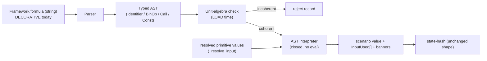
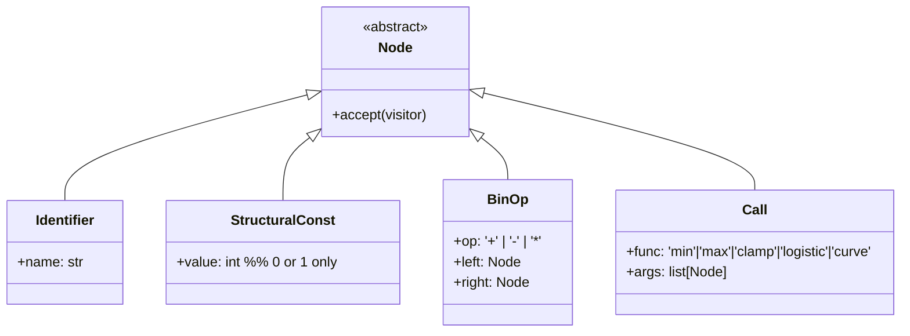
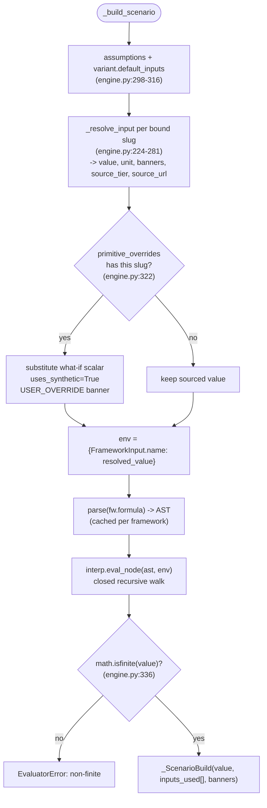
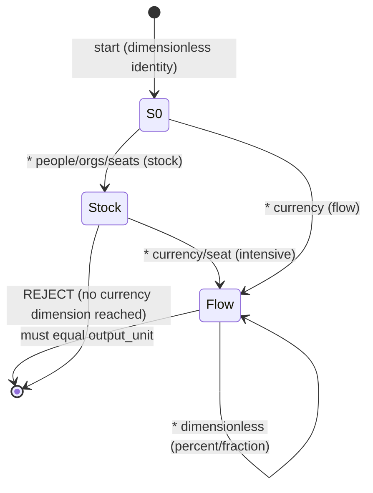
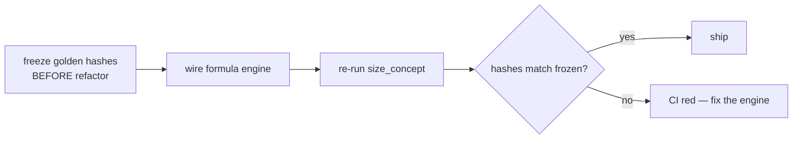
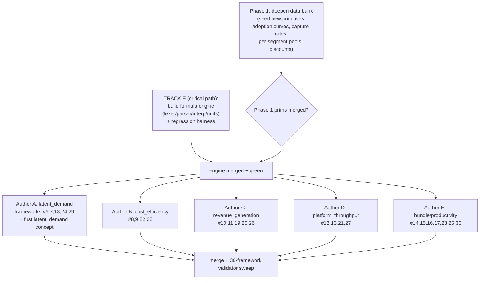

# Phase 2 — Real Formula Engine + Frameworks 6 → 30

**Status:** spec / not yet built
**Owner track:** backend evaluator + data authoring
**Depends on:** [Phase 1 — Deepen the data bank](./01-phase1-deepen-data-bank.md)
(many new frameworks bind to primitives that Phase 1 must seed first)
**Touches:** `backend/src/strata/models/framework.py`,
`backend/src/strata/evaluator/`, `backend/src/strata/validator/`,
`data/frameworks/`, `data/concepts/`

---

## 0. TL;DR

Today a `Framework.formula` is a **string that the evaluator never reads**. The
engine hard-codes a left-fold product over the framework's inputs
(`engine.py:291,335`). This works only because all five seeded frameworks are
literally `a * b`. The moment a framework needs `+`, a weighted sum, a
sum-then-discount, a min/max floor, or a bounded adoption curve (the
`latent_demand` lens, which has *zero* frameworks today), the string field is a
lie: the YAML says one thing, the math does another.

Phase 2 makes the formula **load-bearing**:

1. A **closed, whitelisted AST interpreter** (NOT `eval`/`exec`) that parses
   `Framework.formula` into a typed tree and walks it over resolved primitive
   values.
2. A **unit-algebra** pass that rejects unit-incoherent formulas **at load
   time**, not eval time.
3. **25 new frameworks** (5 → 30) that are genuinely different math, including
   the missing `latent_demand` lens, and a corrected
   `consolidation-sum-then-discount` that actually sums then discounts.
4. A **byte-identical regression guarantee**: the existing five frameworks and
   every TAM hash they have already minted must not move.



---

## 1. Problem statement — the multiply-only reality

### 1.1 The formula field is decorative

`Framework.formula` is declared as a bare string with no parser behind it:

```
backend/src/strata/models/framework.py:83      formula: str
```

The evaluator never imports, reads, or references `fw.formula`. Confirm by
reading `_build_scenario` — the function that turns a framework + variant into a
scenario value:

```
backend/src/strata/evaluator/engine.py:284  def _build_scenario(...) -> _ScenarioBuild:
backend/src/strata/evaluator/engine.py:291      value = 1.0
...
backend/src/strata/evaluator/engine.py:335          value *= input_value
```

The math is a hard-coded left-fold product: start at `1.0`, multiply by every
bound input's value in declaration order. The same hard-coded product appears a
second time in the time-travel path:

```
backend/src/strata/evaluator/engine.py:496      value = 1.0          # _build_scenario_as_of
backend/src/strata/evaluator/engine.py:520          value *= resolved.value
```

So the *only* math the engine can express is `∏ inputs`. The module docstring
admits it (`engine.py:1-9`: "every supported framework is multiplicative across
its declared inputs").

### 1.2 Why this is a problem

- **The `consolidation-sum-then-discount` framework is misnamed and miscomputed.**
  Its slug and name promise *sum-then-discount*, but the YAML formula is
  `tools_displaced * consolidation_rate` (`consolidation_sum_then_discount.yaml:32`)
  — a 2-term product. There is no sum and no `(1 - discount)` term. The Q39
  `BUNDLE_CONSOLIDATION` lens wants `Σ(spend_per_tool) × consolidation_rate ×
  (1 − pricing_discount)`; today it is a degenerate 2-input multiply, and
  `cross.framework_missing_roles` (`cross_record.py:190-219`) is *warning* about
  exactly the missing `spend_per_tool` / `pricing_discount` roles.

- **`latent_demand` has roles but no framework and no concept.**
  `_common.py:55-59` defines `addressable_population × adoption_rate_curve ×
  willingness_to_pay`. The `adoption_rate_curve` role is meant to be a *bounded
  logistic / S-curve*, not a scalar — but a pure product can't express a
  saturating curve, so the lens was never built. No framework declares
  `lens: latent_demand`; no concept declares it as primary.

- **Every other lens is a 2-input simplification** by its own admission
  (`throughput_take_rate.yaml:13-14`, `productivity_uplift_value_split.yaml:13-16`).
  The richer Q39 math (e.g. `gmv × take × digital_share`,
  `persona × productivity_gain × capture_rate`) needs ≥3 inputs and, in some
  cases, non-product structure.

- **The string and the math can silently disagree.** Nothing validates that
  `formula` matches what the engine does. An author can write
  `formula: "(a + b) * c"` and the engine will quietly compute `a * b * c`.

**Phase 2 closes this gap: the formula string becomes the single source of truth
for the math, parsed into a closed AST, unit-checked at load, and interpreted at
eval — with the existing product frameworks producing byte-identical output.**

---

## 2. Formula language design

### 2.1 Design constraints (inherited from the schema, do not violate)

- **Q15 — no scalar defaults.** Every *input quantity* is a primitive slug bound
  by a variant; a formula identifier resolves to a `FrameworkInput.name`, never
  to a hard-coded magnitude. This is the single most important rule and it
  shapes the grammar (see §2.4 on literals).
- **Q3 — frameworks own all unit-crossing math.** The formula language is the
  *only* place `*` between different dimensions is allowed.
- **Q20 — no LLM-projected primitives.** The formula engine never invents a
  value; it only combines bound primitive values.
- **Closed interpreter.** No `eval`, no `exec`, no `ast.literal_eval` of
  attacker-influenced text, no `numexpr`. See §12.

### 2.2 Operator set

| Op / fn | Arity | Meaning | Unit rule (see §5) |
|---|---|---|---|
| `*` | binary | product (the only unit-crossing op) | dimensions combine |
| `+` | binary | sum | operands must share a unit |
| `-` | binary | difference | operands must share a unit |
| `min(a, b, …)` | n-ary | floor of a set | all operands same unit; result that unit |
| `max(a, b, …)` | n-ary | ceiling of a set | all operands same unit; result that unit |
| `clamp(x, lo, hi)` | ternary | bound `x` into `[lo, hi]` | all three same unit; result that unit |
| `logistic(x, midpoint, steepness)` | ternary | bounded S-curve ∈ (0,1) | all operands **dimensionless**; result dimensionless |
| `curve(x, k)` | binary | bounded saturating adoption `1 − e^(−k·x)` ∈ (0,1) | operands **dimensionless**; result dimensionless |
| `(1 - x)` | — | structural discount idiom | `x` dimensionless percent; result dimensionless |

`logistic` and `curve` are the **only** way to model a bounded adoption fraction
without a scalar coefficient leaking into the math; they take *primitive-bound*
inputs (midpoint year-offset, steepness, penetration ceiling) and emit a
dimensionless fraction the rest of the formula multiplies.

### 2.3 Precedence & associativity

Standard arithmetic precedence; function calls bind tightest; parentheses
override.

```
lowest   + -            (left-assoc)
         * /            (left-assoc)   -- note: '/' is reserved, see §2.5
highest  unary -        (prefix, only inside structural literal idiom)
         f(...)  (...)   primary
```

### 2.4 Literals — the one carefully justified exception to Q15

**Decision: the grammar admits NO free numeric literals as *quantities*. It
admits exactly two *structural constants* — `0` and `1` — usable ONLY inside the
discount idiom `(1 - <ident-or-expr>)` and as `clamp`/`logistic` structural
bounds.**

Justification vs Q15: Q15 forbids a *scalar default standing in for a sourced
quantity* (e.g. `consolidation_rate: 0.3`). The `1` in `(1 - discount_rate)` is
**not a quantity** — it is the dimensionless identity that expresses "the
complement of a fraction." It carries no market meaning, has no source, and
cannot be a knob. Allowing only `{0, 1}` and only in fixed structural positions
keeps the door shut on smuggling magnitudes through the formula. The parser
**rejects any other numeric literal** (`2`, `0.3`, `1e6`, …) with a
`FormulaSyntaxError`. The semantic validator's existing
`semantic.framework_scalar_default` (`semantic.py:90-162`) continues to guard
the *variant binding* side; the new parser guards the *formula* side.

```
ALLOWED:    (1 - pricing_discount)          -- structural complement
            clamp(adoption_index, 0, 1)     -- structural bounds
DISALLOWED: tools_displaced * 0.3           -- scalar magnitude  -> FormulaSyntaxError
            persona_pool * 2                -- scalar multiplier -> FormulaSyntaxError
```

### 2.5 Reserved / excluded

- `/` (division) is **reserved but not enabled** in Phase 2. Division creates
  intensive units (per-X) and the unit algebra for it is deferred; no target
  framework needs it. The lexer recognizes `/` and raises a clear
  "division not supported in Phase 2" error rather than silently mis-parsing.
- No exponentiation `**`, no comparison operators, no boolean logic, no
  assignment. The language is a pure arithmetic expression over bound inputs.

### 2.6 EBNF grammar

```ebnf
formula      = expr ;

expr         = term , { ("+" | "-") , term } ;
term         = factor , { "*" , factor } ;
factor       = primary ;

primary      = identifier
             | call
             | structural_const
             | "(" , expr , ")" ;

call         = func_name , "(" , arg_list , ")" ;
arg_list     = expr , { "," , expr } ;
func_name    = "min" | "max" | "clamp" | "logistic" | "curve" ;

identifier   = letter , { letter | digit | "_" } ;   (* binds to FrameworkInput.name *)

structural_const = "0" | "1" ;   (* ONLY legal inside (1 - x), clamp/logistic bounds *)

letter       = "a".."z" | "A".."Z" ;
digit        = "0".."9" ;
```

> The grammar is intentionally tiny. `identifier` is the leaf that binds to a
> `FrameworkInput.name`; `structural_const` is the only literal; everything else
> is operators and calls.

### 2.7 Identifier binding

An identifier in the formula is a `FrameworkInput.name`. The chain:

```
formula identifier  ──→  FrameworkInput.name      (framework.py:53)
FrameworkInput.name ──→  variant.default_inputs[name] = primitive_slug   (framework.py:67)
primitive_slug      ──→  _resolve_input(registry, slug) -> value+unit    (engine.py:224-281)
```

Every identifier in the formula **must** be a declared `FrameworkInput.name`
(validated at load — §5.4) and **must** be bound by every variant (already
enforced at eval, `engine.py:312-316`).

### 2.8 Example formula per lens

| Lens | Example formula | Notes |
|---|---|---|
| `cost_efficiency` | `persona_pool * addressable_share * replacement_rate * cost_per_persona` | full 4-role Q39 shape |
| `revenue_generation` | `target_segment_count * spend_per_target * capture_rate` | 3-role |
| `latent_demand` | `addressable_population * curve(adoption_rate_curve, adoption_steepness) * willingness_to_pay` | bounded S-curve |
| `platform_throughput` | `gmv_or_volume * take_rate * market_share_assumption` | 3-role |
| `bundle_consolidation` | `tools_displaced * consolidation_rate * (1 - pricing_discount)` | sum-then-discount idiom |
| `productivity_uplift` | `persona_count * productivity_gain_pct * value_split_to_vendor` | 3-role |
| (weighted-sum example) | `min(seats_based_estimate, spend_cap)` | floor of two same-unit currency estimates |

> Existing seeded frameworks keep their current 2-input product formulas
> verbatim (e.g. `persona_pool * cost_per_persona`,
> `bottoms_up_cost_efficiency.yaml:21`) so they evaluate byte-identically. The
> richer shapes above ship as **new** frameworks (§7), not edits to the five.

---

## 3. The AST

### 3.1 Node types (mermaid classDiagram)



There are exactly **four** node kinds. Note the deliberate decision (§2.4):
`StructuralConst` exists but is constrained to `{0, 1}` and is rejected by the
unit-algebra pass anywhere except the discount idiom / clamp-logistic bounds.
There is **no** general `Num` literal node — that is the structural guard
against scalar magnitudes (Q15).

Each node is a frozen dataclass with `slots=True`. The tree is immutable once
parsed; the interpreter never mutates it.

### 3.2 ASCII render of a parsed formula

`consolidation-sum-then-discount` corrected formula:
`tools_displaced * consolidation_rate * (1 - pricing_discount)`

```
                       BinOp(*)
                      /        \
              BinOp(*)          BinOp(-)
             /        \         /       \
   Identifier         Identifier   StructuralConst   Identifier
 "tools_displaced"  "consolidation   (1)            "pricing_discount"
                       _rate"

Left-assoc grouping of '*' makes the tree:
  ((tools_displaced * consolidation_rate) * (1 - pricing_discount))
```

A `latent_demand` formula
`addressable_population * curve(adoption_rate_curve, adoption_steepness) * willingness_to_pay`:

```
                         BinOp(*)
                        /        \
                 BinOp(*)         Identifier
                /        \       "willingness_to_pay"
        Identifier        Call(curve)
   "addressable_pop"     /          \
                  Identifier         Identifier
              "adoption_rate_curve" "adoption_steepness"
```

### 3.3 Why a closed AST and not a string + eval

`eval("...")` over a YAML-authored string is a remote-code-execution hole and a
unit-blindness hole. The AST is **closed**: only the four whitelisted node kinds
exist, only five function names are callable, only `+ - *` operators exist, and
the leaf set is `{declared FrameworkInput.name} ∪ {0, 1}`. Anything else fails
to parse. See §12 for the full safety argument.

---

## 4. The evaluator

### 4.1 Module layout

```
backend/src/strata/evaluator/
  engine.py        # existing — _build_scenario rewired to call the formula evaluator
  formula/
    __init__.py
    ast_nodes.py   # frozen dataclasses: Identifier, StructuralConst, BinOp, Call
    lexer.py       # text -> tokens (rejects unknown chars, '/', stray literals)
    parser.py      # tokens -> Node (recursive descent over the EBNF in §2.6)
    interp.py      # Node + {name: value} -> float (closed walk, no eval)
    units.py       # unit algebra over the AST (§5) — used at LOAD time
    errors.py      # FormulaSyntaxError, FormulaUnitError, FormulaEvalError
```

`formula/` is self-contained and importable by both the evaluator (eval-time
walk) and the validator (load-time unit check).

### 4.2 Parse → bind → walk → emit (flowchart)



The **InputUsed list and banners are built exactly as today** — one
`InputUsed` row per `FrameworkInput`, in declaration order, carrying
`value`/`name`/`unit`/`source_tier`/`source_url` (`engine.py:342-353`). The only
change is that the *scenario value* comes from `interp.eval_node(...)` instead of
the `value *= input_value` fold. The override and banner machinery
(`engine.py:298-355`) is untouched.

### 4.3 Sequence (mermaid)

```mermaid
sequenceDiagram
  participant SC as size_concept
  participant BS as _build_scenario
  participant RI as _resolve_input
  participant FP as formula.parser
  participant IN as formula.interp
  SC->>BS: fw, variant, overrides
  loop each FrameworkInput
    BS->>RI: resolve(default_inputs[name])
    RI-->>BS: value, unit, banners, tiers
    Note over BS: apply primitive_overrides if present
    BS->>BS: env[input.name] = value ; append InputUsed
  end
  BS->>FP: parse(fw.formula)  (memoized)
  FP-->>BS: AST root Node
  BS->>IN: eval_node(root, env)
  IN-->>BS: scalar value
  BS->>BS: assert math.isfinite(value)
  BS-->>SC: _ScenarioBuild(value, inputs_used, banners)
```

### 4.4 The interpreter (closed walk — pseudocode)

```python
# interp.py  — NO eval/exec anywhere.
def eval_node(node: Node, env: dict[str, float]) -> float:
    match node:
        case Identifier(name):
            try:
                return env[name]                       # bound primitive value
            except KeyError:
                raise FormulaEvalError(f"unbound identifier {name!r}")
        case StructuralConst(value):
            return float(value)                        # 0 or 1 only
        case BinOp(op, left, right):
            a, b = eval_node(left, env), eval_node(right, env)
            r = {"+": a + b, "-": a - b, "*": a * b}[op]
            return _guard_finite(r)
        case Call("min", args):  return _guard_finite(min(_evals(args, env)))
        case Call("max", args):  return _guard_finite(max(_evals(args, env)))
        case Call("clamp", [x, lo, hi]):
            return _guard_finite(max(eval_node(lo, env),
                                     min(eval_node(x, env), eval_node(hi, env))))
        case Call("logistic", [x, mid, steep]):
            return 1.0 / (1.0 + math.exp(-_evals_one(steep) * (_evals_one(x) - _evals_one(mid))))
        case Call("curve", [x, k]):
            return 1.0 - math.exp(-eval_node(k, env) * eval_node(x, env))
        case _:
            raise FormulaEvalError(f"non-whitelisted node {node!r}")  # unreachable post-parse
```

`_guard_finite` raises `FormulaEvalError` on NaN/±inf (mirrors the existing
`engine.py:336` finite check). `logistic`/`curve` are bounded into `(0, 1)` by
construction, so they can never blow up the product.

### 4.5 Byte-identical guarantee — the strategy

**Strategy: a single code path, no feature flag, with the parser proving the
fold is equivalent for the product case.**

The existing five frameworks have formulas that are pure left-associative
products of their two inputs (`a * b`). The new interpreter walks
`BinOp('*', Identifier(a), Identifier(b))` and returns `a_value * b_value` —
**the identical IEEE-754 operation** the old fold did (`value = 1.0; value *=
a; value *= b` ≡ `1.0 * a * b`; and `1.0 * a * b == a * b` for finite floats —
multiplication by `1.0` is exact). To be airtight about float associativity:

- The old fold seeds `value = 1.0` then multiplies inputs left to right
  (`engine.py:291,335`). For two inputs that is `(1.0 * a) * b`.
- The new walk of `a * b` computes `a * b`.
- `(1.0 * a) * b == a * b` is **exact** in IEEE-754 (multiplying by `1.0` is the
  identity and introduces no rounding). Property test in §10 asserts this over
  random finite inputs.

For frameworks with **≥3 product terms** authored as a left-assoc chain
`((a * b) * c)`, the AST walk reproduces the same left-to-right grouping the old
fold used, so even multi-term products are bit-identical. Non-product math
(`+`, `min`, `curve`, …) only ever appears in **new** frameworks, which have no
pre-existing committed TAM hash to protect.

A **frozen golden-hash regression fixture** (§9) pins the current
`state_hash` for every (framework, variant) the five frameworks size today. CI
fails if any moves.

### 4.6 Overrides threading

- `primitive_overrides` (`engine.py:64-77,322-334`) substitute the *resolved
  value* before it enters `env`. The formula walk sees the overridden value;
  the `USER_OVERRIDE` banner + `uses_synthetic=True` are emitted exactly as
  today. No formula change.
- `framework_assumptions` (`engine.py:77,298-311`) re-point an input name to a
  different existing primitive *before* resolution. The formula identifier still
  binds to the same `FrameworkInput.name`; only the slug behind it changes. No
  formula change.

Both fold into the state hash via the existing `payload["overrides"]` block
(`engine.py:142-154`) — unchanged.

---

## 5. Unit coherence at validation time

### 5.1 Principle: reject unit-incoherent formulas at LOAD, not eval

The interpreter is unit-blind (it walks floats). All unit safety happens **once,
at registry load**, by walking the same AST with a *unit* algebra instead of a
value algebra. An incoherent formula (e.g. `people + currency`) makes the
**record fail to load** — it never reaches the evaluator.

### 5.2 Unit algebra (table)

`Unit` is `(kind, dimension, denominator, currency, basis)` (`unit.py:38-51`).
The algebra works on a reduced unit signature derived from each
`FrameworkInput.unit_signature`:

| AST node | Operand requirement | Result unit |
|---|---|---|
| `Identifier` | — | the input's `unit_signature` |
| `StructuralConst(0/1)` | — | **dimensionless** |
| `BinOp('*')` | none (unit-crossing allowed, Q3) | dimension-combined (see §5.3) |
| `BinOp('+')` | both operands **same** unit | that unit |
| `BinOp('-')` | both operands **same** unit | that unit |
| `min` / `max` | all operands **same** unit | that unit |
| `clamp(x, lo, hi)` | all three **same** unit | that unit |
| `logistic(x, mid, steep)` | all operands **dimensionless** | **dimensionless** |
| `curve(x, k)` | all operands **dimensionless** | **dimensionless** |

"Same unit" uses the existing `Unit.is_compatible_with` (`unit.py:53-66`):
matching `dimension` + `kind`, signature `denominator`/`currency` accept-any
when unset. The discount idiom `(1 - pricing_discount)` type-checks because
`pricing_discount` is `dimensionless/percent` and `1` is `StructuralConst →
dimensionless`; `dimensionless - dimensionless = dimensionless`.

### 5.3 Product dimension combination (state machine)



The product must terminate in a unit `is_compatible_with` the framework's
declared `output_unit` (`framework.py:84`). Multiplying a `dimensionless`
fraction (a percent, a `curve(...)` result, a `(1-x)` complement) **preserves**
the running dimension — it scales, it does not change kind. The output-unit
match is the final gate: a `cost_efficiency` framework whose product lands in
`people` (forgot the `cost_per_persona` term) is **rejected at load**.

### 5.4 Where it lives

- New module `evaluator/formula/units.py`: `infer_unit(node, inputs_by_name) ->
  ReducedUnit | raise FormulaUnitError`.
- New cross-record check in `validator/cross_record.py`,
  `_framework_formula_coherence(registry)`, added to `cross_record_check`
  (`cross_record.py:54-60`). For each framework: parse `fw.formula`, assert
  every identifier is a declared `FrameworkInput.name`, run `infer_unit`, assert
  the inferred result `is_compatible_with(fw.output_unit)`. Emit:
  - `cross.formula_syntax_error` (ERROR) — unparseable / stray literal / `/`.
  - `cross.formula_unknown_identifier` (ERROR) — identifier not a declared input.
  - `cross.formula_unit_incoherent` (ERROR) — unit algebra failed (`+` across
    dimensions, `logistic` over a non-dimensionless operand, etc.).
  - `cross.formula_output_unit_mismatch` (ERROR) — inferred unit ≠ `output_unit`.
- The parser itself also runs in the loader's framework path so a syntactically
  broken formula fails the load before the registry is built.

### 5.5 Coverage check stays a warning

`cross.framework_missing_roles` (`cross_record.py:190-219`) keeps warning when a
framework's input *names* don't cover all Q39 roles for its lens. Once a new
framework covers all roles, the warning disappears for it — a built-in progress
signal toward the 30-framework target.

---

## 6. State-hash impact

The `/tam/<hash>` permalink hashes a canonicalized payload (`engine.py:123-166`,
`mint_state_hash` in `hashing.py`). The payload projects, per scenario:
`framework`, `variant`, **`value`**, and per-input `{name, primitive, hash}`
(`engine.py:125-141`).

**Key invariant: the formula is NOT a separate hash field — its *effect* enters
the hash through the already-hashed `value`.** Two states that produce the same
scenario `value` from the same inputs collide; a formula change that moves a
value mints a fresh hash automatically. This is correct: the hash addresses the
*computed TAM*, not the recipe text.

Changes required to the hash inputs: **none for the five existing frameworks**
(their `value` is byte-identical, §4.5). For new frameworks, the `value` is
whatever the formula yields — already covered. We deliberately do **not** add
`formula` text to the payload, because two frameworks with equivalent math
(`a*b` vs `b*a` if we ever normalized) should collide on equal value, and
because formula text is a recipe detail, not a state coordinate. The
`overrides` and `declared_scope` folds (`engine.py:142-166`) are untouched.

```
hash payload (unchanged shape):
  concept, scenarios[{framework, variant, value, inputs[{name,primitive,hash}]}],
  [overrides], [declared_scope]
            └── formula influence enters HERE via `value`, never as its own key
```

---

## 7. The 30-framework catalog

### 7.1 Build order

1. **`latent_demand` first** — it's the only lens with zero frameworks and it
   exercises the new `curve`/`logistic` operators (the riskiest new code path).
   Building it first de-risks the operator set before the fan-out.
2. **Fix `consolidation-sum-then-discount`** to the real sum-then-discount shape.
3. Fan out the remaining 22 across the six lenses.

### 7.2 Enum deltas

- **`AnalysisLens`** (`_common.py:23-36`): no new values — all six lenses already
  exist; `latent_demand` just needs a framework + concept.
- **`MethodFamily`** (`framework.py:20-29`): five families today. The new
  frameworks introduce two structurally-distinct families that don't fit the
  existing five cleanly:
  - `ADOPTION_CURVE` — for `latent_demand` S-curve frameworks (independence vs a
    top-down spend method must score as distinct, `engine.py:472-481`).
  - `WEIGHTED_BLEND` — for min/max/blend frameworks that triangulate two
    same-unit estimates.
  These are **flagged enum additions** — add to `MethodFamily` with the same
  `StrEnum` pattern; no migration needed (enum is in-code).

### 7.3 Catalog (5 existing + 25 new = 30)

Legend — Shape: `P`=pure product, `PD`=product-then-discount, `S`=sum/weighted
sum, `MM`=min/max blend, `CV`=adoption curve (`curve`/`logistic`). "New prims"
notes the dependency on Phase 1 bank depth.

| # | Slug | Lens | MethodFamily | Shape | Formula (illustrative shape) | New prims from Phase 1? |
|---|---|---|---|---|---|---|
| 1 | `bottoms-up-cost-efficiency` *(exists)* | cost_efficiency | bottoms_up_seats | P | `persona_pool * cost_per_persona` | no — frozen |
| 2 | `top-down-revenue-capture` *(exists)* | revenue_generation | top_down_spend | P | `target_segment_count * spend_per_target` | no — frozen |
| 3 | `throughput-take-rate` *(exists)* | platform_throughput | value_chain | P | `gmv_or_volume * take_rate` | no — frozen |
| 4 | `consolidation-sum-then-discount` *(exists, formula UNCHANGED to stay byte-identical)* | bundle_consolidation | comparable_revenue | P | `tools_displaced * consolidation_rate` | no — frozen |
| 5 | `productivity-uplift-value-split` *(exists)* | productivity_uplift | comparable_revenue | P | `persona_count * value_split_to_vendor` | no — frozen |
| 6 | `latent-demand-logistic-adoption` | latent_demand | adoption_curve | CV | `addressable_population * curve(adoption_rate_curve, adoption_steepness) * willingness_to_pay` | **yes** — population, steepness, WTP |
| 7 | `latent-demand-s-curve-penetration` | latent_demand | adoption_curve | CV | `addressable_population * logistic(years_since_launch, adoption_midpoint, adoption_steepness) * willingness_to_pay` | yes |
| 8 | `cost-efficiency-full-roles` | cost_efficiency | bottoms_up_seats | P | `persona_pool * addressable_share * replacement_rate * cost_per_persona` | yes — addressable_share, replacement_rate |
| 9 | `cost-efficiency-clamped-penetration` | cost_efficiency | bottoms_up_seats | PD/MM | `persona_pool * clamp(addressable_share,0,1) * cost_per_persona` | yes |
| 10 | `revenue-capture-with-capture-rate` | revenue_generation | top_down_spend | P | `target_segment_count * spend_per_target * capture_rate` | yes — capture_rate |
| 11 | `revenue-capture-segment-blend` | revenue_generation | top_down_spend | S | `enterprise_pool + midmarket_pool + smb_pool` *(same-unit currency sum)* | yes — per-segment pools |
| 12 | `throughput-digital-share` | platform_throughput | value_chain | P | `gmv_or_volume * take_rate * market_share_assumption` | yes — digital share |
| 13 | `throughput-multi-rail-sum` | platform_throughput | value_chain | S | `(card_volume * card_take) + (ach_volume * ach_take)` | yes — per-rail volume/take |
| 14 | `bundle-consolidation-true-discount` | bundle_consolidation | comparable_revenue | PD | `tools_displaced * consolidation_rate * (1 - pricing_discount)` | yes — pricing_discount |
| 15 | `bundle-consolidation-sum-of-tools` | bundle_consolidation | comparable_revenue | S+PD | `(tool_a_spend + tool_b_spend + tool_c_spend) * consolidation_rate * (1 - pricing_discount)` | yes — per-tool spend |
| 16 | `productivity-uplift-three-role` | productivity_uplift | comparable_revenue | P | `persona_count * productivity_gain_pct * value_split_to_vendor` | yes — productivity_gain_pct |
| 17 | `productivity-uplift-capped` | productivity_uplift | comparable_revenue | MM | `min(persona_count * productivity_gain_pct * value_split_to_vendor, market_spend_ceiling)` | yes — ceiling |
| 18 | `latent-demand-geo-stacked` | latent_demand | adoption_curve | CV+S | `(us_pop * curve(us_adopt,k) + eu_pop * curve(eu_adopt,k)) * willingness_to_pay` | yes — per-geo pops |
| 19 | `revenue-capture-floor-of-two` | revenue_generation | weighted_blend | MM | `min(top_down_estimate, bottoms_up_estimate)` | yes — two same-unit estimates |
| 20 | `revenue-capture-ceiling-blend` | revenue_generation | weighted_blend | MM | `max(conservative_estimate, base_estimate)` | yes |
| 21 | `throughput-take-rate-clamped` | platform_throughput | value_chain | MM | `gmv_or_volume * clamp(take_rate,0,1)` | yes |
| 22 | `cost-efficiency-replacement-adjusted` | cost_efficiency | bottoms_up_seats | PD | `persona_pool * cost_per_persona * (1 - automation_displacement)` | yes |
| 23 | `bundle-consolidation-net-of-churn` | bundle_consolidation | comparable_revenue | PD | `tools_displaced * consolidation_rate * (1 - churn_rate)` | yes |
| 24 | `latent-demand-bounded-wtp` | latent_demand | adoption_curve | CV+MM | `addressable_population * curve(adoption_rate_curve,k) * min(willingness_to_pay, wtp_ceiling)` | yes |
| 25 | `productivity-uplift-segment-sum` | productivity_uplift | comparable_revenue | S | `(senior_personas * senior_value) + (junior_personas * junior_value)` | yes |
| 26 | `revenue-capture-digital-only` | revenue_generation | top_down_spend | P | `target_segment_count * spend_per_target * digital_channel_share` | yes |
| 27 | `throughput-value-chain-stacked` | platform_throughput | value_chain | S | `(layer1_revenue * layer1_share) + (layer2_revenue * layer2_share)` | yes |
| 28 | `cost-efficiency-geo-sum` | cost_efficiency | bottoms_up_seats | S | `(us_personas * us_cost) + (eu_personas * eu_cost)` | yes |
| 29 | `latent-demand-conservative-curve` | latent_demand | adoption_curve | CV | `addressable_population * curve(adoption_rate_curve, conservative_k) * willingness_to_pay` | yes — conservative steepness |
| 30 | `bundle-consolidation-suite-premium` | bundle_consolidation | comparable_revenue | PD | `tools_displaced * consolidation_rate * (1 - pricing_discount) * suite_premium_factor` | yes — suite_premium_factor |

> Counts (10× `latent_demand`/`adoption_curve` etc.) are framework *shapes*, not
> market figures — no TAM numbers are invented here. Actual values come only
> from sourced primitives at eval time.

### 7.4 Note on #4 vs #14

The existing `consolidation-sum-then-discount` (#4) keeps its current product
formula **verbatim** so its committed TAM hashes don't move. The *correctly
named* sum-then-discount math ships as a **new** framework
`bundle-consolidation-true-discount` (#14) and `bundle-consolidation-sum-of-tools`
(#15). The misleading name on #4 is documented as legacy; renaming a slug would
break permalinks, so we leave it and let #14/#15 carry the honest math. (A
follow-up may deprecate #4 once no concept binds it.)

---

## 8. Per-new-framework authoring checklist

For each new framework YAML in `data/frameworks/<slug>.yaml`:

1. **Header**: `kind: framework`, kebab `slug`, `schema_version: 1`, `name`,
   `method_family` (add `adoption_curve` / `weighted_blend` to the enum if
   used), `lens`.
2. **Inputs**: one `FrameworkInput` per identifier in the formula. `name` must
   match a Q39 role for full role coverage (silences
   `cross.framework_missing_roles`). `role` is the Q6 `InputRole`
   (`base_value` for quantities; `regime_modifier` for subsidy-style multipliers).
   `unit_signature` must be **consistent with the unit algebra** (§5):
   percent/fraction inputs → `kind: dimensionless, dimension: percent`; the
   `curve`/`logistic` operands must be dimensionless.
3. **Formula**: a valid expression per the EBNF (§2.6). Every identifier ∈ input
   names. No stray literals. Must infer to a unit `is_compatible_with`
   `output_unit`.
4. **output_unit**: the dimension the product lands in (currency/per-year for a
   TAM).
5. **applicable_to**: concept slugs this framework can size.
6. **variants**: one per concept; `default_inputs` binds **every** input name to
   an **existing** primitive slug (Q15 — no scalars). The bound primitive's unit
   must `is_compatible_with` the input `unit_signature`
   (`cross_record.py:170-186`).
7. **Concept side**: each bound concept's `analysis_lens.primary` (or
   `.secondary`) must equal the framework's `lens`, or
   `cross.lens_tag_mismatch` (`cross_record.py:109-126`) fails the load.

### 8.1 Concept YAML shape (for `latent_demand`, which has no concept today)

Model: `Concept` (`concept.py:86-111`). Minimum viable lens-tagged concept:

```yaml
kind: concept
slug: <kebab-slug>
schema_version: 1
name: <human name>
definition: <one-paragraph scope statement>
analysis_lens:
  primary: latent_demand          # the missing lens — first concept to use it
  # secondary: <other lens>       # optional; must differ from primary
modifiers: {}
scope:                            # MarketScope (scope.py) — optional, recommended
  geo_supply: [US]
  geo_demand: [US]
  product: [<free-text product tag>]
measurements:                     # primitive slugs that compete to size it
  - <addressable-population-primitive>
  - <adoption-curve-primitive>
  - <willingness-to-pay-primitive>
competing_concepts: []
requires_clearance: []
```

At least **one** new concept must declare `primary: latent_demand` so framework
#6 has a variant scope to bind, and `_iter_scenario_builds` (`engine.py:185-205`)
will actually pick it up (it filters by lens match).

---

## 9. Migration / back-compat

### 9.1 What must not move

- The five framework YAMLs' **formulas stay byte-for-byte unchanged** (#1–#5).
- Every TAM `state_hash` those frameworks have already minted.

### 9.2 Regression harness

`backend/tests/test_formula_regression.py`:

1. **Golden-hash fixture**: before the refactor, run `size_concept` for every
   concept currently sized by the five frameworks and snapshot
   `{concept_slug: tam.state_hash}` into
   `backend/tests/fixtures/phase1_golden_tam_hashes.json`.
2. **Post-refactor assertion**: after wiring the formula engine, re-run and
   assert every hash matches the frozen fixture exactly. Any drift fails CI.
3. **Per-scenario value equality**: assert each `Scenario.value` equals the
   pre-refactor value (stronger than the aggregate hash; catches a value change
   that happens to re-collide).



---

## 10. Test plan

| Layer | Test | Asserts |
|---|---|---|
| Lexer | unknown char, `/`, stray literal `0.3`, `2` | `FormulaSyntaxError` |
| Parser | each EBNF production; precedence `a + b * c`; assoc `a*b*c` | correct AST |
| Parser | `(1 - x)` allowed; bare `1` outside idiom rejected | structural-const guard |
| Interp `*` | golden values | exact product |
| Interp `+`/`-` | golden values | exact sum/diff |
| Interp `min`/`max`/`clamp` | golden | floor/ceiling/bound |
| Interp `logistic` | known points (x=mid → 0.5) | ∈ (0,1), monotone |
| Interp `curve` | x=0 → 0, x→∞ → 1 | bounded, monotone |
| Interp | NaN/inf operand | `FormulaEvalError` (mirrors `engine.py:336`) |
| **Property** | random finite a,b: `(1.0*a)*b == eval("a*b")` | **byte-identical fold** (§4.5) |
| Units (load) | `people + currency` | `cross.formula_unit_incoherent` |
| Units (load) | `logistic` over currency operand | `cross.formula_unit_incoherent` |
| Units (load) | product lands in wrong dimension | `cross.formula_output_unit_mismatch` |
| Units (load) | identifier not a declared input | `cross.formula_unknown_identifier` |
| Regression | all 5 framework TAM hashes | match frozen fixture (§9) |
| Each new framework | size each bound concept | finite, positive, unit-correct value |
| `latent_demand` e2e | new concept → framework #6 | scenario emitted, picked by `_iter_scenario_builds` |
| Safety | `__import__('os')`, `1;2`, backticks in formula | `FormulaSyntaxError`, never executed |

Gates: `uv run pytest && uv run pyright && uv run ruff check . && uv run ruff
format --check .` — pyright strict zero errors on `src/`, ruff clean.

---

## 11. Parallel execution model



**Critical path**: the formula engine (Track E) must merge *and* the regression
harness must be green before any author fans out — otherwise authors can't
validate their non-product formulas. Phase 1 primitive depth gates the
*variants* (every new framework variant binds to a real primitive slug); authors
whose primitives aren't seeded yet are blocked on Phase 1.

---

## 12. Risks & definition of done

### 12.1 Risks

- **Formula injection / RCE — PRIMARY RISK.**
  **MITIGATION (non-negotiable): the evaluator is a closed, whitelisted AST
  interpreter. It NEVER calls `eval`, `exec`, `compile`, `ast.literal_eval` on
  formula text, `getattr`, or `numexpr`.** The lexer recognizes only the
  characters of the grammar (`§2.6`); the parser produces only the four node
  kinds (`§3.1`); the interpreter's `match` (`§4.4`) handles only those kinds
  and only five function names — any other shape raises before evaluation.
  Identifiers resolve only against the bound `env` dict of primitive values;
  there is no attribute access, no call into Python builtins, no I/O. A YAML
  author cannot smuggle code through `formula`.
- **Non-finite blow-ups.** `_guard_finite` + the existing `math.isfinite` gate
  (`engine.py:336`) reject NaN/±inf; `logistic`/`curve` are analytically bounded
  to `(0, 1)`.
- **Float drift breaking byte-identity.** Mitigated by the exact-multiply
  property test and the frozen golden-hash fixture (§9). The product path is
  proven equivalent; only new frameworks use new ops.
- **Performance.** Formulas are tiny (≤ ~10 nodes). Parse once per framework,
  memoize the AST on the `Framework` (or a module-level cache keyed by formula
  string). The walk is O(nodes) per scenario — negligible vs the existing fold.
- **Author mistakes.** Caught at load by the four new `cross.formula_*` ERROR
  codes (§5.4); a bad formula fails the registry build, never ships.

### 12.2 Definition of done

- [ ] `evaluator/formula/` ships: lexer, parser, closed interpreter, unit
      algebra, errors — **no `eval`/`exec` anywhere** (grep clean).
- [ ] `_build_scenario` and `_build_scenario_as_of` (`engine.py:284,484`) call
      the AST interpreter; the `value *= ...` fold is removed.
- [ ] `cross_record.py` rejects syntactically/unit-incoherent formulas at load
      (4 new ERROR codes); `framework_missing_roles` stays a warning.
- [ ] Golden-hash regression green: all 5 existing frameworks byte-identical.
- [ ] 25 new frameworks authored; `latent_demand` built first with ≥1 concept;
      `consolidation` corrected via new #14/#15 (legacy #4 left intact).
- [ ] `MethodFamily` gains `adoption_curve` + `weighted_blend`.
- [ ] Full test matrix (§10) green; `uv run pytest && uv run pyright && uv run
      ruff check . && uv run ruff format --check .` clean.
- [ ] No invented market figures — every framework value derives from sourced
      primitives bound by variants.
