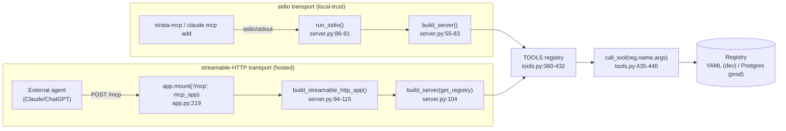
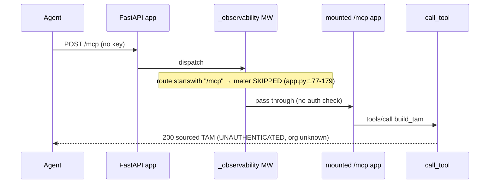
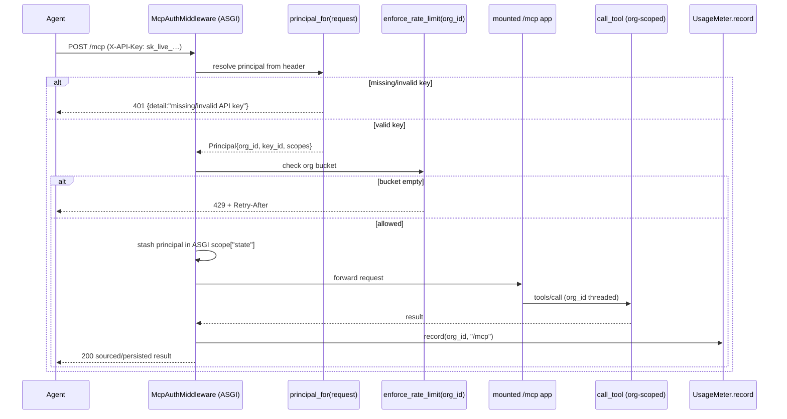
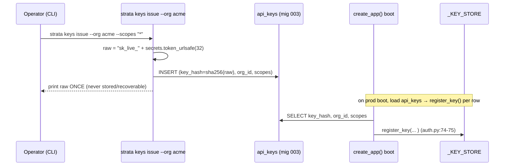
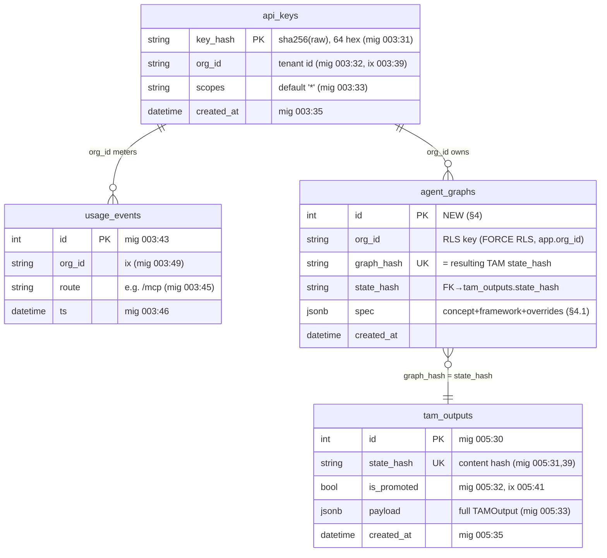
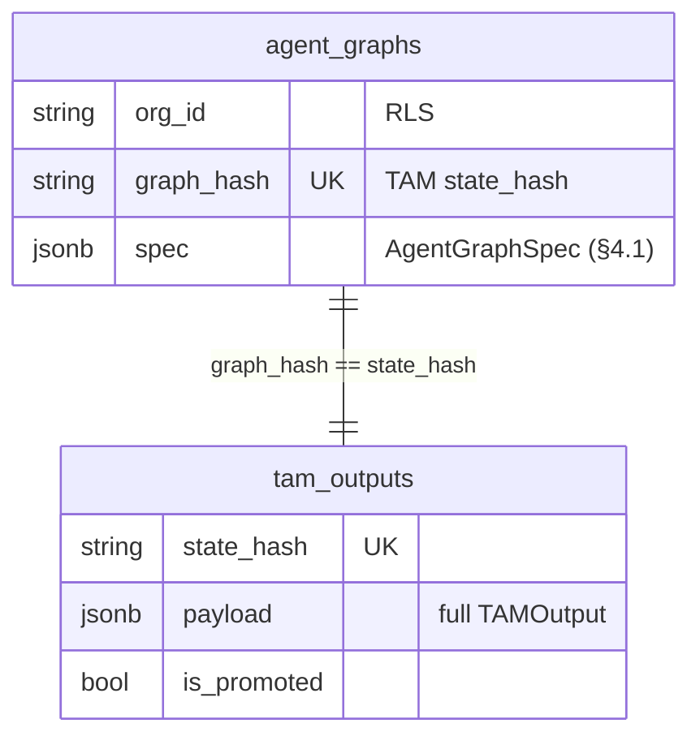
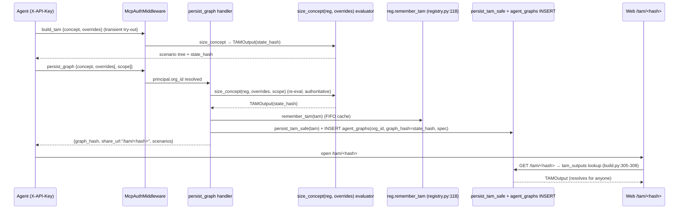
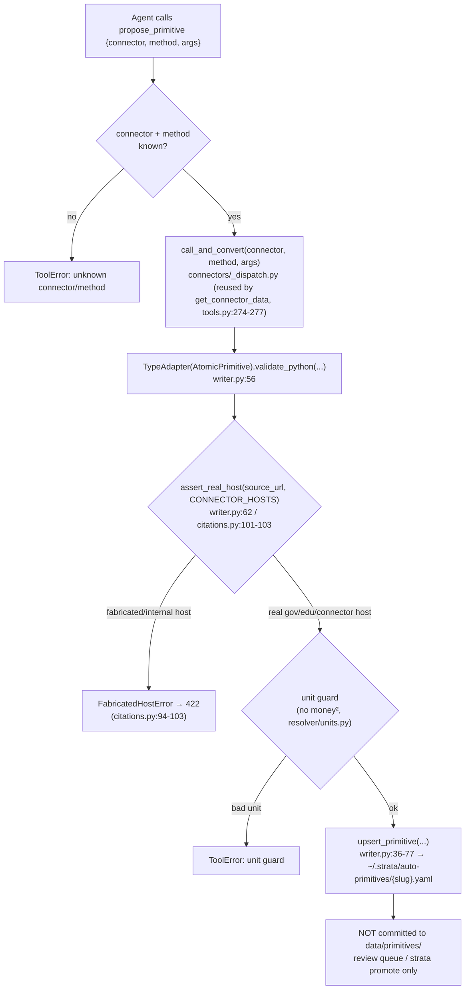
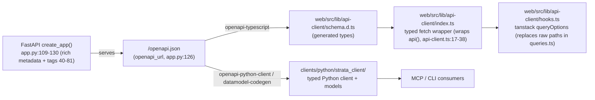
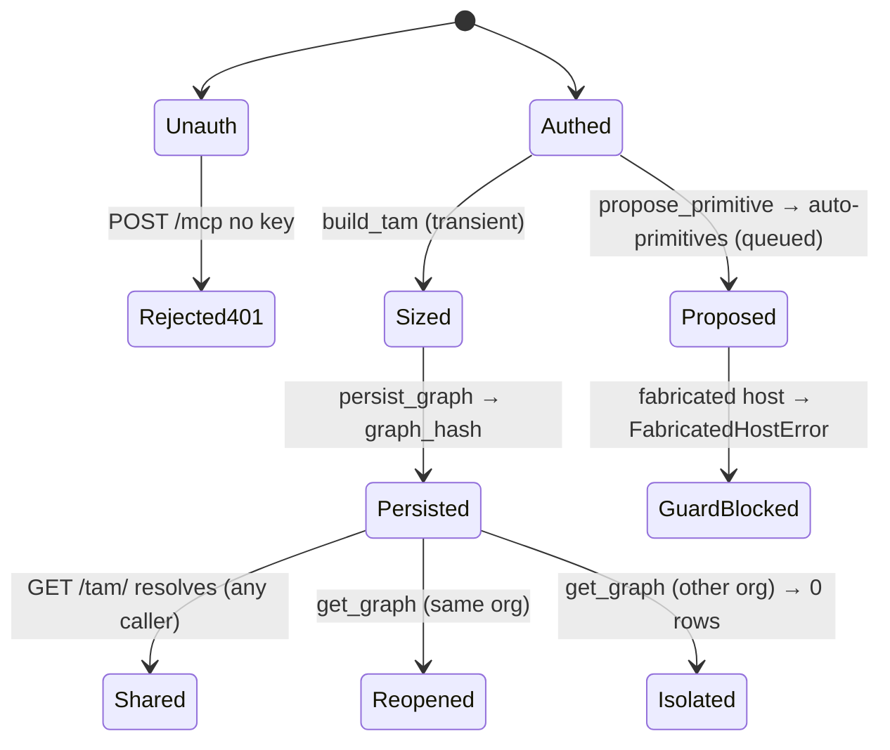

# Phase 3 — MCP Harness: Auth + Compose/Persist + SDK

**Status:** spec (not yet built)
**Owner:** Arkash Jain (`arkash@benmore.tech`)
**Scope codename:** "Plaid for AI agents" — let an external Claude/ChatGPT agent
authenticate, compose a graph of *sourced* primitives/frameworks, recompute a
TAM, and persist/share it at a permanent `/tam/<hash>` URL.

This is a **technical spec**, not code. The only file this phase's planning
step touches is this markdown. Every code reference below is `file:line` against
the tree at `/Users/arkashjain/Developer/VC_stuff/backend` and `…/web`.

---

## 0. Why this phase exists (the three gaps)

Today the MCP surface is **catalog + evaluate only**, it is **mounted with no
auth**, and there is **no typed SDK** for external consumers. Three concrete
defects block "Plaid for agents":

| # | Gap | Evidence (file:line) |
|---|-----|----------------------|
| A | The hosted `/mcp` transport has **no authentication** and is explicitly **skipped** by the observability/metering middleware. | Mount: `backend/src/strata/api/app.py:206-219`. Middleware skip: `app.py:177-179` (`route.startswith(… "/mcp")`). Lifespan note "local-trust until the Wave-3 API-key middleware gates it": `app.py:96-105`. Server docstring: `backend/src/strata/mcp/server.py:9-11`. |
| B | MCP is **read/evaluate only**. `build_tam` is **transient** and can only re-point to **existing** primitives — there is no way for an agent to *persist* a graph it built or *propose* a new sourced number. | `build_tam` "never persisted": `backend/src/strata/mcp/tools.py:209-236`; `framework_assumptions` re-points to an *existing* primitive only: `schemas.py:85-91`. |
| C | **No SDK.** `web/src/lib/api-client.ts` is a hand-rolled `fetch` wrapper whose comment promises a `gen:api` codegen step that does not exist; `web/src/lib/queries.ts` calls raw string paths. No Python client. | `web/src/lib/api-client.ts:1-3,17-38`; `web/src/lib/queries.ts` (all `api("/c")`, `api("/build/recompute")` etc.). |

The phase ships three workstreams — **A) API-key auth on `/mcp`**, **B)
compose/persist tools**, **C) OpenAPI → typed SDK** — without breaking the
local stdio transport (back-compat is a hard requirement; see §10).

**Deferred (explicitly out of scope):** full user accounts / Clerk-linked MCP
identity. Phase 3 ships **API-key-only** identity for the agent surface.

---

## 1. Current MCP surface (inventory)

### 1.1 The twelve tools

Source of truth is the `TOOLS` registry at `backend/src/strata/mcp/tools.py:360-432`;
`server.py:61-70` iterates it for `tools/list` and `server.py:72-81` for
`tools/call`. The web doc page `web/src/app/agents/page.tsx:21-78` mirrors it.

| # | Tool | R/W/Live | Input schema (`schemas.py`) | Required args | Output (handler) | Gating env |
|---|------|----------|------------------------------|---------------|------------------|------------|
| 1 | `search_concepts` | read | `SEARCH_CONCEPTS` `schemas.py:11-19` | `query` | `{query,count,concepts[]}` w/ `_cite` measurements `tools.py:55-83` | — |
| 2 | `get_primitive` | read | `GET_PRIMITIVE` `schemas.py:21-28` | `slug` | `{primitive:{…_cite, description}}` `tools.py:86-91` | — |
| 3 | `list_frameworks` | read | `LIST_FRAMEWORKS` `schemas.py:30-34` | — | `{count, frameworks[]}` `tools.py:94-107` | — |
| 4 | `size_tam` | read | `SIZE_TAM` `schemas.py:36-45` (`minProperties:1`) | one of `concept_slug`/`query` | serialized TAM tree `tools.py:150-163` | — |
| 5 | `resolve_market` | read | `RESOLVE_MARKET` `schemas.py:47-54` | `query` | `{matched, …}` **LLM-free** `tools.py:166-181` | — |
| 6 | `list_primitives` | read | `LIST_PRIMITIVES` `schemas.py:56-71` | — | `{count, primitives[]}` `tools.py:184-206` | — |
| 7 | `build_tam` | read* | `BUILD_TAM` `schemas.py:73-95` | `concept_slug` | TAM tree w/ override banner, **transient** `tools.py:209-236` | — |
| 8 | `list_connectors` | read | `LIST_CONNECTORS` `schemas.py:97-103` | — | `{count, connectors[]}` `tools.py:239-256` | — |
| 9 | `get_connector_data` | **live** | `GET_CONNECTOR_DATA` `schemas.py:105-118` | `connector,method,args` | `{connector,method,primitive}` `tools.py:259-280` | `STRATA_MCP_LIVE_CONNECTORS=1` (`tools.py:268`) |
| 10 | `import_portfolio` | **write** | `IMPORT_PORTFOLIO` `schemas.py:121-142` | `rows[]` | `{imported,existing,parsed,org_id}` `portfolio_tools.py:43-58` | `STRATA_PORTFOLIO_ENABLED` (`portfolio_tools.py:45`) |
| 11 | `size_company` | **write** | `SIZE_COMPANY` `schemas.py:144-152` | one of `domain`/`name` | sized row + `state_hash` `portfolio_tools.py:61-89` | `STRATA_PORTFOLIO_ENABLED` (`portfolio_tools.py:66`) |
| 12 | `list_portfolio` | read | `LIST_PORTFOLIO` `schemas.py:154-162` | — | rows + counts, demo fallback `portfolio_tools.py:92-116` | — |

`*` `build_tam` is classified "read" on the `/agents` page (`page.tsx:48-51`)
because it never persists — but it is **override-aware** (it builds an
`EvalOverrides`, `tools.py:224-232`). The new persist tools in §4 are what turn
its output into a durable artifact.

**Hard invariants already enforced in this surface (do not regress):**

- Every numeric payload carries `source_url` + `source_tier` + `snapshot_sha256`
  off the registry record — `_cite` at `tools.py:40-52`. A modeled/internal host
  emits `source_url: None`, never a fabricated host — `_clean_url` `tools.py:36-37`,
  `_INTERNAL_HOST` `tools.py:33`.
- `resolve_market` is **registry-first and LLM-free** — a miss returns
  `matched:false`, never a synthesized number (`tools.py:166-181`). This is the
  Q20 wall on the MCP surface.
- The portfolio write tools size **registry-first, offline-safe** — never a live
  LLM/Exa call (`portfolio_tools.py:11-15,76`), and gate on
  `STRATA_PORTFOLIO_ENABLED` (`portfolio_tools.py:45,66`), with `org_id="default"`
  on the local-trust stdio path (`portfolio_tools.py:29,40`).

### 1.2 Serving topology (two transports, one tool registry)



ASCII summary of the boot wiring:

```
create_app()  app.py:109
   ├─ CORS                         app.py:146-152
   ├─ @middleware _observability   app.py:155-190   ← SKIPS /mcp (app.py:177-179)
   ├─ include_router(... 13 routers ...)  app.py:192-204
   └─ try: build_streamable_http_app(get_registry=_mcp_registry)  app.py:208-219
         app.state.mcp_app = mcp_app
         app.mount("/mcp", mcp_app)          ← NO auth dependency today
   lifespan(): runs mcp_app's session-manager lifespan  app.py:96-105
```

The mounted Starlette sub-app is a single `Mount("/", _handle)` over a
`StreamableHTTPSessionManager(stateless=True, json_response=True)` —
`server.py:100-115`. Because it is **mounted**, FastAPI route dependencies do
**not** apply to it, and the `@app.middleware("http")` observability hook
deliberately excludes its path prefix. **That is the auth gap.**

---

## 2. Workstream A — API-key auth on `/mcp`

### 2.1 The gap, as a sequence

**TODAY (open `/mcp`):**



**TARGET (keyed `/mcp`, per-key org):**



### 2.2 Why a dedicated middleware (not the FastAPI dep)

`require_principal` (`auth.py:98-102`) is a **FastAPI route dependency** — it
only runs for routes registered on the FastAPI router, never for a mounted
Starlette sub-app. So the auth cannot be a `Depends`. Two options:

1. **Wrap the mounted app in a pure-ASGI middleware** (chosen). Auth runs in the
   ASGI layer that owns the `/mcp` subtree, before the session manager sees the
   request. Keeps the existing `_observability` middleware unchanged except for
   *un-skipping* metering of `/mcp` (it currently skips on `app.py:177-179`).
2. Re-implement `/mcp` as a FastAPI route with `Depends(require_principal)`.
   Rejected: would mean re-hosting the MCP `StreamableHTTPSessionManager` request
   plumbing inside a FastAPI handler, fighting the SDK's ASGI contract.

### 2.3 Exact code changes

**New file `backend/src/strata/api/mcp_auth.py`** — a pure-ASGI middleware that
reuses the *existing* auth/limit/meter primitives, no new identity logic:

```python
# mcp_auth.py  (NEW — spec sketch, not final code)
class McpAuthMiddleware:
    """ASGI middleware guarding the mounted /mcp subtree (Workstream A).

    Reuses principal_for / enforce_rate_limit / get_meter so the hosted MCP
    transport gets the SAME org-scoped auth, rate-limit, and metering as the
    REST API. stdio is untouched (it never instantiates this)."""
    def __init__(self, app):  # app == build_streamable_http_app() result
        self.app = app

    async def __call__(self, scope, receive, send):
        if scope["type"] != "http":          # SSE/websocket passthrough if any
            return await self.app(scope, receive, send)
        from .auth import principal_for_headers   # NEW header-only variant, see below
        from .ratelimit import enforce_rate_limit
        from .metering import get_meter
        headers = {k.decode().lower(): v.decode() for k, v in scope["headers"]}
        try:
            principal = principal_for_headers(headers, require=True)  # 401 on miss
        except HTTPException as e:
            return await _send_json(send, e.status_code, {"error": e.detail})
        try:
            enforce_rate_limit(principal.org_id)                      # 429 + Retry-After
        except HTTPException as e:
            return await _send_json(send, e.status_code, {"error": e.detail},
                                    headers=e.headers)
        scope = dict(scope)
        scope["state"] = {**scope.get("state", {}), "principal": principal}
        get_meter().record(principal.org_id, "/mcp")
        await self.app(scope, receive, send)
```

**`auth.py` change** — `principal_for` currently reads from a FastAPI `Request`
(`auth.py:82-95`). Factor the header logic out so the ASGI middleware can call it
without a `Request`:

```python
# auth.py  (refactor — add header-only variant; principal_for delegates to it)
def principal_for_headers(headers: Mapping[str, str], *, require: bool) -> Principal:
    raw = headers.get(_API_KEY_HEADER)            # "x-api-key", auth.py:28
    if raw:
        p = _KEY_STORE.get(hash_key(raw))         # auth.py:71,87
        if p is not None:
            return p
        raise HTTPException(401, "invalid API key")
    if require or settings.require_auth:          # /mcp forces require=True
        raise HTTPException(401, "missing API key")
    return _anonymous()                           # auth.py:78-79

def principal_for(request: Request) -> Principal:   # unchanged behaviour
    return principal_for_headers(request.headers, require=settings.require_auth)
```

`principal_for_headers(..., require=True)` makes the hosted `/mcp` path **always**
demand a key, regardless of `settings.require_auth` — so even a dev server that
leaves the REST API open keeps `/mcp` closed once this ships (the public agent
surface is the asset we are protecting).

**`app.py` mount change** (`app.py:206-219`) — wrap before mount:

```python
from strata.api.mcp_auth import McpAuthMiddleware
mcp_app = build_streamable_http_app(get_registry=_mcp_registry)
app.state.mcp_app = mcp_app                         # lifespan still uses the raw app
app.mount("/mcp", McpAuthMiddleware(mcp_app))       # auth wraps the mount
```

Note the lifespan at `app.py:96-105` reads `app.state.mcp_app` to run the session
manager — keep that pointing at the **raw** `mcp_app` (the wrapper has no
lifespan of its own; it only intercepts requests).

**`app.py` observability change** (`app.py:177-179`) — stop skipping `/mcp` for
metering now that it is authenticated. The current skip-list was correct while
`/mcp` was unauthenticated (no `org_id`); once keyed, `/mcp` should meter under
the real org. Either drop `"/mcp"` from the skip tuple and let `_observability`
meter it under the resolved principal, **or** keep the skip and let
`McpAuthMiddleware.get_meter().record(...)` own `/mcp` metering (chosen, to avoid
double-counting — the wrapper meters once with the principal it already resolved).

### 2.4 stdio stays local-trust

`run_stdio()` (`server.py:86-91`) and `main()` (`server.py:118-124`) never
instantiate `McpAuthMiddleware`. The stdio transport keeps the
`org_id="default"` local-trust contract (`portfolio_tools.py:29`). This is the
back-compat guarantee: `claude mcp add strata --command strata-mcp` is unchanged
(`server.py:7-8`, `page.tsx:183-187`).

```
TRANSPORT      AUTH                       org_id
─────────────  ─────────────────────────  ─────────────────
stdio          local-trust (no header)    "default"  (DEFAULT_ORG)
HTTP /mcp      X-API-Key REQUIRED → 401    from Principal.org_id (per key)
```

### 2.5 Rate-limit + observability reach

`enforce_rate_limit(org_id)` (`ratelimit.py:71-79`) is already a per-`org_id`
token bucket sized from `settings.rate_limit_rpm` (`ratelimit.py:64`). The
middleware calls it with the resolved org, so an agent key shares the same
bucket model as a REST key. `UsageMeter.record(org_id, "/mcp")`
(`metering.py:21-23`) gives `GET /usage` an MCP usage line per org. A bad-key
401 must **not** inflate the meter — mirror the REST guard at `app.py:177` (the
middleware only records *after* a successful `principal_for_headers`).

---

## 3. API-key lifecycle

### 3.1 Storage, hashing, header contract

- **Header:** `X-API-Key: <raw>` — `_API_KEY_HEADER = "x-api-key"` (`auth.py:28`),
  surfaced in OpenAPI via `APIKeyHeader(name="X-API-Key", auto_error=False)`
  (`auth.py:37`). `auto_error=False` means the scheme is documentation-only; real
  validation is `principal_for` (`auth.py:82-95`).
- **Hashing:** keys are stored **sha256-hashed**, never raw — `hash_key`
  (`auth.py:52-53`). The in-process store maps `sha256(raw) → Principal`
  (`_KEY_STORE`, `auth.py:71`), seeded from `settings.api_keys_raw`
  (`rawkey:org_id` pairs, `_parse_key_store` `auth.py:56-67`). `key_id` is the
  first 12 hex of the hash (`auth.py:66`) — safe to log.
- **DB table:** `api_keys(key_hash PK, org_id, scopes, created_at)` already
  exists — migration `003_substrate_auth_rls.py:29-39`, indexed on `org_id`
  (`003:39`). It is **forward scaffolding** today (`auth.py:9-12`); the active
  path is the in-process store.

### 3.2 Issuance flow (this phase wires it)

The in-process store cannot mint keys for external agents at scale. Phase 3
activates the `api_keys` table as the source of truth:



- New CLI command `strata keys issue|list|revoke` (Typer, follows the B008 rule:
  `typer.Option(...)` as module-level singletons — CLAUDE.md). `issue` prints the
  raw key exactly once; only the hash is persisted.
- `register_key(raw, org_id, scopes)` (`auth.py:74-75`) already exists to merge a
  DB row into `_KEY_STORE`; the boot loader (mentioned as a follow-up at
  `auth.py:10-12`) becomes real: on `settings.env == "prod"`, after the registry
  load (`app.py:89-94`), `SELECT * FROM api_keys` → `register_key` per row.
- `revoke` deletes the row and evicts the hash from `_KEY_STORE`.

### 3.3 Error envelopes

| Condition | Status | Body / headers | Source |
|-----------|--------|----------------|--------|
| present-but-wrong key (REST or `/mcp`) | 401 | `{"detail":"invalid API key"}` | `auth.py:90-92` |
| missing key on `/mcp` (always required) | 401 | `{"detail":"missing API key"}` | `principal_for_headers(require=True)` §2.3 |
| missing key on REST when `require_auth` | 401 | `{"detail":"missing API key"}` | `auth.py:93-94` |
| org bucket empty | 429 | `{"detail":"rate limit exceeded"}` + `Retry-After` | `ratelimit.py:74-79` |
| portfolio write w/ flag off | 200 w/ error body | `{"error":"portfolio surface disabled"}` | `portfolio_tools.py:32-36` |

MCP-layer 401/429 are emitted as a JSON ASGI response by the middleware (`_send_json`
helper, §2.3) so an MCP client sees a clean HTTP status, not a half-open stream.

### 3.4 New tables / RLS (ER)



`api_keys` and `usage_events` already exist (mig 003). `tam_outputs` already
exists (mig 005) — **org-agnostic today** (global content-addressed cache,
`db/tams.py:25-42`). The new `agent_graphs` table (§4) is the **org-scoped**
pointer layer, mirroring the `companies` RLS pattern (mig `006_companies.py:56-66`:
`ENABLE`/`FORCE ROW LEVEL SECURITY`, `USING/WITH CHECK (org_id = current_setting('app.org_id', true))`, fails **closed** when `app.org_id` is unset). The `tenant_data` reference policy is mig `003:64-72`.

---

## 4. Workstream B — Compose / Persist tools

### 4.1 What an agent-built graph serializes

A "graph" the agent composes is exactly the inputs that `build_tam` / `POST
/build/recompute` already take, plus the resulting hash. We do **not** invent a
new graph model — we serialize the recompute request shape (`RecomputeRequest`,
`build.py:36-44`):

```
AgentGraphSpec
├─ concept_slug            : str        # the curated concept being sized
├─ framework_assumptions   : {fw_slug: {input_name: primitive_slug}}  # re-point to EXISTING primitives
├─ primitive_overrides     : {primitive_slug: value}                   # what-if scalars (unit inherited)
├─ scope                   : MarketScope | null    # optional pinned market (build.py:40-44)
└─ (derived) state_hash    : str        # mint over the recomputed TAMOutput (hashing.py:25-27)
```

This is byte-identical to the fields the web app already POSTs at
`queries.ts:132-141` (`toRecomputeRequest`). The agent path and the web path
mint the **same** `state_hash` for the **same** spec — equivalent states collide
(Q38, `registry.py:118-129`, `hashing.py:1-5`). A persisted graph is therefore
just: *(spec → recompute → remember_tam → durable row)*, keyed by org.

### 4.2 ER + persistence reuse



- **`tam_outputs` is reused verbatim** as the content-addressed artifact store
  (`db/tams.py:29-42`, `persist_tam_safe`). The TAM itself is **org-agnostic**
  (a sourced number is a sourced number — sharing a `/tam/<hash>` link must work
  for anyone, `db/tams.py:1-9`). `get_tam` already falls back to the DB on a
  cache miss (`build.py:297-309`).
- **`agent_graphs` is the new org-scoped pointer** — "org X built this graph."
  It stores the *spec* (so the agent can re-open / fork) and references the
  global TAM by `graph_hash == state_hash`. RLS isolates the *pointer*; the TAM
  artifact stays globally resolvable.

### 4.3 Flow: `size_tam` → `persist_graph` → `get_graph` → reopen `/tam/<hash>`



`persist_graph` is, in effect, the MCP twin of `POST /build/recompute`
(`build.py:113-159`): it validates the concept exists (`build.py:120-122`),
builds `EvalOverrides` (`build.py:126-132`), calls `size_concept`
(`build.py:134-139`), `remember_tam` (`build.py:146`) and `persist_tam_safe`
(`build.py:147`) — **then additionally** writes the org-scoped `agent_graphs`
row. Reusing this path means the agent and the web UI produce identical,
collision-safe artifacts.

`get_graph` reads `agent_graphs` under the caller's `org_id` (RLS) and returns
the spec + the live TAM (re-resolved from `tam_outputs` or recomputed). Listing
an org's graphs is org-isolated by the same `current_setting('app.org_id')`
policy as `companies` (mig 006:60-66).

### 4.4 Org scoping under stdio vs HTTP

| Path | `org_id` source | Graph visibility |
|------|-----------------|------------------|
| stdio (local) | `"default"` (`portfolio_tools.py:29`) | local-trust single tenant |
| HTTP `/mcp` | `Principal.org_id` from the key (§2) | RLS-isolated per org (mig 006 pattern) |

The deferred piece called out in `portfolio_tools.py:8-10` ("per-principal org
threading on the hosted path") is **closed by this phase**: the
`McpAuthMiddleware` stashes the `Principal` in the ASGI scope (`scope["state"]`,
§2.3), and the persist/portfolio handlers read it instead of the hardcoded
`_DEFAULT_ORG`. The threading mechanism: `call_tool` (`tools.py:435-440`) gains
an optional `principal` kwarg passed through from `server.py:72-81`'s
`_call_tool`, which reads it from the streamable-HTTP request context.

---

## 5. `propose_primitive` — the guarded write path (Q20 wall)

An agent may *suggest* a connector-sourced primitive, but **must never** be able
to introduce an LLM-authored number. The only legal source for a new primitive
is a real, allowlisted connector host. This routes through the **exact same
writer guard** the resolver/ingest path uses.



Key facts grounding this design:

- `propose_primitive` is a **thin wrapper over `get_connector_data`'s machinery**
  (`call_and_convert`, `tools.py:274-277`) feeding `writer.upsert_primitive`
  (`writer.py:36-77`). It does **not** accept a caller-supplied numeric value —
  the value comes from the connector response, not the agent.
- The writer **always** runs `assert_real_host` at the chokepoint
  (`writer.py:58-62`); a fabricated or `strata.internal` host raises
  `FabricatedHostError` (`citations.py:94-103`, `_INTERNAL_HOST` mirror in
  `tools.py:33`). An LLM cannot mint a host that passes.
- The writer writes to **`~/.strata/auto-primitives/`** (`writer.py:28,72-76`),
  **never** to the committed `data/primitives/` tree — that move is the
  validator-gated `strata promote` CLI (`writer.py:1-12`, CLAUDE.md "Free-form
  TAM queries" §). So an agent proposal lands in a review queue, never live data.
- Gated by `STRATA_MCP_LIVE_CONNECTORS=1` (same gate as `get_connector_data`,
  `tools.py:268`) **and** `require=True` auth (§2). Hosted default: **off**.

> **Q20 invariant (prominent):** *No LLM-projected primitives, ever.*
> `propose_primitive` can only persist a number that a real connector returned
> from an allowlisted host. There is no code path by which a model-authored
> figure becomes a citable Strata primitive. The host allowlist
> (`citations.py:94-117`) derives the tier from the host class, **never** from
> the agent's claim (`citations.py:106-109`).

If the connectors layer is not desired on the hosted surface at all,
`propose_primitive` ships **disabled by default** and is documented as a
self-host-only capability — the §1.1 gating column already establishes this
pattern.

---

## 6. New / updated MCP tool contracts

Written in the `schemas.py` style (plain JSON Schema dicts, `additionalProperties:false`).

### 6.1 `persist_graph`

```python
# schemas.py (NEW)
PERSIST_GRAPH: dict[str, Any] = {
    "type": "object",
    "properties": {
        "concept_slug": {"type": "string", "description": "Exact curated concept slug."},
        "primitive_overrides": {
            "type": "object",
            "description": "What-if scalars: {primitive_slug: number}. Unit inherited "
                           "from the replaced primitive (mirrors build_tam, tools.py:224-228).",
            "additionalProperties": {"type": "number"},
        },
        "framework_assumptions": {
            "type": "object",
            "description": "Re-point a framework input to a different EXISTING primitive: "
                           "{framework_slug: {input_name: primitive_slug}}.",
        },
        "scope": {
            "type": "object",
            "description": "Optional pinned MarketScope (build.py:40-44). Omit for the "
                           "concept's declared scope.",
        },
    },
    "required": ["concept_slug"],
    "additionalProperties": False,
}
```

**Output:** `{ "graph_hash": str, "state_hash": str, "share_url": "/tam/<hash>",
"org_id": str, "estimate_kind": "triangulated"|"single_method",
"scenarios": [...] }` — `share_url` is the durable, content-addressed permalink
(`build.py:291-309`).

### 6.2 `get_graph`

```python
GET_GRAPH: dict[str, Any] = {
    "type": "object",
    "properties": {
        "graph_hash": {"type": "string", "description": "A graph_hash returned by persist_graph."},
    },
    "required": ["graph_hash"],
    "additionalProperties": False,
}
```

**Output:** `{ "graph_hash": str, "spec": AgentGraphSpec (§4.1),
"tam": <serialized TAM, tools.py:110-147>, "share_url": "/tam/<hash>" }`.
Org-isolated: a `graph_hash` owned by another org returns
`{"error":"graph not found"}` (RLS returns zero rows, mig 006:60-66).

> **List variant:** `list_graphs {limit?}` → the caller-org's graphs, newest
> first. Same RLS isolation.

### 6.3 `propose_primitive`

```python
PROPOSE_PRIMITIVE: dict[str, Any] = {
    "type": "object",
    "properties": {
        "connector": {"type": "string", "description": "Connector name (e.g. fred, worldbank)."},
        "method":    {"type": "string", "description": "Connector method (e.g. get_indicator)."},
        "args": {
            "type": "object",
            "description": "Method args + converter metadata (primitive_slug, concept_slug, name, "
                           "source_url, unit_*). Same arg_set shape as get_connector_data "
                           "(schemas.py:105-118). The numeric VALUE is taken from the connector "
                           "response, NEVER from the caller.",
        },
    },
    "required": ["connector", "method", "args"],
    "additionalProperties": False,
}
```

**Output:** `{ "status": "queued", "slug": str, "path":
"~/.strata/auto-primitives/<slug>.yaml", "source_url": str, "source_tier": str,
"snapshot_sha256": str, "note": "Pending validator review; NOT in committed
data/primitives until `strata promote`." }`. A guard failure returns the
relevant error (fabricated host → 422-style `FabricatedHostError`,
`citations.py:101-103`).

### 6.4 `TOOLS` registry update (`tools.py:360-432`)

Append three handlers + entries (15 tools total). Sketch:

```python
def _h_persist_graph(reg, args, principal=None):
    from .compose_tools import persist_graph
    return persist_graph(reg, org_id=_org(principal), concept_slug=args["concept_slug"],
                         primitive_overrides=args.get("primitive_overrides"),
                         framework_assumptions=args.get("framework_assumptions"),
                         scope=args.get("scope"))

def _h_get_graph(reg, args, principal=None):
    from .compose_tools import get_graph
    return get_graph(reg, org_id=_org(principal), graph_hash=args["graph_hash"])

def _h_propose_primitive(reg, args, principal=None):
    from .compose_tools import propose_primitive
    return propose_primitive(reg, connector=args["connector"], method=args["method"],
                             args=dict(args.get("args", {})))

TOOLS["persist_graph"] = {
    "description": "[WRITE] Persist an agent-built graph (concept + framework re-points + "
                   "what-if overrides) to your org; returns a shareable /tam/<hash>.",
    "inputSchema": schemas.PERSIST_GRAPH, "handler": _h_persist_graph}
TOOLS["get_graph"] = {
    "description": "[READ] Re-open a persisted graph by hash (org-scoped).",
    "inputSchema": schemas.GET_GRAPH, "handler": _h_get_graph}
TOOLS["propose_primitive"] = {
    "description": "[WRITE] Suggest a connector-sourced primitive via the SAME writer guard "
                   "(assert_real_host). Lands in the review queue, NEVER an LLM number, NEVER "
                   "committed data. Gated by STRATA_MCP_LIVE_CONNECTORS.",
    "inputSchema": schemas.PROPOSE_PRIMITIVE, "handler": _h_propose_primitive}
```

`call_tool` (`tools.py:435-440`) and `server.py:72-81` gain an optional
`principal` passthrough so write handlers can read the org (§4.4). Read handlers
ignore it (back-compat with the current signature `Callable[[Registry, dict], dict]`,
`tools.py:283`).

### 6.5 `/agents` page connect snippets (`web/src/app/agents/page.tsx`)

1. Add the three tools to the `TOOLS` array (`page.tsx:21-78`): `persist_graph`
   (write), `get_graph` (read), `propose_primitive` (write).
2. Update the **Hosted (HTTP)** `CodeBlock` (`page.tsx:191-195`) to show the key
   header and the auth requirement:

```
# Hosted streamable-HTTP — authentication REQUIRED
POST  https://<your-strata-host>/mcp
Header:  X-API-Key: sk_live_…

# write tools (persist_graph / propose_primitive) also need:
STRATA_MCP_LIVE_CONNECTORS=1   # propose_primitive (connector live calls)
STRATA_PORTFOLIO_ENABLED=1     # import/size_company
```

3. Add a one-line Q20 note next to `propose_primitive`: "suggests a
   connector-sourced number through the writer guard — never an LLM figure,
   never committed data" (mirrors `tools.py:1-9`).

---

## 7. Workstream C — OpenAPI → typed SDK

### 7.1 Generation flow



### 7.2 TypeScript client

The existing `api-client.ts` comment already promises this (`api-client.ts:1-3`).
Concrete plan:

- **Codegen:** `openapi-typescript` reads `/openapi.json` → `schema.d.ts` (typed
  `paths`/`components`). Output dir: **`web/src/lib/api-client/`** (new dir; the
  current single-file `api-client.ts` becomes `api-client/index.ts`).
- **Thin fetch wrapper:** keep the runtime `api()` shape (`api-client.ts:17-38`,
  `ApiError`, `env.NEXT_PUBLIC_API_URL`) but type `path` against generated
  `paths` keys and the response against `components`. Add an `X-API-Key` header
  injection point (read from env / runtime config) so the same wrapper can call
  authenticated routes.
- **tanstack hooks:** generate/maintain `hooks.ts` of `queryOptions` mirroring
  the hand-written set in `queries.ts:36-225`. Zod validation stays as the
  runtime guard (`queries.ts:32-34`) — the generated types are compile-time, Zod
  is the runtime contract (defense in depth; do not delete the Zod schemas).
- Per `web/AGENTS.md`: this is the breaking-changes Next.js — read
  `node_modules/next/dist/docs/` before touching app files.

### 7.3 Python client

For MCP/CLI consumers (`server.py`, the `strata` CLI):

- Generate with `openapi-python-client` (or `datamodel-code-generator` for
  Pydantic models only) from the same `/openapi.json`. Output:
  **`backend/clients/python/strata_client/`** (sibling, not inside `src/strata`
  so it is not part of the server package).
- Pydantic v2 models reuse the server's schemas where possible. Honour the
  CLAUDE.md Pydantic v2 note: discriminated unions (e.g. `Source`) validate via
  `TypeAdapter`, not `.model_validate`.
- The client injects `X-API-Key` and surfaces 401/429 as typed exceptions
  matching §3.3.

### 7.4 CI regenerate + drift-check

```
make sdk            # boot app in-process, dump /openapi.json, run both codegens
make sdk-check      # regenerate to a temp dir, `git diff --exit-code` against committed
```

- **Drift gate (CI):** `sdk-check` fails the build if a route/schema changed
  without regenerating the SDK — the same discipline as the doc-count CI
  (CLAUDE.md GTM wave). Run in the backend + web typecheck job.
- **Versioning:** SDK version tracks the API `__version__` (`app.py:112`,
  `VERSION` file). Tag SDK releases alongside `vX.Y.Z` (CLAUDE.md Versioning §).
  The OpenAPI `info.version` already carries `__version__` (`app.py:112`).

---

## 8. Security review

### 8.1 Threat model — open vs keyed `/mcp`

```
                    OPEN /mcp (TODAY)                 KEYED /mcp (TARGET)
                    ───────────────────────────────  ───────────────────────────────
Identity            none (org unknown)                Principal{org_id} per key
Abuse: scraping     unlimited, unattributed           rate-limited per org (429)
Abuse: write tools  would run under "default" org     org-isolated (RLS, mig 006)
Cost (live conn.)   any caller triggers network        gated + metered per org
Attribution         none (meter skipped, app.py:177)  metered "/mcp" per org
```

- **Unauthenticated read scraping** of the entire sourced data bank is the
  primary risk today — `list_primitives` + `size_tam` expose the whole bank with
  no limit. Keying + rate-limit closes it.
- **`get_connector_data` cost/abuse:** an open caller can drive credentialed
  upstream API calls. Already gated by `STRATA_MCP_LIVE_CONNECTORS`
  (`tools.py:268`); keying adds attribution + a per-org bucket.

### 8.2 CSRF / replay

- MCP over HTTP uses a custom `X-API-Key` header (not cookies), so it is **not
  CSRF-prone** — a browser cannot attach the header cross-site without an
  explicit fetch the attacker controls. No cookie auth on `/mcp`.
- **Replay:** keys are bearer credentials; mitigations are TLS-only transport
  (terminate at Railway/edge), short-lived issuance + `revoke` (§3.2), and
  per-org rate-limit capping blast radius. (HMAC-signed nonce requests are a
  future hardening, not Phase 3.)

### 8.3 `propose_primitive` abuse surface

The deliberately narrow design (§5) is the mitigation:
1. No caller-supplied value — number comes from the connector response only.
2. `assert_real_host` chokepoint (`writer.py:62`) blocks any fabricated/internal
   host (`citations.py:94-103`).
3. Lands in `~/.strata/auto-primitives/` (`writer.py:72-76`), never committed
   data — human `strata promote` is the only path to live primitives.
4. Disabled by default on the hosted surface (gated like `get_connector_data`).

Residual risk: an agent could spam the review queue. Mitigation: per-org
rate-limit (§2.5) + a queue size cap per org.

### 8.4 Secrets handling

- Raw keys printed once at issuance, never stored (sha256 only, `auth.py:52-53`,
  mig 003:31). `key_id` (12-hex prefix, `auth.py:66`) is the safe log handle —
  the request log already logs `org` not the key (`app.py:181-189`).
- Connector credentials stay server-side; the agent never sees them
  (`get_connector_data`/`propose_primitive` run on the server).
- CORS stays fails-closed in prod (`app.py:137-139`); `/mcp` is a non-browser
  surface so CORS is irrelevant to it, but the wildcard guard remains.

---

## 9. Test plan



| # | Test | Assertion | Anchors |
|---|------|-----------|---------|
| T1 | Unauthenticated `/mcp` | `POST /mcp` no header → **401** `{"error":"missing API key"}` | §2.3, `auth.py:93-94` |
| T2 | Wrong key `/mcp` | bad `X-API-Key` → **401** invalid; meter **not** bumped | `auth.py:90-92`, `app.py:177` |
| T3 | Rate limit | exceed `rate_limit_rpm` on one org → **429 + Retry-After** | `ratelimit.py:74-79` |
| T4 | Authed E2E | `build_tam` → `persist_graph` → `GET /tam/<hash>` returns the same TAM | `build.py:297-309`, §4.3 |
| T5 | Hash collision | web `recompute` and MCP `persist_graph` with identical spec → identical `state_hash` | `hashing.py:25-27`, `queries.ts:132-141` |
| T6 | Org isolation | org B `get_graph(hash_of_A)` → not found (RLS 0 rows) | mig 006:60-66, mig 003:64-72 |
| T7 | `propose_primitive` guard | fabricated/internal host → `FabricatedHostError`; nothing written | `writer.py:62`, `citations.py:101-103` |
| T8 | `propose_primitive` placement | success writes to `~/.strata/auto-primitives/`, **not** `data/primitives/` | `writer.py:72-76` |
| T9 | stdio back-compat | `strata-mcp` over stdio still works with no key, `org_id="default"` | `server.py:86-91`, `portfolio_tools.py:29` |
| T10 | SDK typecheck | TS client typechecks against live `/openapi.json`; `make sdk-check` clean | §7.4 |
| T11 | Q20 negative | no MCP tool returns a number lacking `snapshot_sha256` / with a synthesized host | `tools.py:40-52`, `resolve_market` `tools.py:166-181` |

Backend tests live at `backend/tests/`; verification suite is `uv run pytest &&
uv run pyright && uv run ruff check . && uv run ruff format --check .` (CLAUDE.md).
Org-isolation tests need Postgres + RLS (CI runs `alembic upgrade head`).

---

## 10. Rollout, back-compat, risks, DoD

### 10.1 Rollout (staged)

```
Stage 1  Ship McpAuthMiddleware behind a flag (STRATA_MCP_REQUIRE_KEY).
         Default OFF for one release so existing hosted callers don't break
         mid-flight. Issue keys to known agents.
Stage 2  Flip the flag ON in prod; /mcp now 401s without a key. Meter /mcp.
Stage 3  Ship persist_graph / get_graph / list_graphs (read+write graphs).
Stage 4  Ship propose_primitive (default OFF; self-host opt-in).
Stage 5  Ship SDKs + CI drift gate; migrate web/src/lib/queries.ts onto the
         generated client incrementally (Zod guards stay).
```

### 10.2 Back-compat

- **stdio is untouched** — `server.py:86-124` never sees the middleware; `claude
  mcp add strata` keeps working with `org_id="default"` (§2.4, T9).
- **Existing REST routes unchanged** — `require_principal` already wraps build
  routes (`build.py:28,116,273`); this phase only adds the `/mcp` ASGI wrapper
  and a header-only `principal_for` variant that preserves
  `principal_for(request)` semantics (§2.3).
- **`tam_outputs` stays org-agnostic** — shared `/tam/<hash>` links keep
  resolving for anyone (`db/tams.py:1-9`); only the new `agent_graphs` pointer is
  org-scoped.
- The MCP mount stays **best-effort** (`app.py:208-221`): a wrapper/auth failure
  must not take down the REST API.

### 10.3 Risks

| Risk | Mitigation |
|------|-----------|
| Middleware breaks the streamable-HTTP session handshake | Auth runs *before* the session manager; passthrough non-HTTP scopes (§2.3); integration test T4 on the real transport. |
| Double-metering `/mcp` | Wrapper meters once; keep `/mcp` in `_observability` skip (`app.py:177-179`). |
| In-process `_KEY_STORE` lost on restart | Boot loader from `api_keys` table (§3.2); already-scaffolded `register_key` (`auth.py:74`). |
| RLS session var unset → leak | Policy fails **closed** (`current_setting('app.org_id', true)` → NULL, mig 006:57; mig 003:60-63). T6. |
| SDK drift | `make sdk-check` CI gate (§7.4). |
| `propose_primitive` review-queue spam | per-org rate-limit + queue cap; default OFF on hosted (§5, §8.3). |

### 10.4 Definition of Done

- [ ] `POST /mcp` without a valid `X-API-Key` → 401 (T1/T2); stdio unaffected (T9).
- [ ] `/mcp` rate-limited + metered per org (T3); `GET /usage` shows an `/mcp` line.
- [ ] `persist_graph` / `get_graph` / `list_graphs` ship; agent E2E green (T4); web↔MCP hash parity (T5); org isolation (T6).
- [ ] `propose_primitive` routes through `assert_real_host` + writer; never an LLM number; lands in auto-primitives only (T7/T8); Q20 negative test green (T11).
- [ ] `/agents` page lists 15 tools, shows the `X-API-Key` hosted snippet (§6.5).
- [ ] TS + Python SDKs generated from `/openapi.json`; `make sdk-check` CI gate green (T10).
- [ ] `uv run pytest && uv run pyright && uv run ruff check . && uv run ruff format --check .` clean; web typecheck/biome clean.
- [ ] Migration for `agent_graphs` (RLS, mirrors mig 006) added and `alembic upgrade head` in CI.
- [ ] CLAUDE.md repo-state note + CHANGELOG `[Unreleased]` updated (CLAUDE.md Conventions §).

---

## Appendix A — File touch map

| File | Change |
|------|--------|
| `backend/src/strata/api/mcp_auth.py` | **NEW** — ASGI `McpAuthMiddleware` (§2.3). |
| `backend/src/strata/api/auth.py` | Add `principal_for_headers` (§2.3); boot loader from `api_keys` (§3.2). |
| `backend/src/strata/api/app.py` | Wrap mount (`:219`); keep lifespan on raw app (`:96-105`); metering policy (`:177-179`). |
| `backend/src/strata/mcp/server.py` | Thread `principal` through `_call_tool` (`:72-81`). |
| `backend/src/strata/mcp/tools.py` | `call_tool` principal passthrough (`:435`); 3 new handlers + `TOOLS` entries (`:360-432`). |
| `backend/src/strata/mcp/compose_tools.py` | **NEW** — `persist_graph` / `get_graph` / `list_graphs` / `propose_primitive`. |
| `backend/src/strata/mcp/schemas.py` | **NEW** schemas `PERSIST_GRAPH` / `GET_GRAPH` / `PROPOSE_PRIMITIVE`. |
| `backend/alembic/versions/008_agent_graphs.py` | **NEW** — org-scoped `agent_graphs` + RLS (mirror mig 006). |
| `backend/src/strata/cli*` | **NEW** `strata keys issue|list|revoke`. |
| `web/src/app/agents/page.tsx` | +3 tools (`:21-78`), keyed hosted snippet (`:191-195`). |
| `web/src/lib/api-client/` | **NEW** dir — generated `schema.d.ts` + typed wrapper + hooks (§7.2). |
| `backend/clients/python/strata_client/` | **NEW** Python client (§7.3). |
| `Makefile` / CI | `make sdk` / `make sdk-check` drift gate (§7.4). |

## Appendix B — Invariants this phase must not break

1. **Q20:** no LLM-projected primitives — `propose_primitive` is connector-only,
   value never caller-supplied (§5; `writer.py:62`, `tools.py:166-181`).
2. **Sourced contract:** every numeric payload keeps `source_url` (or `None`) +
   tier + `snapshot_sha256` (`tools.py:40-52`).
3. **Content addressing:** equivalent build states collide on `state_hash`
   (`hashing.py:25-27`, `registry.py:118-129`); web and MCP mint the same hash.
4. **Composite/framework line:** persist_graph re-points to existing primitives
   only and runs `size_concept` — no scalar defaults, no unit-crossing in
   composites (`schemas.py:85-91`, CLAUDE.md schema rules).
5. **Fails closed:** RLS unset → 0 rows (mig 006:57); MCP missing key → 401;
   prod CORS wildcard → empty (`app.py:137-139`).
