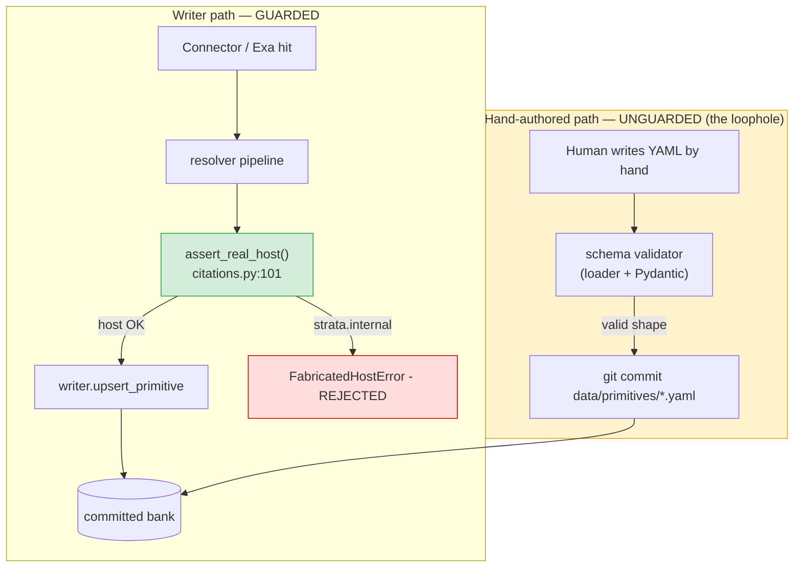
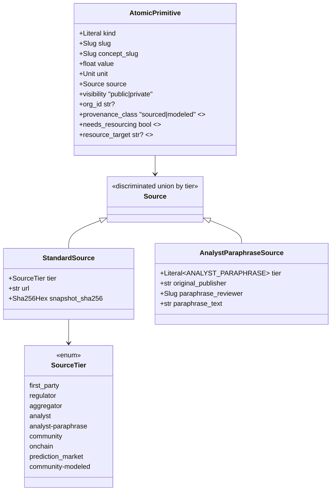
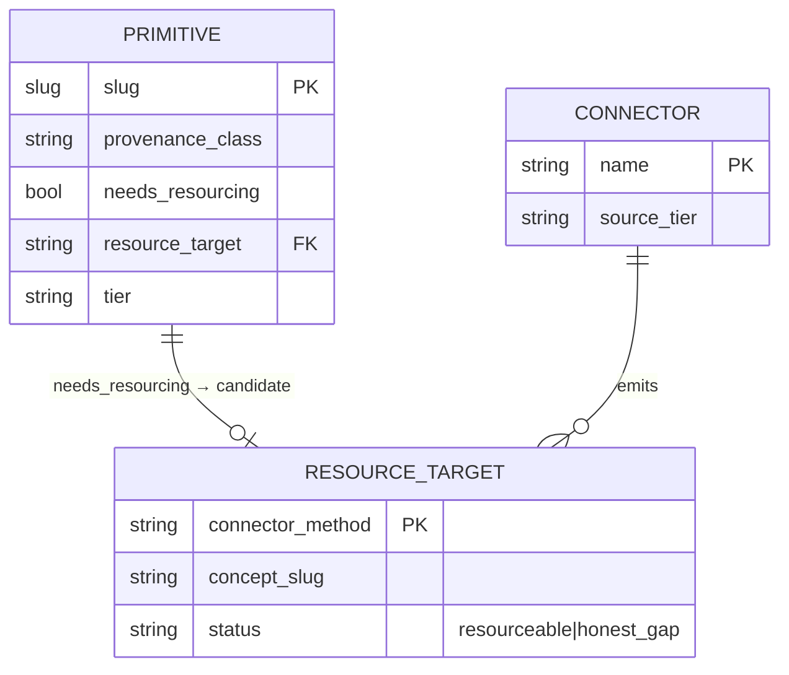
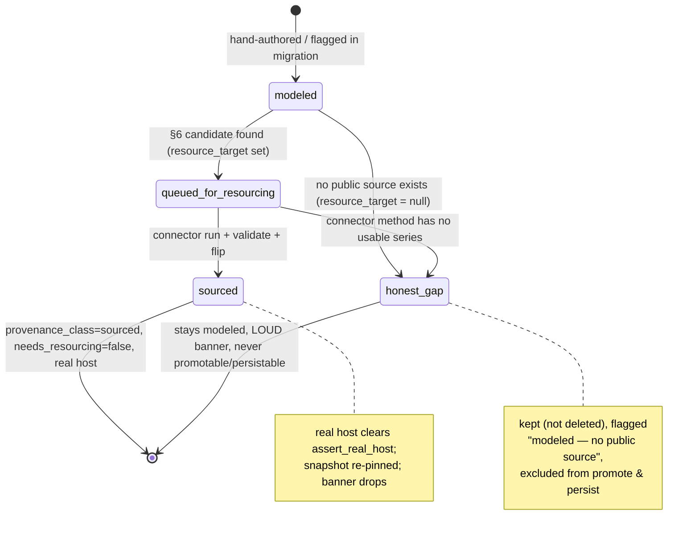
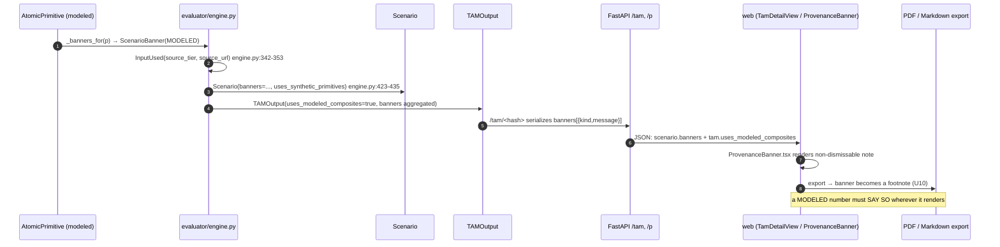
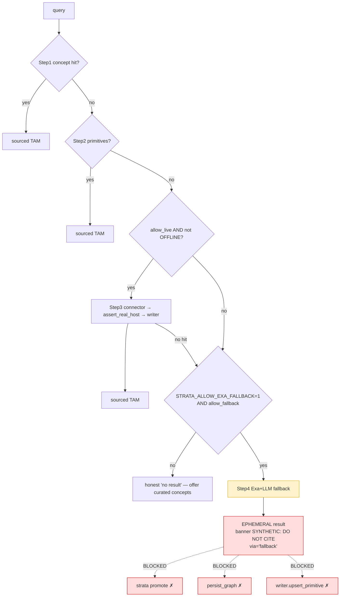
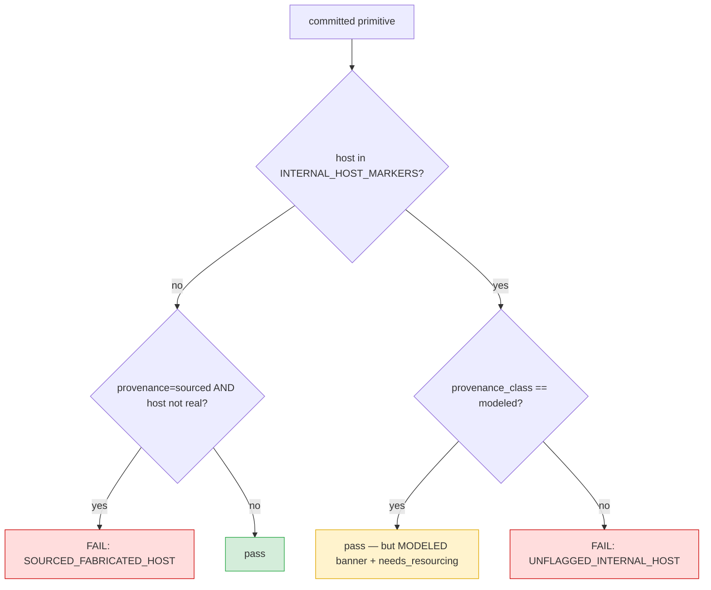
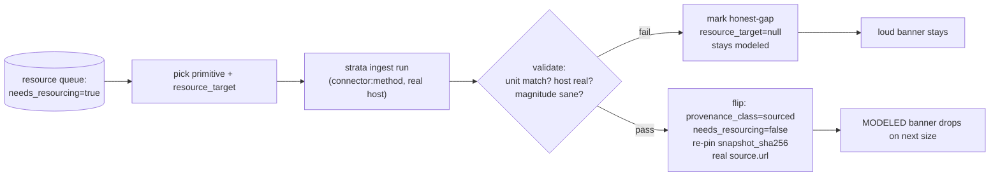

# Phase 4 — Soft-Data Fence + Re-source

**Status:** spec / not yet implemented
**Owner:** Arkash Jain
**Initiative:** Strata data-integrity hardening
**Cross-refs:** Overview (`docs/plans/00-OVERVIEW-plaid-for-agents.md`),
Phase 1 (`docs/plans/01-phase1-deepen-data-bank.md`),
Wave 1 citation allowlist (`backend/src/strata/resolver/citations.py`),
Q20 / Q37 / Q40 (`CLAUDE.md`, `docs/07-data-layer-brainstorm.md`).

> **The thesis at stake.** Strata's entire pitch is *"we don't hallucinate —
> every number has a source you can click."* An audit of the committed data bank
> found that **64 of 215 committed atomic primitives (~30%)** are hand-seeded
> **modeled / paraphrased** YAML, and **12 of them cite a fabricated
> `strata.internal` host** that the Wave-1 citation guard
> (`citations.py:101 assert_real_host`) would *reject* if a connector tried to
> write them — yet they sit committed because they were **hand-authored**, never
> passing through the guarded writer path. The decision is **FENCE + RE-SOURCE,
> not delete**: flag the modeled data loudly, make the Exa fallback strictly
> opt-in and non-citable, forbid promotion/persistence of any modeled-or-fallback
> number, and queue each `strata.internal` primitive for re-sourcing from a real
> connector — recording an honest gap where no public source exists.

---

## 0. Table of contents

1. [Problem statement](#1-problem-statement)
2. [Provenance data model](#2-provenance-data-model)
3. [The honesty-banner system](#3-the-honesty-banner-system)
4. [Exa fencing](#4-exa-fencing)
5. [The two-gates invariant](#5-the-two-gates-invariant)
6. [Re-sourcing queue](#6-re-sourcing-queue)
7. [`strata stats` extension](#7-strata-stats-extension)
8. [Test plan](#8-test-plan)
9. [Rollout, back-compat, risks, definition-of-done](#9-rollout-back-compat-risks-definition-of-done)

---

## 1. Problem statement

### 1.1 The exact breakdown

The committed bank is `data/primitives/*.yaml` — **215 files**. Tier counts
(verified by grep over `tier:` lines):

| Tier | Count | What it is | Citable? |
|---|---:|---|---|
| `community-modeled` | **23** | An internal estimate (a number, but no external source) | **NO** — modeled |
| `analyst-paraphrase` | **35** | A ≤280-char paraphrase of a paywalled analyst claim (Q40) | conditionally (verify-against) |
| `analyst` | **6** | Hand-entered analyst figure, no machine-readable connector behind it | weakly |
| **Soft-data subtotal** | **64** | The fenced set | — |
| *(sourced: regulator / aggregator / first_party / prediction_market)* | *~151* | Connector-emitted, hash-pinned | YES |

The **23 community-modeled** + **35 analyst-paraphrase** + **6 analyst** = **64**
soft-data primitives. Of these, **12 files cite the fabricated host
`strata.internal`** (all in the `community-modeled` set; the other 11
community-modeled cite real-but-weak URLs or vendor pages).

**The 64 cluster into two families:**

- **`ai-*` family** (modeled capture-rates / ACVs): e.g.
  `data/primitives/ai-coding-assistant-acv-per-engineer-2024.yaml`,
  `data/primitives/ai-recruiting-agent-capture-rate-2024.yaml`,
  `data/primitives/ai-legal-assistant-acv-per-seat-2024.yaml`,
  `data/primitives/ai-native-itsm-share-shift-rate-2024.yaml`. These are the
  *invented capture-rate sliders* — there is no public regulator series for
  "share of engineer spend an AI IDE captures at maturity."
- **`demo-*` family** (paraphrased census/wage figures for the seeded demo
  concepts): e.g.
  `data/primitives/demo-aamc-active-physicians-us-2024.yaml`,
  `data/primitives/demo-aba-licensed-lawyers-us-2024.yaml`,
  `data/primitives/demo-bls-ces-claims-adjusters-us-2024.yaml`,
  `data/primitives/demo-acs-sales-reps-us-2024.yaml`. Most of these *do* have a
  real public counterpart (BLS OEWS, Census ACS, AAMC) — they are **re-sourceable**.

### 1.2 A real fabricated URL (quoted verbatim)

From `data/primitives/ai-coding-assistant-acv-per-engineer-2024.yaml:35-40`:

```yaml
source:
  slug: strata-modeled-ai-coding-acv-2024
  tier: community-modeled
  url: https://strata.internal/models/ai-coding-acv-2024
  accessed: '2026-05-28'
  snapshot_sha256: b9ee1e4978ed783523f417a2fbbeb4d72295695407d7713c72e529175aacb821
```

Other observed `strata.internal` URLs (grep `data/primitives`, deduped):

```
https://strata.internal/methodology/ai-native-regulated-services-capture
https://strata.internal/models/ai-coding-acv-2024
https://strata.internal/models/ai-creative-displacement
https://strata.internal/models/ai-debug-capture-rate
https://strata.internal/models/ai-design-capture-2024
https://strata.internal/models/ai-legal-acv-2024
https://strata.internal/models/ai-recruiting-capture-rate
https://strata.internal/models/ai-voice-survey-capture
https://strata.internal/models/itsm-share-shift-2024
https://strata.internal/models/share-shift-tax-ai
```

`strata.internal` is *exactly* the host the Wave-1 guard treats as fabricated:
`citations.py:18 INTERNAL_HOST_MARKERS = frozenset({"strata.internal"})`, and
`citations.py:96-98 is_real_host` returns `False` for any host in that set. So
`assert_real_host` (`citations.py:101`) **would raise `FabricatedHostError`** on
these URLs.

### 1.3 How they bypassed the guard

The guard only sits on the **writer path** (connector → resolver →
`writer.upsert_primitive`). Hand-authored YAML committed straight into
`data/primitives/` is loaded by `strata.loader` and accepted by the schema
validator — which today has **no host check**. So the modeled YAML entered the
committed bank through a door the guard does not watch.



ASCII summary:

```
  GUARDED:   connector ─▶ resolver ─▶ assert_real_host ─▶ writer ─▶ bank
                                          │ strata.internal ─▶ REJECT
  UNGUARDED: human ─▶ schema validate (shape only) ─▶ git commit ─▶ bank   ← LOOPHOLE
```

Phase 4 closes this loophole (§5) **without** deleting the 64 primitives:
they remain, loudly flagged, and either get re-sourced or recorded as honest gaps.

---

## 2. Provenance data model

### 2.1 The new field

Today `AtomicPrimitive` (`backend/src/strata/models/primitive.py:59-113`) has no
field distinguishing *sourced* from *modeled* — the only signal is
`source.tier`, which is implicit and scattered. We add an **explicit provenance
class**, mirroring the Wave-5B `visibility` pattern
(`primitive.py:98 visibility: Literal["public", "private"] = "public"`).

```python
# backend/src/strata/models/primitive.py — add to AtomicPrimitive
class ProvenanceClass(StrEnum):
    SOURCED = "sourced"   # connector-emitted, real host, hash-pinned
    MODELED = "modeled"   # community-modeled / analyst / paraphrase estimate

# new fields (defaults preserve back-compat for the ~151 sourced primitives):
provenance_class: ProvenanceClass = ProvenanceClass.SOURCED
needs_resourcing: bool = False   # True for the 64 fenced primitives
resource_target: str | None = None  # connector:method candidate (see §6); None = honest gap
```

Default = `SOURCED` so **all ~151 existing sourced YAML load unchanged** (no
field to add). A **post-validator** (§5) derives/cross-checks the class from the
tier so the two can never disagree:

- `tier ∈ {community-modeled, analyst-paraphrase, analyst}` ⇒ MUST be `modeled`.
- `tier ∈ {regulator, aggregator, first_party, prediction_market}` ⇒ MUST be `sourced`.

This makes `provenance_class` **load-bearing and self-consistent**, not a free
annotation.

### 2.2 Migration of the 64

A one-shot codemod (`scripts/phase4_flag_modeled.py`) walks `data/primitives/`,
and for every file whose `source.tier` is one of the three soft tiers:

1. sets `provenance_class: modeled`,
2. sets `needs_resourcing: true`,
3. sets `resource_target` from the §6 mapping (or leaves `null` = honest gap).

The ~151 sourced primitives are **not touched** (default already correct).

### 2.3 Class diagram



ER view of the resource-queue relationship (§6):



### 2.4 Provenance lifecycle (state machine)



---

## 3. The honesty-banner system

### 3.1 Where banners originate

`BannerKind` is the taxonomy
(`backend/src/strata/models/tam_output.py:29-49`): `SYNTHETIC`, `MODELED`,
`SUBSIDY`, `REGULATED`, `DARK_ESTIMATE`, `ANALYST_PARAPHRASE`, `USER_OVERRIDE`,
`PRIVATE`. Banners are minted per-primitive by
`_banners_for(p)` (`backend/src/strata/evaluator/engine.py:368-408`):

- `p.visibility == "private"` → `BannerKind.PRIVATE` (engine.py:371-381)
- `isinstance(p.source, AnalystParaphraseSource)` → `BannerKind.ANALYST_PARAPHRASE`
  (engine.py:382-391)
- `p.source.tier is SourceTier.COMMUNITY_MODELED` → `BannerKind.MODELED`
  (engine.py:396-407)

**Gap today:** the `analyst` tier (6 primitives) mints **no banner** — it falls
through to `return []` (engine.py:408). Phase 4 extends `_banners_for` to fire a
`BannerKind.MODELED` banner whenever `p.provenance_class is MODELED`, so all 64
get a loud banner regardless of which of the three soft tiers they carry:

```python
# engine.py _banners_for — add ahead of the `return []`:
if p.provenance_class is ProvenanceClass.MODELED:
    verb = "queued for re-sourcing" if p.needs_resourcing else "modeled"
    return [ScenarioBanner(
        kind=BannerKind.MODELED,
        message=f"{p.name} is MODELED, not a sourced measurement ({verb}). Do not cite as fact.",
    )]
```

### 3.2 Propagation: primitive → InputUsed → scenario → TAMOutput → API → UI → export



ASCII propagation chain:

```
primitive.provenance_class=modeled
   └▶ _banners_for() ─▶ ScenarioBanner(MODELED)
         └▶ Scenario.banners ─▶ TAMOutput (uses_modeled_composites=true)
               └▶ /tam JSON banners[] ─▶ ProvenanceBanner.tsx ─▶ PDF footnote
```

### 3.3 The UI treatment

The existing component is `web/src/components/rail/ProvenanceBanner.tsx`. Today
`provenanceNotes(tam)` (lines 12-23) reads only `tam.uses_synthetic_primitives`
and `tam.uses_modeled_composites` and renders a **non-dismissable** `role="note"`
in `--warning` color (lines 25-42). Phase 4:

- Surface the **per-input** MODELED banners (not just the rolled-up composite
  flag): iterate `scenario.banners` where `kind === "modeled"` and list each
  named primitive ("`AI coding-assistant ACV` is MODELED — queued for
  re-sourcing").
- Promote the styling from a quiet note to a **loud** treatment: keep
  non-dismissable, but raise contrast — solid `--warning` left border + bold
  "MODELED, NOT SOURCED" label, so it is *impossible to miss* on `/tam`,
  `/p/<slug>`, and `/build`.
- **WCAG 2.2 AA:** keep `role="note"`; ensure the `--warning` text on the tinted
  background meets the **4.5:1** contrast ratio (the current
  `color-mix(... --warning 30% ...)` border is decorative — the *text* color
  carries meaning, so it must not rely on color alone: the literal word
  **"MODELED"** carries the meaning textually). Banner must be reachable in tab
  order and announced by SR before the number.

A new `/p/<slug>` page treatment shows the banner **above** the value, never
below, so the reader sees "modeled" before they read the figure.

---

## 4. Exa fencing

### 4.1 The 4-step cascade, with Step 4 fenced

The resolver runs four steps (`backend/src/strata/resolver/pipeline.py`):
Step 1 concept (`_step1_concept`), Step 2 primitives (`_step2_primitives`),
Step 3 live connector (`_step3_connector`, gated by `options.allow_live`,
pipeline.py:701-704), Step 4 Exa+LLM fallback (`_step4_fallback`,
pipeline.py:514-613, gated by `options.allow_fallback`, pipeline.py:706-707).

`_step4_fallback` is already **ephemeral** — *"Synthesize via Claude+Exa.
Ephemeral — never written to disk."* (pipeline.py:522) — and already carries the
banner *"synthesized via fallback — not in data bank, do not cite without manual
verification"* (pipeline.py:609), then runs `apply_verifier`
(`resolver/verify.py:65`) which can stamp `dark_estimate`. Exa itself is invoked
in `search.py:60-114` (`search_primitive` → `_get_exa()` → `Exa(api_key=...)`).

Phase 4 hardens three things:

1. **Strictly opt-in.** Today `RunOptions.allow_fallback` defaults to **`True`**
   (pipeline.py:92). Flip the *committed-surface* default to `False`: the
   fallback only fires when **both** an explicit flag **and** an env gate are
   set. New env gate `STRATA_ALLOW_EXA_FALLBACK=1` (analogous to
   `STRATA_MCP_LIVE_CONNECTORS` in `mcp/tools.py:268`). `STRATA_OFFLINE=1`
   continues to force `allow_live=False, allow_fallback=False` (pipeline.py:28-29).
2. **"Do not cite" impossible to miss.** Upgrade the fallback `banner` to a
   `BannerKind.SYNTHETIC` (not a bare string), prefix `⚠ NOT IN DATA BANK — DO
   NOT CITE`, and have the UI render it in the loud non-dismissable treatment
   (§3.3) at the **top** of `ResolveView`, before any number.
3. **Non-promotable + non-persistable** (§4.3).



### 4.2 Env-flag table

| Flag / env | Default (committed surface) | Effect |
|---|---|---|
| `STRATA_OFFLINE=1` | unset | forces `allow_live=False, allow_fallback=False` (pipeline.py:28-29) |
| `RunOptions.allow_fallback` | **`False`** (was `True`, pipeline.py:92) | gates Step 4 entry (pipeline.py:706) |
| `STRATA_ALLOW_EXA_FALLBACK=1` | unset | **new** — required *in addition* to `allow_fallback` for Step 4 to fire |
| `STRATA_LLM_BACKEND` | unset → honest error | `anthropic` enables the paid SDK; without it the resolver fails honestly |
| `STRATA_MCP_LIVE_CONNECTORS=1` | unset | gates the MCP live connector tool (`mcp/tools.py:268`) — unchanged |

### 4.3 Guard insertion points (the no-leak invariant)

A fallback result (`via == "fallback"`) or any modeled primitive must **never**
become committed/persisted. Three insertion points:

- **`strata promote` (`cli.py:681-743`):** before staging, load the candidate
  YAML and **reject if** `provenance_class == "modeled"` **or** the source host
  is `strata.internal` **without** the explicit modeled flag, **or** `via ==
  "fallback"` provenance. Exit non-zero with a clear message. (Promotion already
  runs the validator and rolls back on reject, cli.py:719-737 — this adds an
  earlier, explicit refusal so the error names *why*.)
- **`persist_graph` (Phase 3 `/build/graph` → `/tam/<hash>`):** before persisting
  a composed graph, walk every bound primitive and **refuse** if any is
  `provenance_class == "modeled"` *and* `needs_resourcing` *and* an honest gap,
  or if the graph leans on a `via=fallback` synthesized number. Modeled inputs
  may still be *displayed live* (with the loud banner) but a persisted, shareable
  `/tam/<hash>` must not bake in an unsourced number silently.
- **`writer.upsert_primitive` (`resolver/writer.py`):** assert the source host
  via `assert_real_host` (already the contract on the connector path) — and now
  also refuse any primitive whose `provenance_class == "modeled"` reaching the
  writer (the writer is for *sourced* connector output only).

---

## 5. The two-gates invariant

Strata's "we don't hallucinate" reduces to **two enforceable invariants**:

| Gate | Invariant | Enforced today by | Phase-4 closure |
|---|---|---|---|
| **G1 — No fabricated host** | A committed/emitted citation host is never fabricated/internal | `assert_real_host` (`citations.py:101`), `is_real_host` (`citations.py:94-98`), `INTERNAL_HOST_MARKERS` (`citations.py:18`) — **writer path only** | Add a **loader/validator rule** so the *hand-authored path* is also gated |
| **G2 — No LLM-projected committed number (Q20)** | An LLM-synthesized number never becomes a citable committed primitive | `_step4_fallback` is ephemeral (`pipeline.py:522`); MCP `resolve_market` is LLM-free (`mcp/tools.py:166-181`); `_clean_url` nulls `strata.internal` (`mcp/tools.py:36-37`) | Add **promote/persist/writer guards** (§4.3) so a fallback number can never be committed/persisted |

### 5.1 Closing the hand-authored loophole (the new validator)

The decisive fix: a validator rule that **rejects any committed primitive citing
`strata.internal` unless it is explicitly flagged `provenance_class: modeled`**.
This means the 64 modeled primitives stay legal *only because they are honestly
labeled* — and a future hand-authored `strata.internal` number that *forgot* the
flag fails the build.

```python
# new rule in the loader/validator (runs on every committed primitive):
def validate_no_unflagged_internal(p: AtomicPrimitive) -> Finding | None:
    host = host_of(p.source.url)               # citations.py:70
    if host in INTERNAL_HOST_MARKERS:          # citations.py:18
        if p.provenance_class is not ProvenanceClass.MODELED:
            return Finding(
                code="UNFLAGGED_INTERNAL_HOST",
                message=f"{p.slug} cites {host} but is not flagged provenance_class: modeled",
            )
    # A sourced primitive must NOT cite an internal host at all:
    if p.provenance_class is ProvenanceClass.SOURCED and not is_real_host(p.source.url, allowed):
        return Finding(code="SOURCED_FABRICATED_HOST",
                       message=f"{p.slug} is provenance_class: sourced but host {host} is not real")
    return None
```



ASCII:

```
  committed primitive
     │
     ├─ host == strata.internal ─┬─ flagged modeled ─▶ PASS (loud banner)
     │                           └─ NOT flagged    ─▶ FAIL UNFLAGGED_INTERNAL_HOST
     └─ host != strata.internal ─┬─ sourced & host not real ─▶ FAIL SOURCED_FABRICATED_HOST
                                 └─ else ─▶ PASS
```

---

## 6. Re-sourcing queue

For each modeled family, a **candidate connector + method** that could replace
it (cross-ref Phase 1's deepened bank: the 23 typed connectors, 13 producing).
`status` is **resourceable** (a public series exists) or **honest-gap** (no
public source — the number stays modeled forever, flagged).

| Modeled primitive (example file) | Family | Candidate connector:method | Concept slug | Status |
|---|---|---|---|---|
| `demo-aamc-active-physicians-us-2024.yaml` | demo | `census:acs_occupation` or `bls:oews_series` (physicians SOC 29-1210) | `demo-ai-clinical-docs-us` | resourceable |
| `demo-bls-ces-claims-adjusters-us-2024.yaml` | demo | `bls:oews_series` (SOC 13-1031) | `demo-ai-claims-*` | resourceable |
| `demo-acs-sales-reps-us-2024.yaml` | demo | `bls:oews_series` (SOC 41-4012) / `census:acs` | `demo-ai-sales-ops-us` | resourceable |
| `demo-cps-software-developers-us-2024.yaml` | demo | `bls:oews_series` (SOC 15-1252) | `demo-ai-dev-tooling-*` | resourceable |
| `demo-aba-licensed-lawyers-us-2024.yaml` | demo | `bls:oews_series` (SOC 23-1011) | `demo-ai-legal-*` | resourceable |
| `ai-coding-assistant-acv-per-engineer-2024.yaml` | ai | *(no public ACV series)* | `ai-coding-assistants-us` | **honest-gap** |
| `ai-recruiting-agent-capture-rate-2024.yaml` | ai | *(no public capture-rate series)* | recruiting | **honest-gap** |
| `ai-native-itsm-share-shift-rate-2024.yaml` | ai | *(no public share-shift series)* | itsm | **honest-gap** |
| `*-capture-rate-*` / `*-share-shift-*` (ai family) | ai | none — definitionally a forward estimate | various | **honest-gap** |
| `avg-saas-spend-midmarket-2024.yaml` (analyst) | analyst | `census:susb` adjacency / first-party | midmarket SaaS | partial / resourceable |
| `payment-processing-take-rate-2024.yaml` (analyst) | analyst | `edgar:xbrl_frames` (issuer take-rate disclosures) | payments | resourceable |

**Honest gaps are first-class.** The `ai-*` capture-rates have *no public
regulator series* — they are inherently forward-looking modeling assumptions.
Per Q20 we do **not** fabricate a source; we keep them `provenance_class:
modeled`, `resource_target: null`, and they render with the loud banner forever.
That is the honest answer.

### 6.1 The re-source → validate → flip loop



ASCII:

```
  queue ─▶ ingest run (connector) ─▶ validate ─┬─ pass ─▶ flip to sourced (banner drops)
                                               └─ fail ─▶ honest-gap (modeled banner stays)
```

A tracking field/CLI surfaces progress: `strata resource-status` reports
`{resourced N, queued M, honest_gap K}` over the 64.

---

## 7. `strata stats` extension

`stats` today (`cli.py:287-318`) reports primitive/signal/concept/framework
counts and a by-lens histogram — but **not** sourced-vs-modeled. Add a
provenance block:

```python
# cli.py stats() — after the existing counts
sourced = sum(1 for p in reg.atomic.values()
              if p.provenance_class is ProvenanceClass.SOURCED)
modeled = sum(1 for p in reg.atomic.values()
              if p.provenance_class is ProvenanceClass.MODELED)
queued = sum(1 for p in reg.atomic.values() if p.needs_resourcing)
typer.echo("\nProvenance:")
typer.echo(f"  {'sourced':24} {sourced:>6}")
typer.echo(f"  {'modeled':24} {modeled:>6}")
typer.echo(f"  {'queued for re-sourcing':24} {queued:>6}")
```

Expected first run: `sourced ~151 · modeled 64 · queued 64`, trending toward
`modeled → honest-gap-only` as the demo family is re-sourced.

---

## 8. Test plan

All backend tests in `backend/tests/`; run from `backend/` with
`uv run pytest && uv run pyright && uv run ruff check .`.

1. **Validator rejects unflagged `strata.internal`** (`test_validator_internal_host.py`):
   construct a committed primitive citing `https://strata.internal/x` with
   `provenance_class: sourced` → assert `UNFLAGGED_INTERNAL_HOST` finding.
   Same primitive with `provenance_class: modeled` → passes.
2. **Sourced-with-fabricated-host fails** (`test_validator_sourced_host.py`):
   `provenance_class: sourced` + non-allowlisted host → `SOURCED_FABRICATED_HOST`.
3. **All 64 currently-committed modeled primitives are flagged** (data test):
   load `data/primitives`, assert every soft-tier primitive has
   `provenance_class == modeled` and `needs_resourcing == True` post-migration.
4. **Banner propagation** (`test_banner_propagation.py`): size a concept whose
   input is modeled → assert a `BannerKind.MODELED` banner appears on the
   scenario and `tam.uses_modeled_composites` is `True`; assert the `analyst`
   tier (previously silent) now also fires `MODELED`.
5. **`strata promote` rejects modeled** (`test_promote_rejects_modeled.py`):
   stage a `provenance_class: modeled` auto-primitive → `promote` exits non-zero,
   target file not committed.
6. **`persist_graph` rejects fallback** (`test_persist_rejects_fallback.py`):
   compose a graph binding a `via=fallback` synthesized number / honest-gap
   modeled primitive → persist refuses.
7. **Exa gated off by default** (`test_exa_gated.py`): run pipeline with default
   `RunOptions()` and no env → Step 4 never fires (honest "no result"); set
   `allow_fallback=True` + `STRATA_ALLOW_EXA_FALLBACK=1` → Step 4 fires.
8. **Back-compat** (`test_sourced_unchanged.py`): the ~151 sourced YAML load
   with `provenance_class == sourced` and produce byte-identical TAM hashes vs.
   pre-Phase-4 (no displayed number changes).
9. **UI snapshot** (`web/src/components/tam/__tests__/ProvenanceBanner.test.tsx`):
   render `ProvenanceBanner`/`/p/<slug>` with a modeled input → snapshot the
   loud "MODELED, NOT SOURCED" non-dismissable treatment; assert
   `role="note"`, presence of the literal word "MODELED", and tab-reachability.

---

## 9. Rollout, back-compat, risks, definition-of-done

### 9.1 Rollout order

```
1. models: add ProvenanceClass + 3 fields (default sourced) — no behavior change
2. migration codemod: flag the 64 modeled YAML (+ resource_target from §6)
3. validator: add UNFLAGGED_INTERNAL_HOST + SOURCED_FABRICATED_HOST rules
4. evaluator: _banners_for fires MODELED on provenance_class (covers analyst tier)
5. frontend: ProvenanceBanner loud treatment + /p banner-above-value
6. fence Exa: flip allow_fallback default + STRATA_ALLOW_EXA_FALLBACK gate
7. guards: promote / persist_graph / writer reject modeled+fallback
8. stats: sourced/modeled/queued block
9. re-source loop: ingest the resourceable demo-* family, flip to sourced
```

### 9.2 Back-compat

- **No displayed number changes.** `provenance_class` defaults to `sourced`; the
  64 keep their *values* — only their *labeling* and *citability* change. State
  hashes for existing demo TAMs are unchanged (provenance fields are display/
  governance metadata, not part of the hash payload — mirror the
  `InputUsed.source_url` "display-only, never in the state hash" rule at
  `tam_output.py:81-85`).
- **Demo TAMs keep working.** The seeded `demo-ai-*` concepts still size; they
  just now carry a loud MODELED banner on their paraphrased inputs (which is the
  honest state — those *were* paraphrased).
- **Exa default flip is the one behavior change.** Anywhere the resolver
  silently fell back to Exa now returns an honest "no curated result" unless the
  operator opts in. This is intentional (fencing) and matches the MCP surface's
  existing LLM-free posture (`mcp/tools.py:166-181`).

### 9.3 Risks

| Risk | Mitigation |
|---|---|
| Silently changing a displayed figure during re-source | Re-source is a *separate, validated* flip; the codemod (step 2) never touches values, only labels |
| Breaking a demo concept by flipping an input mid-flight | Flip per-primitive, run the full TAM acceptance suite (`test_tam_v2_acceptance.py`) after each flip |
| Over-fencing Exa breaks a legitimate dev workflow | `STRATA_ALLOW_EXA_FALLBACK=1` restores it explicitly; CLI `--allow-fallback` flag documented |
| A re-sourced number disagrees with the modeled one (e.g. AAMC vs OEWS physicians — already noted in `demo-aamc-active-physicians-us-2024.yaml`) | Keep *both* as competing measurements on the concept (Q9 disagreement-gets-a-page); do not silently overwrite |
| `analyst-paraphrase` legality (Q40 fair-use) | unchanged — paraphrase rules already enforced by `AnalystParaphraseSource` (`source.py:69-77`); these stay `modeled` and flagged |

### 9.4 Definition of done

- [ ] `AtomicPrimitive` carries `provenance_class` / `needs_resourcing` /
      `resource_target`; ~151 sourced load with no YAML edits.
- [ ] All 64 soft-data primitives flagged `provenance_class: modeled`,
      `needs_resourcing: true`.
- [ ] Validator **fails** on any committed primitive citing `strata.internal`
      unless flagged `modeled`; **fails** on a `sourced` primitive with a
      fabricated host (closes the hand-authored loophole, §5).
- [ ] `_banners_for` fires a `MODELED` banner for every modeled primitive
      (including the previously-silent `analyst` tier).
- [ ] `ProvenanceBanner` renders the loud, non-dismissable, WCAG-AA "MODELED,
      NOT SOURCED" treatment on `/tam`, `/p`, `/build`; MCP `_cite` still nulls
      `source_url` for internal hosts (`mcp/tools.py:36-37`).
- [ ] Exa Step 4 is opt-in (default off) and **non-promotable / non-persistable
      / non-writable** (guards in `promote`, `persist_graph`, `writer`).
- [ ] `strata stats` reports `sourced / modeled / queued`.
- [ ] Re-source queue mapped (§6); the resourceable `demo-*` family flipped to
      `sourced` with real connector citations; `ai-*` capture-rates recorded as
      honest gaps (never fabricated).
- [ ] All tests in §8 green; `pyright`/`ruff`/`biome` clean; existing demo TAM
      hashes unchanged.
