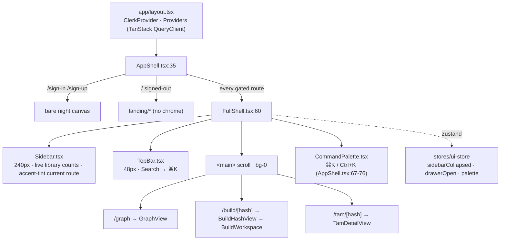
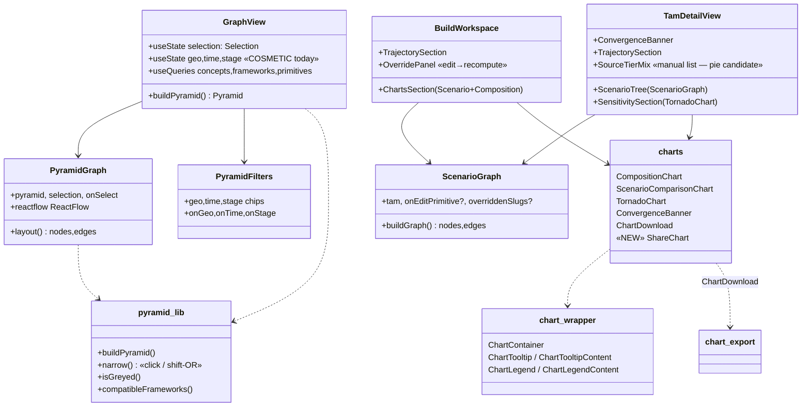
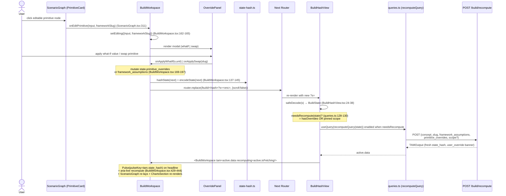
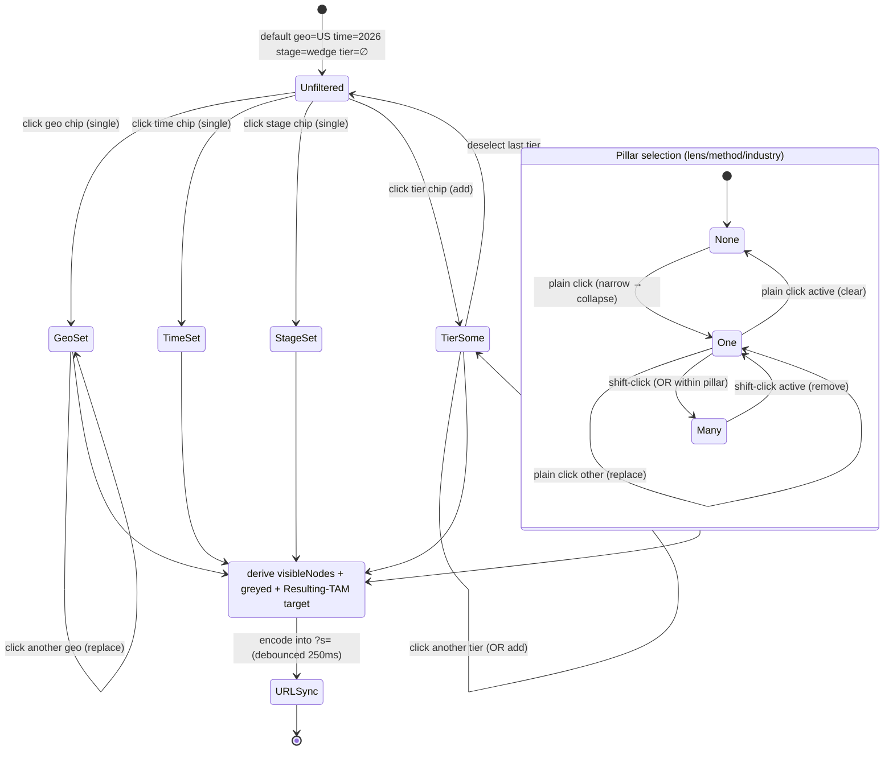
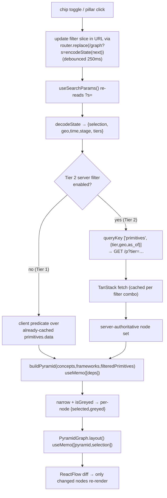
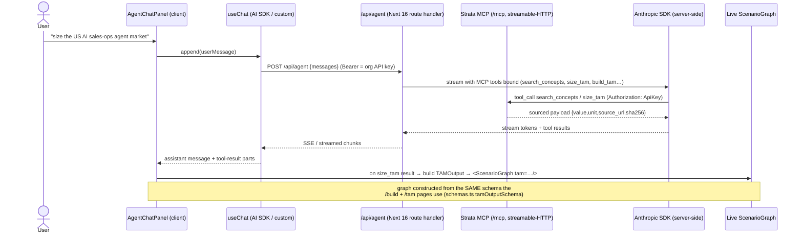

# Phase 5 — Frontend: Live Graph + Charts (+ stretch agent surface)

> **Codename:** Strata · **Surface:** `web/` (Next 16.2.6 · React 19 · Tailwind 4 ·
> bun · biome · @tanstack/react-query 5 · zustand 5 · shadcn/ui new-york ·
> recharts 3.8 · reactflow 11 · vis-network 10 · motion 12)
> **Design contract:** [`PRODUCT.md`](../../PRODUCT.md) + [`DESIGN.md`](../../DESIGN.md)
> (Impeccable). **WCAG 2.2 AA** is a release gate, not a nice-to-have.
> **Stack warning:** [`web/AGENTS.md`](../../web/AGENTS.md) — *"This is NOT the
> Next.js you know."* Next 16 has breaking API/convention changes vs. training
> data. Read `node_modules/next/dist/docs/` before touching any Next API
> (routing, `useSearchParams`, server/client boundaries, `next/og`).

This phase makes the **graph interactive for real** and the **charts complete**.
Two workstreams ship; one is a clearly-fenced stretch.

| WS | Title | Ships? | Hard dependency |
|----|-------|--------|-----------------|
| **A** | Live filters on the pyramid graph | Yes | needs a backend filter contract (specced below) |
| **B** | Chart breadth (pie/share + trajectory + a11y/export) | Yes | Phase 1 multi-date primitives (cross-ref) |
| **C** | Agent chat surface on `/agents` | **Stretch** | Phases 1→3 (authenticated MCP) must land first |

---

## 0. Scope, non-goals, definition-of-done

**In scope**
- A) Wire the `PyramidFilters` chips (geo / time / tier / lens) so they
  **actually narrow the node set and/or re-query** — today they are cosmetic
  `useState` that only relabel the rail (`GraphView.tsx:38-41,161-163`).
- A) Fold filter state into URL/`?s=`-style addressing so a filtered pyramid is
  shareable and back/forward-safe (the `/build/<hash>` model — `state-hash.ts`).
- B) Add the **missing pie/share chart** (share-of-TAM / source-tier mix) on
  shadcn `ChartContainer` + recharts `Pie`. There is **no pie/share chart today**.
- B) Confirm `TamTrajectoryChart` renders the **new multi-date primitives** from
  Phase 1 (it already branches on `points.length` — `TamTrajectoryChart.tsx:55-75`).
- B) Make every chart theme-aware (`globals.css` tokens), exportable
  (`lib/chart-export.ts` via `ChartDownload`), and WCAG-compliant.
- C) (stretch) A minimal `useChat`-style panel on `/agents` driving the
  authenticated MCP, rendering the agent-built graph live.

**Non-goals**
- No backend formula-engine work (Phase 2). No new connectors (Phase 1).
- No redesign of `ScenarioGraph` / `LineageGraph` topology — only additive hooks.
- No new charting library; recharts 3.8 + the existing shadcn `chart.tsx` wrapper
  only. vis-network stays confined to the `LineageGraph`/`NetworkGraphModal` modal.
- Workstream C does **not** block A or B and does **not** ship if Phase 3 slips.

**Definition of done** — see [§9](#9-rollout-back-compat-risks-definition-of-done).

---

## 1. Current frontend map

### 1.1 Every route

All under `web/src/app/*/page.tsx`. The signed-in app renders inside `AppShell`
(`shell/AppShell.tsx:35-58`); `/sign-in`, `/sign-up`, and the signed-out `/`
render bare (night canvas).

| Route | File | Surface | Touched by Phase 5 |
|-------|------|---------|--------------------|
| `/` | `app/page.tsx` | Home / signed-out landing | — |
| `/graph` | `app/graph/page.tsx` → `GraphView` | **Pyramid explorer** | **A (primary)** |
| `/build` | `app/build/page.tsx` → `BuildView` | Legacy `?q=` entry → MarketSpecStep | — |
| `/build/[hash]` | `app/build/[hash]/page.tsx` → `BuildHashView` | **Workhorse** | **B (charts mount)** |
| `/build/graph` | `app/build/graph/page.tsx` | Dropdown rebinder (Phase 4) | indirect (B) |
| `/tam/[hash]` | `app/tam/[hash]/page.tsx` → `TamDetailView` | **Frozen artifact** | **B (charts mount)** |
| `/tam/[hash]/report` | `app/tam/[hash]/report/page.tsx` → `TamReport` | Print one-pager | B (print-safe) |
| `/embed/tam/[hash]` | `app/embed/tam/[hash]/page.tsx` | OG/embed card | — |
| `/c`, `/c/[slug]` | `app/c/*` | Concept list + disagreement view | — |
| `/p`, `/p/[slug]` | `app/p/*` | Primitive list + detail | — |
| `/f`, `/f/[slug]` | `app/f/*` | Framework list + detail | — |
| `/browse` | `app/browse/page.tsx` | Promoted-TAM registry | — |
| `/connectors` | `app/connectors/page.tsx` | Plaid-style connector catalog | — |
| `/portfolio` | `app/portfolio/page.tsx` | Sized-portfolio rows | — |
| `/signals` | `app/signals/page.tsx` | Quarantined prediction-market signals | — |
| `/agents` | `app/agents/page.tsx` | Static MCP tool catalog | **C (stretch)** |
| `/integrations` | `app/integrations/page.tsx` | OAuth connector gallery | — |
| `/contribute` | `app/contribute/page.tsx` | Validator-gated intake | — |
| `/dashboard` | `app/dashboard/page.tsx` | Favorites + audit feed | — |
| `/guides`, `/explore`, `/bank`, `/data` | resp. files | Walkthroughs / aux | — |

### 1.2 App shell (Mermaid flowchart)



Theme: `html.dark` token swap via a `useSyncExternalStore` store (`lib/theme.ts`,
`ThemeToggle.tsx`), no-flash inline script in layout. **Every chart and graph
must read its colours from CSS custom properties so the theme swap is free** —
this is already the discipline (`ScenarioComparisonChart.tsx:20-27` tokenizes lens
colours; `chart-export.ts:117-122` resolves vars for the PNG backdrop).

### 1.3 Graph + chart component tree (Mermaid classDiagram)



The three ReactFlow/vis surfaces:
- **`PyramidGraph.tsx`** (~381 lines) — `/graph` explorer. 3 pillar columns +
  apex; explicit hand-placed layout (`PyramidGraph.tsx:36-50,207-293`);
  `narrow`/`isGreyed` selection; right-click menu + 250ms ghost-card
  (`PyramidGraph.tsx:103-147`); `nodesDraggable=false`, `elementsSelectable=false`.
- **`ScenarioGraph.tsx`** (~329 lines) — `/build` + `/tam` DAG (target →
  framework → base-value primitives). Interactive only when `onEditPrimitive`
  is passed (`ScenarioGraph.tsx:62-75,245-329`). Note the `pointer-events-auto`
  workaround (`ScenarioGraph.tsx:299-302`) — ReactFlow disables clicks on
  non-draggable nodes.
- **`LineageGraph.tsx`** (~514 lines) — vis-network modal (lineage / related
  entities). Out of scope for Phase 5 (no changes).

---

## 2. The override→recompute loop (AS-IS)

This is the one **real** live loop in the app today; Workstream A copies its
URL-state discipline. Click a base-value primitive node → `OverridePanel` →
re-mint `/build/<hash>?s=` → `BuildHashView` POSTs `/build/recompute` →
headline + graph + charts re-render.



**Key files/lines**
- Edit entry: `ScenarioGraph.tsx:305-321` (button, `pointer-events-auto`).
- Modal: `OverridePanel.tsx` (what-if `WhatIfTab` 160-236; swap `SwapTab` 238-302).
- Mint: `BuildWorkspace.tsx:137-145` (`hashState` + `encodeState`, `router.replace`).
- Decode + route choice: `BuildHashView.tsx:50-63`.
- Recompute query (cache key = canonical override payload): `queries.ts:146-160`.
- `needsRecompute` / `hasOverrides`: `queries.ts:119-130`.
- Charts re-render from the new `tam`: `BuildWorkspace.tsx:266,299-324`.

The contract Workstream A reuses: **state lives in the URL** (`?s=` base64url of
canonical `BuildState`), the **hash is the address**, `router.replace` (not push)
for in-flight tweaks, and TanStack caches by canonical payload so equivalent
states collide.

---

## 3. Workstream A — live filters on the pyramid

### 3.1 Today: cosmetic chips

`GraphView` holds `geo/time/stage` in plain `useState` (`GraphView.tsx:38-41`),
passes them to `PyramidFilters`, and the *only* consumer is a label in the rail:
`{geo} · {time} · {stage}` (`GraphView.tsx:161-163`). Nothing in
`buildPyramid` / `narrow` / `isGreyed` reads them. The pyramid node set never
changes when a chip flips. The existing e2e even encodes this — it only asserts
the chip's `aria-pressed` toggles, not any graph effect (`graph.spec.ts:113-118`).

We also have **no `tier` and no `lens` filter chip** today; the task asks for
geo/time/**tier**/**lens**. Lens is already a *pillar axis* (Qualitative), so a
lens **chip** would duplicate pillar selection — instead we treat lens filtering
as the existing pillar `narrow()` and add **tier** + keep **geo/time/stage** as
true chips.

### 3.2 The data-contract problem (load-bearing — cross-ref backend)

The list endpoints take **no filter params** and the summary payloads **carry no
filterable fields**:

- `GET /p` → `PrimitiveSummary{slug,name,kind,concept_slug,value,unit_label}` —
  **no `tier`, no `geo`, no `as_of`** (`backend/src/strata/api/routes/primitives.py:18-59`).
  `tier` lives only on the **detail** record (`atomic.source.tier`), which is
  exactly why `GraphView`'s SourcesPanel fetches per-primitive detail
  (`GraphView.tsx:286-326`).
- `GET /c` → `ConceptSummary{slug,name,definition,primary_lens,measurement_count}` —
  has `primary_lens` (good, lens filter is client-side) but **no geo/time**.

**Two implementation tiers, pick by what the backend can offer in this phase:**

> **Tier 1 — client-only (ships regardless of backend).**
> Filter the already-loaded node set in memory. `geo`/`time`/`stage` are
> *view-state* (they already are, per `PyramidFilters.tsx:3-12`) and gate the
> **Resulting-TAM** target (`/build?q=` link folds geo into scope). `tier`
> filtering greys/hides industry leaves whose concept has **no primitive of the
> selected tier** — derived client-side from primitive detail already fetched on
> demand. No new endpoint. This is the **default deliverable**.

> **Tier 2 — server-filtered (preferred; needs a small backend change).**
> Add optional query params so the node set is authoritative and cheap:
> - `GET /p?tier=<tier>&dimension=<dim>&concept=<slug>&geo=<iso>&as_of=<date>`
> - add `tier`, `geo`, `as_of` to `PrimitiveSummary` (already on the model;
>   surface them — `tier=a.source.tier.value`, `geo=a.geo...`, `as_of=a.as_of`).
> Cross-ref: this rides naturally on the **Phase 1** data-bank work (more
> primitives, dated `as_of`) and the **Phase 3** MCP `list_primitives` which
> *already* advertises tier/dimension/query filtering (`agents/page.tsx:28-30`).
> If Phase 1/3 expose the filter, Workstream A consumes it; otherwise Tier 1
> ships and the chip behaviour is identical to the user (only the data source
> differs).

The spec below is written so the **UI is identical** under either tier; only the
`queryKey` and the predicate source change.

### 3.3 Filter state machine (Mermaid stateDiagram)

`geo`, `time`, `stage` are **single-select** (radio-like — one active per group,
matching `PyramidFilters.tsx`). `tier` is **multi-select OR** (a primitive may be
any of several tiers; selecting Regulator+Aggregator keeps either). Lens is the
pillar `narrow()` (single-click collapse, shift-click OR — unchanged).



**How each maps to node visibility vs. re-query**

| Chip group | Select model | Effect | Mechanism |
|------------|--------------|--------|-----------|
| **Lens** (Qualitative pillar) | click / shift-OR | greys cross-pillar incompatibles | `narrow()` + `isGreyed()` (existing, `pyramid.ts:185-231`) |
| **Tier** | multi-OR | greys/hides industry leaves with no primitive of any selected tier | client predicate (Tier 1) **or** `GET /p?tier=` re-query (Tier 2) |
| **Geo** | single | (a) gates the Resulting-TAM `/build?q=` scope; (b) Tier-2: re-query `GET /p?geo=` | view-state + scope fold |
| **Time / as_of** | single | (a) selects which dated snapshot the Resulting-TAM reports; (b) Tier-2: `GET /p?as_of=` | view-state + scope fold |
| **Stage** | single | view-state lens (expansion stage), folds into scope | unchanged semantics |

**Greying is preserved, never silent removal.** Per PRODUCT.md principle 3
("honest about limits") and the locked U1 grey-out behaviour, a tier-filtered-out
industry leaf is **greyed at 0.32 opacity** (the existing treatment,
`PyramidGraph.tsx:347-348`) with a tooltip "no <tier> source for this market",
not deleted — the user must see *what fell away*. A "hide greyed" toggle is the
only way to actually drop nodes, defaulting **off**.

### 3.4 zustand vs URL state — decision

| State | Home | Why |
|-------|------|-----|
| `selection` (pillars) + `geo/time/stage/tier` | **URL (`?s=` filter slice)** | shareable, back/forward-safe; mirrors the `/build/<hash>` model (U5/U6). A filtered pyramid is a *meaningful state* and gets an address. |
| transient hover ghost, context menu, "hide greyed" toggle | **component `useState`** | ephemeral, not worth an address (matches PRODUCT/U6 "pan/zoom/hover do not mint"). |
| sidebar collapse, palette open | **zustand `ui-store`** | already there (`AppShell.tsx:61-64`); cross-route chrome, not page state. |

**Decision: URL is canonical for filters, not zustand.** Rationale: the explorer
is a sharing surface and the project already has a battle-tested canonicalizer
(`state-hash.ts`). We extend `BuildState` rather than invent a parallel store —
geo/time/stage already exist on `BuildState` (`state-hash.ts:21-23`); we add a
`tiers?: string[]` and a `pillar_selection?: Selection` slice (or reuse
`?s=`-encoded `selection`). The `/graph` URL becomes `/graph?s=<encodeState>`,
read with `useSearchParams` (read the Next 16 doc first — `useSearchParams`
requires a Suspense boundary, and the page is already `"use client"`).

> **Why not zustand for filters?** zustand state dies on reload and can't be
> pasted into a memo — both violate "forwardable artifact" (PRODUCT.md success
> criterion). zustand stays for chrome only.

### 3.5 ASCII wireframe — filtered pyramid + rail

```
 /graph?s=…                                                      [Explore the pyramid]
 ┌──────────────────────────────────────────────────────────────────────────────────┐
 │ Geo  [Global][•US•][EU]   │ Time [2025][•2026•][2027]   │ Stage [•wedge•][adj][plat]│
 │ Tier [Regulator•][Aggregator•][Analyst][Community]   ◻ hide greyed   (clear all ×) │
 ├───────────────────────────────────────────────┬──────────────────────────────────┤
 │                         · TAM ·                │  SELECTION            (Clear)      │
 │            ╱              │              ╲      │  US · 2026 · wedge · 2 tiers      │
 │   Qualitative      Quantitative      Industry  │  Qualitative  [Cost Efficiency]   │
 │   ┌─────────┐      ┌─────────┐      ┌─────────┐ │  ─────────────────────────────    │
 │   │Cost Eff•│──────│ Bottoms │──────│ AI Sales│ │  RESULTING TAM                    │
 │   └─────────┘      │   Up    │      └─────────┘ │   $2.0B – $31.2B   ◐ indep .61    │
 │   ┌╌╌╌╌╌╌╌╌╌┐ grey └─────────┘      ┌╌╌╌╌╌╌╌╌╌┐ │   Open this TAM →                 │
 │   ┊Revenue G┊      ┌─────────┐ grey ┊EV Charge┊ │  SOURCES (4)                      │
 │   └╌╌╌╌╌╌╌╌╌┘      ┊Top Down ┊ tier └╌╌╌╌╌╌╌╌╌┘ │   • BLS OEWS    [Regulator]       │
 │           ↑ greyed: no Regulator/Aggregator src └─────────────────────────────────│
 │                                                │  COMPATIBLE FRAMEWORKS  (3/30)    │
 │  [+N more]                                     │   persona_pool × cost  …          │
 └───────────────────────────────────────────────┴──────────────────────────────────┘
   • = active chip / selected node    ╌ = greyed (kept, 0.32 opacity, tooltip)
```

The chip row gains a **Tier** group (multi-select, pill style per DESIGN.md
`chip-filter`) and a **clear all** affordance; the rail's `geo · time · stage`
summary line (`GraphView.tsx:161-163`) gains `· N tiers`.

---

## 4. Workstream A — filtering data flow + performance



**Query-key design (Tier 2).** Today every list is a static key
(`queries.ts:51-57` → `["primitives"]`). Add a parameterized variant so distinct
filter combos cache independently and equivalent ones collide:

```ts
// queries.ts — additive, does not touch the existing unfiltered query
export const primitivesFilteredQuery = (f: PrimitiveFilter) =>
  queryOptions({
    queryKey: ["primitives", canonicalFilter(f)],  // sorted keys → stable
    queryFn: async () =>
      validated(z.array(primitiveSummarySchema),
        await api(`/p?${toSearch(f)}`)),
    staleTime: 5 * 60_000,
    placeholderData: keepPreviousData,  // no flash between filter flips
  });
```

`keepPreviousData` (TanStack v5) keeps the prior node set on screen while the
next filter resolves — no empty-canvas flash, matching the "fast to a defensible
answer" principle.

**Performance**
- `buildPyramid` is already `useMemo`'d on `[concepts.data, frameworks.data,
  primitives.data]` (`GraphView.tsx:49-52`); the filtered set becomes a new memo
  input. Keep it pure (it is — `pyramid.ts` has no React/network).
- `layout()` is `useMemo`'d on `[pyramid, selection]` (`PyramidGraph.tsx:100`).
  Adding tier filtering changes `pyramid` identity only when the filtered set
  actually changes — fine.
- **ReactFlow node diffing:** node identity is the stable `id`
  (`PyramidGraph.tsx:249`); only `data.greyed`/`data.selected` flip. ReactFlow
  re-renders only nodes whose `data` reference changed. Keep `data` objects
  referentially stable for unchanged nodes (the layout already rebuilds the whole
  array, which is acceptable at ~50 nodes; if profiling shows jank, memoize per-id
  `data`). Do **not** call `fitView` on filter change (the comment at
  `PyramidGraph.tsx:34-35,87` is explicit: only fit once).
- **Debounce** the URL write at 250ms so a rapid chip-mash doesn't spam
  `router.replace` / history; the visible greying is instant (local derive),
  the URL catches up. Mirrors the override loop's `replace`-not-push discipline.

---

## 5. Workstream B — charts spec

### 5.1 Existing chart inventory + the gap

| Component | File | Type | Data shape | Theme tokens | Export today |
|-----------|------|------|-----------|--------------|--------------|
| `ScenarioComparisonChart` | `charts/ScenarioComparisonChart.tsx` | recharts horizontal `BarChart` | `TAMOutput.scenarios[]` | `--chart-lens-*`, `--accent` (20-27) | via `ChartDownload` if wrapped |
| `CompositionChart` | `charts/CompositionChart.tsx` | recharts log-scale `BarChart` | one `Scenario.inputs_used[]` | `--fg-*`, `--border-1` | wrap-able |
| `TornadoChart` | `charts/TornadoChart.tsx` | recharts floating `BarChart` | `SensitivityResponse.inputs[]` | `--accent` + opacity (81-83) | yes (`TamDetailView.tsx:183`) |
| `ConvergenceBanner` | `charts/ConvergenceBanner.tsx` | bespoke bar + `CountUp` | `Convergence` | `--success/--accent/--warning` | n/a (banner) |
| `TamTrajectoryChart` | `tam/TamTrajectoryChart.tsx` | recharts `ComposedChart` (Area+Line) | `TamTrajectory.points[]` | `--accent/--border-*/--bg-2` | yes (`TamDetailView.tsx:249`) |
| `IndependenceDonut` | `ui/IndependenceDonut.tsx` | SVG donut | `independence_score` | accent | n/a |
| `TierSparkline` | `ui/TierSparkline.tsx` | SVG sparkline | tier counts | tier palette | n/a |
| `WaterfallChart`, `ScenarioBarChart`, `ResolveResultChart` | (resolver/aux) | recharts | resolver scenarios | tokens | varies |
| **`ShareChart` (NEW)** | `charts/ShareChart.tsx` | recharts `PieChart` (donut) | tier-mix / scenario-share | tier palette + lens tokens | yes (wrap in `ChartDownload`) |

**There is no pie/share chart today.** The closest is the hand-rolled
`SourceTierMix` list in the artifact rail (`TamDetailView.tsx:380-416`) and the
`IndependenceDonut`. Workstream B adds a real recharts donut.

### 5.2 `ShareChart` design

A **donut** (not a full pie — a donut's hole carries a centered total, reads as
"composition of a whole" without the misleading 0° anchor of a pie). Two modes,
one component:

```ts
// charts/ShareChart.tsx
type ShareMode = "tier" | "scenario";
interface ShareDatum { key: string; label: string; value: number; fill: string; }
interface ShareChartProps {
  mode: ShareMode;
  data: ShareDatum[];      // pre-aggregated by the caller (pure, testable)
  total: number;
  totalLabel: string;      // e.g. "12 inputs" or "5 methods"
  unit?: Unit;             // scenario mode formats with formatCompact
}
```

- **`mode="tier"`** — share of sourced inputs by **source tier**, replacing/
  augmenting the manual `SourceTierMix` list. Colours come **straight from the
  source-tier palette** (DESIGN.md §"Tertiary"): `--tier-regulator #3FA66B`,
  `--tier-aggregator #2BA39A`, `--tier-analyst #C99846`, `--tier-community
  #7A7A82`, `--tier-onchain #8B5CD6`, `--tier-prediction #D97849`. **Provenance-
  Color Rule:** each slice is paired with its tier **label** in the legend — never
  hue alone (PRODUCT.md a11y line; DESIGN.md "Provenance-Color Rule").
- **`mode="scenario"`** — share-of-TAM by method/scenario, coloured by the
  **lens tokens** already defined for `ScenarioComparisonChart`
  (`--chart-lens-*`). Honest caveat: scenarios **multiply**, they don't sum to
  TAM, so the "share" here is *relative method weight*, not a literal additive
  decomposition — the footer says so (mirrors `CompositionChart`'s product-line
  honesty, `CompositionChart.tsx:139-153`). When a single method exists, render
  the snapshot text, **never a 100% pie** (a one-slice donut is meaningless).

**recharts config**, on the shadcn wrapper (`ui/chart.tsx`):

```tsx
<ChartContainer config={config} className="aspect-square max-h-[260px]">
  <PieChart accessibilityLayer>
    <ChartTooltip cursor={false}
      content={<ChartTooltipContent hideLabel nameKey="label" />} />
    <Pie data={data} dataKey="value" nameKey="label"
         innerRadius={64} outerRadius={96} paddingAngle={2} strokeWidth={2}>
      {data.map(d => <Cell key={d.key} fill={d.fill} />)}
      <Label content={<CenterTotal total={total} label={totalLabel} />} />
    </Pie>
    <ChartLegend content={<ChartLegendContent nameKey="label" />} />
  </PieChart>
</ChartContainer>
```

The center total uses Geist Mono tabular (Numbers-Are-Mono rule). `config` keys
map each tier/lens to its label + token so the shadcn `ChartStyle`
(`ui/chart.tsx:80-107`) emits `--color-<key>` for light/dark — theme-aware for
free. **Use the `accessibilityLayer` prop** (recharts) so the donut is keyboard-
navigable and screen-reader-announced.

**Where it mounts**
- `/tam/[hash]` (`TamDetailView`): a new rail/section "Source-tier mix" using
  `ShareChart mode="tier"` (replacing or sitting beside the list at
  `TamDetailView.tsx:431-433`), wrapped in a `ChartDownload` so it exports.
- `/build/[hash]` (`BuildWorkspace.ChartsSection`, `BuildWorkspace.tsx:301-324`):
  optionally a `ShareChart mode="scenario"` beside the method-comparison bar, so
  the workhorse shows method weight at a glance. Gated behind ≥2 scenarios.

**ASCII — ShareChart (tier mode)**

```
  Source-tier mix                          [PNG][SVG]
  ┌───────────────────────────────────────────────┐
  │            ███▒▒▒                               │
  │         ██       ▒▒                             │
  │        █    ┌────────┐  ▒                       │
  │       █     │   12   │   ▒    ● Regulator   7   │
  │       █     │ inputs │   ▒    ● Aggregator  3   │
  │        █    └────────┘  ▒     ● Analyst     2   │
  │         ██       ▒▒                             │
  │            ███▒▒▒                               │
  │  multiplicative — relative weight, not a sum    │
  └───────────────────────────────────────────────┘
```

### 5.3 Trajectory multi-date confirmation (cross-ref Phase 1)

`TamTrajectoryChart` already does the right thing:
- `points.length === 0` → empty honest state (`TamTrajectoryChart.tsx:55-59`).
- `points.length === 1` → `SingleSnapshot`, **no fabricated curve**
  (`TamTrajectoryChart.tsx:63-65,221-248`).
- `points.length > 1` → `ComposedChart`: low–high band `Area` + mid `Line` +
  latest "you are here" dot (`TamTrajectoryChart.tsx:67-144`).

The schema is multi-date-ready: `TamTrajectory.points[]` keyed by `as_of`
(`schemas.ts:459-475`), fed by `GET /build/{slug}/trajectory`
(`queries.ts:162-171`). **Phase-5 action = confirmation only:** once Phase 1
ingests **dated multi-`as_of` primitives**, concepts that today return one point
will return several and the chart "lights up" with zero frontend change. The
e2e (`trajectory.spec.ts`) must be extended to assert the multi-point render path
against a seeded multi-date concept (see [§8](#8-test-plan)). **Cross-ref:**
[`docs/plans/01-…`](./2026-06-05-frontend-restructure-and-personal-bank.md) is the
Phase-1 data plan; this WS depends on it producing ≥2 `as_of` dates for at least
one demo concept. **No figures invented** — if Phase 1 yields no multi-date
data, the snapshot path is the honest, shipped behaviour.

### 5.4 Theme-aware + exportable + WCAG for ALL charts

- **Theme:** every chart already paints from CSS vars; the only rule is *no inline
  hex* (audit: `ConvergenceBanner` uses `color-mix(currentColor)` and tokens —
  OK). `ShareChart` follows suit. The shadcn `ChartStyle` handles light/dark var
  emission.
- **Export:** wrap each chart's container in a `ref` and add `ChartDownload`
  (`charts/ChartDownload.tsx`) — it grabs the first `<svg>`, inlines computed
  paint (`chart-export.ts:24-41`), and rasterizes at 2× with a theme-resolved
  background (`chart-export.ts:82-115,117-122`). **Gap to close:**
  `ScenarioComparisonChart` and `CompositionChart` on `/build` are **not**
  currently wrapped in `ChartDownload` — add it so every chart is forwardable
  (PRODUCT.md "forwardable artifact"). The pie's `<Cell fill>` must resolve to a
  concrete colour (token → computed) for the SVG export; `inlineComputedStyles`
  already handles `fill`.
- **WCAG 2.2 AA:**
  - Pass `accessibilityLayer` to every recharts chart (keyboard + SR). Bar charts
    already do (`ScenarioComparisonChart.tsx:78`, `CompositionChart.tsx:90`,
    `TornadoChart.tsx:87`); `TamTrajectoryChart` uses raw `ResponsiveContainer`
    — **add `accessibilityLayer`** to its `ComposedChart`.
  - **Never colour-only:** tier slices carry text labels; lens bars carry the
    definition label; the tornado encodes magnitude as *opacity of one hue*
    plus a sorted order + tooltip impact value (`TornadoChart.tsx:80-83`).
  - Contrast: verify `--fg-3 #7E7E86` axis ticks hit 3:1 (large/graphical) on
    both papers; bump to `--fg-2` if a tick is body-sized.
  - `prefers-reduced-motion`: recharts `isAnimationActive` must be gated. The
    trajectory animates (`TamTrajectoryChart.tsx:125,135`) and convergence grows
    a bar (`ConvergenceBanner.tsx:31-42`, already gated). Add a
    `useReducedMotion()` (motion 12, `ui/motion.tsx:10`) check to set
    `isAnimationActive={!reduce}` on the trajectory and the new pie.

---

## 6. Workstream C — stretch agent surface (Phase-3-dependent)

> **STRETCH. Ships only if Phases 1→3 land** (authenticated MCP with API-key
> auth, compose/persist, SDK — task #3). Today `/agents` is a **static Server
> Component** documenting the 12-tool catalog (`agents/page.tsx`, mirrors
> `backend/mcp/tools.py`). This adds a live chat panel beside it.

### 6.1 Sequence — chat → authenticated MCP → live ReactFlow



### 6.2 Component + wiring

- **`AgentChatPanel.tsx`** (`"use client"`): message list + composer; renders
  assistant text and **tool-result cards** (each carrying `source_url` + tier +
  `sha256` — provenance is the product, even in chat). On a `size_tam`/`build_tam`
  result it parses against `tamOutputSchema` (`schemas.ts`) and mounts a read-only
  `<ScenarioGraph tam={…}/>` — **reusing the exact same graph the rest of the app
  uses**, so the "agent-built graph" is real, not a mock.
- **Streaming for Next 16:** use a **Route Handler** (`app/api/agent/route.ts`,
  `runtime = "nodejs"`) that streams. **Read the Next 16 docs** (`AGENTS.md`) —
  route-handler streaming and the `Response`/`ReadableStream` contract may differ
  from training data. Prefer the **Vercel AI SDK** `useChat` + `streamText` if we
  adopt it (new dep — **confirm with the user**, per CLAUDE.md "don't pick new
  tooling for web/ without confirming"); otherwise a thin custom SSE reader
  (we already stream the resolver — `lib/resolver-client.ts`).
- **MCP client wiring:** the LLM call binds the **hosted MCP** (`POST /mcp`,
  streamable-HTTP — `agents/page.tsx:191-195`). Tool auth = the org **API key**
  (Phase 3 substrate: `api/auth.py` `Principal{org_id}`, per-org rate-limit).
  The key is **server-side only** (the route handler holds it / the user's
  session token), never shipped to the client.
- **Gating:** the panel renders only when `process.env`/a capability flag says
  the authenticated MCP is live; otherwise `/agents` stays the static doc page.
  Reduced-motion: streaming text uses no entrance animation; the graph reuses
  `ScenarioGraph` (static layout).

**ASCII — /agents with chat**

```
 /agents                                              Agent harness
 ┌───────────────────────────┬──────────────────────────────────────┐
 │ TOOLS (read/write/live)   │  CHAT                                  │
 │  search_concepts          │  ┌──────────────────────────────────┐ │
 │  size_tam   build_tam     │  │ you: size US AI sales-ops agents  │ │
 │  …                        │  │ ───────────────────────────────── │ │
 │  Connect (stdio / HTTP)   │  │ ⚙ search_concepts → demo-ai-…     │ │
 │                           │  │ ⚙ size_tam → $2.0B–$31.2B          │ │
 │                           │  │   [src: bls.gov ✓ sha256…]         │ │
 │                           │  │ ┌──── live ScenarioGraph ───────┐  │ │
 │                           │  │ │  target → frameworks → prims  │  │ │
 │                           │  │ └───────────────────────────────┘  │ │
 │                           │  └──────────────────────────────────┘ │
 │                           │  [ ask the harness…              ] (→) │
 └───────────────────────────┴──────────────────────────────────────┘
```

---

## 7. IMPECCABLE compliance

| Principle / Rule (source) | How Phase 5 honours it |
|---------------------------|-------------------------|
| **Provenance is the product** (PRODUCT P1) | tier filter chips + `ShareChart mode="tier"` make source provenance a *filter dimension* and a *chart*, not a footnote; chat tool-cards carry `source_url`+tier+`sha256`. |
| **Disagreement gets a page** (P2) | unchanged Convergence banner + method-comparison; ShareChart scenario mode shows method weight; trajectory shows the band. |
| **Honest about limits** (P3) | greyed (not deleted) tier-filtered leaves with tooltips; single-point trajectory snapshot; "multiplicative not additive" pie footer; chat never fabricates — refuses off-bank. |
| **Fast to a defensible answer** (P4) | `keepPreviousData` (no flash), 250ms debounce, instant local greying, memoized layout. |
| **Restraint as authority** (P5) | one new chart, no decoration; greying uses opacity not new colour; the One Voice Rule kept (indigo ≤10%). |
| **The One Voice Rule** (DESIGN §2) | active chips use accent tint `rgba(91,91,214,0.12)` + `#4848C4` text (DESIGN chip spec); tornado stays single-hue-by-opacity; pie uses *provenance* hues, not decorative ones. |
| **Provenance-Color Rule** (DESIGN §2) | every tier slice paired with its label in the legend; tier hues used **only** for tier (`--tier-*`), never decoration. |
| **Numbers-Are-Mono** (DESIGN §3) | pie center total, chat figures, headline all Geist Mono tabular. |
| **Serif-Is-Editorial** (DESIGN §3) | chart titles use `.display` (Instrument Serif) as today; data labels/axes stay Geist/mono. |
| **Flat-by-default** (DESIGN §4) | chart cards keep the hairline `canvas-card`, no resting shadow; tooltips/popovers get the Pop/Overlay shadow only. |
| **Focus ring** (DESIGN §5, a11y) | new chips + pie segments + chat composer get the global 3px indigo ring; ReactFlow nodes already focusable. |
| **prefers-reduced-motion** (PRODUCT a11y) | gate `isAnimationActive` on trajectory + pie via `useReducedMotion` (motion 12); no `fitView` re-fit on filter; CountUp/Pulse already gated. |
| **WCAG 2.2 AA** | `accessibilityLayer` on every recharts chart; never colour-alone; verify `--fg-3` tick contrast; keyboard-operable chips and legend. |

Anti-references actively avoided: no purple-to-blue gradients on charts (the
convergence bar's lone gradient is a deliberate two-marker spread, kept), no
nested cards, no per-section eyebrow, no decorative glassmorphism (chat panel is
a flat surface, not frosted — the night canvas is the only sanctioned glass).

---

## 8. Test plan

Existing harness (confirmed): **Playwright** (`web/playwright.config.ts`,
`e2e/*.spec.ts`, Clerk Testing Token → `storageState` via `e2e/global.setup.ts`,
3 local workers, `E2E_API_URL`), **vitest** (`web/vitest.config.ts`, jsdom,
`bun run test`), **Storybook 10 + Vite** (`.storybook/`,
`bun run storybook`), and the quality gate `bun run check`
(`typecheck` + biome + eslint + knip) per `package.json:10-26`.

### 8.1 Playwright e2e (extend, don't replace)

- **`graph.spec.ts`** (existing — `graph.spec.ts:113-118` only checks chip
  `aria-pressed`): add
  - *tier filter narrows the graph* — select a tier chip → assert ≥1 industry
    leaf gains `data-greyed="true"` (or is hidden under "hide greyed"); assert the
    "Compatible frameworks (n/total)" counter or the visible-leaf count changes.
  - *filter folds into URL* — after toggling chips, assert `page.url()` carries
    `?s=`; reload → assert the chips + greying restore (back/forward-safe).
  - (Tier 2 only) *re-query fires* — `page.waitForRequest(/\/p\?tier=/)`.
- **`trajectory.spec.ts`** (existing): add a multi-date assertion against a
  seeded multi-`as_of` concept — assert the `ComposedChart` path (≥2 dots / a
  visible `recharts-area`), and that single-`as_of` still renders `SingleSnapshot`.
- **New `charts.spec.ts`**: on `/tam/<seeded hash>` assert the `ShareChart`
  renders (legend has tier labels), and that clicking **PNG/SVG** in
  `ChartDownload` triggers a download (`page.waitForEvent("download")`). Confirm
  `ScenarioComparisonChart` + `CompositionChart` now expose export controls.
- (Stretch C) **`agents.spec.ts`**: gated behind the MCP-live flag — type a
  query, assert a tool-result card with a `source_url` link and a rendered
  `ScenarioGraph` appear.

### 8.2 vitest unit

- **`pyramid.test.ts`** (extend): a `filterByTier(primitives, tiers)` /
  `applyFilters(pyramid, filter)` pure helper — assert OR semantics, empty-tier =
  no-op, greying vs. hiding. The compatibility logic stays pure (no React).
- **`share-chart.test.ts`**: pure aggregator `toTierShare(tam)` /
  `toScenarioShare(tam)` — dedupe-by-primitive (mirror `SourceTierMix`
  `TamDetailView.tsx:380-394`), unit, single-method → null, fill-token mapping.
- **`state-hash.test.ts`** (extend): round-trip the new filter slice
  (`tiers`, `pillar_selection`) through `encodeState`/`decodeState`; canonical
  collision for reordered tiers.
- **`chart-export`**: keep as integration (jsdom can't rasterize) — unit-test
  `resolveCssVar` fallback only.

### 8.3 Storybook

- `ShareChart.stories.tsx` — tier mode (full palette), scenario mode, single-
  method (snapshot), empty; light + dark via the theme decorator.
- `PyramidFilters.stories.tsx` — add the tier group; default / multi-selected /
  cleared.
- Reuse the `DesignTokens.stories.tsx` pattern to prove tier-hue legibility.

### 8.4 Gate

`bun run typecheck && bun run lint && bun run knip` clean (no unused exports from
the new files — knip will catch a `ShareChart` that isn't mounted), biome
formatted. Follow the existing strictness; pyright is backend-only.

---

## 9. Rollout, back-compat, risks, definition-of-done

### 9.1 Rollout order
1. **B-charts first** (lowest risk, no contract change): `ShareChart` +
   wrap-everything-in-`ChartDownload` + `accessibilityLayer`/reduced-motion pass.
2. **A Tier-1** (client-only filters + URL state) — ships independent of backend.
3. **A Tier-2** (server filter params) — *only if* Phase 1/3 expose `GET /p?tier=…`;
   swap the query source behind the same UI.
4. **C** — *only if* Phase 3 authenticated MCP is live.

### 9.2 Back-compat (must not break `/graph` `/build` `/tam`)
- `BuildState` additions (`tiers?`, `pillar_selection?`) are **optional** and
  omitted from the canonical form when empty — exactly how `scope` already does it
  (`state-hash.ts:106-108`), so **every existing `/build/<hash>?s=` round-trips
  byte-identically**. A pre-Phase-5 `/graph` URL with no `?s=` defaults to today's
  unfiltered state.
- `ShareChart` is **additive**; the manual `SourceTierMix` list can stay as a
  fallback or be replaced — replacing keeps the same data (deduped tier counts).
- The override→recompute loop is **untouched**; charts just receive the same
  `tam` they do today.
- `GET /p` stays valid with no params (Tier-2 params are all optional) — no
  breaking backend change.

### 9.3 Risks
- **Next 16 API drift** (`AGENTS.md`): `useSearchParams` Suspense requirement,
  route-handler streaming, `next/og` — **read `node_modules/next/dist/docs/`
  before each**. Highest risk in Workstream C.
- **New dependency for C** (Vercel AI SDK / `ai` / `@ai-sdk/*`): **not in
  `package.json`** today — requires user confirmation (CLAUDE.md tooling rule).
  Mitigation: a thin custom SSE reader avoids the dep entirely.
- **Tier data contract**: if Phase 1/3 don't expose tier on the summary, Tier-1
  must fetch per-primitive detail to know tier (N requests) — acceptable for the
  small per-concept set (as SourcesPanel already does, `GraphView.tsx:286-326`),
  but not for a global tier filter over all 214+ primitives. Mitigation: prefer
  Tier-2; if blocked, scope the tier filter to **selected-concept** primitives
  only, and say so in the UI.
- **recharts 3.8 Pie a11y**: verify `accessibilityLayer` keyboard support on
  `PieChart` in this version (read recharts 3.8 changelog; fall back to an
  SVG-table aria-described summary if the layer is bar-only).
- **Export of `<Pie>`**: `Cell fill` from a token must resolve before
  `inlineComputedStyles`; verify the PNG isn't a blank donut on dark theme.

### 9.4 Definition of done
- [ ] `/graph` tier (+geo/time/stage) chips **actually change the node set**
      (grey/hide) and the Resulting-TAM target; verified by `graph.spec.ts`.
- [ ] Filter state lives in the URL; reload/back/forward and a pasted link
      restore the filtered pyramid.
- [ ] `ShareChart` (donut) ships in both modes, mounts on `/tam` (tier) and
      `/build` (scenario, ≥2 methods), theme-aware, exportable, labelled legend.
- [ ] `TamTrajectoryChart` confirmed rendering the multi-date path against a
      seeded Phase-1 concept; single-date snapshot preserved.
- [ ] Every chart wrapped for export (`ChartDownload`) and passes
      `accessibilityLayer` + reduced-motion gating.
- [ ] IMPECCABLE: One Voice + Provenance-Color + Numbers-Are-Mono + focus rings
      verified; WCAG 2.2 AA contrast checked on both papers.
- [ ] `bun run check` + `bun run test` + the extended Playwright suite green.
- [ ] (Stretch C, only if Phase 3 live) chat panel drives the authenticated MCP
      and renders a live `ScenarioGraph` from a `size_tam` result.
- [ ] No regression on existing `/graph` `/build` `/tam` e2e specs.
```
