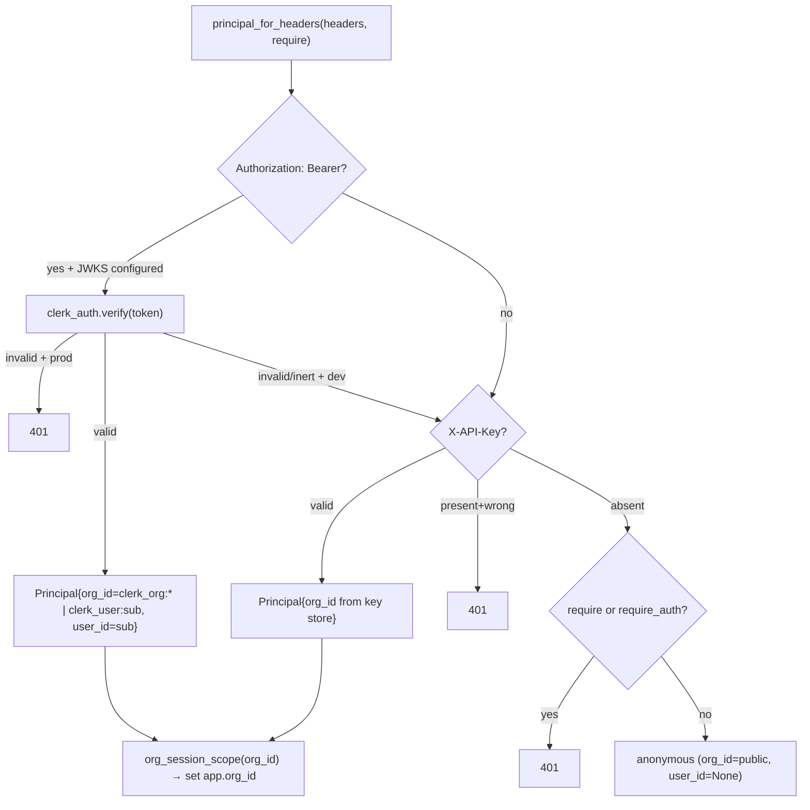
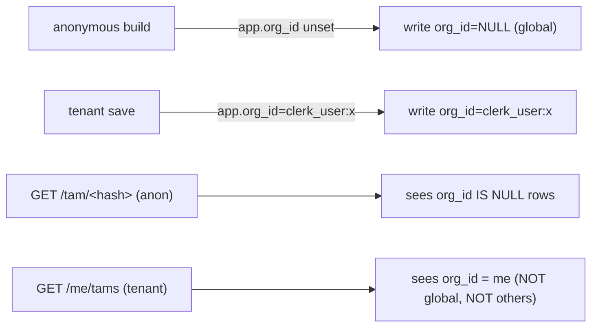

# PR 1 — Real multi-tenant per-user workspace

## Summary

Make saved research, audit history, and personal primitives **real, server-backed,
and tenant-isolated** — the foundation PR 3's boards and the CRM build on. The
linchpin is a **Clerk session-JWT → backend Principal** bridge, plus Postgres RLS
so one tenant can never read another's data **while anonymous content-addressed
`/tam/<hash>` permalinks keep resolving**.

Off `main` (PR 0 + PR 4 merged). Open a PR against `main`; the orchestrator merges
after local-green. **Highest correctness risk in the whole program** — the
`tam_outputs` dual public/private RLS policy must be exactly right.

---

## Problem Frame

Today: `tam_outputs` and `audit_events` have **no `org_id`** (saved research +
history are globally shared); Clerk is frontend-only (the backend never sees the
user); `/bank` "My Primitives" is faked (`lib/queries-personal.ts`), there is no
per-user primitive store; write paths log `actor=None`. Auth is `X-API-Key`-only
(`api/auth.py`), with a keyless anonymous fallback that must be preserved.

The proven multi-tenancy machinery already exists and must be **mirrored, not
reinvented**: migration 006's RLS template (`ENABLE`/`FORCE ROW LEVEL SECURITY` +
`CREATE POLICY USING (org_id = current_setting('app.org_id', true))`), and
`db/engine.py:org_session_scope` / `set_org_scope` (transaction-local
`app.org_id`). The novelty here is the **dual-purpose** policy on `tam_outputs`.

---

## Key Technical Decisions

### KTD-1 — Dual-purpose RLS on `tam_outputs` (the load-bearing decision)

`tam_outputs` serves **two** masters: anonymous content-addressed permalinks
(`org_id IS NULL`, world-readable) and tenant saves (`org_id = <tenant>`,
isolated). The policy must admit both:

```sql
-- USING (read) and WITH CHECK (write) both:
org_id IS NULL OR org_id = current_setting('app.org_id', true)
```

So an anonymous build (`app.org_id` unset → `current_setting(...) = NULL`) still
reads/writes global rows, while a tenant session reads globals **plus** its own,
never another tenant's. This **differs from migration 006/003** (which fail
*closed*: `org_id = current_setting`); the `OR org_id IS NULL` clause is the
permalink-preserving difference and is the single most important line in the PR.

`audit_events`, `user_primitives`, `boards`, `board_items` use the **strict**
006-style closed policy (no `IS NULL` clause) — those are never world-readable.

### KTD-2 — Split partial-unique indexes on `state_hash`

Migration 005 has `UNIQUE(state_hash)`. With `org_id` added, the same content
hash can legitimately exist once as a global permalink AND once per tenant-save.
Replace the single unique constraint with **two partial unique indexes**:

```sql
CREATE UNIQUE INDEX uq_tam_outputs_state_hash_public
  ON tam_outputs (state_hash) WHERE org_id IS NULL;
CREATE UNIQUE INDEX uq_tam_outputs_state_hash_org
  ON tam_outputs (org_id, state_hash) WHERE org_id IS NOT NULL;
```

This keeps permalink upsert idempotent (one global row per hash) while letting a
tenant save its own copy. Any code that upserts by `state_hash` must be audited
for the new (org_id, state_hash) key on the tenant path.

### KTD-3 — Clerk JWKS verification: cache, fail-open(dev)/closed(prod), never 500

`clerk_auth.py` fetches the JWKS once, caches by `kid`, and refreshes on an
unknown `kid` (key rotation). On a verification *error* it returns `None`
(treated as "no principal") rather than raising — so a bad token degrades to
anonymous in dev and 401 in prod, **never a 500 on the hot path**. When
`STRATA_CLERK_JWKS_URL` is unset (the keyless/dev default and current prod), the
verifier is **inert** — it returns `None` immediately, so existing permalinks
resolve with no 401 storm. `org_id = clerk_org:<org_id claim>` when the token
carries an org, else `clerk_user:<sub>`.

### KTD-4 — Bearer branch goes BEFORE the API-key branch

In `principal_for_headers`, check `Authorization: Bearer` first; fall through to
`X-API-Key`; then the existing anonymous/require logic. A present-but-invalid
Bearer in prod is a 401 (mirrors the present-but-wrong-key rule); in dev it
falls through to anonymous (fail-open).

### KTD-5 — Honesty fences on personal primitives

`POST/PATCH /me/primitives` forces `visibility=private` + `org_id` server-side
and **enforces the MODELED fence** exactly like `resolver/writer.py`
(community-modeled/analyst inputs cannot be written as sourced; no LLM numbers,
Q20). `promote` does **not** write public — it routes the primitive into the
existing `/contribute` review queue (migration 004 `contributions`).

---

## High-Level Technical Design

### Auth resolution (Clerk → Principal)



### tam_outputs read/write under dual-purpose RLS



---

## Implementation Units

### U1. Clerk JWKS verifier + settings + dependency

**Goal:** A pure, cached, fail-safe Clerk session-JWT verifier; inert when unconfigured.

**Files:**
- `backend/src/strata/api/clerk_auth.py` (new)
- `backend/src/strata/config.py` (add `clerk_jwks_url`, `clerk_issuer`, `clerk_audience`; all `None`-default)
- `backend/pyproject.toml` (add `pyjwt[crypto]`)
- test: `backend/tests/test_clerk_auth.py`

**Approach:** `verify_clerk_jwt(token) -> ClerkClaims | None`. Fetch JWKS from
`clerk_jwks_url` (cached module-level by `kid`; on unknown `kid` refetch once).
Verify signature (RS256), `iss`/`aud` when configured, `exp`. Return claims
(`sub`, optional `org_id`) or `None` on any failure. If `clerk_jwks_url` is None,
return `None` immediately (inert). Never raise on the hot path — catch all
`PyJWT`/network errors → `None`. Use a tiny TTL + a synchronous fetch guarded so
concurrent requests don't stampede (single in-process cache).

**Patterns to follow:** `resolver/citations.py` module-level frozen caches;
`config.py` Settings field style (env-prefixed, `None` defaults).

**Test scenarios:**
- Inert when `clerk_jwks_url is None` → returns `None` without network.
- Valid RS256 token (test keypair, JWKS stubbed) → returns claims with `sub`.
- Token with `org_id` claim → claims carry org.
- Expired token → `None` (no raise). Bad signature → `None`. Unknown `kid` →
  triggers one refetch, then `None` if still unknown.
- `iss`/`aud` mismatch when configured → `None`.
- Network error fetching JWKS → `None` (no raise, no 500).

**Verification:** `pyright src` clean; verifier never raises; inert by default.

---

### U2. Add `user_id` to Principal + Bearer branch in auth

**Goal:** Bearer-first resolution producing a Clerk-derived Principal; keyless preserved.

**Files:**
- `backend/src/strata/api/auth.py` (add `user_id: str | None` to `Principal`; Bearer branch in `principal_for_headers` BEFORE the API-key branch; `require_authenticated` dependency)
- test: `backend/tests/test_auth_clerk_bridge.py`

**Approach:** Per KTD-3/KTD-4. `org_id = f"clerk_org:{org}"` or
`f"clerk_user:{sub}"`; `user_id = sub`. Add a `require_authenticated`
FastAPI dependency that 401s when the principal is anonymous (for `/me/*`
routes). Keep `_anonymous()` with `user_id=None`.

**Patterns to follow:** existing `principal_for_headers` present-but-wrong-key 401.

**Test scenarios:**
- Valid Bearer (verifier stubbed) → Principal `org_id=clerk_user:sub`, `user_id=sub`.
- Bearer with org claim → `org_id=clerk_org:<id>`.
- Invalid Bearer + prod (`require_auth=True`) → 401; + dev → falls through to anonymous.
- No Bearer, valid X-API-Key → existing key Principal (unchanged).
- No auth headers + dev → anonymous (`user_id=None`); + prod → 401.
- `require_authenticated` 401s for anonymous, passes for a Clerk principal.

---

### U3. Migration 008 — org-scope `tam_outputs` + `audit_events` (dual-purpose RLS)

**Goal:** Per KTD-1/KTD-2. Permalinks preserved, tenant saves isolated.

**Files:**
- `backend/alembic/versions/008_org_scope_outputs_audit.py` (new)
- test: `backend/tests/test_migration_008_rls.py`

**Approach:** `tam_outputs` add `org_id String(128) NULL`, `created_by
String(128) NULL`, `title Text NULL`, `is_saved Boolean default false`. Drop
`uq_tam_outputs_state_hash`; create the two partial unique indexes (KTD-2). Index
`org_id`. `ENABLE`+`FORCE RLS`; dual-purpose policy (KTD-1, the `OR org_id IS
NULL` clause). `audit_events` add `org_id String(128) NULL` (+ index) with the
**strict** closed policy (006-style). Provide a complete `downgrade()`.

**Patterns to follow:** migration 006 verbatim for the RLS DDL; migration 005 for
the table shape.

**Test scenarios:**
- up→down→up round-trips clean (no orphan policy/index).
- anon session (no `app.org_id`): can read/write `org_id IS NULL`; cannot see a
  row with `org_id='clerk_user:a'`.
- tenant A session: sees globals + own; **0 rows** of tenant B's saves.
- Same `state_hash` can exist once as global AND once per tenant (partial indexes
  permit it); a second global insert of the same hash conflicts (idempotent upsert).

**Execution note:** Start with the RLS isolation test (test-first) — this is the
tenant-leak guard; it must fail before the policy exists.

---

### U4. Migration 009 — `user_primitives`, `boards`, `board_items`

**Goal:** Durable org-scoped private store + dashboard tables (strict RLS).

**Files:**
- `backend/alembic/versions/009_user_primitives_boards.py` (new)
- test: covered by `backend/tests/test_migration_009_rls.py`

**Approach:** `user_primitives` (id, org_id NOT NULL, created_by, slug, payload
JSONB [the AtomicPrimitive], visibility default 'private', created_at; unique
(org_id, slug)). `boards` (id, org_id, created_by, title, layout JSONB,
created_at). `board_items` (id, board_id FK, kind, ref, position JSONB). All three
get the **strict** 006-style closed RLS policy + `org_id` indexes. Full downgrade.

**Patterns to follow:** migration 006 (RLS + unique index).

**Test scenarios:**
- round-trip clean.
- tenant isolation on all three (A cannot read B).
- `(org_id, slug)` uniqueness enforced; cross-org same slug allowed.

---

### U5. Thread the Principal into write paths

**Goal:** Audit + persistence run under the caller's `org_session_scope`; `actor` is real.

**Files:**
- `backend/src/strata/db/audit.py` (accept actor/org)
- `backend/src/strata/api/routes/build.py`, `backend/src/strata/api/routes/resolve.py` (pass principal; run persist+audit under `org_session_scope(principal.org_id)`)
- test: `backend/tests/test_audit_actor.py`

**Approach:** Where `actor=None` today, pass `principal.user_id`/`org_id`. TAM
persistence on an authenticated build writes `org_id=principal.org_id`,
`created_by=user_id`; anonymous writes `org_id=NULL` (global permalink — unchanged
behavior). Wrap DB writes in `org_session_scope` so RLS `WITH CHECK` passes.

**Test scenarios:**
- Authenticated build → audit row carries `org_id`+`created_by`; tam row `org_id` set.
- Anonymous build → tam row `org_id IS NULL` (permalink still global); audit `org_id` NULL.
- No regression: `/tam/<hash>` for an anonymous build still resolves.

---

### U6. Personal primitive CRUD (`/me/primitives`)

**Goal:** Per-user private primitive store with the MODELED fence; promote→queue.

**Files:**
- `backend/src/strata/api/routes/me.py` (new; or extend `routes/primitives.py`) — `GET/POST/PATCH/DELETE /me/primitives`, `POST /me/primitives/{slug}/promote`
- `backend/src/strata/db/user_primitives.py` (new store)
- test: `backend/tests/test_me_primitives.py`

**Approach:** `require_authenticated`. Server forces `visibility=private`,
`org_id=principal.org_id`. Validate the primitive (same validators as ingest) and
**enforce the MODELED fence** (reuse `resolver/writer.py` guard — reject a
sourced-tier claim that's actually modeled). Persist to `user_primitives` under
`org_session_scope`. `promote` packages the primitive into the `/contribute`
review queue (migration 004) — never a direct public write.

**Test scenarios:**
- POST forces private+org even if body says public/other-org.
- MODELED fence: a community-modeled value claiming regulator tier → 422.
- GET returns only caller's primitives (RLS); PATCH/DELETE scoped to caller.
- promote creates a contribution-queue row, not a public primitive.
- anonymous → 401 on every `/me/primitives` verb.

---

### U7. Saved TAMs + per-user audit (`/me/tams`, `/me/audit`)

**Goal:** Cross-device saved research + history.

**Files:**
- `backend/src/strata/api/routes/me.py` — `POST /me/tams/save`, `GET /me/tams`, `GET /me/audit`
- test: `backend/tests/test_me_tams.py`

**Approach:** `save` upserts the caller's `tam_outputs` row (`org_id`,
`created_by`, `title`, `is_saved=true`) using the (org_id, state_hash) partial
index. `GET /me/tams` lists `is_saved` rows for the org. `GET /me/audit` lists the
caller's audit events (hash + market + rebuild link). All under
`org_session_scope`.

**Test scenarios:**
- save then GET /me/tams returns it; a second org sees nothing.
- saving a hash that also exists globally creates/updates the tenant row without
  touching the global permalink row.
- GET /me/audit returns only caller's events.

---

### U8. Lineage DAG endpoint (`GET /lineage/{id}`)

**Goal:** Server-side lineage replacing the frontend's local walk.

**Files:**
- `backend/src/strata/api/routes/lineage.py` (new)
- test: `backend/tests/test_lineage.py`

**Approach:** Recursive DAG over `concept.measurements → framework.inputs →
derives_from / composite.inputs`, with a cycle-guard (visited set) and depth cap.
Shape the response to match `web/src/components/.../LineageGraph.tsx`'s existing
client builder (nodes/edges) so the frontend swaps a local walk for a fetch.
Read-only (registry); no auth required (public graph).

**Test scenarios:**
- a concept with composite inputs returns the full node/edge set.
- a cyclic/self-referential link terminates (cycle-guard) — no infinite loop.
- depth cap honored; unknown id → 404.
- response shape matches the LineageGraph builder's expected keys.

---

### U9. Frontend — Bearer injection + real personal queries

**Goal:** The app sends the Clerk token and reads real `/me/*` data.

**Files:**
- `web/src/lib/api-client.ts` (inject `Authorization: Bearer` via a Clerk token getter; no-op when signed out)
- `web/src/lib/queries-personal.ts` (replace faked `myPrimitivesQuery` with real `/me/primitives`; add saved-tams + audit queries)
- `web/src/components/.../MyPrimitivesSection.tsx`, `ActivitySection.tsx`, `SavedBuildsSection.tsx` (wire to new endpoints)
- migrate `web/src/lib/favorites-store.ts` / `build-history.ts` localStorage → server on first login
- test: co-located unit tests for the token getter + query wiring where present

**Approach:** A Clerk `getToken()` accessor injected into `api-client`; when
signed out it sends no header (keyless reads still work). Replace the faked query;
keep graceful empty/loading/error states (DESIGN). On first authenticated load,
one-time migrate localStorage favorites/history to the server, then read server.

**Test scenarios:**
- signed-out: api-client sends no Authorization header; public reads still work.
- signed-in: header present; `myPrimitivesQuery` hits `/me/primitives`.
- localStorage migration runs once and is idempotent.
- `Test expectation: none` for pure presentational wiring with no logic branch.

**Verification:** `bunx tsc --noEmit` + `bunx biome check` clean on changed files;
authed `shot.ts` of `/bank` shows real personal data (or honest empty state).

---

### U10. Verification gate (RLS isolation + keyless regression)

**Goal:** Prove tenant isolation, permalink preservation, and green gates.

**Approach / Verification (outcomes):**
- `uv run pytest` green incl. all new RLS isolation tests (org A ⊥ org B across
  tams/primitives/boards/audit; anon sees only `org_id IS NULL`).
- migrations 008 + 009 up→down→up round-trip clean.
- keyless regression: with `STRATA_CLERK_*` unset, `/tam/<hash>` resolves, no 401
  storm, anonymous build still global.
- `uv run pyright src`, `ruff check src`, `ruff format --check src` clean.
- `uv run strata validate ../data` 0 errors.
- web `tsc` + `biome` clean.

**Test scenarios:** `Test expectation: none — aggregation gate.`

---

## System-Wide Impact

- **DB:** two migrations; `tam_outputs` gains a dual-purpose policy — every code
  path that reads/writes it now runs under an org scope (or anonymous). Audit the
  existing `remember_tam`/persist path for the new partial-unique keys (KTD-2).
- **Auth:** every request now has a (possibly anonymous) Principal with `user_id`;
  the Bearer branch is hot-path — must never 500.
- **Frontend:** api-client gains an auth header; signed-out behavior must be
  byte-identical to today (keyless).
- **Honesty fences:** `/me/primitives` enforces MODELED + private; promote→queue.

---

## Risks & Mitigations

- **Tenant leak / broken permalink (KTD-1)** — the dual-purpose policy is the
  highest risk. Mitigation: test-first RLS isolation tests (U3) covering anon,
  tenant-A, tenant-B, and cross-tenant 0-rows; explicit permalink-still-resolves
  test.
- **Clerk 500 on hot path (KTD-3)** — verifier returns `None` on all errors,
  inert when unconfigured; covered by U1 error-path tests.
- **Real Clerk prod keys unavailable (secret)** — implement everything; keep
  `STRATA_CLERK_*` unset (inert/dev) and **mark BLOCKED in the PR body**: live
  prod JWKS verification can't be exercised here, only the stubbed-keypair path.
- **Partial-unique-index upsert bugs (KTD-2)** — audit every `state_hash` upsert
  for the org_id-aware key; test same-hash global+tenant coexistence.
