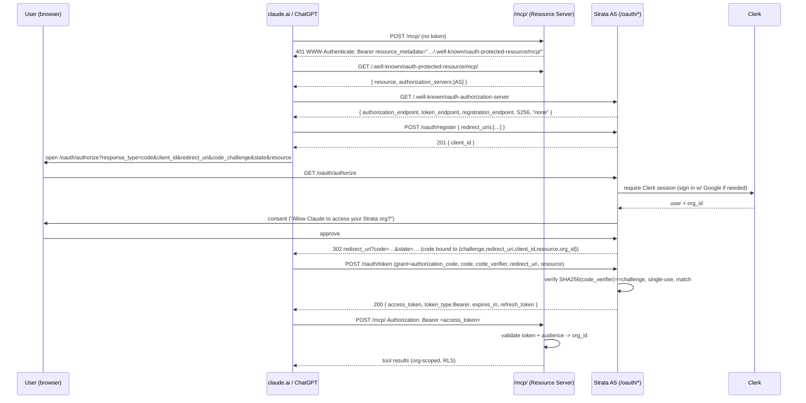

# feat: OAuth 2.1 Authorization Server — one-click claude.ai / ChatGPT MCP connect

## Summary

The hosted MCP at `/mcp/` already authenticates three ways today via a **static**
`Authorization: Bearer` credential (Clerk JWT · `strata_sk_` key) — but only Claude
Code (CLI) and Claude Desktop (JSON config) can send a static header. The **claude.ai
web** and **ChatGPT** "Add custom connector" UIs have **no header field**; they
authenticate **only via OAuth** (URL + OAuth metadata discovered from the server). So a
key-based connector cannot be added in those web UIs.

This plan co-hosts an **OAuth 2.1 Authorization Server (AS)** in the same FastAPI app as
the existing Resource Server (RS = `/mcp/`). Identity reuses **Clerk** (the user signs in
with Google), and the issued opaque access token maps to the **same `org_id`** the API-key
+ RLS path already uses — so the bidirectional loop, metering, and tenant isolation stay
consistent. OAuth is a **third, additive** bearer branch; the `strata_sk_` and Clerk-JWT
paths are untouched.

Spec basis: MCP Authorization rev **2025-06-18** (OAuth 2.1 + RFC 8414 + 7591 + 9728 +
8707 + PKCE S256). Library: **authlib** for grants/PKCE; metadata + audience binding by hand.

---

## Problem Frame

- **Who:** a VC/operator who wants to add Strata as a custom connector inside claude.ai or
  ChatGPT in one click, signing in with their existing Clerk (Google) identity.
- **Current state (as-built, verified `file:line`):**
  - MCP mounted: `backend/src/strata/api/app.py:301` — `app.mount("/mcp", McpAuthMiddleware(mcp_app))`.
  - ASGI auth guard: `backend/src/strata/api/mcp_auth.py` — `principal_for_headers(headers, require=True)`; cache-warm in `_ensure_key_loaded` (`mcp_auth.py:46`); 401 send path (`mcp_auth.py:118`); `_send_json(headers=…)` (`mcp_auth.py:91`).
  - Bearer resolution: `backend/src/strata/api/auth.py:133` `principal_for_headers` — two branches today (`strata_sk_` key at `:150`, Clerk JWT at `:156`, org-id derivation at `:158`). `_KEY_STORE` dict hot-path + `register_hashed` (`:91`), `hash_key` (`:65`).
  - Clerk verify: `backend/src/strata/api/clerk_auth.py:111` `verify_clerk_jwt` — inert when `clerk_jwks_url` unset, never raises (fails open dev / closed prod).
  - Org scoping: `org_session_scope(org_id)` / `set_org_scope` (`backend/src/strata/db/engine.py:55,62`); RLS keyed on `app.org_id`. `session_scope` (`engine.py:33`).
  - Self-serve key pattern to mirror: `backend/src/strata/db/api_keys.py` (mint/lookup/hash/rotate-style); `ApiKeyRow` (`backend/src/strata/db/models.py:239`, with the **NOT-under-RLS** rationale at `:246`); migration `012_api_key_lifecycle.py`.
  - Config: `STRATA_` prefix (`backend/src/strata/config.py:31`); Clerk knobs `:61`; `portfolio_enabled` dark-flag posture `:77`.
  - Frontend connect snippets: `web/src/components/agents/ApiKeysPanel.tsx` (`ConnectSnippets` at `:253`; the misleading claude.ai/ChatGPT block at `:301`; Clerk gating `Show when=…` at `:350`/`:367`). Trailing-slash `/mcp/` is load-bearing (`:254` — the 307 strips `Authorization`).
- **The gap:** no AS, no RFC 9728/8414 discovery docs, no `WWW-Authenticate` on the 401, no DCR, no `/authorize` + `/token`, no OAuth-token bearer branch, and the UI tells web users to "set the auth header" which those UIs cannot do.

---

## Key Technical Decisions

**KTD-1 — Co-host AS in the same FastAPI app; do not stand up a separate service.**
The AS routes (`/.well-known/*`, `/oauth/*`) mount as ordinary FastAPI routers alongside
the existing 17 routers (`app.py:265-281`). `issuer` == `authorization_servers[0]` ==
the metadata-serving base must be **byte-identical** to the deployed API origin
(`STRATA_OAUTH_ISSUER`). This is the #1 cause of claude.ai connect failures.

**KTD-2 — OAuth tables mirror `api_keys`: hash-stored, NOT under RLS.**
`oauth_tokens` / `oauth_auth_codes` / `oauth_clients` are looked up **by hash before an
`org_id` is known** (exactly like `api_keys` — see `models.py:246` rationale). Putting them
under RLS would make the auth path unable to read them. Org isolation is enforced by (a)
the token row *carrying* `org_id`, (b) the resolved `Principal(org_id)` then driving
`org_session_scope` + RLS on the actual *data* tables, and (c) the **audience check**. This
is the established, reviewed pattern — do not invent a new one.

**KTD-3 — Opaque access tokens, not JWTs.** Mirror `strata_sk_` keys: random secret,
sha256-hashed at rest, dict hot-path (`_KEY_STORE`-style) + DB cold-warm. Opaque tokens are
trivially revocable and need no key-management; the RS already has a fast hash-lookup path.

**KTD-4 — Third bearer branch, ordered after the `strata_sk_` and Clerk-JWT checks.**
In `principal_for_headers`, a Bearer that is neither `strata_sk_`-prefixed nor a verifiable
Clerk JWT falls through to an **oauth access-token** lookup before the final 401. Order
matters: `strata_sk_` is prefix-detectable and cheap; Clerk is a signature check; oauth is a
hash lookup. The new branch must not change behavior for the first two.

**KTD-5 — authlib for PKCE crypto + RFC primitives; async grant orchestration is ours.**
**Verified via ctx7 (`/authlib/authlib`, 2026-06-07):** authlib's `AuthorizationServer` +
`grants.AuthorizationCodeGrant`/`RefreshTokenGrant` machinery is **synchronous and
Flask/Django-coupled** (the Starlette integration is OAuth *client* login only — there is no
async OAuth-*provider* integration). Strata is **async FastAPI + async SQLAlchemy (asyncpg)**,
so wiring authlib's sync `save_authorization_code`/`query_client`/`save_token` callbacks into
async routes would force a sync↔async bridge against the grain of the stack. Decision: use
authlib for the **part you must not hand-roll** — PKCE S256 (`authlib.oauth2.rfc7636.create_s256_code_challenge`
+ constant-time compare) and the RFC 6749 error types/response shapes — and implement the thin
grant orchestration (validate → consume code → issue token → rotate) directly in async route
handlers backed by our async `db/oauth.py` (U3). This honors "don't hand-roll PKCE" while
keeping everything else async-native. authlib also does **not** implement RFC 9728
(protected-resource metadata) or RFC 8707 (`resource` audience binding) — those are small
hand-written additions (U4/U7). Keep the existing `McpAuthMiddleware` for the RS; add only the
`WWW-Authenticate` header to its 401. *If* a future maintainer prefers authlib's full server,
it must be driven via `asyncio.to_thread` with a sync session — out of scope here.

**KTD-6 — redirect_uri = exact-match-against-registered, gated by trusted-host allowlist.**
ChatGPT's production callback path is **dynamic per connector**
(`https://chatgpt.com/connector/oauth/{callback_id}`), so a hardcoded full-URL allowlist
cannot work. Instead: DCR persists the client's declared `redirect_uris`; `/authorize`
requires the incoming `redirect_uri` to (a) **exact-match** one the client registered AND
(b) have a scheme+host in a **trusted-host allowlist**. This is both RFC-correct (6749 exact
match) and defense-in-depth against open-redirect.

**KTD-7 — Clerk is the login step; consent uses the REAL Clerk identity.** `/authorize`
requires a Clerk session; if absent it redirects to a frontend Clerk-gated consent page
(`/oauth/authorize`). On approval the **backend** mints the code bound to the Clerk-derived
`org_id` (`clerk_org:…` / `clerk_user:…` — identical to `auth.py:158`). Never auto-consent
to a fixed demo org in prod.

---

## High-Level Technical Design

### OAuth discovery + code + token flow



### The three bearer branches at the RS (KTD-4)

```
Authorization: Bearer <token>
        │
        ├─ token starts "strata_sk_"  ─▶ _KEY_STORE[hash] ─▶ Principal(org_id)      [existing]
        │
        ├─ verify_clerk_jwt(token) ok  ─▶ Principal(clerk_org:… / clerk_user:…)      [existing]
        │
        └─ else: oauth_tokens[hash], not expired, audience==MCP_RESOURCE_URL
                                       ─▶ Principal(org_id)                          [NEW — U5]
                                       └─ miss/expired/bad-audience ─▶ 401
```

### Trusted-host allowlist (KTD-6)

```
redirect_uri must (a) EXACT-match a DCR-registered uri for this client_id
              AND (b) scheme+host ∈ {
                  https://claude.ai            (path /api/mcp/auth_callback)
                  https://chatgpt.com          (path /connector/oauth/{id} | /connector_platform_oauth_redirect)
                  https://chat.openai.com
                  http://127.0.0.1:* | http://localhost:*   (RFC 8252 loopback, Claude Code)
              }
```

---

## Output Structure

```
backend/src/strata/
  api/
    oauth/                       # NEW package — the Authorization Server
      __init__.py
      grants.py                  # authlib AuthorizationCodeGrant + RefreshTokenGrant subclasses
      allowlist.py               # trusted-host validation (KTD-6)
    routes/
      oauth_metadata.py          # NEW — RFC 9728 + RFC 8414 .well-known docs (unauth, CORS-open)
      oauth.py                   # NEW — /oauth/register, /oauth/authorize, /oauth/token
  db/
    oauth.py                     # NEW — persistence + hash (mirror db/api_keys.py)
  alembic/versions/
    013_oauth_server.py          # NEW — oauth_clients + oauth_tokens + oauth_auth_codes
web/src/app/oauth/authorize/
  page.tsx                       # NEW — Clerk-gated consent screen
```

---

## Implementation Units

### U1. Config knobs for the OAuth issuer + resource

**Goal:** Add the OAuth settings so issuer/resource/TTLs are env-driven and byte-exact.
**Requirements:** KTD-1, KTD-5.
**Dependencies:** none.
**Files:** `backend/src/strata/config.py`, `backend/tests/test_config.py` (extend, if present; else add).
**Approach:** Add to `Settings`: `oauth_issuer: str | None = None` (the API base, scheme+host,
no trailing path), `mcp_resource_url: str | None = None` (the `…/mcp/` URL byte-exact as users
type it, **trailing slash**), `oauth_access_ttl_seconds: int = 3600`,
`oauth_refresh_ttl_seconds: int = 2592000`. All `STRATA_`-prefixed, all optional so existing
envs load unchanged. Add an `oauth_enabled` property (issuer + resource both set) so routes
short-circuit to an honest 404 when unconfigured (mirror `portfolio_enabled`, `config.py:77`).
**Patterns to follow:** the Clerk block (`config.py:61`) — optional, inert-when-unset.
**Test scenarios:**
- Defaults: no env → `oauth_issuer`/`mcp_resource_url` are `None`, `oauth_enabled` False.
- Set both via `STRATA_OAUTH_ISSUER` / `STRATA_MCP_RESOURCE_URL` → values read verbatim (trailing slash preserved); `oauth_enabled` True.
- TTLs override from env; defaults 1h / 30d.

### U2. Migration 013 — oauth_clients, oauth_tokens, oauth_auth_codes

**Goal:** Persist DCR clients, issued tokens (hashed), and short-lived single-use codes.
**Requirements:** KTD-2, KTD-3.
**Dependencies:** U1.
**Files:** `backend/alembic/versions/013_oauth_server.py`, `backend/src/strata/db/models.py`
(add `OAuthClientRow`, `OAuthTokenRow`, `OAuthAuthCodeRow`).
**Approach:** `revision="013"`, `down_revision="012"`. Three tables, **NOT under RLS**
(mirror the `api_keys` rationale at `models.py:246` — auth looks up by hash before org is known):
- `oauth_clients`: `client_id` (PK, String 64), `redirect_uris` (Text — JSON array of registered URIs), `client_name` (Text nullable), `created_at` (server_default now).
- `oauth_auth_codes`: `code_hash` (PK, String 64), `client_id` (String 64, indexed), `redirect_uri` (Text), `code_challenge` (String 128), `code_challenge_method` (String 8, default `S256`), `resource` (Text), `org_id` (String 128, indexed), `user_id` (String 128 nullable), `scope` (String 256 default `*`), `expires_at` (timestamptz), `consumed_at` (timestamptz nullable — single-use marker).
- `oauth_tokens`: `token_hash` (PK, String 64), `refresh_hash` (String 64 nullable; partial-unique index where not null), `client_id` (String 64), `org_id` (String 128, indexed), `user_id` (String 128 nullable), `scope` (String 256 default `*`), `resource` (Text — bound audience), `expires_at` (timestamptz), `refresh_expires_at` (timestamptz nullable), `revoked_at` (timestamptz nullable), `created_at` (server_default now).
- `downgrade()` drops all three (+ indexes) in reverse order.
**Patterns to follow:** `012_api_key_lifecycle.py` (column/index style; `postgresql_where` partial index); `ApiKeyRow` mapping style (`models.py:239`); CompanyRow comment style for the RLS-exemption note.
**Test scenarios:**
- `alembic upgrade head` then `downgrade -1` round-trips with no error (migration gate).
- Tables exist with documented columns; `oauth_tokens.token_hash` is PK; partial-unique on `refresh_hash` permits multiple NULLs.

### U3. OAuth persistence layer (mirror db/api_keys.py)

**Goal:** Pure persistence + crypto-of-the-hash for clients, codes, tokens.
**Requirements:** KTD-2, KTD-3.
**Dependencies:** U2.
**Files:** `backend/src/strata/db/oauth.py`, `backend/tests/db/test_oauth_store.py`.
**Approach:** Functions mirroring `db/api_keys.py`, reusing `hash_key` from `api.auth` (sha256):
- `register_client(session, *, redirect_uris, client_name) -> client_id` (random `client_…` id).
- `get_client(session, client_id) -> OAuthClientRow | None`.
- `create_auth_code(session, *, client_id, redirect_uri, code_challenge, resource, org_id, user_id, scope, ttl) -> raw_code` (store `hash_key(raw_code)`; raw returned once).
- `consume_auth_code(session, raw_code) -> OAuthAuthCodeRow | None` — atomically set `consumed_at` and return the row **only if** not already consumed and not expired; a second call returns `None` (single-use, replay-safe under a row lock / `UPDATE … WHERE consumed_at IS NULL RETURNING`).
- `issue_token(session, *, client_id, org_id, user_id, scope, resource, access_ttl, refresh_ttl) -> (raw_access, raw_refresh, OAuthTokenRow)`.
- `lookup_access(session, raw_access) -> OAuthTokenRow | None` — by hash, not expired/revoked.
- `rotate_refresh(session, raw_refresh) -> (raw_access, raw_refresh, row) | None` — verify the old refresh, **revoke it** (`revoked_at`), issue a new pair; a reused old refresh → `None`.
**Patterns to follow:** `db/api_keys.py` mint/lookup/revoke structure; `secrets.token_urlsafe`.
**Test scenarios:**
- Round-trip: register client → create code → consume once returns the row; consume again → `None` (single-use).
- Expired code: a code past `expires_at` → `None` from `consume_auth_code`.
- `issue_token` then `lookup_access` resolves the org; expired/revoked → `None`.
- `rotate_refresh`: first call issues a new pair and revokes the old; reusing the old refresh → `None` (reuse detection).
- Cross-tenant: a token issued for org A carries `org_id="A"` and `lookup_access` returns A only.

### U4. Metadata routes — RFC 9728 + RFC 8414 (.well-known)

**Goal:** Serve the discovery docs claude.ai/ChatGPT fetch from the browser.
**Requirements:** KTD-1, KTD-5.
**Dependencies:** U1.
**Files:** `backend/src/strata/api/routes/oauth_metadata.py`, register in `backend/src/strata/api/app.py` (`include_router`), `backend/tests/api/test_oauth_metadata.py`.
**Approach:** Three GET routes, **unauthenticated, CORS-open** (claude.ai fetches cross-origin):
- `GET /.well-known/oauth-protected-resource` and `GET /.well-known/oauth-protected-resource/mcp/` → `{ "resource": <mcp_resource_url byte-exact>, "authorization_servers": [<issuer>] }`.
- `GET /.well-known/oauth-authorization-server` → `{ issuer, authorization_endpoint, token_endpoint, registration_endpoint, response_types_supported:["code"], grant_types_supported:["authorization_code","refresh_token"], code_challenge_methods_supported:["S256"], token_endpoint_auth_methods_supported:["none"] }`.
- `issuer` == `authorization_servers[0]` == the scheme+host serving the metadata, **byte-identical**.
- When `oauth_enabled` is False → 404 ("not configured") rather than a half-doc.
- Ensure `CORSMiddleware` (`app.py:220`) covers these paths, or set explicit `Access-Control-Allow-Origin: *` on these specific unauth, secret-free docs.
**Patterns to follow:** thin `APIRouter` in `routes/`; `healthz.router` (unauth route).
**Test scenarios:**
- Protected-resource doc: `resource` equals configured `mcp_resource_url` byte-for-byte (incl. trailing slash); `authorization_servers[0]` equals `issuer`.
- Path-suffixed `/.well-known/oauth-protected-resource/mcp/` returns the same doc.
- AS-metadata doc: advertises `S256` only, `"none"` auth method, both grant types, all three endpoint URLs absolute under `issuer`.
- Docs respond 200 with no `Authorization` header (unauth) and carry permissive CORS.
- `oauth_enabled` False → 404 on all three.

### U5. RS acceptance — third bearer branch + WWW-Authenticate

**Goal:** Accept oauth access tokens at `/mcp/`, with audience check; advertise discovery on 401.
**Requirements:** KTD-2, KTD-3, KTD-4; invariant: additive, `/mcp/` always-require-auth.
**Dependencies:** U3, U4.
**Files:** `backend/src/strata/api/auth.py` (third branch + oauth-token cache), `backend/src/strata/api/mcp_auth.py` (WWW-Authenticate on 401 + DB cold-warm for oauth tokens), `backend/tests/api/test_oauth_rs.py`.
**Approach:**
- In `principal_for_headers` (`auth.py:144` Bearer block), after the `strata_sk_` check (`:150`) and the Clerk verify (`:156`), add a third branch: hash the token, look it up in an in-process oauth cache (a dict mirroring `_KEY_STORE`), and if present **and** its bound `resource` == `settings.mcp_resource_url`, return `Principal(org_id=…, user_id=…)`. Wrong-audience → reject. The existing fall-through 401 stays last.
- In `mcp_auth._ensure_key_loaded` (`mcp_auth.py:46`), extend the cold-warm — **note the detection gap:** the current function calls `api_key_from_headers` (`auth.py:115`), which returns `None` for any Bearer that is not `strata_sk_`-prefixed, so an OAuth Bearer would silently skip the warm. Add a parallel extraction (read the raw Bearer token directly; if it's neither a `strata_sk_` key nor a verifiable Clerk JWT and not already in the oauth cache) → look it up via `db.oauth.lookup_access` and register it into the oauth cache (mirror `register_hashed`). Best-effort; never 500.
- In `McpAuthMiddleware.__call__`, on the `HTTPException` 401 path (`mcp_auth.py:118`), add a `WWW-Authenticate: Bearer resource_metadata="<issuer>/.well-known/oauth-protected-resource/mcp/"` response header via `_send_json`'s `headers` arg.
- **Audience check is non-negotiable** — a token minted for a different resource must 401.
**Patterns to follow:** the existing `strata_sk_` Bearer branch (`auth.py:150`); `_ensure_key_loaded` cold-warm; `_send_json(headers=…)` (`mcp_auth.py:91`).
**Test scenarios:**
- A valid oauth token (right audience) resolves to its `Principal(org_id)`; `/mcp/` serves it.
- A token with `resource` != `mcp_resource_url` → 401 (audience confusion blocked).
- An expired/revoked oauth token → 401.
- A `strata_sk_` key and a Clerk JWT still resolve exactly as before (regression: additive only).
- 401 on missing token carries `WWW-Authenticate: Bearer resource_metadata="…/oauth-protected-resource/mcp/"`.
- Cross-tenant: org A's oauth token at `/mcp/` yields `Principal(org_id="A")` and cannot read org B's rows. Covers the highest-risk invariant.

### U6. DCR — POST /oauth/register

**Goal:** Accept-any dynamic client registration (RFC 7591), persist redirect_uris.
**Requirements:** KTD-6.
**Dependencies:** U3.
**Files:** `backend/src/strata/api/routes/oauth.py` (register endpoint), `backend/src/strata/api/oauth/allowlist.py`, register router in `app.py`, `backend/tests/api/test_oauth_dcr.py`.
**Approach:** `POST /oauth/register` accepts the RFC 7591 body (`redirect_uris`, `client_name`, …),
validates `redirect_uris` is a non-empty array of absolute URIs whose hosts pass the
trusted-host allowlist (reject off-allowlist hosts up front — defense in depth), persists via
`db.oauth.register_client`, returns `201 { client_id, redirect_uris, token_endpoint_auth_method:"none", … }`.
Unauthenticated (DCR is pre-auth).
**Patterns to follow:** thin router in `routes/`.
**Test scenarios:**
- Accept-any: a well-formed body with a claude.ai redirect_uri returns 201 + `client_id`.
- A body whose `redirect_uris` host is off-allowlist (`https://evil.test/cb`) → rejected.
- Empty / missing `redirect_uris` → 400.
- The returned `client_id` round-trips: `/authorize` later finds the persisted redirect_uris.

### U7. /oauth/authorize — Clerk gate, allowlist, mint code

**Goal:** The authorization endpoint: validate, require Clerk identity, consent, mint single-use code.
**Requirements:** KTD-6, KTD-7; invariant: real Clerk identity, never auto-consent in prod.
**Dependencies:** U3, U6.
**Files:** `backend/src/strata/api/routes/oauth.py` (authorize endpoint), `backend/src/strata/api/oauth/allowlist.py`, `backend/src/strata/api/oauth/grants.py`, `backend/tests/api/test_oauth_authorize.py`.
**Approach:** `GET /oauth/authorize?response_type=code&client_id&redirect_uri&code_challenge&code_challenge_method=S256&state&resource&scope`:
1. Resolve `client_id` → 400 if unknown.
2. `redirect_uri` must **exact-match** a registered uri **and** pass the trusted-host allowlist (KTD-6) → 400 (do **not** redirect on a bad redirect_uri — that would be the open-redirect bug).
3. Require `code_challenge` + `code_challenge_method=S256` → 400 if missing/`plain` (no PKCE downgrade).
4. Validate `resource` (RFC 8707) present and equals `mcp_resource_url` → 400 otherwise.
5. Require a Clerk session: the browser reaches this through the frontend consent page (U9), which forwards the Clerk session token; verify with `verify_clerk_jwt`. If absent/invalid, redirect the browser to the frontend `/oauth/authorize` consent page (carrying the query) to sign in. **Never** mint without a verified Clerk identity in prod.
6. On approval, derive `org_id` exactly as `auth.py:158` (`clerk_org:…` / `clerk_user:…`), mint a single-use code via `db.oauth.create_auth_code` bound to `{code_challenge, redirect_uri, client_id, resource, org_id, user_id}`, and `302` to `redirect_uri?code=…&state=…`.
**Patterns to follow:** `verify_clerk_jwt` (`clerk_auth.py:111`); org-id derivation (`auth.py:158`); authlib `AuthorizationCodeGrant` for the response shape.
**Test scenarios:**
- Non-registered redirect_uri → 400, **no redirect** (open-redirect blocked).
- Off-allowlist host (even if a client registered it) → 400.
- Missing `code_challenge` or `code_challenge_method=plain` → 400 (PKCE downgrade blocked).
- Missing/mismatched `resource` → 400 (audience binding enforced at mint).
- No Clerk session → redirect to the frontend consent/sign-in page (no code minted).
- Happy path: valid Clerk session + approval → 302 to the registered redirect_uri with `code` + echoed `state`; code bound to the Clerk-derived org_id.

### U8. /oauth/token — authorization_code + refresh_token grants

**Goal:** Exchange code→tokens with PKCE+single-use+audience, and rotate refresh tokens.
**Requirements:** KTD-3, KTD-5.
**Dependencies:** U3, U7.
**Files:** `backend/src/strata/api/routes/oauth.py` (token endpoint), `backend/src/strata/api/oauth/grants.py`, `backend/tests/api/test_oauth_token.py`.
**Approach:** `POST /oauth/token`:
- `grant_type=authorization_code`: consume the code (single-use via `consume_auth_code`), verify `SHA256(code_verifier)==code_challenge` (authlib `CodeChallenge`), verify `redirect_uri` + `client_id` match the code's binding, then issue opaque `{access_token, token_type:"Bearer", expires_in, refresh_token, scope}` via `db.oauth.issue_token`, carrying the code's `resource` as the token's bound audience.
- `grant_type=refresh_token`: `db.oauth.rotate_refresh` — issue a new pair, revoke the old refresh (rotation); a reused old refresh → `invalid_grant`.
- Standard OAuth error JSON (`{"error":"invalid_grant"}`, 400) on every failure.
**Patterns to follow (consistent with KTD-5 — do NOT use authlib's sync `AuthorizationServer`/`RefreshTokenGrant` classes):** authlib `authlib.oauth2.rfc7636.create_s256_code_challenge` for the PKCE verify; standard OAuth error JSON shapes (`{"error":"invalid_grant"}`, 400). Orchestration (consume code → issue/rotate) is our async `db/oauth.py` (U3).
**Test scenarios:**
- Happy path: valid code + correct `code_verifier` → 200 with access+refresh; the access token then authenticates at `/mcp/` (integration with U5).
- Replay: a second `/token` with the same code → `invalid_grant` (single-use).
- PKCE mismatch: wrong `code_verifier` → `invalid_grant`.
- redirect_uri/client_id mismatch vs the code binding → `invalid_grant`.
- Refresh rotation: refresh once → new pair; the **old** refresh is then rejected (reuse detection).
- The issued access token's bound `resource` equals the code's `resource` (audience carried through).

### U9. Frontend consent page — /oauth/authorize

**Goal:** Clerk-gated "Allow Claude to access your Strata org?" screen that drives the backend mint.
**Requirements:** KTD-7; design governance (Sourced Ledger, WCAG 2.2 AA, reduced-motion).
**Dependencies:** U7.
**Files:** `web/src/app/oauth/authorize/page.tsx` (+ any small client component it needs).
**Approach:** A route that reads the OAuth query params, requires a Clerk session (same `Show`/sign-in
pattern as `ApiKeysPanel.tsx:350`), shows the requesting client name + the org the user will grant,
and an **Approve** / **Deny** pair. Approve forwards to the backend `/oauth/authorize` decision with the
Clerk session token attached so the backend mints the code and 302s to the connector callback. Deny returns
the user to safety. Sourced Ledger tokens (`var(--bg-0)`, `var(--accent)`, Instrument Serif display),
tabular mono where relevant, AA contrast, motion-free or `prefers-reduced-motion`-safe.
**Read `node_modules/next/dist/docs/` before writing** (web/AGENTS.md: this Next.js has breaking changes).
**Patterns to follow:** `ApiKeysPanel.tsx` Clerk gating (`Show when="signed-in/out"`), Button/CopyBox primitives, design tokens.
**Test scenarios:** `Test expectation: none — verified via ce-test-browser` (screenshot: signed-out shows sign-in; signed-in shows the consent card with org + client name; Approve wires to the backend). Behavioral assertions live in the backend U7/U8 tests.

### U10. Fix the misleading connect snippet

**Goal:** Stop telling claude.ai/ChatGPT users to "set the auth header" — those UIs are OAuth-only.
**Requirements:** product honesty.
**Dependencies:** none (independent; can land first).
**Files:** `web/src/components/agents/ApiKeysPanel.tsx` (`ConnectSnippets`, `:300`).
**Approach:** Rewrite the "claude.ai / ChatGPT (custom connector)" block (`:301`) to:
"Settings → Connectors → Add custom connector. Paste the URL below — Claude/ChatGPT runs an OAuth
sign-in; **no header needed**." Keep the URL CopyBox. The `Authorization: Bearer …` header instructions
stay **only** under the Claude Code and Claude Desktop blocks (`:291`, `:296`) and the Raw block. Do not
remove the static-key snippets — they remain correct for header-capable clients.
**Patterns to follow:** the surrounding block markup; keep copy terse and tier-honest.
**Test scenarios:** `Test expectation: none — copy change; verified via ce-test-browser screenshot of /agents`.

---

## Dependencies / Prerequisites

- **authlib** added to `backend/pyproject.toml` (KTD-5): `uv add authlib` (or edit + `uv lock`).
- Migration 013 applied (`uv run alembic upgrade head`) before the RS/token paths are exercised.
- Prod: set `STRATA_OAUTH_ISSUER` (= the Railway API origin, scheme+host, no trailing path) and
  `STRATA_MCP_RESOURCE_URL` (= `https://<api>/mcp/`, trailing slash). Clerk JWKS already set on prod
  (`STRATA_CLERK_JWKS_URL`).

## Risk Analysis & Mitigation

| Risk | Mitigation |
|---|---|
| Open redirect via `redirect_uri` | Exact-match-registered **and** trusted-host allowlist; never redirect on a bad redirect_uri (400 instead) — U7. |
| Auth-code replay | `consume_auth_code` single-use + short TTL; second use → `invalid_grant` — U3/U8. |
| PKCE downgrade / `none` | `/authorize` requires `S256`; metadata advertises S256 only — U4/U7. |
| Token-audience confusion | RS rejects tokens whose bound `resource` != `mcp_resource_url` — U5. |
| Refresh-token reuse | Rotation revokes the old refresh; reuse → `invalid_grant` — U3/U8. |
| Breaking the existing two bearer paths | Third branch appended after them; regression tests assert `strata_sk_` + Clerk unchanged — U5. |
| Cross-tenant read | Token carries `org_id`; `org_session_scope` + RLS enforce on data tables; explicit cross-tenant test — U5. |
| issuer/resource mismatch (silent connect failure) | Byte-identical issuer/resource tests; trailing-slash preserved in config — U1/U4. |

## Scope Boundaries

**In scope:** the full discovery → DCR → authorize → token → RS-accept loop for claude.ai +
ChatGPT + Claude Code loopback; the consent page; the snippet fix; tests + security review.

### Deferred to Follow-Up Work
- CIMD (Client ID Metadata Documents) support — ChatGPT's preferred scale path; DCR is sufficient for launch.
- Per-scope authorization (granular tool scopes) — issue `*` scope for now, matching `strata_sk_` keys.
- An OAuth-client management UI (list/revoke registered clients) — not needed for connect.

**Out of scope:** changing the `strata_sk_`/Clerk paths; changing `/mcp/`'s always-require-auth posture; any honesty-fence change.

## Sources & Research
- Origin design doc: `docs/plans/2026-06-07-mcp-oauth-connector.md` (mermaid, file:line map, the five common break causes, confirmed callback URLs).
- ChatGPT callbacks confirmed (2026-06-07, OpenAI Apps SDK): production `https://chatgpt.com/connector/oauth/{callback_id}` (dynamic), legacy `https://chatgpt.com/connector_platform_oauth_redirect`; ChatGPT supports DCR (RFC 7591) + CIMD.
- Claude callback: `https://claude.ai/api/mcp/auth_callback` (static).
- Prior learnings: `[[strata-mcp-connect-verified]]`, `[[strata-cli-deploy]]`.
