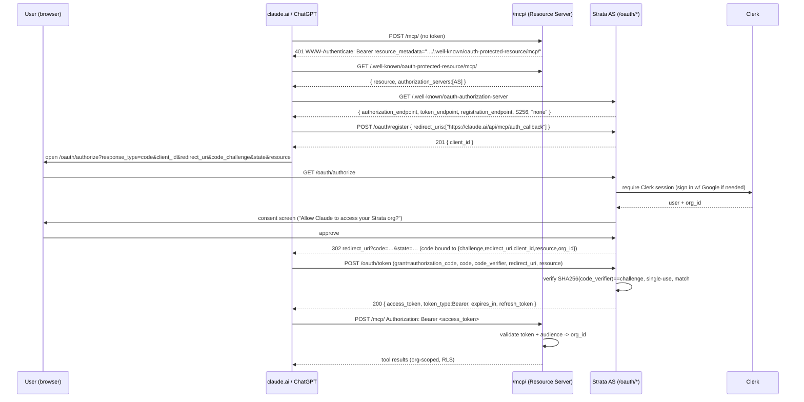

# Plan — OAuth 2.1 for the hosted MCP (one-click claude.ai / ChatGPT connectors)

**Status:** ready to implement · **Created:** 2026-06-07 · **Owner:** next session

## Why

The hosted MCP at `https://strata-api-production-9740.up.railway.app/mcp/` already
works with a static API key sent as `Authorization: Bearer strata_sk_…` — but
**only** via Claude Code (CLI) and Claude Desktop (config). The **claude.ai web**
and **ChatGPT** "Add custom connector" UIs have **no field for a static header** —
they authenticate **only via OAuth** (URL + OAuth Client ID/Secret discovered from
the server). So a key-based connector cannot be added in the web UIs today.

This plan adds an OAuth 2.1 Authorization Server (AS) co-hosted with the existing
Resource Server (RS = `/mcp/`) so the web UIs connect in one click. Identity reuses
**Clerk** (the user signs in with Google), and the issued token maps to the **same
`org_id`** the API-key + RLS path already uses — so the bidirectional loop and
tenant isolation stay consistent.

Spec basis: MCP Authorization rev **2025-06-18** (OAuth 2.1 + RFC 8414 + 7591 +
9728 + 8707 + PKCE S256). Anthropic connector auth docs.

## Current state (as-built, file:line)

- MCP mounted: `backend/src/strata/api/app.py:~289` — `app.mount("/mcp", McpAuthMiddleware(mcp_app))`.
- Auth middleware: `backend/src/strata/api/mcp_auth.py` → `principal_for_headers(headers, require=True)`.
- Principal resolution: `backend/src/strata/api/auth.py` — Bearer accepts a Clerk JWT
  **or** a `strata_sk_` key (`api_key_from_headers`); `_KEY_STORE` hash lookup.
- Clerk verify: `backend/src/strata/api/clerk_auth.py` (`STRATA_CLERK_JWKS_URL` now set on prod).
- Org scoping for writes: `org_session_scope(org_id)` + RLS (`db/engine.py`, migration 009).
- Config prefix `STRATA_` (`backend/src/strata/config.py`).

## Design — co-host AS + RS, reuse Clerk for the login step

```
RESOURCE SERVER (existing /mcp/)
  • On missing/invalid token -> 401 + WWW-Authenticate: Bearer resource_metadata="…"
  • On valid token -> validate signature/exp + AUDIENCE(resource) -> serve
  • Accept THREE bearer credential kinds: Clerk JWT · strata_sk_ key · oauth access token

AUTHORIZATION SERVER (new routes, same FastAPI app)
  GET /.well-known/oauth-protected-resource          (RFC 9728, unauth, CORS-open)
  GET /.well-known/oauth-protected-resource/mcp/      (path-suffixed probe variant)
  GET /.well-known/oauth-authorization-server         (RFC 8414, S256, token_auth "none")
  POST /oauth/register   (RFC 7591 accept-any DCR -> client_id; persist redirect_uris)
  GET  /oauth/authorize  (validate exact redirect_uri + S256; Clerk login + consent; mint code)
  POST /oauth/token      (authorization_code + refresh_token grants; verify PKCE; issue tokens)
```

### OAuth flow (mermaid — carry this into the new session)



### Token -> org mapping (keeps the loop consistent)

- Opaque access token, stored hashed in a new `oauth_tokens` table
  (`token_hash, org_id, scope, expires_at, refresh_hash`), org-scoped exactly like
  `api_keys`. **Reuse the `_KEY_STORE`/`register_hashed` pattern** so the hot path
  stays a dict lookup; warm from DB on cold miss (mirror `mcp_auth._ensure_key_loaded`).
- Add a **third branch** in `auth.principal_for_headers`: a Bearer token that is
  neither a Clerk JWT nor `strata_sk_` -> look up the oauth token -> `Principal(org_id=…)`.
- `org_id` = the Clerk org from the `/authorize` session (`clerk_org:…` / `clerk_user:…`)
  — **identical** to what the website + API-key path use -> `/bank`, `save_primitive`,
  RLS all line up.

## Library choice (do NOT hand-roll PKCE/token issuance)

- **RS half:** lean on `mcp` SDK `mcp.server.auth` — `TokenVerifier` + `AuthSettings`
  emit the RFC 9728 metadata + the 401 `WWW-Authenticate` header for you; you implement
  `verify_token()` (audience check) — OR keep the existing `McpAuthMiddleware` and add
  the metadata routes + `WWW-Authenticate` by hand (small).
- **AS half:** **`authlib`** (`authlib.oauth2`) for `AuthorizationCodeGrant`, built-in
  `CodeChallenge` (S256) PKCE, `RefreshTokenGrant` with rotation. Add one route for the
  RFC 8414 metadata + the `resource` audience binding (authlib doesn't do 9728/8707).

## Build steps (ordered)

1. **Config:** add `STRATA_OAUTH_ISSUER` (= the API base), `STRATA_MCP_RESOURCE_URL`
   (= `…/mcp/`, byte-exact as users type it), token TTLs. (`config.py`)
2. **Migration:** `oauth_clients` (DCR) + `oauth_tokens` + `oauth_auth_codes`
   (short-lived, single-use) tables, org-scoped. Mirror migration 012 (api_keys).
3. **Metadata routes** (`routes/oauth_metadata.py`): the two `.well-known` docs, CORS-open,
   unauth. `issuer` == `authorization_servers[0]` == metadata base (byte-identical).
4. **`WWW-Authenticate` on 401** in `mcp_auth.py` pointing at the path-suffixed
   resource-metadata URL.
5. **DCR** `POST /oauth/register` (accept-any -> `client_id`, persist `redirect_uris`).
6. **`/oauth/authorize`**: exact redirect-URI allowlist (`https://claude.ai/api/mcp/auth_callback`,
   ChatGPT's callback, and RFC 8252 loopback for Claude Code); require Clerk session
   (redirect to the frontend Clerk sign-in + consent page if absent); mint a single-use
   code bound to `{challenge, redirect_uri, client_id, resource, org_id}`.
7. **`/oauth/token`**: `authorization_code` (verify S256, single-use, matches) +
   `refresh_token` (rotate). Issue opaque tokens; persist hashed -> org.
8. **RS acceptance:** third branch in `auth.principal_for_headers` + DB cold-warm in
   `mcp_auth`. **Audience check**: reject tokens whose bound `resource` != our MCP URL.
9. **Frontend consent page** (`web/src/app/oauth/authorize/page.tsx`): Clerk-gated, shows
   "Allow Claude to access your Strata org", approve -> backend mints code -> 302 to callback.
10. **Fix the misleading snippet** (`web/src/components/agents/ApiKeysPanel.tsx`): the
    "claude.ai / ChatGPT (custom connector)" block must say **"paste the URL; Claude runs
    an OAuth sign-in — no header needed"**, NOT "set the auth header". Header instructions
    stay only under Claude Code + Claude Desktop.

## Tests + review (the project bar)

- Backend: metadata-doc shape, DCR accept-any, `/authorize` rejects non-allowlisted
  redirect_uri + missing PKCE, `/token` verifies S256 + single-use + audience, refresh
  rotation, token->org mapping, **cross-tenant**: org A's oauth token can't read org B.
- `uv run pytest && uv run pyright && uv run ruff check . && uv run ruff format --check .`
- Spawn `ce-security-reviewer` + `ce-adversarial-reviewer` on the AS (open-redirect,
  code replay, PKCE downgrade, token-audience confusion, refresh reuse).
- Deploy: Railway CLI (`railway up --service strata-api --detach`, NOT `--ci`) + Vercel
  CLI (`vercel build/deploy --prebuilt --prod`). Verify live: claude.ai "Add custom
  connector" -> URL -> completes OAuth -> `whoami` returns the user's org. See
  [[strata-mcp-connect-verified]] + [[strata-cli-deploy]].

## Five things that most commonly break the claude.ai connect (from the spec research)

1. `issuer` (AS metadata) != `authorization_servers[0]` != metadata-serving base — must be byte-identical.
2. `resource` in protected-resource-metadata != the URL the user typed (trailing slash/path) — Anthropic matches exactly.
3. Missing `WWW-Authenticate` on the 401 (forces slow probe; some clients won't recover).
4. CORS not enabled on the `.well-known/*` docs (claude.ai fetches them from the browser).
5. Forgetting the path-suffixed `/.well-known/oauth-protected-resource/mcp/` variant.

## Out of scope / risks

- Don't break the existing `strata_sk_` key + Clerk-JWT bearer paths — OAuth is a third, additive branch.
- Keep `/mcp/` always-require-auth.
- The consent page must use the real Clerk identity — never auto-consent to a fixed demo org in prod.
