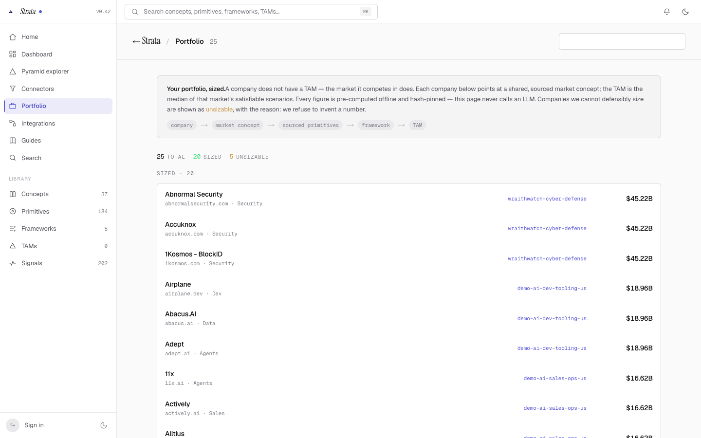
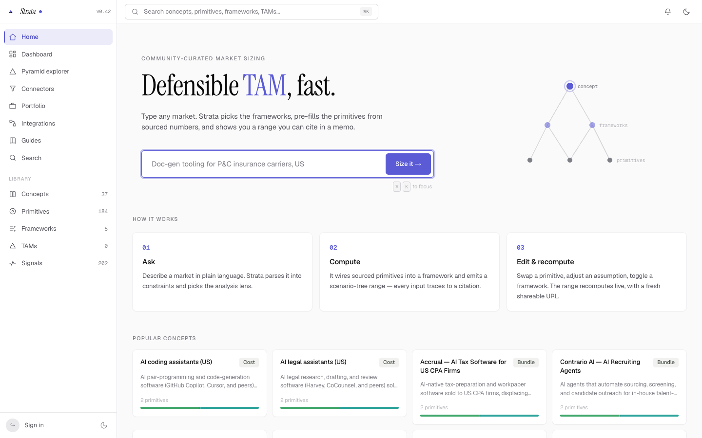
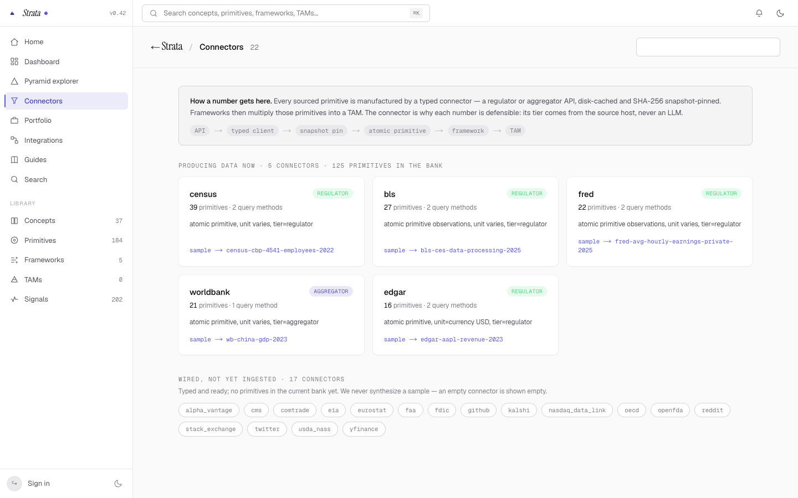
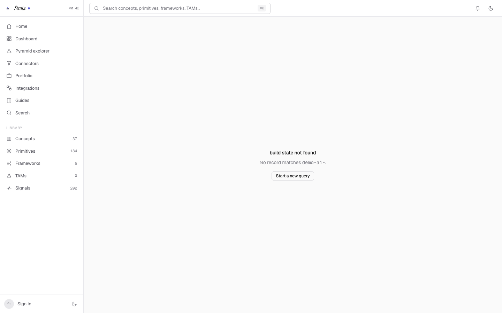
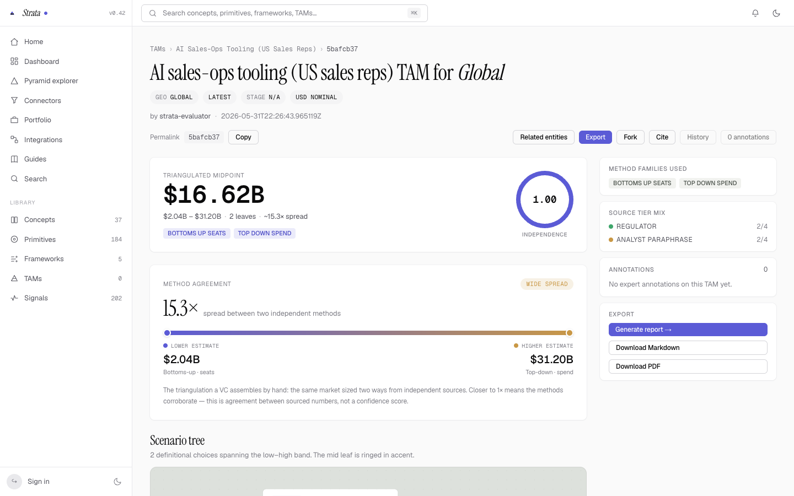
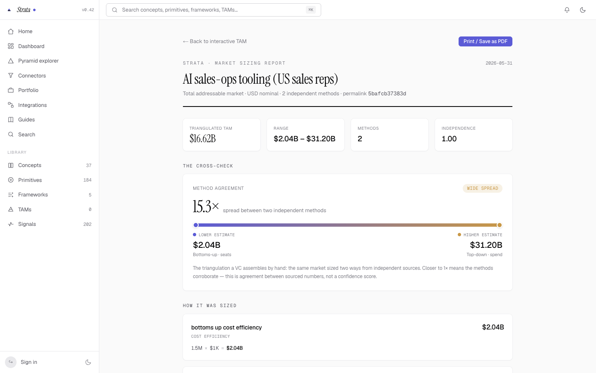

# Strata — Platform Walkthrough

**A community-curated market-sizing engine for VCs and operators.** Drop in a
portfolio, get defensible TAMs sourced from regulator and analyst data — every
number traceable to a URL and a content hash, and an honest "we can't size this
yet" when the data isn't there.

*Captured live from production on 2026-05-31. Frontend:
[strata-pied-three.vercel.app](https://strata-pied-three.vercel.app) · API:
strata-api-production-9740.up.railway.app. All six surfaces below rendered with
**zero console errors**.*

```
 connectors ─► sourced primitives ─► frameworks ─► TAM ──┬─► /tam/<hash>  (shareable artifact)
 (regulator/analyst, hash-pinned)        ▲               ├─► /tam/<hash>/report (forwardable PDF)
                                         │ pointer       └─► /build/<market> (interactive graph)
 portfolio companies ─► MARKET concept ──┘
        (org-scoped)         the sourced work + bank growth lives here
```

---

## 1. The wedge: your portfolio, sized — `/portfolio`



A VC links their portfolio to their org and gets each company sized against the
sourced market bank. The core idea: **a company does not have a TAM — the market
it competes in does.** So each company is a cheap pointer at a shared, sourced
market concept; the TAM is the median of that market's satisfiable scenarios.

- **20 sized · 5 unsizable** of a curated 25-company demo subset (real companies
  from a 4,918-row portfolio).
- Every figure is **pre-computed offline and hash-pinned** — this page never
  calls an LLM. Sized rows link through to the interactive market graph.
- **"Unsizable" is the headline feature, not a gap.** When we have no sourced
  framework for a market (crypto token pricing, wet-lab biotech, AR/VR), we
  *refuse to invent a number* and say exactly why. That refusal is the product's
  defensibility made visible — and each reason is a proven signal for which lens
  to build next.

> Why this matters to a VC: the numbers you paste into an IC memo are only as
> good as their provenance. Strata never hands you a confident hallucination.

---

## 2. The home surface — `/`



Featured TAMs sized live from the bank — no invented figures. A persistent app
shell (sidebar + ⌘K command palette + live library counts: 37 concepts · 184
primitives · 5 frameworks · 202 quarantined signals) wraps every route.

---

## 3. Where the numbers come from — `/connectors`



Every sourced primitive is manufactured by a **typed connector** — a regulator
or aggregator API (Census, BLS, FRED, World Bank, EDGAR, …), disk-cached and
SHA-256 snapshot-pinned. The tier of a number comes from its **source host,
never an LLM**. Connectors that have actually produced primitives lead; wired-
but-not-yet-ingested connectors are shown honestly as empty.

---

## 4. The interactive market — `/build/<market>`



Clicking a sized company opens the market it competes in as an interactive
pyramid: primitives multiply through a framework into a scenario tree. Override
a what-if value or swap a sourced primitive and the TAM recomputes live —
what-if scenarios carry a banner and never persist as primitives (the Q20 wall).

---

## 5. The shareable artifact — `/tam/<hash>`



Every meaningful state mints a **permanent, content-addressed URL** — here, *AI
sales-ops tooling (US sales reps) TAM — $16.62B*. This is the same $16.62B the
portfolio page shows for **11x**, **Actively**, and **Alltius** (all three
compete in that one sourced market) — the company → market → TAM linkage is
consistent end to end. The artifact survives restarts (persisted to Postgres)
and leads with a convergence cross-check when ≥2 independent methods agree.

---

## 6. The forwardable one-pager — `/tam/<hash>/report`



A print-first report: KPI strip, per-method equations, sensitivity, and a full
**Sources & provenance** table with honest footnotes. Save-as-PDF and forward to
an LP or partner. Every banner (synthetic, modeled, analyst-unverified) becomes
a footnote — nothing is hidden.

---

## The thesis, in one line

> **Defensible numbers fast — and an honest refusal when the data isn't there.**

Under the hood, the new portfolio layer adds the Q20 wall in code: a **verbatim
guard** that only lets a number persist if it semantically matches a real
fetched page *for the right quantity role* and is *corroborated* by a second
source — and even then, analyst numbers stay org-private until promoted. No
LLM-computed number ever enters the bank. That is what lets a VC trust the TAM
they paste into a memo.

---

### How to drive it yourself

```bash
# MCP (in a Claude session with the Strata MCP attached)
import_portfolio(rows=[{name, domain, vertical}, ...])   # link your portfolio
size_company(domain="cursor.com")                        # registry-first, sourced
list_portfolio(status="sized")                           # progress + TAMs

# CLI (local, default org)
strata portfolio import "Cos list.csv"
strata portfolio size --vertical Dev --limit 20
strata portfolio list --status sized
```

*Write surfaces ship behind `STRATA_PORTFOLIO_ENABLED`; the read-only
`/portfolio` page and `GET /portfolio` always serve the cached, pre-sized demo —
no live LLM/Exa on any surface a reviewer sees.*
